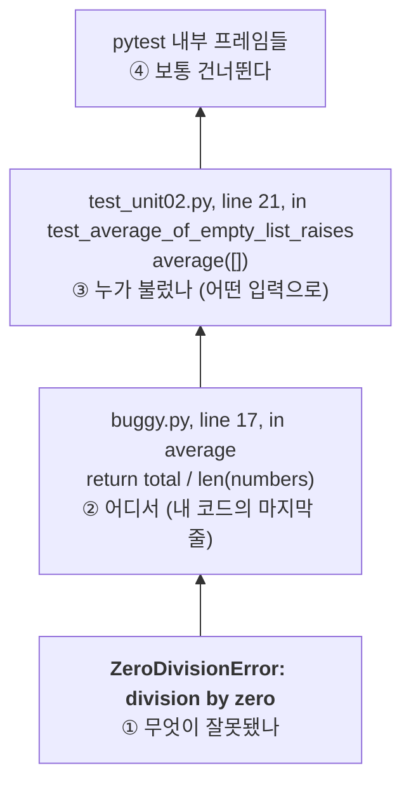

# 02 — 디버깅과 테스트 입문

## 목표

오류 메시지(트레이스백)를 **위에서 아래로가 아니라 아래에서 위로** 읽고, 실패한 테스트가 무엇을 기대하는지 읽어 낼 수 있게 됩니다.
pytest의 기능 중 이후 모든 단원에서 쓰는 다섯 가지(`assert`, `raises`, `parametrize`, `tmp_path`, `monkeypatch`)를 익힙니다.

## 노트와의 연결

노트의 체크리스트는 에이전트가 만든 결과물을 "불확실한 것으로 보고 직접 검토"하고, "테스트가 내 목표를 제대로 반영하는지 확인"하라고 합니다.
테스트를 읽고 쓸 줄 모르면 이 두 가지를 할 수 없습니다. 이 단원은 그 최소 도구입니다.

## 공부할 개념

| 개념 | 핵심 | 참고 |
| --- | --- | --- |
| 트레이스백(traceback) 읽기 | 마지막 줄이 "무엇이" 잘못됐는지, 그 바로 위가 "어디서"인지. 호출 순서는 위→아래 | [튜토리얼 8장 오류와 예외](https://docs.python.org/ko/3/tutorial/errors.html) |
| 디버거(debugger) | `print`로 값 찍기 → `breakpoint()`로 멈춰서 변수 보기 (`n` 다음 줄, `s` 함수 안으로, `p 변수`, `c` 계속, `q` 종료) | [pdb 문서](https://docs.python.org/ko/3/library/pdb.html) |
| pytest 기본 | `assert`, `pytest.raises`, `@pytest.mark.parametrize`, `tmp_path`, `monkeypatch` | [pytest 시작하기](https://docs.pytest.org/en/stable/getting-started.html), [fixture 안내](https://docs.pytest.org/en/stable/how-to/fixtures.html) |

### 트레이스백은 아래에서 위로



읽는 법: 화살표 방향이 읽는 순서입니다. 맨 아래 줄(①)에서 오류의 종류를, 그 위(②)에서 내 코드의 어느 줄인지를, 그 위(③)에서 어떤 입력으로 불렸는지를 봅니다. 위로 갈수록 내 코드에서 멀어집니다.

### pytest 다섯 가지, 한 줄씩

| 기능 | 하는 일 | 쓰는 모양 |
| --- | --- | --- |
| `assert` | 참이어야 할 식. 거짓이면 테스트 실패, pytest가 양쪽 값을 보여 줌 | `assert add(1, 2) == 3` |
| `pytest.raises` | 이 블록 안에서 그 예외가 **나야** 통과 | `with pytest.raises(ValueError): parse("")` |
| `parametrize` | 같은 테스트를 여러 입력으로 반복 | `@pytest.mark.parametrize("x", [1, 2, 3])` |
| `tmp_path` | 테스트마다 새로 만들어지는 임시 폴더(`Path`). 실제 파일을 건드리지 않음 | `def test_save(tmp_path): p = tmp_path / "a.txt"` |
| `monkeypatch` | 테스트 동안만 함수·속성·환경 변수를 바꿔치기. 테스트 끝나면 자동 복구 | `monkeypatch.setattr(mod, "now", lambda: 0)` |

## 과제

`buggy.py`에는 **버그가 있는 함수 네 개**가 있습니다. 테스트는 이미 올바르게 쓰여 있습니다.

```bash
pytest units/02-debugging-and-pytest -q
```

1. 실패 출력을 읽습니다. 각 실패마다 `NOTES.md`에 세 줄을 적습니다: 어느 줄에서 / 무엇을 기대했는데 / 무엇이 나왔나.
2. 고치기 전에 **원인을 먼저 적습니다.** 그다음 `breakpoint()`를 넣어 실제로 그 값인지 확인하고, 고칩니다.
3. 네 함수를 모두 고쳐 테스트를 통과시킵니다. 테스트 파일은 고치지 않습니다.
4. `test_unit02.py`를 읽고 다섯 가지 pytest 기능이 각각 어디에 쓰였는지 주석으로 표시해 봅니다.

| 함수 | 해야 하는 일 |
| --- | --- |
| `average(numbers)` | 평균. 빈 리스트면 `ValueError` |
| `parse_age(text)` | 문자열을 나이(정수)로. 공백 허용, 0~150 밖이거나 숫자가 아니면 `ValueError` |
| `count_words(path)` | 텍스트 파일의 단어 수 (공백 기준) |
| `greeting(name, now)` | `now()`가 돌려준 시(hour)가 12 전이면 "좋은 아침, {name}", 아니면 "안녕하세요, {name}" |

## 스스로 답해 볼 질문

1. 트레이스백의 **맨 위 줄**부터 읽으면 왜 시간이 더 걸릴까요?
2. `greeting`은 왜 `datetime.now()`를 직접 부르지 않고 `now` 함수를 인자로 받을까요? 테스트에서 "오전"을 어떻게 만들었나요? (이 질문은 25단원까지 계속 따라옵니다)
3. 테스트가 "통과"했다는 것은 코드가 "맞다"는 뜻일까요? 테스트가 틀렸을 가능성은 어떻게 확인하나요?

## 함정

- `breakpoint()`를 지우지 않고 커밋하면 프로그램이 멈춥니다. 커밋 전 `git diff`에서 찾아보세요.
- `assert a == b`가 실패하면 pytest가 두 값의 차이를 보여 줍니다. 그걸 안 읽고 코드부터 보면 돌아갑니다.
- `pytest.raises` 블록 안에 코드를 여러 줄 넣으면 첫 줄에서 예외가 나는 순간 나머지는 실행되지 않습니다. 한 줄만.

## 완료 기준

- [ ] `pytest units/02-debugging-and-pytest -q` 전부 통과 (테스트 파일 수정 없이)
- [ ] `NOTES.md`에 버그 네 개 각각의 "줄 / 기대 / 실제 / 원인"
- [ ] `breakpoint()`로 멈춰서 `p 변수`를 한 번 이상 해 봄
- [ ] 브랜치 `unit-02`에서 PR → 셀프 리뷰 → 머지

## 더 깊이

- `pytest -x` (첫 실패에서 멈춤), `pytest -k 이름` (일부만 실행), `pytest --lf` (지난번 실패만)를 써 보세요.
- `pytest --pdb`는 실패한 순간 디버거를 엽니다. 어떤 상황에서 편할까요?
