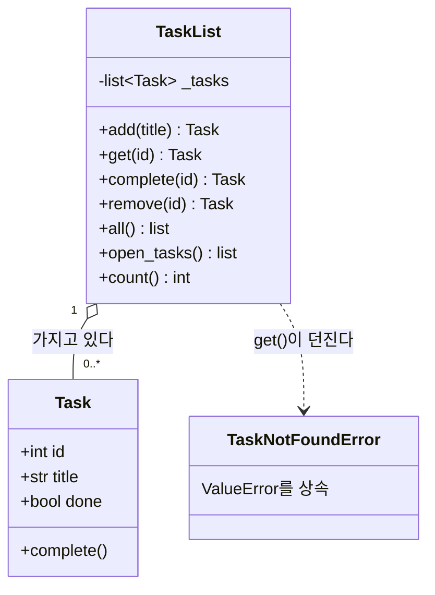

# 04 — 클래스와 예외

## 목표

03단원에서 다섯 함수가 모두 첫 인자로 들고 다니던 `tasks` 리스트와, 그 리스트를 다루는 함수들을 **하나의 클래스**로 묶습니다.
"항상 같이 다니는 데이터와 동작을 묶는다"가 클래스의 전부입니다. 특수 메서드나 데코레이터는 아직 쓰지 않습니다.

## 노트와의 연결

노트의 기초 5영역 중 풀스택 앱 영역은 "상태·세션 관리"를 꼽고, 아키텍처 영역의 질문은 "상태는 어디에 두는가?"입니다.
이 단원에서 할 일 목록이라는 **상태**가 처음으로 자기 집(`TaskList` 객체)을 갖습니다. 상태가 어디 있는지 분명해야
나중에 파일로, DB로, 서버로 옮길 때 무엇을 옮기는지 알 수 있습니다.

## 공부할 개념

| 개념 | 핵심 | 참고 |
| --- | --- | --- |
| 클래스(class)와 인스턴스(instance) | `class Task:`는 설계도, `Task(1, "산책")`은 그 설계도로 만든 물건. `__init__`은 물건을 만들 때 한 번 실행 | [튜토리얼 9장 클래스](https://docs.python.org/ko/3/tutorial/classes.html) |
| `self`와 메서드(method) | 메서드는 "이 객체의" 함수. `self`는 그 객체 자신. `task.complete()`는 `Task.complete(task)`와 같다 | 같은 장 9.3절 |
| 직접 만든 예외 | `class TaskNotFoundError(ValueError): pass` — 의미가 분명한 이름의 예외. 상위 예외로도 잡힌다 | [8.6 사용자 정의 예외](https://docs.python.org/ko/3/tutorial/errors.html#user-defined-exceptions) |

### 이 단원의 구조

읽는 법: `TaskList`가 여러 `Task`를 **가지고 있고**(마름모), 밖에서는 `_tasks`를 직접 만지지 않고 메서드로만 바꿉니다. 03단원의 "함수 + `tasks` 리스트"가 이 두 상자 안으로 들어온 것입니다.

### 03단원 코드와 나란히 보기

| 03단원 (함수 + 딕셔너리) | 04단원 (클래스) |
| --- | --- |
| `task = {"id": 1, "title": "산책", "done": False}` | `task = Task(1, "산책")` |
| `task["title"]` | `task.title` |
| `complete_task(tasks, 1)` | `tasks.complete(1)` |
| `add_task(tasks, title)` 안의 공백 검사 | `Task.__init__` 안의 공백 검사 |

## 과제

`todo_classes.py`의 `TODO`를 채워 `pytest units/04-classes`를 통과시키세요.

| 클래스 / 메서드 | 하는 일 |
| --- | --- |
| `Task(id, title, done=False)` | 제목 앞뒤 공백 제거, 빈 제목이면 `ValueError`. 속성 `id`, `title`, `done` |
| `Task.complete()` | `done`을 `True`로. 이미 완료면 `ValueError` (규칙이 객체 안에 산다) |
| `TaskNotFoundError` | `ValueError`를 상속한 예외 |
| `TaskList()` | 비어 있는 목록으로 시작. 내부 리스트는 `self._tasks` (앞의 `_`는 "밖에서 직접 만지지 마세요"라는 약속) |
| `TaskList.add(title)` | 새 `Task`를 만들어 추가하고 반환. id는 최대 id + 1 |
| `TaskList.get(task_id)` | 찾아서 반환. 없으면 `TaskNotFoundError` |
| `TaskList.complete(task_id)` / `remove(task_id)` | 03단원과 같음. 없으면 `TaskNotFoundError` |
| `TaskList.all()` / `open_tasks()` | 전체 / 미완료만, **새 리스트** |
| `TaskList.count()` | 할 일 개수 |

다 되면 03단원의 CLI(`todo_memory.py`의 `main`)를 복사해 와서 `TaskList`를 쓰도록 고쳐 보세요. 함수 호출이 어떻게 짧아지는지 느껴 보세요.

## 스스로 답해 볼 질문

1. "빈 제목 금지" 규칙이 03단원에는 `add_task`에, 지금은 `Task.__init__`에 있습니다. `Task`를 만드는 길이 두 군데 이상 생기면 어느 쪽이 안전할까요?
2. `TaskList.all()`이 `self._tasks`를 그대로 돌려주면 어떤 일이 생길 수 있나요? 테스트 중 하나가 이걸 확인합니다. 찾아보세요.
3. `TaskNotFoundError`가 `ValueError`를 상속하면, 03단원 CLI의 `except ValueError`를 고치지 않아도 되는 이유는?
4. `Task`와 `TaskList`, 두 클래스로 나눈 이유는? 하나로 합치면 무엇이 불편할까요?

## 함정

- `self.title = title.strip()`처럼 **`self.`를 붙여야 객체에 저장**됩니다. `title = title.strip()`은 지역 변수만 바꿉니다.
- 메서드 첫 인자 `self`를 빼먹으면 "takes 0 positional arguments but 1 was given" 오류가 납니다. 이 메시지를 보면 `self`부터 확인하세요.
- `__init__`에서 `return 값`을 하면 오류입니다. `__init__`은 돌려주는 게 없습니다.

## 완료 기준

- [ ] `pytest units/04-classes` 15개 전부 통과
- [ ] 03단원 CLI를 `TaskList`로 고쳐서 실행해 봄
- [ ] `NOTES.md`: 배운 것 3가지 / 헷갈린 것 1가지 / 질문 1~4에 대한 내 답
- [ ] 브랜치 `unit-04` → PR → 셀프 리뷰 → 머지

## 더 깊이

- `print(task)`를 하면 `<todo_classes.Task object at 0x...>`가 나옵니다. `__repr__` 메서드를 정의하면 어떻게 바뀌는지 해 보세요. 05단원의 `@dataclass`가 이걸 자동으로 해 줍니다.
- `Task(1, "a") == Task(1, "a")`는 왜 `False`일까요? (`__eq__`) 이것도 05단원에서 해결됩니다.
