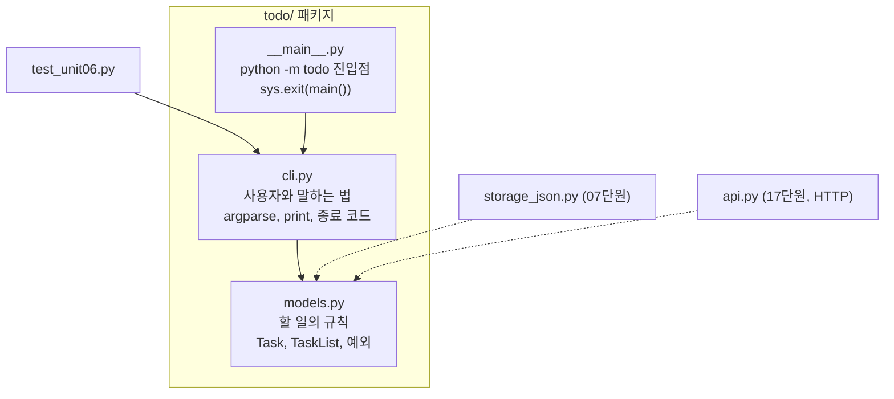

# 06 — 모듈 · 패키지 · CLI

## 목표

파일 하나였던 프로그램을 `todo/` **패키지**로 나누고, `argparse`로 제대로 된 명령줄 인터페이스(CLI)를 만듭니다.
`python -m todo add "산책"`처럼 실행되고, 종료 코드(exit code)로 성공·실패를 알립니다.
이 패키지 구조가 53단원까지 그대로 갑니다.

> 이 단원부터 폴더 안에 **앞 단원까지의 완성본**이 들어 있습니다(`todo/models.py`). 05단원을 스스로 끝낸 뒤에
> 내 코드와 비교해 보세요. 막혔다면 참고해도 되지만, 먼저 끝내는 쪽이 남는 게 많습니다.

## 노트와의 연결

노트의 아키텍처 영역은 "시스템 분해와 상태의 위치"를 말합니다. 분해의 가장 작은 단위가 모듈입니다.
"할 일의 규칙(models)"과 "사용자와 말하는 법(cli)"을 다른 파일에 두는 순간, 나중에 cli를 HTTP API(17단원)로
바꿔도 models는 손대지 않아도 됩니다. 분해는 거창한 마이크로서비스가 아니라 여기서 시작합니다.

## 공부할 개념

| 개념 | 핵심 | 참고 |
| --- | --- | --- |
| 모듈(module)과 패키지(package) | 파일 하나 = 모듈, `__init__.py`가 있는 폴더 = 패키지. `from todo.models import Task`. 절대 임포트를 쓴다 | [튜토리얼 6장 모듈](https://docs.python.org/ko/3/tutorial/modules.html) |
| `argparse` | 하위 명령(subcommand), 위치 인자, 옵션, 자동 `--help`. `parse_args(argv)`에 리스트를 넘기면 테스트 가능 | [argparse 튜토리얼](https://docs.python.org/ko/3/howto/argparse.html) |
| 진입점과 종료 코드 | `python -m todo`는 `todo/__main__.py`를 실행. `main(argv) -> int`가 종료 코드를 돌려주고 `sys.exit`는 한 곳에서만 | [`__main__` 문서](https://docs.python.org/ko/3/library/__main__.html) |

### 패키지의 의존 방향



읽는 법: 화살표는 "임포트한다"입니다. 모두 `models.py`를 향하고, `models.py`는 아무것도 임포트하지 않습니다. 그래서 나중에 `cli.py` 옆에 `api.py`가 생겨도 `models.py`는 그대로입니다. 반대 방향 화살표(`models` → `cli`)가 생기면 구조가 무너집니다.

### 테스트할 수 있는 CLI의 모양

```python
def main(argv: list[str] | None = None, tasks: TaskList | None = None) -> int:
    ...
```

- `argv`를 인자로 받으면 테스트에서 `main(["add", "산책"])`처럼 부를 수 있습니다. `None`이면 `sys.argv[1:]`.
- `tasks`를 인자로 받으면 테스트에서 상태를 들여다볼 수 있습니다. 02단원의 `now`와 같은 생각입니다.
- 출력은 `print`로, 실패는 `return 1`로. 테스트는 `capsys`로 출력을 읽습니다.

## 과제

`todo/cli.py`의 `TODO`를 채워 `pytest units/06-package-and-cli`를 통과시키세요.

| 명령 | 동작 | 출력 / 종료 코드 |
| --- | --- | --- |
| `add <제목>` | 할 일 추가 | `추가: #1 산책` / 0 |
| `done <id>` | 완료 | `완료: #1 산책` / 0 |
| `rm <id>` | 삭제 | `삭제: #1 산책` / 0 |
| `ls` | 전체 목록, 한 줄에 하나 `[ ] #1 산책`, 완료는 `[x]` | 0 |
| `ls --open` | 미완료만 | 0 |
| `shell` | 명령을 반복해서 받는 대화형 모드 (`quit`로 종료) | 0 |
| 잘못된 입력 (빈 제목, 없는 id) | `오류: ...`를 **표준 오류(stderr)** 에 출력 | 1 |

아직 저장이 없으므로 `python -m todo add 산책` 뒤에 `python -m todo ls`를 하면 비어 있습니다. 그래서 `shell`이 있습니다.
07단원에서 파일 저장이 붙으면 각 명령이 독립적으로 쓸모 있어집니다.

실행:

```bash
cd units/06-package-and-cli
python -m todo --help
python -m todo shell
```

## 스스로 답해 볼 질문

1. 오류 메시지를 표준 출력이 아니라 표준 오류에 쓰는 이유는? `python -m todo ls > list.txt`를 떠올려 보세요.
2. 종료 코드 0과 1을 구분하면 누가 이득을 보나요? (힌트: 셸 스크립트, CI, 그리고 에이전트)
3. `cli.py`가 `models.py`를 임포트합니다. 반대로 `models.py`가 `cli.py`를 임포트하면 무엇이 문제일까요?
4. `shell` 모드는 왜 `main`을 재귀 호출하는 대신 명령을 파싱하는 함수를 따로 두는 게 좋을까요?

## 함정

- `units/06-package-and-cli` 폴더 **안에서** 실행해야 `python -m todo`가 패키지를 찾습니다. 테스트도 이 폴더를 기준으로 합니다.
- `argparse`는 인자가 틀리면 스스로 `SystemExit(2)`를 던집니다. 테스트에서 `pytest.raises(SystemExit)`로 받습니다.
- `print(..., file=sys.stderr)`를 잊으면 오류가 표준 출력에 섞입니다. 테스트가 `capsys.readouterr().err`를 봅니다.

## 완료 기준

- [ ] `pytest units/06-package-and-cli` 전부 통과
- [ ] `python -m todo --help`가 모든 하위 명령을 보여 줌
- [ ] `shell` 모드로 할 일 세 개를 넣고 하나를 완료하고 `ls --open` 확인
- [ ] `NOTES.md`: 질문 1~4의 내 답, 05단원 내 코드와 `todo/models.py` 완성본의 차이 세 가지
- [ ] 브랜치 `unit-06` → PR → 머지

## 더 깊이

- `pyproject.toml`에 `[project.scripts] todo = "todo.cli:main"`을 추가하고 `pip install -e .`를 하면 `todo add 산책`으로 실행됩니다. 어떻게 동작하는지 찾아보세요.
- `click`, `typer` 같은 라이브러리가 `argparse`보다 무엇을 편하게 해 주는지 비교해 보세요. 지금은 표준 라이브러리로 충분합니다.
