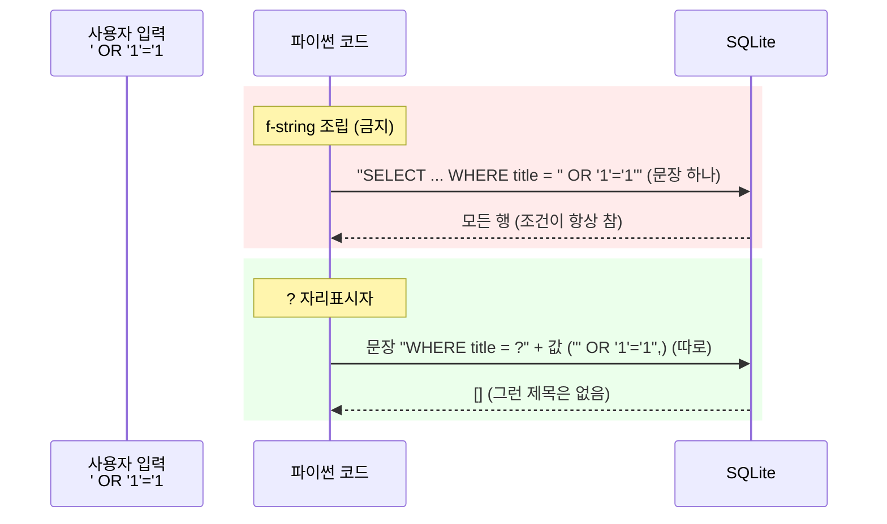

# 08 — SQL 기초와 sqlite3

## 목표

07단원에서 JSON 파일에 통째로 저장하던 할 일 목록을 **SQLite 데이터베이스의 테이블**에 저장하는
`SqliteTaskStore` 를 만듭니다. 테이블을 정의하고(제약 포함), 네 가지 기본 조작(CRUD)을 SQL 로 쓰고,
사용자 입력을 `?` 자리표시자로 안전하게 넘기는 법을 익힙니다. 테스트는 디스크를 쓰지 않는 `:memory:` DB 로 돌립니다.

## 노트와의 연결

노트는 "AI 시스템은 데이터 소스가 보여주는 것만 본다. 데이터 아키텍처를 잘못 고르면 AI는 자기가 무엇을
모르는지조차 모른다"고 말합니다. 그 "데이터 소스"의 가장 흔한 모습이 관계형 데이터베이스(relational database)이고,
그것과 대화하는 언어가 SQL 입니다. 또 노트는 에이전트의 운영 DB 접근에 "최소 권한, 읽기 전용 계정"을 요구하는데,
이 단원에서 보는 SQL 인젝션은 **왜 입력을 그대로 믿으면 안 되는지**를 손으로 확인하는 첫 경험입니다.
15단원(리포지토리 패턴)부터 54단원까지 이 저장소가 프로그램의 바닥을 받칩니다.

## 공부할 개념

| 개념 | 핵심 | 참고 |
| --- | --- | --- |
| 테이블과 제약(constraint) | `CREATE TABLE`, 열 타입, `PRIMARY KEY`, `NOT NULL`, `CHECK`, `DEFAULT`. 잘못된 데이터가 들어오는 길을 DB 가 막는다 | [sqlite.org — CREATE TABLE](https://sqlite.org/lang_createtable.html), [SQLite 의 데이터 타입](https://sqlite.org/datatype3.html) |
| CRUD 네 문장 | `INSERT`, `SELECT … WHERE … ORDER BY`, `UPDATE … WHERE`, `DELETE … WHERE`. `WHERE` 를 빼먹으면 전체 행이 바뀐다 | [INSERT](https://sqlite.org/lang_insert.html), [SELECT](https://sqlite.org/lang_select.html), [UPDATE](https://sqlite.org/lang_update.html), [DELETE](https://sqlite.org/lang_delete.html) |
| `sqlite3` 모듈과 `?` 자리표시자(placeholder) | `connect`, `execute`, `fetchone`/`fetchall`, `lastrowid`, `commit`. 값은 항상 `?` 로 넘긴다 — SQL 인젝션(SQL injection) 방지 | [docs.python.org — sqlite3](https://docs.python.org/ko/3/library/sqlite3.html) (특히 "자리 표시자를 사용하여 SQL 인젝션 공격을 방지하는 방법") |

### 읽기 전 미리 알아 둘 것

**SQL 은 "어떻게"가 아니라 "무엇을"** 적는 언어입니다. 파이썬에서는 `for task in tasks: if task.done == False: ...`
라고 절차를 쓰지만, SQL 에서는 `SELECT id, title, done FROM tasks WHERE done = 0 ORDER BY id` 라고 **조건과 결과 모양**만
적고 찾는 방법은 DB 에 맡깁니다. 그 "방법"이 어떻게 결정되는지는 10단원에서 `EXPLAIN QUERY PLAN` 으로 들여다봅니다.

**연결(connection)과 커서(cursor).** `sqlite3.connect(경로)` 는 DB 파일을 열어 연결 객체를 돌려줍니다.
`conn.execute(sql, params)` 는 SQL 한 문장을 실행하고 커서(cursor)를 돌려주며, 커서에서 `fetchone()`(한 줄 또는 `None`),
`fetchall()`(리스트)로 결과를 꺼냅니다. 경로 대신 `":memory:"` 를 주면 디스크에 아무것도 쓰지 않는 임시 DB 가 됩니다.
테스트에 딱 맞습니다.

**`?` 자리표시자.** 아래 두 줄은 같은 일을 하는 것처럼 보이지만 완전히 다릅니다.

```python
conn.execute(f"SELECT id FROM tasks WHERE title = '{title}'")      # 절대 금지
conn.execute("SELECT id FROM tasks WHERE title = ?", (title,))      # 이렇게
```



읽는 법: 위 상자는 입력이 SQL 문장에 섞여 들어가 DB 가 "문법"으로 해석하는 경로, 아래 상자는 문장과 값이 따로 전달되어
입력이 끝까지 "값"으로 남는 경로입니다.

첫 줄은 사용자가 입력한 문자열을 **SQL 문법의 일부**로 붙여 넣습니다. `title` 이 `' OR '1'='1` 이면 실행되는 SQL 은
`... WHERE title = '' OR '1'='1'` 이 되어 조건이 항상 참이고, 테이블의 모든 행이 나옵니다. 둘째 줄은 SQL 문장과 값을
따로 DB 에 보내므로 값 안에 따옴표가 백 개 있어도 그냥 글자입니다. `injection_demo.py` 를 실행해 눈으로 확인하세요.
(두 번째 인자가 **튜플**이어야 한다는 점에 주의 — `(title)` 이 아니라 `(title,)` 입니다.)

**`commit()`.** sqlite3 모듈은 기본 설정에서 INSERT/UPDATE/DELETE 를 만나면 조용히 트랜잭션(transaction)을 시작하고,
`conn.commit()` 을 부를 때까지 디스크에 확정하지 않습니다. 커밋하지 않고 연결을 닫으면 변경은 사라집니다. 이번 단원에서는
"쓰기 뒤에 commit" 규칙만 지키고, 트랜잭션의 의미와 `with conn:` 은 11단원에서 제대로 다룹니다.

## 과제

`todo/storage_sqlite.py` 의 `TODO` 를 채워 `pytest units/08-sql-sqlite` 를 모두 통과시키세요.
`todo/` 안의 다른 파일은 07단원까지의 완성본입니다. 내 07단원 코드와 비교해 보고, 다르면 왜 다른지 생각해 보세요.

처음 실행하면 거의 모든 테스트가 "SqliteTaskStore.init_schema 을(를) 아직 구현하지 않음" 으로 실패합니다. 테스트가 쓰는 `store`
픽스처(fixture)가 `init_schema()` 를 부르기 때문입니다. `init_schema` 부터 구현하면 각 테스트가 진짜 이유로 실패하기 시작합니다.

| 만들 것 | 하는 일 | 관련 테스트 |
| --- | --- | --- |
| `init_schema()` | `tasks` 테이블 생성. 두 번 불러도 안전 | `test_init_schema_*`, `test_schema_rejects_*` |
| `add(title)` | INSERT, DB 가 매긴 id 로 `Task` 반환. 빈 제목은 `ValueError`, 행도 남기지 않음 | `test_add_*`, `test_id_is_not_reused_*` |
| `get(task_id)` | SELECT 한 건. 없으면 `TaskNotFoundError` | `test_get_missing_*`, `test_task_not_found_is_a_value_error` |
| `complete(task_id)` | UPDATE. 이미 완료면 `ValueError` | `test_complete_*` |
| `remove(task_id)` | DELETE, 지운 `Task` 반환 | `test_remove_*` |
| `all()`, `open_tasks()`, `__len__` | SELECT … ORDER BY, WHERE done = 0, COUNT(*) | `test_all_*`, `test_open_tasks_*`, `test_len_*` |
| (쓰기 뒤 commit) | 연결을 닫았다 열어도 데이터가 남아야 함 | `test_data_survives_reconnect` |

`sqlite3` 셸로 직접 테이블을 들여다보는 연습도 하세요. 파이썬 셸에서:

```python
import sqlite3
from todo.storage_sqlite import SqliteTaskStore
conn = sqlite3.connect("play.db"); store = SqliteTaskStore(conn); store.init_schema()
store.add("SQL 공부"); store.add("산책")
conn.execute("SELECT * FROM tasks").fetchall()
conn.execute("SELECT sql FROM sqlite_master").fetchall()   # 내가 만든 테이블 정의가 그대로 들어 있다
```

## 스스로 답해 볼 질문

1. `TaskList` 는 id 를 "최대 id + 1" 로 계산했습니다. SQLite 의 `INTEGER PRIMARY KEY` 는 번호를 어떻게 매길까요?
   가운데 행을 지운 뒤 추가하면? 마지막 행을 지운 뒤 추가하면? (`AUTOINCREMENT` 키워드를 찾아보고, 둘의 차이를 적어 보세요.)
2. 빈 제목 검사가 `Task.__post_init__`(파이썬)에도 있고 `CHECK` 제약(DB)에도 있습니다. 중복 아닌가요?
   둘 중 하나만 남긴다면 어느 쪽을 남기겠습니까? 그 이유는?
3. `SELECT *` 대신 열 이름을 나열하는 이유는? 나중에 09단원에서 열을 추가하면 어느 쪽이 깨질까요?
4. JSON 파일 저장소는 `save(tasks)` 로 전체를 덮어썼고, SQLite 저장소는 행 하나씩 바꿉니다. 할 일이 10만 개일 때
   `complete(1)` 의 비용은 각각 어떻게 달라질까요? 이것이 "접근 패턴(access pattern)" 이야기의 시작입니다 → 09단원.
5. 테스트는 `:memory:` 를 쓰고 실제 프로그램은 파일을 씁니다. 같은 코드가 두 곳에서 다르게 동작할 가능성은 없을까요?
   `test_data_survives_reconnect` 가 왜 필요한지와 연결해 생각해 보세요.

## 함정

- `conn.execute(sql, title)` 처럼 문자열을 직접 넘기면 sqlite3 는 문자열을 **글자 하나하나의 시퀀스**로 해석해
  "자리표시자 개수가 맞지 않는다"는 오류를 냅니다. 항상 튜플 `(title,)` 입니다.
- `UPDATE tasks SET done = 1` 에서 `WHERE id = ?` 를 빼먹으면 **모든 행**이 완료됩니다. 오류도 나지 않습니다.
  쓰기 SQL 을 짤 때는 `WHERE` 부터 쓰는 습관을 들이세요.
- `fetchone()` 은 결과가 없으면 `None` 을 돌려줍니다. 바로 언패킹(`a, b, c = cursor.fetchone()`)하면 `TypeError` 가 납니다.
- `commit()` 을 빼먹으면 같은 연결 안에서는 멀쩡해 보입니다(자기 변경은 자기가 봅니다). `:memory:` 테스트만으로는
  이 실수를 잡을 수 없어서 `tmp_path` 로 파일 DB 를 닫았다 여는 테스트가 들어 있습니다.
- SQLite 에는 `bool` 타입이 없습니다. `done` 은 0/1 정수로 저장되고, 읽을 때 `bool()` 로 바꿔야 `Task(done=True) == Task(done=1)` 비교에서 놀라지 않습니다.
- `executescript` 는 실행 전에 **커밋을 먼저 해버립니다**. 스키마 생성 같은 곳에만 쓰고 데이터 변경에는 `execute` 를 쓰세요.

## 완료 기준

- [ ] `pytest units/08-sql-sqlite` 23개 테스트 전부 통과
- [ ] `python units/08-sql-sqlite/injection_demo.py` 를 실행하고, unsafe 가 실제로 실행한 SQL 문장을 `NOTES.md` 에 옮겨 적음
- [ ] 테스트를 **2개 직접 추가** (예: 제목이 1000자면? 같은 제목을 두 번 추가하면?)
- [ ] `docs/adr/0002-*.md` — "저장소를 JSON 파일에서 SQLite 로 바꾼다" 결정. 검토한 대안에 "JSON 유지"와 "CSV" 를 넣고,
      "이 결정을 다시 볼 신호"를 구체적으로 적기 (예: 동시에 쓰는 프로세스가 둘 이상이면)
- [ ] `NOTES.md` 에 배운 것 3가지 / 헷갈린 것 1가지 / 다음 단원에 바꿀 것 / **세 문장 설명**("왜 파일 대신 데이터베이스를 쓰기로 했나"를 비개발자에게)
- [ ] **AI 코드 리뷰(이번 단원부터)**: 완성한 `storage_sqlite.py` 를 AI 에게 리뷰받고, 지적 중 하나를 반영하고 하나는 근거를 들어 반박한 내용을 `NOTES.md` 에 기록
- [ ] 브랜치 `unit-08` → PR → 스스로 리뷰 → 머지

## 더 깊이

- CLI 에 `--db todo.db` 옵션을 붙여 `JsonTaskStore` 대신 `SqliteTaskStore` 를 고를 수 있게 해 보세요. 두 저장소가 메서드가 다르다는 것(`load/save` vs `add/get/…`)이 불편할 겁니다. 그 불편함이 15단원 리포지토리 패턴의 동기입니다.
- `conn.row_factory = sqlite3.Row` 를 설정하면 결과를 `row["title"]` 처럼 이름으로 읽을 수 있습니다. 튜플 인덱스와 비교해 어떤 쪽이 변화에 강할까요?
- [SQLite 공식 "Quirks" 문서](https://sqlite.org/quirks.html)를 훑어보세요. 열 타입을 강제하지 않는다는 점(`title` 에 숫자를 넣어도 들어감)이 다른 DB 와 가장 다른 부분입니다. `CHECK (typeof(title) = 'text')` 로 막을 수 있습니다.
- 파이썬 3.12 부터 `sqlite3.connect(..., autocommit=False)` 라는 새 옵션이 있습니다. 기존 동작(`isolation_level`)과 무엇이 다른지 문서를 읽어 보고 11단원에서 다시 만나세요.
