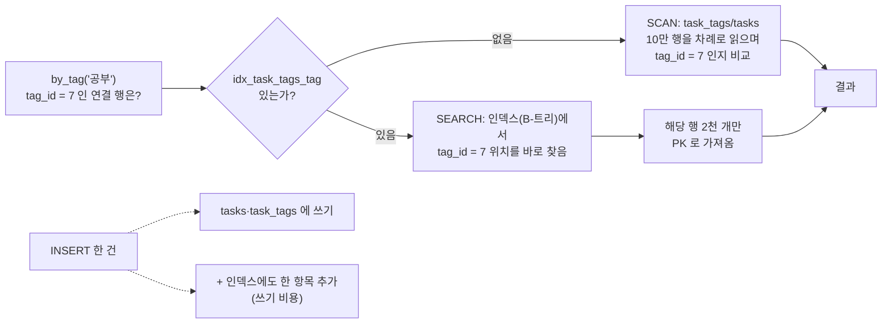

# 10 — 인덱스·쿼리 플랜·성능 측정

## 목표

09단원의 "태그로 거르기"가 할 일 10만 건에서 얼마나 걸리는지 **재고**, `EXPLAIN QUERY PLAN` 으로 DB 가 어떤 길로
답을 찾는지 **읽고**, 인덱스(index) 한 줄로 그 길을 바꾼 뒤 **다시 재서** 표로 남깁니다. 인덱스가 공짜가 아니라는 것
(쓰기 비용)도 같은 표에서 확인합니다. 이 단원이 끝나면 "느리다"는 말을 숫자와 플랜으로 바꿔 말할 수 있습니다.

## 노트와의 연결

노트는 "**에이전트는 사람보다 훨씬 많이 검색·저장·조회하므로 메모리와 장기 저장소 수요가 커진다**"고 합니다. 사람이
하루 열 번 누르던 "태그로 거르기"를 에이전트는 초당 열 번 호출할 수 있습니다. 그때 10 ms 와 1 ms 의 차이는 서버 한 대와
열 대의 차이입니다. 또 노트의 질문 "**가장 자주 일어나는 조회는 무엇인가?**"는 바로 "어디에 인덱스를 둘 것인가"로
번역됩니다 — 모든 열에 인덱스를 두면 쓰기가 느려지기 때문에, 가장 잦은 조회를 알아야 답할 수 있습니다.

## 공부할 개념

| 개념 | 핵심 | 참고 |
| --- | --- | --- |
| 인덱스(index)와 `CREATE INDEX` | 열 값으로 정렬된 별도 자료구조(B-트리). 조회는 "전체 훑기(scan)"에서 "찾아가기(search)"로 바뀌고, 그 대신 쓰기마다 인덱스도 갱신해야 한다 | [sqlite.org — CREATE INDEX](https://sqlite.org/lang_createindex.html), [SQLite 쿼리 플래너 소개](https://sqlite.org/queryplanner.html) (인덱스가 왜 빠른지 그림으로) |
| `EXPLAIN QUERY PLAN` | DB 가 쿼리를 **어떻게** 실행할지 보여 준다. `SCAN 테이블` = 전부 읽음, `SEARCH 테이블 USING INDEX …` = 인덱스로 찾아감 | [sqlite.org — EXPLAIN QUERY PLAN](https://sqlite.org/eqp.html) |
| 측정(`time.perf_counter`)과 측정표 | 바꾸기 전·후를 같은 조건에서 여러 번 재서 평균. 절대값이 아니라 배율을 본다. 재현 가능하도록 난수 시드 고정 | [docs.python.org — time.perf_counter](https://docs.python.org/ko/3/library/time.html#time.perf_counter), [sqlite3 — executemany](https://docs.python.org/ko/3/library/sqlite3.html#sqlite3.Cursor.executemany) |

### 인덱스는 "찾아보기"다

책 뒤의 찾아보기(index)가 없으면 "트랜잭션"이 나오는 쪽을 찾기 위해 책을 처음부터 끝까지 넘겨야 합니다(SCAN).
찾아보기가 있으면 가나다순 목록에서 단어를 찾고 쪽수로 바로 갑니다(SEARCH). 대신 책에 한 쪽을 끼워 넣을 때마다
찾아보기도 고쳐야 합니다 — 그것이 쓰기 비용입니다.

SQLite 는 몇 가지 인덱스를 **자동으로** 만듭니다. `INTEGER PRIMARY KEY` 는 그 자체가 테이블의 정렬 기준이라 `WHERE id = ?`
는 항상 빠릅니다. `UNIQUE` 제약(`tags.name`)과 복합 기본 키(`task_tags(task_id, tag_id)`)도 `sqlite_autoindex_…` 라는 인덱스를
얻습니다. 그런데 복합 인덱스는 **앞 열부터** 정렬되어 있어서, `task_id` 없이 `tag_id` 만으로 찾을 때는 쓸모가 없습니다.
(성→이름 순 전화번호부에서 이름만 알 때와 같습니다.) 그래서 09단원의 접근 패턴 B(태그로 거르기)는 인덱스가 없는 셈이고,
이것이 이번 단원에서 만들 `idx_task_tags_tag` 입니다.



읽는 법: 실선은 조회 경로 — 인덱스가 있으면 10만 행 훑기(SCAN)가 "찾아가기(SEARCH)"로 바뀝니다. 점선은 그 대가 —
쓰기마다 인덱스도 함께 갱신해야 합니다.

### 플랜 읽기

`EXPLAIN QUERY PLAN` 을 SQL 앞에 붙여 실행하면 실제로 실행하지 않고 계획만 돌려줍니다. 인덱스를 만들기 전의 `by_tag` 쿼리:

```
SEARCH tags USING COVERING INDEX sqlite_autoindex_tags_1 (name=?)       ← 태그 이름은 UNIQUE 덕에 바로 찾고
SCAN tasks                                                              ← 할 일 10만 건을 전부 훑으면서
SEARCH task_tags USING COVERING INDEX sqlite_autoindex_task_tags_1 (...) ← 각 할 일마다 연결 여부를 확인한다
```

인덱스를 만든 뒤:

```
SEARCH tags USING COVERING INDEX sqlite_autoindex_tags_1 (name=?)
SEARCH task_tags USING INDEX idx_task_tags_tag (tag_id=?)   ← 그 태그의 연결 행만 바로 찾고
SEARCH tasks USING INTEGER PRIMARY KEY (rowid=?)           ← 각 연결 행의 할 일을 PK 로 가져온다
USE TEMP B-TREE FOR ORDER BY                               ← 정렬은 따로 해야 한다 (작은 비용)
```

`SCAN` 이 사라졌습니다. 10만 건 중 2천 건만 읽습니다. 플랜은 데이터 양이 적어도 같은 모양이므로, 테스트는 플랜만 확인하고
시간은 재지 않습니다. (`COVERING INDEX` 는 "필요한 열이 전부 인덱스 안에 있어 테이블을 들여다볼 필요가 없다"는 뜻입니다.)

### 측정의 규칙

1. **같은 조건**: 같은 데이터(시드 고정 `random.Random(42)`), 같은 쿼리, 같은 횟수.
2. **여러 번 재서 평균**: 첫 실행은 캐시가 비어 느립니다. `measure(fn, repeat=5)`.
3. **전·후를 나란히**: 표 한 장에 "없음 / 있음 / 배율".
4. **쓰기도 잰다**: 인덱스가 조회를 5배 빠르게 하면서 INSERT 를 몇 % 느리게 하는지 같은 표에.
5. **숫자보다 방향**: 내 컴퓨터의 1.2 ms 는 남의 컴퓨터에서 3 ms 입니다. "5배", "거의 그대로", "15% 느려짐"이 결론입니다.

## 과제

| 만들 것 | 하는 일 | 관련 테스트 |
| --- | --- | --- |
| `todo/storage_sqlite.py` — `SCHEMA` 에 `idx_task_tags_tag` | `task_tags(tag_id)` 인덱스. `IF NOT EXISTS` | `test_tag_index_*`, `test_init_schema_twice_*`, `test_by_tag_plan_uses_the_index` |
| `scripts/bench.py` — `measure(fn, repeat)` | `perf_counter` 로 평균 ms | `test_measure_*` |
| `scripts/bench.py` — `plan(conn, sql, params)` | EXPLAIN QUERY PLAN 의 detail 열 합치기 | `test_plan_helper_*` |
| `scripts/bench.py` — `bench_insert(conn, n, rng)` | `store.add` n 번의 시간 (쓰기 비용) | `test_bench_insert_adds_rows` |
| 측정표 (`NOTES.md`) | `python units/10-indexes-and-performance/scripts/bench.py` 를 **10만 건**으로 돌린 결과 | — |

`generate()` 는 이미 구현되어 있습니다. `executemany` 와 "commit 한 번"으로 10만 건을 1~2초 안에 넣습니다. 루프에서
`store.add` 를 10만 번 부르면 왜 훨씬 느린지는 11단원(트랜잭션)에서 답이 나옵니다 — 지금은 두 방식의 시간을 비교만 해 두세요.

측정표는 이 형식으로 `NOTES.md` 에 남기세요.

| 작업 | 인덱스 없음 (ms) | 인덱스 있음 (ms) | 있음/없음 | 해석 |
| --- | --- | --- | --- | --- |
| `by_tag` 조회 (10만 건) | | | | |
| `open_tasks` 조회 | | | | 인덱스가 영향을 주지 않는 이유는? |
| INSERT 2000건 (태그 포함) | | | | 쓰기 비용 |
| (내가 추가한 시나리오) | | | | |

"내가 추가한 시나리오" 예: `tasks(done)` 에 인덱스를 만들고 `open_tasks` 를 다시 재기. 할 일의 80% 가 미완료라면 인덱스가 도움이 될까요?
(선택도(selectivity)가 낮은 열의 인덱스 — 결과를 보고 설명을 적으세요.)

## 스스로 답해 볼 질문

1. 09단원의 접근 패턴 A~E 중 인덱스가 **이미** 있는 것(자동 인덱스)과 없는 것을 나눠 보세요. 왜 B 만 새 인덱스가 필요했나요?
2. 인덱스를 `tasks.title` 에도 만들면 어떤 조회가 빨라지나요? `WHERE title LIKE '%공부%'` 도 빨라질까요? (왼쪽에 `%` 가 있는 LIKE 와 B-트리의 관계를 생각해 보세요)
3. 할 일이 100건뿐이라면 인덱스가 필요한가요? `EXPLAIN QUERY PLAN` 은 데이터가 100건일 때와 10만 건일 때 다른 답을 줄 수 있습니다(`ANALYZE` 를 찾아보세요). 그렇다면 "지금 느리지 않으니 인덱스는 나중에" 는 좋은 전략인가요?
4. 쓰기가 읽기보다 100배 많은 테이블(예: 로그)에 인덱스를 다섯 개 두면 무슨 일이 생기나요?
5. 측정 결과가 실행할 때마다 ±30% 흔들립니다. 무엇이 원인일 수 있고, 어떻게 줄일 수 있나요?

## 함정

- `EXPLAIN QUERY PLAN` 에 `SEARCH` 가 보인다고 끝이 아닙니다. **어느 테이블이 `SCAN` 으로 남아 있는지** 보세요. 위 "전" 플랜도 `SEARCH` 가 두 줄이지만 가운데 `SCAN tasks` 가 10만 건을 읽습니다.
- `time.time()` 은 시스템 시계가 조정되면 뒤로 갈 수도 있습니다. 경과 시간은 `perf_counter` 로.
- 한 번만 재고 결론 내리기. 첫 실행은 OS 파일 캐시·SQLite 페이지 캐시가 비어 있어 항상 느립니다.
- `:memory:` DB 와 파일 DB 는 쓰기 비용이 다릅니다(디스크 동기화). 벤치마크는 메모리로 간단히 돌리되, "실제 파일에서는 쓰기 차이가 더 벌어진다"를 기억하세요. 궁금하면 `fresh_db` 를 `tmp` 파일로 바꿔 한 번 더 재 보세요.
- 인덱스 이름을 다르게 지으면(`idx_tag`) 테스트가 실패합니다. 테스트가 이름에 의존하는 것이 옳은지도 생각해 보세요 — 이름은 12단원 마이그레이션에서 "되돌리기" 대상이 되므로 약속이 필요합니다.
- `IF NOT EXISTS` 를 빼면 `init_schema()` 두 번째 호출이 실패합니다.

## 완료 기준

- [ ] `pytest units/10-indexes-and-performance` 13개 테스트 전부 통과
- [ ] `scripts/bench.py` 를 10만 건으로 실행한 측정표가 `NOTES.md` 에 있고, 행마다 "해석" 한 줄이 있음
- [ ] 측정표에 내가 추가한 시나리오 1개 (예: `tasks(done)` 인덱스)
- [ ] 테스트를 **1개 직접 추가** (예: 내가 추가한 인덱스의 플랜)
- [ ] `NOTES.md` 에 배운 것 3가지 / 헷갈린 것 1가지 / 다음 단원에 바꿀 것 / 세 문장 설명("인덱스란 무엇이고 왜 아무 데나 두지 않나")
- [ ] AI 코드 리뷰: 측정표를 AI 에게 보여 주고 해석이 맞는지 리뷰받기. 하나 반영, 하나 반박
- [ ] 브랜치 `unit-10` → PR → 머지 (이 단원은 ADR 대신 측정표가 결정 기록입니다. 다만 "인덱스를 둘 기준"을 09단원 ADR-0003 에 한 줄 덧붙이세요)

## 더 깊이

- **부분 인덱스(partial index)**: `CREATE INDEX idx_tasks_open ON tasks(id) WHERE done = 0`. 미완료가 전체의 5% 뿐인 상황에서 `open_tasks` 를 재 보세요. [sqlite.org — Partial Indexes](https://sqlite.org/partialindex.html)
- **커버링 인덱스**: `task_tags(tag_id, task_id)` 두 열 인덱스로 만들면 플랜이 어떻게 달라지나요? 테이블을 아예 읽지 않는 경우가 생깁니다.
- `ANALYZE` 를 실행하면 SQLite 가 통계를 모아 플랜을 바꿀 수 있습니다. 09단원 질문 4의 "N+1 쿼리"를 `GROUP_CONCAT` 한 방 쿼리로 바꾸고 `all()` 을 10만 건에서 재 보세요 — 인덱스보다 쿼리 수가 더 큰 차이를 만들 때가 많습니다.
- 『데이터 중심 애플리케이션 설계』 3장 "저장소와 검색" — B-트리와 LSM 트리. 왜 어떤 DB 는 쓰기가, 어떤 DB 는 읽기가 빠른지.
