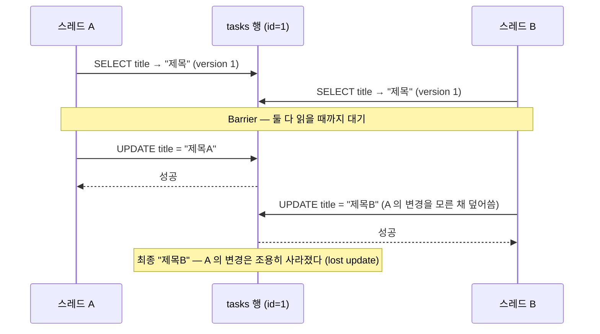

# 11 — 트랜잭션과 동시성

## 목표

"여러 문장이 **함께** 성공하거나 **함께** 실패해야 한다"를 트랜잭션(transaction)으로 보장하고, 두 스레드가 같은 할 일을
동시에 고칠 때 한쪽의 변경이 **조용히 사라지는 현상(lost update)** 을 직접 재현한 뒤, `version` 열을 이용한
낙관적 잠금(optimistic locking)으로 막습니다. SQLite 가 동시 쓰기를 어떻게 다루는지(데이터베이스 단위 잠금)도 이해합니다.

## 노트와의 연결

노트는 데이터 영역의 핵심을 "**데이터의 정합성과 최신성**"이라 부르고, "에이전트는 사람보다 훨씬 많이 검색·저장·조회한다"고
합니다. 사람 한 명이 쓰던 프로그램에서는 동시성 문제가 거의 드러나지 않습니다. 에이전트 여러 개가 같은 할 일 목록을 고치기
시작하는 순간(43단원) 이 단원의 문제가 매일 일어납니다. 노트가 요구하는 "에이전트의 운영 DB 접근 → 최소 권한"도
결국 "누가 무엇을 덮어쓸 수 있는가"의 문제이고, 그 첫 방어선이 트랜잭션과 version 검사입니다.

## 공부할 개념

| 개념 | 핵심 | 참고 |
| --- | --- | --- |
| 트랜잭션과 ACID, `with conn:` | 여러 문장을 한 단위로. 끝까지 가면 commit, 중간에 예외가 나면 rollback. 원자성(A)·일관성(C)·격리성(I)·지속성(D) | [docs.python.org — sqlite3 트랜잭션 제어](https://docs.python.org/ko/3/library/sqlite3.html#transaction-control), [sqlite.org — Atomic Commit](https://sqlite.org/atomiccommit.html) |
| 스레드(thread)와 경쟁 조건(race condition) | `threading.Thread` 로 동시에 실행, `Barrier` 로 타이밍 고정. "읽고 → 고치고 → 쓰기" 사이에 남이 끼어들면 lost update | [docs.python.org — threading](https://docs.python.org/ko/3/library/threading.html), [위키백과 — 경쟁 상태](https://ko.wikipedia.org/wiki/경쟁_상태) |
| 낙관적 잠금(optimistic locking)과 SQLite 잠금 | `UPDATE … WHERE id = ? AND version = ?` 로 "내가 읽은 그대로일 때만" 쓰기. SQLite 는 쓰기 잠금이 DB 파일 전체에 하나 | [sqlite.org — File Locking](https://sqlite.org/lockingv3.html), [sqlite.org — WAL 모드](https://sqlite.org/wal.html) |

### 트랜잭션: "둘 다 아니면 아무것도"

`move_tag(1, "급함", "나중에")` 는 SQL 두 문장입니다 — `task_tags` 에서 한 행을 지우고, 한 행을 넣습니다. 지우기는 됐는데
넣기가 실패하면(이미 붙어 있는 태그라서 복합 PK 위반) 태그 하나가 그냥 사라집니다. 사용자는 "옮기기 실패" 메시지를 보는데
데이터는 반쯤 바뀌어 있는, 가장 찾기 어려운 종류의 버그입니다.

트랜잭션은 이 두 문장을 하나의 단위로 묶습니다. 파이썬 `sqlite3` 에서 가장 안전한 쓰기 방법은 이것입니다.

```python
with self.conn:                      # 블록이 정상 종료 → commit, 예외가 빠져나감 → rollback
    self.conn.execute("DELETE ...")
    self.conn.execute("INSERT ...")  # 여기서 IntegrityError 가 나면 DELETE 도 없던 일이 된다
```

`with conn:` 은 **연결을 닫지 않습니다**(파일의 `with open` 과 다릅니다). 커밋/롤백만 합니다. 08단원부터 쓰던
`conn.commit()` 을 이번 단원의 시작 코드에서 모두 `with self.conn:` 으로 바꿔 두었습니다. 비교해 보세요.

ACID 네 글자 중 이 단원이 손으로 만지는 것은 **원자성(Atomicity, 전부 아니면 전무)** 과 **격리성(Isolation, 동시 실행이 서로 안 보임)** 입니다.
일관성(제약이 깨지지 않음)은 08~09단원의 CHECK·FK 가, 지속성(commit 하면 전원이 나가도 남음)은 SQLite 가 맡습니다.

### 두 스레드와 lost update

스레드(thread)는 같은 프로그램 안에서 동시에 도는 실행 흐름입니다. `threading.Thread(target=함수).start()` 로 시작하고
`.join()` 으로 끝나기를 기다립니다. 두 스레드가 "할 일을 읽고 → 제목 끝에 글자를 붙여 → 쓰는" 일을 동시에 하면:



읽는 법: 시간은 위에서 아래로 흐릅니다. 두 쓰기 모두 "성공"이라고 보고받지만, B 는 A 가 바꾼 뒤의 값이 아니라 자기가
**옛날에 읽은 값**을 기준으로 썼기 때문에 A 의 작업이 지워집니다. 오류는 아무 데서도 나지 않습니다.

테스트는 `threading.Barrier(2)` 로 "둘 다 읽은 다음에야 쓰기 시작"을 강제해서 이 순서를 **매번 똑같이** 재현합니다.
실제 세계에서는 수천 번에 한 번 일어나는 일을 테스트에서는 100% 일어나게 만드는 것 — 이것이 동시성 버그를 다루는 기본 기술입니다.

### 낙관적 잠금: "내가 읽은 그대로일 때만 쓴다"

```sql
UPDATE tasks SET title = ?, version = version + 1
WHERE id = ? AND version = ?      -- 내가 읽었을 때의 version
```

B 가 쓰려 할 때 행의 version 은 이미 2 이고 B 는 1 을 기대하므로 `WHERE` 가 거짓 → 바뀐 행 0 개(`cursor.rowcount == 0`).
저장소는 이것을 `ConflictError` 로 바꿔 던집니다. "조용히 사라짐"이 "다시 읽고 다시 시도하라는 신호"로 바뀝니다.
"낙관적"이라는 이름은 "충돌은 드물 테니 미리 잠그지 않고, 쓸 때 확인한다"는 태도에서 왔습니다. 반대는 비관적 잠금
(`SELECT … FOR UPDATE` 로 미리 잠그기)인데 SQLite 에는 없습니다.

### SQLite 의 잠금은 파일 전체 하나

SQLite 는 쓰기 잠금이 **데이터베이스 파일 전체에 하나**입니다. 두 연결이 동시에 쓰려 하면 한쪽은 기다립니다
(`sqlite3.connect(path, timeout=5)` 의 timeout 이 그 대기 시간이고, 넘기면 `database is locked` 오류). 그래서 위 다이어그램의
두 UPDATE 는 실제로는 겹치지 않고 차례로 실행됩니다 — **그런데도 lost update 는 일어납니다.** 잠금은 "두 쓰기가 섞이는 것"을 막을 뿐,
"옛날 값을 기준으로 쓰는 것"은 막지 못하기 때문입니다. 이 구분이 이 단원에서 가장 중요합니다.

## 과제

`todo/storage_sqlite.py` 의 `rename`, `move_tag` 를 채워 `pytest units/11-transactions-and-concurrency` 를 모두 통과시키세요.

| 만들 것 | 하는 일 | 관련 테스트 |
| --- | --- | --- |
| (읽기) `with conn:` 동작 | 블록 성공 → commit, 예외 → rollback | `test_with_conn_*` (이미 통과 — sqlite3 자체 확인) |
| (읽기) `version` 열, `complete` 의 `version + 1` | 이미 구현 | `test_new_task_has_version_1`, `test_complete_bumps_version` |
| `rename(task_id, new_title, expected_version=None)` | 제목 변경 + version 증가. `expected_version` 이 있으면 `AND version = ?`, 안 맞으면 `ConflictError` | `test_rename_*` |
| `move_tag(task_id, from_tag, to_tag)` | DELETE + INSERT 를 한 트랜잭션으로. 실패 시 둘 다 롤백 | `test_move_tag_*` |
| 두 스레드 테스트 | 위 두 메서드가 맞으면 통과. **테스트 코드 `run_two_writers` 를 반드시 읽을 것** | `test_two_writers_*` |

통과한 뒤 `python units/11-transactions-and-concurrency/race_demo.py` 를 실행하세요. 스레드 10개 중 몇 개가 살아남는지,
version 검사를 켜면 어떻게 달라지는지 출력을 `NOTES.md` 에 붙이세요.

## 스스로 답해 볼 질문

1. `test_two_writers_without_version_check_lose_one_update` 는 두 스레드 **모두 예외 없이 성공**했다고 단언합니다. 왜 이것이 버그의 핵심인가요?
2. `with conn:` 블록 안에서 `conn.commit()` 을 직접 부르면 무슨 일이 생기나요? 블록이 끝날 때 롤백할 것이 남아 있나요?
3. 10단원 `generate()` 가 10만 건을 `executemany` + commit 한 번으로 넣을 때와 `store.add` 10만 번(commit 10만 번)의 속도 차이를 쟀습니다. 이제 설명할 수 있나요? (commit 마다 디스크 동기화가 일어난다는 사실과 연결하세요)
4. 낙관적 잠금에서 `ConflictError` 를 받은 쪽은 무엇을 해야 하나요? 자동으로 다시 시도해도 되는 경우와 사용자에게 물어야 하는 경우를 나눠 보세요. ("제목 바꾸기"와 "잔액 차감"을 비교)
5. 서버가 두 대이고 각각 SQLite 파일을 따로 갖고 있다면 이 단원의 장치가 도움이 되나요? 어떤 결정이 "되돌리기 어려운 결정"이 되는 순간인가요? → 12·37단원
6. `version` 대신 `updated_at` 타임스탬프로 같은 일을 할 수 있을까요? 같은 밀리초에 두 번 바뀌면?

## 함정

- `with conn:` 은 **BEGIN 을 직접 하지 않습니다.** 파이썬 sqlite3 의 기본(legacy) 모드에서는 블록 안 첫 INSERT/UPDATE/DELETE 때 트랜잭션이 열립니다. 블록 안의 SELECT 는 트랜잭션 밖일 수 있다는 뜻입니다. 정확한 제어가 필요하면 3.12+ 의 `autocommit=False` 를 읽어 보세요.
- `executescript()` 는 실행 전에 **COMMIT 을 먼저** 합니다. `with conn:` 안에서 쓰면 롤백 단위가 깨집니다. 스키마 생성에만 쓰세요.
- `:memory:` DB 로는 스레드 테스트를 할 수 없습니다. 연결마다 **다른** 메모리 DB 가 생깁니다. 그래서 `tmp_path` 파일을 씁니다.
- sqlite3 연결 객체는 기본적으로 **만든 스레드에서만** 쓸 수 있습니다(`check_same_thread`). 스레드마다 `connect` 하세요. 하나의 연결을 여럿이 나눠 쓰는 설계는 잠금이 아니라 파이썬 쪽 오류로 먼저 깨집니다.
- `cursor.rowcount` 는 SELECT 에서는 의미가 없고(-1), INSERT/UPDATE/DELETE 에서만 "바뀐 행 수"입니다.
- 스레드 안에서 난 예외는 **조용히 사라집니다.** 테스트의 `outcomes` 리스트처럼 직접 모아야 합니다. `join()` 은 예외를 전달하지 않습니다.
- 바쁜 대기(`while not done: pass`)로 타이밍을 맞추지 마세요. `Barrier`, `Event`, `Lock` 같은 동기화 도구가 있습니다.

## 완료 기준

- [ ] `pytest units/11-transactions-and-concurrency` 16개 테스트 전부 통과 (5번 연속 실행해도 전부 통과 — 동시성 테스트는 "가끔 실패"가 곧 실패입니다)
- [ ] `race_demo.py` 출력 두 줄을 `NOTES.md` 에 기록하고, "잠금이 있는데 왜 lost update 가 일어났는가"를 내 말로 세 줄 이내로 설명
- [ ] 테스트를 **1개 직접 추가** (예: `complete` 에도 `expected_version` 을 붙여 보기, 또는 스레드 3개)
- [ ] `docs/adr/0004-*.md` — "동시 수정 충돌을 version 열(낙관적 잠금)로 감지한다". 대안에 "마지막 쓰기 승리(지금 상태)", "파일 잠금/뮤텍스", "비관적 잠금" 을 넣기. "이 결정을 다시 볼 신호"에 "충돌률이 n% 를 넘으면" 같은 측정 가능한 조건
- [ ] `NOTES.md` 에 배운 것 3가지 / 헷갈린 것 1가지 / 다음 단원에 바꿀 것 / 세 문장 설명("두 사람이 동시에 같은 할 일을 고치면 어떻게 되나")
- [ ] AI 코드 리뷰: `move_tag` 를 리뷰받기. "트랜잭션 범위가 적절한가" 를 꼭 묻고, 하나 반영·하나 반박
- [ ] 브랜치 `unit-11` → PR → 머지

## 더 깊이

- `PRAGMA journal_mode = WAL` 을 켜면 읽기와 쓰기가 서로 막지 않습니다. 10단원 벤치마크를 파일 DB + 스레드 2개(하나는 읽기만)로 바꿔 WAL 전후를 재 보세요. [sqlite.org — WAL](https://sqlite.org/wal.html)
- 격리 수준(isolation level) 네 가지(Read Uncommitted ~ Serializable)를 읽고, SQLite 는 어디에 해당하는지 찾아보세요. 『데이터 중심 애플리케이션 설계』 7장 "트랜잭션" 이 lost update 를 포함한 모든 이상 현상을 그림으로 설명합니다.
- "재시도 루프": `ConflictError` 를 받으면 다시 읽고 최대 3번까지 다시 쓰는 `rename_with_retry` 를 만들어 `race_demo.py` 의 10개가 전부 살아남게 해 보세요. 25단원(재시도·백오프)의 예고편입니다.
- 파이썬 3.12+ `sqlite3.connect(..., autocommit=False)` 로 바꾸면 `with conn:` 의 동작이 어떻게 더 명확해지는지 문서를 읽고 실험해 보세요.
