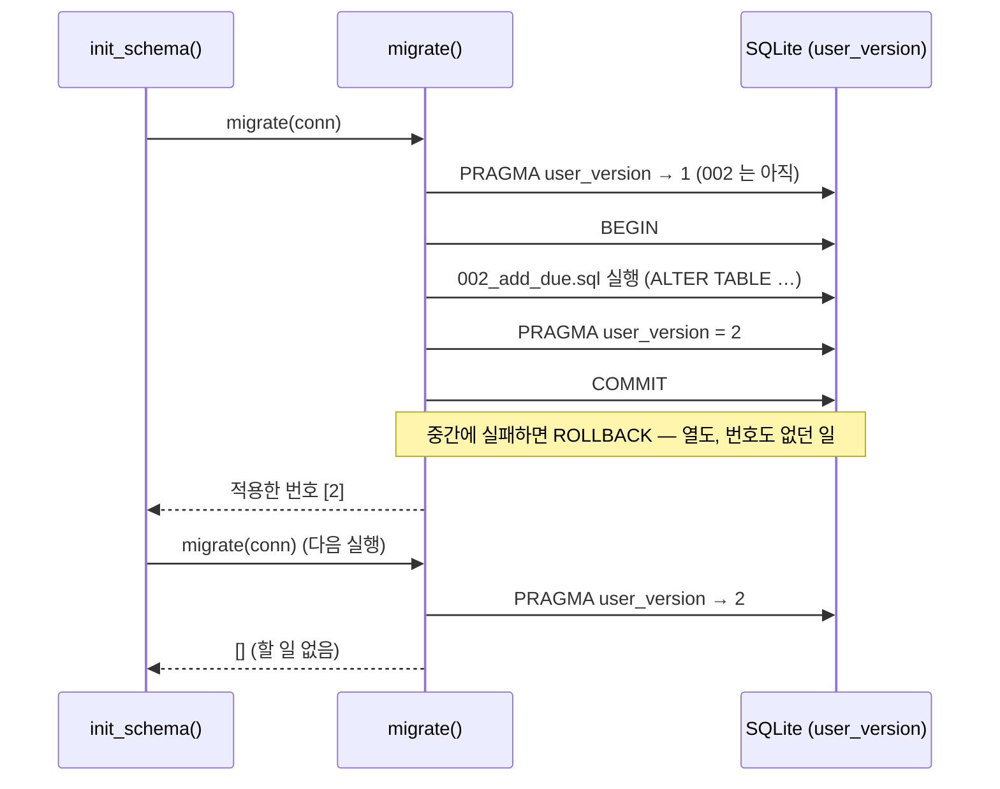
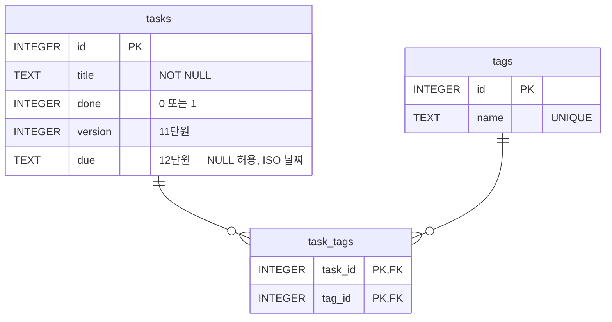

# 12 — 마이그레이션·백업·복구

## 목표

스키마를 "`init_schema()` 가 매번 그리는 그림"에서 "**번호 붙은 SQL 파일의 누적**"으로 바꿉니다. 데이터가 들어 있는 DB 에
마감일(`due`) 열을 추가하는 마이그레이션(migration)을 작성해 적용하고, `PRAGMA user_version` 으로 "어디까지 적용했는지"를
DB 자신이 기억하게 합니다. 그리고 백업(backup)을 만들고 **실제로 복구해 보는 연습(restore drill)** 을 테스트로 남깁니다.

## 노트와의 연결

노트의 경고가 이 단원의 제목입니다: "**데이터는 에이전트가 마이그레이션을 도와도 한번 정하면 바꾸기 어렵다. 되돌리는 비용이
가장 큰 결정이다.**" 코드는 `git revert` 로 되돌리지만, 이미 10만 건이 들어 있는 테이블의 열 하나는 revert 가 없습니다.
그래서 (1) 바꾸는 절차를 코드처럼 리뷰·기록하고(마이그레이션 파일), (2) 바꾸기 **전에** 돌아갈 지점을 만들고(백업),
(3) 돌아가는 법을 **미리 연습**합니다(복구 훈련). 노트가 에이전트의 운영 DB 접근에 "백업과 복구 연습"을 요구하는 이유이기도 합니다 —
에이전트가 마이그레이션을 "도와 준" 뒤 무엇이 바뀌었는지 사람이 알 수 없다면, 되돌릴 수도 없습니다.

## 공부할 개념

| 개념 | 핵심 | 참고 |
| --- | --- | --- |
| 마이그레이션 파일과 `PRAGMA user_version` | `001_init.sql`, `002_add_due.sql` … 번호 순으로 한 번씩만 적용. DB 헤더의 정수 `user_version` 이 "마지막으로 적용한 번호". 적용한 파일은 절대 고치지 않는다 | [sqlite.org — PRAGMA user_version](https://sqlite.org/pragma.html#pragma_user_version), [ALTER TABLE 의 한계](https://sqlite.org/lang_altertable.html) |
| 확장-수축(expand-contract) | 열을 바꿀 때 "새 열 추가 → 양쪽에 쓰기 → 읽기 전환 → 옛 열 제거"로 나누면 각 단계가 되돌릴 수 있다. 되돌릴 수 없는 단계(삭제)는 맨 뒤로 | [Martin Fowler — Evolutionary Database Design](https://martinfowler.com/articles/evodb.html) |
| 온라인 백업과 복구 훈련 | `conn.backup(dest)` 는 사용 중인 DB 도 일관된 시점으로 복사. 백업은 **복구해 본 적이 있을 때만** 백업이다 | [docs.python.org — Connection.backup](https://docs.python.org/ko/3/library/sqlite3.html#sqlite3.Connection.backup), [sqlite.org — Online Backup API](https://sqlite.org/backup.html) |

### 왜 `init_schema()` 로는 부족한가

지금까지 `init_schema()` 는 `CREATE TABLE IF NOT EXISTS` 였습니다. 테이블이 **없을 때** 만들 뿐, **이미 있는** 테이블에 열을
추가하지는 못합니다. 사용자의 `todo.db` 에 할 일 500개가 있는데 `due` 열이 필요해졌다면? "지우고 다시 만들기"는 데이터를 잃고,
"손으로 ALTER TABLE 치기"는 기록이 남지 않아 다음 컴퓨터에서 또 손으로 쳐야 합니다.

마이그레이션은 **스키마의 변경 이력을 번호 붙은 파일로 쌓는** 방법입니다.

```
todo/migrations/
  001_init.sql       ← 11단원까지의 스키마 전체 (IF NOT EXISTS 로, 옛 DB 에도 적용 가능)
  002_add_due.sql    ← ALTER TABLE tasks ADD COLUMN due TEXT;
  003_...            ← 13단원에서 추가
```



읽는 법: 프로그램은 시작할 때마다 `migrate()` 를 부르고, `migrate()` 는 DB 가 기억하는 번호보다 큰 파일만 번호 순으로
적용합니다. 파일 하나가 트랜잭션 하나라서, 실패하면 번호도 올라가지 않아 다음 실행에서 다시 시도됩니다.

### 002 를 적용한 뒤의 `tasks`



읽는 법: 새 열 `due` 는 NULL 을 허용합니다. 이미 있는 500개 행은 건드리지 않고 "값 없음"으로 읽히므로 `ALTER TABLE … ADD COLUMN` 은
행 수와 무관하게 즉시 끝납니다. **NOT NULL 열을 기본값 없이 추가하는 것은 데이터가 있는 테이블에서는 불가능**합니다 — 이것이
"되돌리기 어려운 결정"의 첫 사례입니다.

### 확장-수축: 되돌릴 수 있게 쪼개기

`title` 을 `name` 으로 바꾸고 싶다고 합시다. `ALTER TABLE RENAME COLUMN` 한 방은 그 순간 옛 코드가 전부 깨집니다
(서버가 둘이라 하나는 옛 코드, 하나는 새 코드인 36단원 상황을 떠올리세요). 대신:

1. **확장(expand)**: `name` 열 추가 (003). 옛 코드는 모른 채 계속 `title` 에 씀.
2. 새 코드는 **양쪽에** 쓰고 `title` 을 읽음. 기존 데이터는 백필(backfill) `UPDATE tasks SET name = title`.
3. 읽기를 `name` 으로 전환. 문제가 생기면 여기까지는 **언제든 되돌릴 수 있음** (`title` 이 아직 있음).
4. **수축(contract)**: 충분히 지난 뒤 `title` 열 제거 (004). 이 단계만 되돌릴 수 없고, 그래서 맨 마지막.

이번 단원에서는 1단계(열 추가)만 합니다. 나머지는 "스스로 답해 볼 질문"과 36단원에서 돌아옵니다.

### 백업은 복구해 봤을 때만 백업이다

`shutil.copy("todo.db", "todo.bak")` 은 다른 연결이 쓰는 중이면 반쯤 쓰인 파일이 복사될 수 있습니다. SQLite 의 온라인 백업 API
`conn.backup(dest_conn)` 는 사용 중에도 **일관된 시점**의 사본을 만듭니다. 복구는 방향만 반대입니다.

하지만 진짜 교훈은 API 가 아닙니다. 백업 파일이 있다는 것과 **그 파일로 돌아갈 수 있다는 것**은 다릅니다. 백업이 깨져 있거나,
스키마 버전이 안 맞거나, 복구 절차를 아무도 모르는 경우가 실제 장애의 흔한 모습입니다. 그래서 테스트 `test_restore_drill_*` 는
"백업 → 전부 삭제 → 복구 → 원래와 같은가"를 **매번** 확인합니다.

## 과제

| 만들 것 | 하는 일 | 관련 테스트 |
| --- | --- | --- |
| `todo/migrate.py` — `current_version` | `PRAGMA user_version` 읽기 | `test_fresh_db_starts_at_version_0` |
| `todo/migrate.py` — `load_migrations` | 파일 이름 파싱, 번호 정렬, 무관한 파일 무시, 중복 번호 오류 | `test_repo_has_two_migrations_in_order`, `test_load_migrations_*`, `test_duplicate_number_*` |
| `todo/migrate.py` — `migrate` | pending 을 순서대로 `_apply`, `target` 지원, 적용한 번호 반환 | `test_migrate_*`, `test_migrating_a_db_with_data_*`, `test_legacy_db_*`, `test_failed_migration_*` |
| `todo/migrations/002_add_due.sql` | `ALTER TABLE tasks ADD COLUMN due TEXT;` | `test_add_with_due_*`, `test_init_schema_uses_migrations` |
| `todo/backup.py` — `backup_to`, `restore_from` | `Connection.backup` 양방향 | `test_backup_*`, `test_restore_*` |

이미 되어 있는 것: `Task.due` (`date | None`, JSON 에서는 ISO 문자열), `SqliteTaskStore.add(..., due=)`, `init_schema()` 가 `migrate()` 를
부르도록 바뀐 것, `_apply` (트랜잭션으로 한 파일 적용), `cli.py` 의 `add --due 2026-05-31`.
`storage_sqlite.py` 에서 `SCHEMA` 상수가 사라졌습니다 — 스키마의 주인이 `migrations/` 로 옮겨 갔기 때문입니다.

**복구 훈련을 직접 한 번 하세요** (테스트 말고 손으로): 파일 DB 에 할 일 몇 개를 넣고 → `backup_to` → 할 일을 지우고 →
`restore_from` → 돌아왔는지 확인. 걸린 시간과 막힌 지점을 `NOTES.md` 에 적습니다. 이것이 30단원 "백업 검증"의 씨앗입니다.

## 스스로 답해 볼 질문

1. `002_add_due.sql` 을 적용한 뒤 "역시 `due` 는 `TEXT` 말고 `INTEGER`(유닉스 시간)로 할걸" 싶어졌습니다. 002 파일을 고쳐도 될까요?
   이미 002 를 적용한 DB 와 아직 적용하지 않은 DB 가 섞여 있다면 무슨 일이 생기나요? 올바른 방법은?
2. `001_init.sql` 이 `IF NOT EXISTS` 를 쓴 덕에 11단원 DB(user_version 0) 에도 적용됩니다. 그런데 11단원 DB 의 `tags.name` 에
   `CHECK` 가 빠져 있다면(테스트의 `LEGACY_SCHEMA` 참고) 001 적용 뒤에도 빠진 채입니다. 이런 "조용한 차이"를 어떻게 발견하고 어떻게 맞출까요?
3. 마감일이 지난 할 일을 찾는 `WHERE due < ?` 가 자주 실행된다면 10단원 기준으로 무엇을 추가해야 하나요? 그것은 몇 번 마이그레이션이 되나요?
4. 되돌리기(down migration) 파일 `002_add_due.down.sql` 을 만들어야 할까요? SQLite 의 `ALTER TABLE DROP COLUMN` 제약을 찾아보고,
   "앞으로만 가는(forward-only) 마이그레이션 + 백업" 전략과 비교하세요.
5. 백업을 **언제, 얼마나 자주, 어디에** 둘지 정해 보세요. 마이그레이션 직전에는 반드시? 백업 파일이 원본과 같은 디스크에 있으면 무엇을 못 막나요?
6. 에이전트가 "마이그레이션을 작성해 적용까지 해 드릴까요?" 라고 묻습니다. 어디까지 맡기고 어디부터 사람이 보겠습니까? (40단원 권한 설계의 예고)

## 함정

- `executescript()` 는 자동으로 트랜잭션을 만들어 주지 **않습니다** (실행 전에 COMMIT 을 먼저 할 뿐입니다). `_apply` 가 `BEGIN`/`COMMIT` 을
  스크립트에 직접 붙이는 이유입니다. 직접 `conn.execute("BEGIN")` 뒤 `executescript` 를 부르면 그 BEGIN 은 먼저 커밋되어 사라집니다.
- SQLite 의 `ALTER TABLE` 은 열 추가·이름 변경·열 삭제(3.35+)만 됩니다. 열 타입 변경이나 제약 추가는 "새 테이블 만들기 → 복사 → 교체" 12단계 절차가
  필요합니다([공식 문서의 절차](https://sqlite.org/lang_altertable.html#otheralter)). 그래서 **처음 스키마에서 제약을 빼먹으면 비쌉니다** (08~09단원이 CHECK 에 집착한 이유).
- `PRAGMA user_version` 은 DB 파일마다 하나입니다. `:memory:` 는 연결마다 0 에서 시작하므로 테스트마다 전부 다시 적용됩니다 — 그래서 빠른 마이그레이션이 중요합니다.
- `conn.backup()` 의 대상 연결이 트랜잭션 중이면 실패합니다. 백업 직전에 `with conn:` 블록이 열려 있지 않은지 확인하세요.
- `restore_from` 은 대상 DB 를 **통째로** 덮어씁니다. 백업 이후의 변경은 사라집니다. "복구"는 공짜가 아니고, 그래서 백업 주기가 곧 "잃어도 되는 시간"입니다.
- 파일 이름 패턴을 느슨하게 하면(`1_init.sql`, `01_init.sql`) 문자열 정렬에서 `10 < 2` 가 됩니다. 세 자리 고정이 규칙입니다.

## 완료 기준

- [ ] `pytest units/12-migrations-and-backup` 18개 테스트 전부 통과
- [ ] 손으로 한 복구 훈련 기록이 `NOTES.md` 에 (걸린 시간, 막힌 점, 다음에 자동화할 것)
- [ ] 테스트를 **1개 직접 추가** (예: `target=0` 이면 아무것도 적용하지 않는가, 백업 파일이 없을 때 `restore_from` 은?)
- [ ] `docs/adr/0005-*.md` — "스키마 변경은 번호 붙은 SQL 파일 + user_version 으로 관리하고, 되돌리기는 백업으로 한다". 대안에
      "Alembic 같은 도구 도입", "down 마이그레이션 작성", "init_schema 유지" 를 넣기. "다시 볼 신호": 마이그레이션 파일이 n 개를 넘거나 팀원이 생기면
- [ ] `NOTES.md` 에 배운 것 3가지 / 헷갈린 것 1가지 / 다음 단원에 바꿀 것 / 세 문장 설명("데이터베이스 구조를 바꾸는 게 왜 코드 바꾸기보다 조심스러운가")
- [ ] AI 코드 리뷰: `002_add_due.sql` 과 `migrate()` 를 리뷰받고 "이 마이그레이션은 되돌릴 수 있는가" 를 묻기. 하나 반영·하나 반박
- [ ] 브랜치 `unit-12` → PR → 머지

## 더 깊이

- 확장-수축을 끝까지: `003_add_name.sql` (열 추가 + 백필), 코드를 `name` 으로 전환, `004_drop_title.sql`. 각 단계 사이에 옛 코드가 돌아가는지 확인해 보세요.
- `PRAGMA schema_version` 과 `user_version` 의 차이, `PRAGMA integrity_check` 와 `PRAGMA quick_check` 의 차이를 찾아보세요. 백업 파일 검증에 무엇을 쓰겠습니까?
- Alembic(SQLAlchemy 의 마이그레이션 도구)의 README 를 훑어 보세요. 이 단원에서 직접 만든 것과 구조가 어떻게 같은지(번호·버전 테이블·up 스크립트), 무엇이 더 있는지(자동 생성, 브랜치).
- 백업을 매일 자동으로 돌리는 스크립트를 짜고, 7일 지난 백업을 지우는 보존 규칙(retention)을 붙여 보세요 → 14단원 수명주기.
- 『데이터 중심 애플리케이션 설계』 4장 "부호화와 발전" — 스키마 진화(schema evolution)와 하위·상위 호환성.
