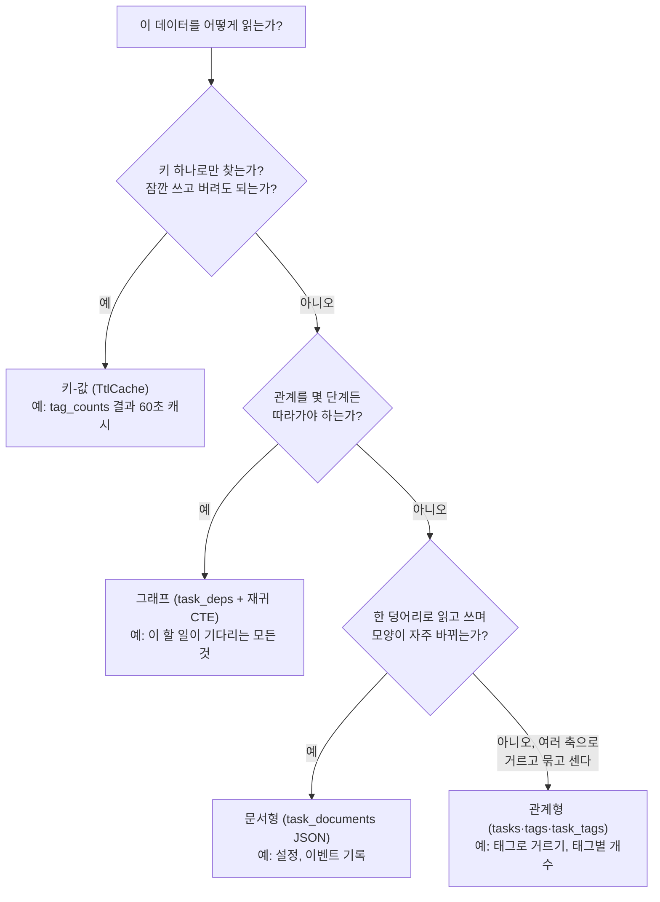

# 13 — 저장소 유형 비교

## 목표

같은 "태그 달린 할 일" 기능을 **관계형**(09단원의 세 테이블)과 **문서형**(할 일 하나 = JSON 문서 하나)으로 각각 만들고,
**같은 테스트**를 두 구현에 돌려 조회 방식과 비용이 어떻게 다른지 비교합니다. 여기에 **키-값**(TTL 있는 캐시)과
**그래프**(할 일 사이의 의존 관계, 재귀 CTE) 두 유형을 더해, "이 데이터에는 어떤 저장소 유형이 맞는가"를 접근 패턴으로 판단하는 눈을 기릅니다.

## 노트와의 연결

노트의 학습법 4 가 이 단원 그 자체입니다: "**같은 기능을 관계형 DB와 문서형 DB로 각각 만들어 보고 조회 방식과 성능을 비교한다.**"
그리고 노트는 "AI 시스템은 데이터 소스가 보여주는 것만 본다. 데이터 아키텍처를 잘못 고르면 AI는 자기가 무엇을 모르는지조차 모른다"고
경고합니다. 저장소 유형은 "무엇을 쉽게 물어볼 수 있는가"를 결정합니다 — 문서형에 넣은 태그는 "이 할 일의 태그"는 쉽게 답하지만
"이 태그가 붙은 모든 할 일"은 전체를 뒤져야 하고, 관계형에 넣은 의존 관계는 "건너건너 무엇을 기다리는가"를 재귀 없이는 답하지 못합니다.
유형을 고르는 일은 곧 **나중에 던질 수 있는 질문의 종류를 고르는 일**입니다.

## 공부할 개념

| 개념 | 핵심 | 참고 |
| --- | --- | --- |
| 문서형(document) 모델과 SQLite JSON 함수 | 행 하나에 중첩 구조 전체. 스키마가 없다(= 읽는 쪽이 검증). `json_extract`, `json_each`, `json_valid` | [sqlite.org — JSON 함수](https://sqlite.org/json1.html), 『데이터 중심 애플리케이션 설계』 2장 "관계형 모델과 문서 모델" |
| 키-값(key-value)과 TTL(time to live) | 키로만 찾는다, 그 대신 아주 빠르다. 값마다 수명을 두어 "오래된 답"을 자동으로 버린다. 시계 주입으로 테스트 | [Redis — EXPIRE 문서](https://redis.io/docs/latest/commands/expire/) (개념 참고), [docs.python.org — time.monotonic](https://docs.python.org/ko/3/library/time.html#time.monotonic) |
| 그래프(graph)와 재귀 CTE | 노드(할 일)와 간선(의존). "몇 단계든 따라가기"는 `WITH RECURSIVE` 로. 순환 탐지 | [sqlite.org — WITH 절(재귀 CTE)](https://sqlite.org/lang_with.html) |

### 네 가지 유형, 한 장으로



읽는 법: 위에서부터 질문에 답하며 내려옵니다. 할 일 자체는 "태그로 거르고 개수를 센다"가 핵심 패턴이라 관계형이 맞고,
의존 관계는 관계형 테이블에 두되 **조회는 그래프식**(재귀)으로 합니다. 하나의 프로그램이 유형 여러 개를 섞어 씁니다 — 그래서
"어느 DB 가 최고인가"가 아니라 "이 데이터의 이 접근 패턴에 무엇이 맞는가"가 질문입니다.

### 문서형: 한 덩어리의 자유와 그 값

```json
{"title": "SQL 공부", "done": false, "tags": ["공부", "db"], "version": 1, "due": null}
```

문서형 저장소 `DocumentTaskStore` 는 테이블이 `task_documents(id, body)` 하나뿐입니다. 장점은 분명합니다 — `get(1)` 은 JOIN 없이
문서 하나를 읽으면 끝이고, 필드를 추가해도 마이그레이션이 필요 없습니다. 비용도 분명합니다.

| 패턴 | 관계형 | 문서형 |
| --- | --- | --- |
| 할 일 하나 + 태그 읽기 | 쿼리 2개 (tasks, task_tags JOIN) | 쿼리 1개, 파싱 1번 |
| 태그로 거르기 | 인덱스로 SEARCH (10단원) | `json_each` 로 모든 문서의 배열을 **펼쳐서** 비교 (SCAN) |
| 태그별 개수 | GROUP BY | `json_each` + GROUP BY (역시 SCAN) |
| 태그 이름 바꾸기 | `tags` 한 행 UPDATE | 모든 문서를 읽어 고쳐 다시 씀 |
| `done` 하나 바꾸기 | 열 하나 UPDATE | 문서 **전체**를 다시 씀 (`complete` 구현을 비교) |
| 필드 추가 | 마이그레이션 (12단원) | 그냥 넣으면 됨 — 읽는 쪽이 모르는 키를 만나면? (`test_document_store_accepts_fields_*`) |
| 잘못된 데이터 막기 | CHECK·FK·UNIQUE | `json_valid` 뿐. 나머지는 코드가 |

테스트 파일의 앞부분은 `@pytest.fixture(params=["relational", "document"])` 로 **같은 테스트를 두 저장소에** 돌립니다.
둘이 같은 답을 내야 하지만 **어떻게** 내는지는 다릅니다. 10단원의 `plan()` 으로 두 `by_tag` 의 플랜을 찍어 비교하는 것이 과제의 일부입니다.

### 키-값: 캐시는 "오래된 답을 언제 버릴 것인가"의 문제

`TtlCache` 는 `dict` 에 "만료 시각"을 붙인 것입니다. `set("tag_counts", {...}, ttl_seconds=60)` 하면 60초 동안은 DB 를 묻지 않고
답할 수 있습니다. 중요한 것은 두 가지입니다. (1) 캐시의 답은 **최신이 아닐 수 있다** — 정합성과 최신성의 교환이며 19단원의 주제입니다.
(2) 시계를 **주입**하므로 테스트가 60초를 기다리지 않습니다. 테스트의 `FakeClock` 은 테스트 대역(test double) 중 **가짜(fake)** —
진짜처럼 동작하지만 우리가 조종할 수 있는 구현 — 입니다. 24단원에서 fake·stub·mock 을 제대로 구분합니다.

### 그래프: 재귀 CTE 로 "건너건너" 따라가기

`task_deps(task_id, depends_on)` 행 하나는 간선 하나입니다. "3번은 2번을, 2번은 1번을 기다린다"에서 "3번이 기다리는 **모든** 것"을
얻으려면 몇 단계인지 모른 채 따라가야 합니다. 일반 SQL 로는 못 하고, 재귀 CTE 가 답입니다.

```sql
WITH RECURSIVE chain(id) AS (
    SELECT depends_on FROM task_deps WHERE task_id = 3           -- 시작: 3 의 직접 의존 → {2}
    UNION                                                         -- 이미 본 id 는 다시 넣지 않는다 (종료 보장)
    SELECT task_deps.depends_on
    FROM task_deps JOIN chain ON task_deps.task_id = chain.id     -- 반복: chain 에 있는 것들의 의존 → {1}, 그다음 {} 로 끝
)
SELECT id FROM chain ORDER BY id;                                 -- [1, 2]
```

`UNION` (중복 제거) 대신 `UNION ALL` 을 쓰면 순환이 있을 때 끝나지 않습니다. 그래서 `add_dependency` 는 간선을 넣기 **전에**
"상대가 이미 나를 기다리고 있는가"를 `blockers` 로 확인해 순환을 거부합니다. 작은 그래프에는 관계형 테이블 + 재귀 CTE 로 충분하고,
수억 간선의 "친구의 친구의 친구"쯤 되어야 전용 그래프 DB 가 등장합니다.

## 과제

| 만들 것 | 하는 일 | 관련 테스트 |
| --- | --- | --- |
| `todo/storage_document.py` — `add`, `get`, `complete`, `open_tasks`, `by_tag` | 관계형과 같은 동작을 JSON 문서로. `json_extract`, `json_each` | 매개변수화된 `test_add_and_get` ~ `test_tag_counts` 의 `[document]` 쪽, `test_document_store_*` |
| `todo/cache_kv.py` — `set`, `get`, `purge_expired` | 만료 시각 저장, 읽을 때 만료 판정(lazy), 한꺼번에 청소(active) | `test_cache_*` |
| `todo/storage_sqlite.py` — `add_dependency`, `blockers` | 간선 추가(자기 참조·순환 거부), 재귀 CTE 로 전이적 의존 | `test_blockers_*`, `test_cycle_*`, `test_dependency_*`, `test_diamond_*` |
| (이미 구현) `003_add_dependencies.sql`, `ready_tasks`, 문서형의 `all/remove/tag_counts` | 참고용 | `test_migration_003_*`, `test_ready_tasks_*` |
| 비교표 (`NOTES.md`) | 두 `by_tag` 의 `EXPLAIN QUERY PLAN`, 10단원 `bench.py` 를 흉내 내어 1만 건에서 `by_tag`·`complete` 시간 비교 | — |

비교표 양식:

| 작업 | 관계형 (ms / 플랜) | 문서형 (ms / 플랜) | 어느 쪽이, 왜 |
| --- | --- | --- | --- |
| `get(id)` | | | |
| `by_tag` (1만 건) | | | |
| `complete(id)` | | | |
| 필드 하나 추가 | (마이그레이션 필요) | (없음) | |

## 스스로 답해 볼 질문

1. 두 저장소가 같은 테스트를 통과합니다. 그렇다면 "어느 쪽이 맞는가"는 무엇으로 정해야 하나요? 09단원의 접근 패턴 표로 돌아가 패턴마다 승자를 적어 보세요.
2. 문서형에서 "태그 이름 바꾸기"를 구현해야 한다면 어떻게 하겠습니까? 도중에 프로그램이 죽으면? (11단원의 트랜잭션이 여기서도 필요한가요?)
3. `TtlCache` 에 `tag_counts()` 결과를 60초 캐시했습니다. 그 사이 누가 태그를 추가하면 사이드바 숫자는 틀립니다. 허용되나요? "잔액"이라면? 캐시를 **무효화(invalidate)** 하는 방법은? → 19단원
4. `blockers` 는 `UNION` 덕에 순환이 있어도 끝납니다. 그런데도 `add_dependency` 가 순환을 **미리** 거부하는 이유는? (`ready_tasks` 에서 순환에 걸린 할 일은 어떻게 보일까요?)
5. 할 일이 100만 개이고 의존 간선이 500만 개라면 재귀 CTE 는 여전히 괜찮을까요? 어떤 조회가 먼저 무너질까요? 그때 "그래프 DB 로 옮긴다"는 결정은 되돌리기 얼마나 어려운가요?
6. 에이전트가 "할 일 메모리"로 쓸 저장소를 고른다면(노트: 메모리와 장기 저장소 수요) 네 유형 중 무엇을, 무엇에 쓰겠습니까?

## 함정

- `json_each` 는 FROM 절에 **테이블처럼** 쓰고(`FROM task_documents, json_each(body, '$.tags')`), 펼쳐진 값은 `json_each.value` 로 읽습니다. WHERE 절에 넣으려 하면 문법 오류입니다.
- JSON 의 `false` 는 `json_extract` 로 꺼내면 정수 `0` 입니다. `= 'false'` 가 아니라 `= 0` 으로 비교하세요.
- 문서형은 `Task(**json.loads(body))` 로 복원하므로 문서에 Task 가 모르는 키가 있으면 `TypeError` 가 **읽을 때** 납니다. 스키마가 없다는 것은 "검증이 없다"가 아니라 "검증이 읽는 쪽으로 옮겨 갔다"입니다.
- `TtlCache.get` 에서 만료 판정을 `>` 로 하면 "정확히 만료 시각"에 살아 있게 됩니다. 테스트는 `>=` 를 기대합니다 — 경계를 어디에 둘지는 정하고 문서화할 문제입니다.
- 딕셔너리를 순회하면서 `del` 하면 `RuntimeError: dictionary changed size during iteration`. 지울 키를 먼저 모으세요.
- 재귀 CTE 에서 `UNION ALL` 을 쓰면 순환 그래프에서 끝나지 않습니다(실제로는 메모리가 다할 때까지). 종료 조건을 SQL 이 아니라 **데이터**(순환 없음)에 의존하고 있다면 그 사실을 적어 두세요.
- `add_dependency(2, 1)` 의 뜻은 "2 가 1 을 기다린다"입니다. 인자 순서를 바꾸면 그래프가 거꾸로 됩니다. 테스트의 픽스처 주석을 먼저 읽으세요.

## 완료 기준

- [ ] `pytest units/13-storage-types` 34개 테스트 전부 통과 (매개변수화 덕에 저장소 테스트 7개가 두 번씩 돕니다)
- [ ] `NOTES.md` 에 비교표 (플랜 문자열 포함) 와 "할 일 프로그램의 태그는 어느 유형이 맞는가" 결론 세 줄
- [ ] 테스트를 **2개 직접 추가** (예: 문서형 `rename`, 캐시에 키 1000개 넣고 `purge_expired`)
- [ ] `docs/adr/0006-*.md` — "할 일·태그는 관계형으로 유지하고, 의존 관계는 같은 DB 의 테이블 + 재귀 CTE 로, 자주 읽는 집계는 TTL 캐시로". 대안에 "전부 문서형", "그래프 DB 도입" 을 넣고 비교표를 근거로
- [ ] `NOTES.md` 에 배운 것 3가지 / 헷갈린 것 1가지 / 다음 단원에 바꿀 것 / 세 문장 설명("데이터베이스에도 종류가 있다 — 왜 하나로 다 하지 않나")
- [ ] AI 코드 리뷰: `DocumentTaskStore.by_tag` 와 `blockers` 를 리뷰받고, "이 쿼리는 데이터가 100배 늘면 어떻게 되는가"를 묻기. 하나 반영·하나 반박
- [ ] 브랜치 `unit-13` → PR → 머지

## 더 깊이

- 문서형 `by_tag` 를 빠르게: SQLite 는 식(expression)에도 인덱스를 만들 수 있지만 `json_each` 처럼 배열을 펼치는 조회에는 못 씁니다. 실제 문서형 DB(MongoDB 의 multikey index)는 이것을 어떻게 푸는지 찾아보세요.
- 15단원 예고: 두 저장소가 같은 메서드를 갖는다는 사실을 `Protocol` 로 선언하면, 서비스 계층은 어느 저장소인지 모른 채 동작합니다. 이 단원의 매개변수화된 테스트가 그 첫 모습입니다.
- `ready_tasks` 를 "위상 정렬(topological sort)" 로 확장해 "전체를 어떤 순서로 하면 되는가"를 돌려주는 메서드를 만들어 보세요. 재귀 CTE 로 깊이(depth)를 함께 계산하면 됩니다.
- 시계열(time-series), 검색 엔진(14단원 FTS5), 벡터(14단원) 등 이 단원에서 다루지 않은 유형을 하나 골라, 위 플로차트의 어디에 가지를 추가해야 할지 그려 보세요.
- 『데이터 중심 애플리케이션 설계』 2장 끝의 "그래프형 데이터 모델" — Cypher 와 SQL 재귀 CTE 로 같은 질의를 쓴 비교가 있습니다.
