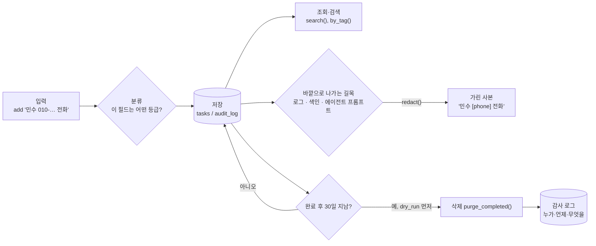

# 14 — 데이터 거버넌스와 에이전트용 데이터

## 목표

데이터가 "저장되고 조회되는 것"을 넘어 **관리되는 것**이 되게 합니다. 열마다 개인정보(PII) 등급을 정하고, 완료한 지 오래된
할 일을 규칙에 따라 지우고(보존 기간·수명주기), 지운 기록을 추가만 하는 감사 로그에 남기고, 제목을 전문 검색(FTS5)으로 찾고,
임베딩·벡터 검색이 무엇인지 코사인 유사도 하나로 손에 익힙니다. 이 단원은 **테스트 뼈대만** 제공합니다 — 독스트링을 읽고
시작 코드의 TODO 를 채운 뒤 테스트 본문을 직접 씁니다. 2단계(데이터 관리)의 마지막 단원입니다.

## 노트와의 연결

노트는 데이터 영역의 마지막 항목으로 "**데이터의 정합성과 최신성, 개인정보·거버넌스·수명주기, 에이전트용 데이터 인프라**"를 들고,
에이전트의 운영 DB 접근에는 "**최소 권한, 읽기 전용 계정, 백업과 복구 연습**"을 요구합니다. 또 "에이전트는 사람보다 훨씬 많이
검색·저장·조회하므로 메모리와 장기 저장소 수요가 커진다"고 합니다. 세 문장이 이 단원의 세 축입니다 — (1) 무엇이 민감한지 **분류**하고
흘러가는 길목에서 **가리고**, (2) 언제까지 갖고 있을지 **정하고 지우며 기록**하고, (3) 에이전트가 쓸 **검색**(키워드 → 의미)을 준비합니다.
"AI 시스템은 데이터 소스가 보여주는 것만 본다"는 경고도 여기에 걸립니다: 검색이 없으면 에이전트는 할 일 1만 개 중 자기가 무엇을
모르는지도 모릅니다.

## 공부할 개념

| 개념 | 핵심 | 참고 |
| --- | --- | --- |
| 개인정보(PII) 분류·보존 기간·감사 로그 (거버넌스 3종) | 열마다 등급을 **표로 선언**, 흘러나가는 길목(로그·검색·프롬프트)에서 가림. "완료 후 N일" 같은 규칙으로 지우되 **먼저 보여 주고(dry run)**, 지운 사실은 추가만 하는 테이블에 | [개인정보 보호법 (국가법령정보센터)](https://www.law.go.kr/법령/개인정보보호법) 제21조 "개인정보의 파기", [OWASP Logging Cheat Sheet](https://cheatsheetseries.owasp.org/cheatsheets/Logging_Cheat_Sheet.html) (무엇을 로그에 남기지 않는가) |
| 전문 검색(full-text search)과 FTS5 | 역색인(inverted index): 단어 → 그 단어가 든 행. `MATCH`, `rank`, 외부 내용 테이블과 동기화 트리거 | [sqlite.org — FTS5](https://sqlite.org/fts5.html) (특히 "External Content Tables"), [CREATE TRIGGER](https://sqlite.org/lang_createtrigger.html) |
| 임베딩과 벡터 검색 (개념) | 텍스트 → 숫자 벡터, 비슷한 의미 ≈ 비슷한 방향, 코사인 유사도로 상위 k 개. 외부 라이브러리 없이 수식만 | [위키백과 — 코사인 유사도](https://ko.wikipedia.org/wiki/코사인_유사도), [docs.python.org — math](https://docs.python.org/ko/3/library/math.html) (`math.sqrt`, `math.fsum`) |

### 데이터의 한살이와 길목



읽는 법: 데이터는 들어올 때 등급이 정해지고(분류표), 저장소 **밖으로 나가는 모든 길목**에서 가려지며(`redact`), 시간이 지나면 규칙에
따라 지워지되 지운 사실은 남습니다(감사 로그). 마름모 세 개가 이 단원이 코드로 만드는 결정 지점입니다.

### PII 분류표 — 코드보다 먼저 쓰는 표

| 필드 | 예 | 등급 | 로그에 | 검색 색인에 | 에이전트 프롬프트에 | 보존 |
| --- | --- | --- | --- | --- | --- | --- |
| `tasks.id`, `done`, `version` | 17, 1, 3 | PUBLIC | 그대로 | - | 그대로 | 할 일과 함께 |
| `tasks.title` | "민수에게 010-… 전화" | INTERNAL (안에 PERSONAL 이 섞여 들어올 수 있음) | `redact()` 후 | 색인됨 — 색인도 개인정보 저장소다 | `redact()` 후 | 완료 후 30일 |
| `tasks.tags`, `due` | "병원", 2026-03-01 | INTERNAL | 그대로 | - | 그대로 | 할 일과 함께 |
| `tasks.completed_at` | 2026-03-01T09:00 | INTERNAL | 그대로 | - | 그대로 | 할 일과 함께 |
| `audit_log.actor` | "cli", "agent:planner", (나중에) 사용자 id | PERSONAL | 그대로 (감사 목적) | - | 넣지 않음 | 1년 |
| `audit_log.detail` | "제목: 치과 예약" | INTERNAL/PERSONAL | 기록 시점에 `redact()` | - | 넣지 않음 | 1년 |
| 비밀번호·토큰 (18단원부터) | - | SECRET | 절대 | 절대 | 절대 | 해시만 |

이 표를 `todo/pii.py` 의 `FIELD_SENSITIVITY` 로 옮기는 것이 첫 과제입니다. 표에 없는 필드는 `classify()` 가 **SECRET** 로 답합니다 —
"모르는 것은 민감하다"가 기본값이어야 새 열을 추가한 사람이 표를 갱신하게 됩니다. 등급을 정하는 기준은 "이 값이 유출되면 **누가**
곤란한가": 아무도 아니면 PUBLIC, 우리 서비스면 INTERNAL, 특정 개인이면 PERSONAL, 되돌릴 수 없으면 SECRET.

### 보존 기간과 삭제: 지우는 코드가 가장 위험한 코드다

`purge_completed(store, audit, now, keep_for=timedelta(days=30))` 는 완료한 지 30일 넘은 할 일을 지웁니다. 규칙 세 가지:

1. **먼저 보여 준다.** `dry_run=True` 가 기본이고, 지울 id 목록만 돌려줍니다. 운영에서 지우는 명령은 항상 두 단계입니다.
2. **기준 시각을 주입한다.** `now` 를 인자로 받으므로 테스트는 "40일 전 완료"를 가짜 시계로 만듭니다 (`datetime.now()` 를 안에서 부르면 테스트가 날짜에 따라 달라집니다).
3. **지운 사실을 남긴다.** 할 일마다 `audit.record("purge", ...)`. 감사 로그의 `task_id` 에 FK 를 걸지 않는 이유가 여기 있습니다 — 지워진 할 일의 기록이어야 하니까요.

004 마이그레이션이 `completed_at` 열을 추가하고 `complete()` 가 `self.clock()` 으로 그 값을 채우도록 바꾸는 것부터 시작합니다.
(12단원에서 배운 대로: 기존 행은 NULL — "언제 완료했는지 모르는 옛 데이터"를 보존 규칙이 어떻게 다룰지도 결정해야 합니다.)

### 감사 로그: 추가만 하는 테이블

`audit_log(id, at, actor, action, task_id, detail)` 는 **INSERT 만** 합니다. 수정·삭제를 트리거로 막으면 더 좋습니다
(`CREATE TRIGGER audit_no_update BEFORE UPDATE ON audit_log BEGIN SELECT RAISE(ABORT, 'audit_log is append-only'); END;`).
`actor` 는 지금은 "cli" 뿐이지만 18단원(인증)에서 사용자 id 가, 43단원에서 "agent:…" 가 들어옵니다. 노트가 말한 "에이전트의
운영 DB 접근"에 대한 답의 절반은 권한(최소 권한·읽기 전용)이고 나머지 절반은 **기록**입니다 — 무엇을 했는지 모르면 되돌릴 수도 없습니다.

### FTS5: 역색인으로 단어 찾기

`WHERE title LIKE '%SQL%'` 은 모든 행을 훑고(10단원의 SCAN), 인덱스로도 못 고칩니다(가운데 `%`). 전문 검색 엔진은
**역색인(inverted index)** — "단어 → 그 단어가 나오는 행 id 목록" — 을 따로 만듭니다. SQLite 에는 FTS5 가 내장되어 있습니다.

```sql
CREATE VIRTUAL TABLE tasks_fts USING fts5(title, content='tasks', content_rowid='id');
-- content= : 본문은 tasks 에 있고 tasks_fts 는 색인만 갖는 "외부 내용 테이블"
-- 따라서 tasks 가 바뀔 때마다 색인을 맞춰 주는 트리거 3개(INSERT/UPDATE/DELETE)가 필요하다 — 공식 문서의 예시 그대로
SELECT rowid FROM tasks_fts WHERE tasks_fts MATCH 'SQL' ORDER BY rank;
```

`MATCH` 의 오른쪽은 **검색 문법**(AND, OR, NOT, "구절", 접두사*)이라서 사용자 입력을 그대로 넣으면 따옴표 하나에 오류가 납니다.
08단원의 `?` 자리표시자와 같은 교훈이 한 번 더 — 값과 문법을 분리하세요(입력을 큰따옴표로 감싸 구절로 만들거나, 허용 문자만 남기기).
한국어는 공백 단위 토큰화(기본 `unicode61` 토크나이저)라서 "공부를" 은 "공부" 로 검색되지 않습니다. 더 깊이에서 다룹니다.

### 임베딩과 벡터 검색: 46단원의 예고편

키워드 검색은 "운동" 으로 "달리기" 를 찾지 못합니다. 임베딩(embedding)은 텍스트를 수백 차원의 숫자 벡터로 바꾸는 모델의 출력이고,
비슷한 의미의 텍스트는 비슷한 **방향**의 벡터가 됩니다. 방향의 비슷함은 코사인 유사도(cosine similarity)로 잽니다.

```
cos(a, b) = (a · b) / (|a| |b|)      a · b = Σ aᵢbᵢ,  |a| = √(Σ aᵢ²)
```

이 단원에서는 **벡터가 이미 있다고 치고** `cosine_similarity` 와 `top_k` 만 만듭니다 — 2차원 벡터 세 개로 테스트할 수 있습니다.
진짜 임베딩 모델 호출, 청킹, "검색 품질을 어떻게 재는가"는 46~47단원입니다. 지금 알아 둘 것은 하나: 벡터 검색도 저장소 유형이고
(13단원의 플로차트에 가지 하나가 더 생깁니다), 할 일 1만 개의 벡터를 전부 코사인 계산하는 것은 10단원의 SCAN 과 같다는 점입니다.

## 과제

◐ 단원입니다. `test_unit14.py` 의 각 테스트에 **기대 동작이 독스트링으로** 적혀 있습니다. 순서대로:

| 단계 | 만들 것 | 테스트 |
| --- | --- | --- |
| 1 | `todo/pii.py` — `FIELD_SENSITIVITY` 표, `classify`, `redact` | `test_every_column_*`, `test_unknown_field_*`, `test_redact_*` |
| 2 | `todo/migrations/004_audit_and_fts.sql` — `completed_at`, `audit_log`, `tasks_fts` + 트리거; `complete()` 가 `completed_at` 기록 | `test_migration_004_*`, `test_complete_records_*` |
| 3 | `todo/audit.py` — `record`, `entries` | `test_audit_*` |
| 4 | `todo/retention.py` — `expired_task_ids`, `purge_completed` (dry run 기본) | `test_expired_*`, `test_purge_*` |
| 5 | `todo/storage_sqlite.py` — `search(text)` | `test_search_*` |
| 6 | `todo/vectors.py` — `dot`, `cosine_similarity`, `top_k` | `test_dot_*`, `test_cosine_*`, `test_top_k_*` |
| 7 | 각 테스트의 `pytest.fail` 을 실제 단언으로 바꾸기 (픽스처 `clock`, `store`, `audit` 는 준비됨) | 24개 전부 |

이미 있는 것: `SqliteTaskStore(conn, clock=...)` 생성자(시계 주입), 13단원까지의 모든 기능, 테스트의 `FakeClock`.

## 스스로 답해 볼 질문

1. 분류표에서 `title` 을 INTERNAL 로 두면서 "안에 PERSONAL 이 섞인다"고 적었습니다. 자유 텍스트 필드의 등급은 어떻게 정해야 하나요? 가장 엄격하게? 그러면 검색 색인은 만들 수 있나요?
2. `redact()` 가 전화번호와 이메일만 가립니다. 이름은? 주소는? 정규식으로 가릴 수 없는 것을 어디서 막아야 하나요? (입력 시점의 안내, 필드 분리, 모델 기반 탐지 — 각각의 비용)
3. 보존 기간 30일은 누가 정하나요? 법(파기 의무)·사용자 기대("왜 내 할 일이 사라졌지?")·비용(저장소) 세 힘이 충돌할 때 어떤 순서로 보나요?
4. 감사 로그 자체도 데이터입니다. 1년 뒤에는 지워야 하나요? 지우는 기록은 어디에 남기나요? (끝없는 되풀이를 어디서 끊을지)
5. FTS5 색인은 `title` 의 사본입니다. 할 일을 `purge` 하면 색인에서도 사라지나요(트리거)? 백업(12단원)에는 색인이 포함되나요? "삭제했다"는 말이 성립하려면 어디까지 지워야 하나요?
6. 에이전트에게 `search()` 만 열어 주고 `all()` 은 막는다면 무엇이 좋아지고 무엇이 불편해지나요? (최소 권한 vs 에이전트가 "자기가 모르는 것"을 모르는 문제)
7. 코사인 유사도 0.8 은 "비슷하다"인가요? 임계값을 어떻게 정하겠습니까? → 47단원 평가

## 함정

- `FIELD_SENSITIVITY` 에 없는 필드를 INTERNAL 로 기본 처리하면 표가 영원히 갱신되지 않습니다. 기본값은 가장 엄격하게.
- 지우는 함수의 기본값이 "진짜 지우기"면 언젠가 REPL 에서 사고가 납니다. `dry_run=True` 가 기본이고, 실제 삭제는 명시적 인자로.
- `audit_log.task_id` 에 FK + CASCADE 를 걸면 할 일을 지우는 순간 감사 기록도 사라집니다 — 감사 로그의 존재 이유가 없어집니다.
- `datetime.now()` 를 `retention.py` 안에서 부르면 테스트가 실행 날짜에 따라 달라집니다. `now` 는 인자로, 저장소의 시계는 생성자로.
- FTS5 외부 내용 테이블은 **트리거 없이는 색인이 갱신되지 않습니다.** `rename` 뒤에도 옛 제목으로 검색되면 트리거를 의심하세요. 기존 행은 `INSERT INTO tasks_fts(tasks_fts) VALUES('rebuild')` 로 한 번 색인합니다.
- `MATCH` 에 사용자 입력을 그대로 넣으면 `"` 하나에 `sqlite3.OperationalError: fts5: syntax error`. 자리표시자 `?` 를 써도 **문법은 그대로 해석**됩니다 — 08단원과 다른 층의 문제입니다.
- 코사인 유사도에서 영벡터는 0 으로 나누기입니다. `ValueError` 로 막고, `top_k` 는 그런 항목을 어떻게 할지 정하세요.
- 부동소수점 비교는 `==` 대신 `pytest.approx`.

## 완료 기준

- [ ] `test_unit14.py` 의 24개 테스트가 모두 **실제 단언**을 갖고 전부 통과 (`pytest.fail` 이 남아 있지 않음)
- [ ] 분류표가 `NOTES.md` 에 있고 `FIELD_SENSITIVITY` 와 일치함 (열 하나라도 빠지면 `test_every_column_*` 가 잡아야 함)
- [ ] 손으로 한 번: 파일 DB 에 할 일 몇 개를 넣고 완료 → 시계를 조작할 수 없으니 `purge_completed(..., now=미래 날짜, dry_run=True)` 로 목록 확인 → 실제 삭제 → `audit.entries()` 로 확인. 과정을 `NOTES.md` 에
- [ ] `docs/adr/0007-*.md` — "완료한 할 일은 30일 보존 후 삭제하고, 삭제는 감사 로그에 남긴다" (또는 내가 정한 다른 기간·규칙). 대안에 "영구 보존", "즉시 삭제", "소프트 삭제(deleted_at 열)" 를 넣고, 분류표를 근거로
- [ ] `NOTES.md` 에 배운 것 3가지 / 헷갈린 것 1가지 / 다음 단계(3단계 아키텍처)에 바꿀 것 / 세 문장 설명("왜 다 끝난 할 일을 굳이 지우고, 지운 기록은 또 남기나")
- [ ] AI 코드 리뷰: `redact` 와 `search` 를 리뷰받고 "이 코드가 놓치는 개인정보 패턴은?" 을 묻기. 하나 반영·하나 반박
- [ ] 2단계 끝 의식 — **사용자에게 보여 주기**: 가족·친구 1~2명에게 `python -m todo` 로 할 일을 추가·완료·검색하게 하고 "가장 불편한 점" 한 줄을 `NOTES.md` 에
- [ ] 브랜치 `unit-14` → PR → 머지

## 더 깊이

- FTS5 토크나이저: `tokenize='trigram'` 으로 만들면 "공부를" 도 "공부" 로 찾습니다(3글자 조각 색인). 색인 크기와 검색 속도를 비교해 보세요. [FTS5 — Tokenizers](https://sqlite.org/fts5.html#tokenizers)
- 소프트 삭제(soft delete, `deleted_at` 열)와 하드 삭제를 비교하세요. "삭제 취소"가 가능해지는 대신 모든 조회에 `WHERE deleted_at IS NULL` 이 붙습니다. 법적 파기 의무는 소프트 삭제로 충족되나요?
- 읽기 전용 접근: `sqlite3.connect("file:todo.db?mode=ro", uri=True)` 로 연결하면 쓰기가 `OperationalError` 입니다. 에이전트에게 줄 연결을 이렇게 만들고 `add()` 가 실패하는 테스트를 써 보세요 → 30단원
- `top_k` 를 할 일 10만 개 × 384차원으로 돌리면 얼마나 걸릴까요? 10단원의 `measure` 로 재고, "근사 최근접 이웃(ANN)" 이 왜 필요한지 한 줄로 적어 보세요.
- 『데이터 중심 애플리케이션 설계』 12장 "데이터 시스템의 미래" 끝부분 "옳은 일 하기" — 데이터를 가진 쪽의 책임에 대한 글입니다.
