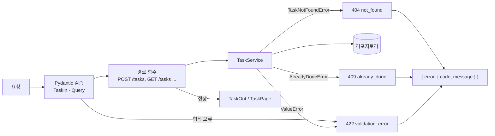

# 17 — REST API 설계 (FastAPI)

## 목표

16단원에서 손으로 쓴 라우팅·검증·오류 번역을 FastAPI 에 맡기고, 대신 **설계**에 집중합니다. 이 단원이 끝나면
`docs/project-api.md` 의 표를 그대로 구현한 API 가 생기고, 커서 페이지네이션과 통일된 오류 봉투(envelope)를 가지며,
OpenAPI 문서가 자동으로 나옵니다. 이후 18~22단원은 전부 이 API 위에 쌓입니다.

## 노트와의 연결

노트는 "**API 선택과 설계**"를 풀스택 기초로 꼽고, 에이전트 시대의 인프라 수요로 "**에이전트는 사람보다 훨씬 많이 호출한다
→ 페이지네이션, 일괄 처리**"를 듭니다. 사람은 할 일 20개를 한 화면에서 보지만, 에이전트는 1만 개를 전부 훑으려 합니다.
그래서 이 단원의 목록 API 는 처음부터 페이지를 나누고, `limit` 상한을 두고, 오류를 기계가 읽을 수 있는 모양으로 돌려줍니다.
노트가 "숙련된 개발자가 설계한 백엔드가 … 여전히 훨씬 낫다"고 할 때의 "설계"가 바로 이런 결정들입니다.

## 공부할 개념

| 개념 | 핵심 | 참고 |
| --- | --- | --- |
| FastAPI 라우팅과 Pydantic 스키마 | 데코레이터로 경로를 선언하면 경로·쿼리·본문을 **타입 힌트대로** 파싱·검증한다. 어기면 422. `response_model` 로 응답 모양을 고정 | [FastAPI 첫걸음](https://fastapi.tiangolo.com/ko/tutorial/first-steps/), [요청 본문](https://fastapi.tiangolo.com/ko/tutorial/body/), [Pydantic 모델](https://docs.pydantic.dev/latest/concepts/models/) |
| 오류 봉투와 예외 핸들러 | 모든 오류를 `{"error": {"code", "message"}}` 한 모양으로. `@app.exception_handler(예외형)` 이 16단원의 `_dispatch` 역할 | [FastAPI 오류 처리](https://fastapi.tiangolo.com/ko/tutorial/handling-errors/) |
| 커서 페이지네이션 | `offset` 은 중간에 삭제가 생기면 건너뛰거나 중복된다. 커서는 "마지막으로 본 것 다음부터"라서 안정적이고, 불투명한 문자열로 주어 내부 구조를 숨긴다 | [FastAPI 쿼리 매개변수](https://fastapi.tiangolo.com/ko/tutorial/query-params/), [MDN: REST 용어](https://developer.mozilla.org/ko/docs/Glossary/REST) |

`TestClient` 는 서버를 띄우지 않고 앱을 직접 호출합니다. `client.post("/tasks", json={...})` 처럼 쓰고 `response.status_code`, `response.json()` 을 읽습니다.
16단원의 스레드·포트·`urllib` 이 전부 사라지는 것을 보세요. [FastAPI 테스트](https://fastapi.tiangolo.com/ko/tutorial/testing/)

OpenAPI 는 "이 API 에 어떤 경로·입력·출력·오류가 있는가"를 기계가 읽는 JSON 으로 적은 것입니다. 앱을 띄우고 `/docs` 를 열면 그 문서가 화면이 됩니다.
43단원에서 에이전트에게 도구를 설명할 때 같은 정보가 다시 필요합니다.



왼쪽에서 오른쪽으로 요청이 흐르고, 어느 단계에서 튕기든 오른쪽 아래의 **같은 봉투**로 모입니다. 16단원과 달라진 것은 검증(Pydantic)과 예외 번역(핸들러)을 프레임워크가 맡는다는 점뿐입니다.

### 준비

```sh
pip install fastapi httpx uvicorn      # httpx 는 TestClient 가 쓴다
pip freeze | grep -i -E "fastapi|httpx|uvicorn" >> requirements.txt   # 00단원의 습관
```

## 과제

`todo/api.py` 의 `TODO` 를 채워 `pytest units/17-rest-api-fastapi` 를 통과시키세요. `todo/schemas.py` 는 완성되어 있습니다. 읽고 쓰기만 하세요.

| 만드는 것 | 규칙 | 테스트 |
| --- | --- | --- |
| `encode_cursor` / `decode_cursor` | `id:<n>` 을 base64 로. 손상되면 `ValueError` | `test_cursor_round_trip`, `test_list_rejects_bad_*` |
| `paginate(tasks, limit, cursor)` | 커서 다음부터 `limit` 개, 남은 것이 있을 때만 `next_cursor` | `test_list_walks_pages_*`, `test_cursor_survives_deletion_*` |
| 예외 핸들러 3개 | 409 `already_done`, 422 `validation_error` (ValueError, RequestValidationError) | `test_create_task_invalid_*`, `test_complete_200_then_409` |
| 엔드포인트 5개 | `docs/project-api.md` 17단원 표 그대로. `limit` 은 1~100 | 나머지 전부 |

다 되면 `uvicorn todo.api:app --reload` 로 띄우고 `http://127.0.0.1:8000/docs` 에서 직접 눌러 보세요. 16단원의 `curl` 명령도 그대로 됩니다.

## 스스로 답해 볼 질문

1. `TaskIn` 의 `min_length=1` 은 `"   "` 를 통과시킵니다. 그래서 공백 제목은 서비스의 `ValueError` 가 잡습니다. 검증을 Pydantic 에 전부 모으는 것과 서비스에 전부 모으는 것, 각각 무엇을 잃나요? (CLI 도 같은 서비스를 쓴다는 점을 떠올리세요)
2. `GET /tasks/abc` 는 404 가 아니라 422 입니다. 호출자 입장에서 404 였다면 무엇을 오해할 수 있었나요?
3. 커서에 `id` 숫자를 그대로 넣지 않고 base64 로 감싸는 이유는 암호화가 아닙니다. 그러면 무엇을 위한 것인가요? 나중에 정렬 기준을 `due` 로 바꾸면 커서에는 무엇이 들어가야 하나요?
4. `limit` 상한이 100 입니다. 에이전트가 할 일 10만 개를 모두 가져가려면 요청이 1,000번입니다. 상한을 없애는 것, `GET /tasks/export` 를 따로 두는 것, 그대로 두는 것 중 무엇을 고르겠습니까? 어떤 비용을 보고 결정하나요?
5. `POST /tasks` 를 같은 본문으로 두 번 보내면 할 일이 두 개 생깁니다. 네트워크가 끊겨 클라이언트가 재시도했다면? → 26단원

## 함정

- `from __future__ import annotations` 가 있어도 FastAPI 는 타입 힌트를 실제로 읽습니다. 경로 함수의 인자 타입을 빼먹으면 검증이 사라집니다.
- `DELETE` 가 204 인데 함수가 `dict` 를 돌려주면 FastAPI 가 본문을 넣으려다 오류를 냅니다. `Response(status_code=204)` 를 돌려주세요.
- 예외 핸들러는 **가장 구체적인 형**이 이깁니다. `AlreadyDoneError` 는 `ValueError` 의 자식이지만 따로 등록하면 409 로 갑니다. 등록을 빼먹으면 422 가 나가 테스트가 "왜 409 가 아니지"로 실패합니다.
- `RequestValidationError` 핸들러를 안 달면 FastAPI 기본 422 본문(`{"detail": [...]}`)이 나갑니다. 봉투가 깨지는 것을 테스트가 잡습니다.
- `Query(ge=1, le=100)` 의 `ge`/`le` 는 "이상/이하"입니다. `gt`/`lt` 와 헷갈리면 `limit=100` 이 거절됩니다.
- `TestClient` 는 기본값으로 서버 쪽 예외를 **테스트로 다시 던집니다**. 500 이 아니라 트레이스백이 보이면 그 때문입니다. 실제 서버라면 500 이었을 것입니다.

## 완료 기준

- [ ] `pytest units/17-rest-api-fastapi` 24개 테스트 전부 통과
- [ ] 테스트 **1개 직접 추가**: `?done=false` 와 커서를 같이 쓸 때 완료된 항목이 커서 계산을 흐트러뜨리지 않는가?
- [ ] `requirements.txt` 에 `fastapi`, `httpx`, `uvicorn` 고정
- [ ] `docs/adr/0009-rest-api-conventions.md`: 오류 봉투 모양, 커서 방식, `limit` 상한을 왜 그렇게 정했는지. 대안(offset, 상한 없음, FastAPI 기본 오류 형식)과 비교
- [ ] `NOTES.md`: 배운 것 3가지 / 헷갈린 것 1가지 / 다음 단원에 바꿀 것, **세 문장 설명**("페이지네이션이 왜 필요한지"를 비개발자에게)
- [ ] **AI 코드 리뷰**: `paginate` 와 예외 핸들러를 리뷰받고 지적 하나 반영, 하나 반박
- [ ] **에이전트에게 작은 과제**: `GET /tasks/search?q=&limit=&cursor=` 추가. 내가 먼저 테스트 3개(정상·빈 q 422·페이지)를 쓰고, 에이전트에게 통과시키게 한 뒤, `/docs` 에서 문서가 맞게 나오는지 **내가** 확인. 경로 순서(`/tasks/search` 가 `/tasks/{task_id}` 보다 앞에 와야 하는 이유)를 에이전트가 설명하는지 보세요
- [ ] 브랜치 `unit-17` → PR → 머지

## 더 깊이

- [FastAPI 의존성](https://fastapi.tiangolo.com/ko/tutorial/dependencies/) `Depends` 를 읽어 두세요. 18단원에서 "현재 사용자"를 이것으로 주입합니다.
- 응답의 `Content-Type` 에 `charset` 이 없는데도 한글이 깨지지 않는 이유는? (JSON 의 기본 인코딩 규칙을 찾아보세요)
- `GET /tasks` 에 `If-None-Match` 를 보내면 지금은 아무 일도 없습니다. 19단원에서 304 를 만듭니다.
