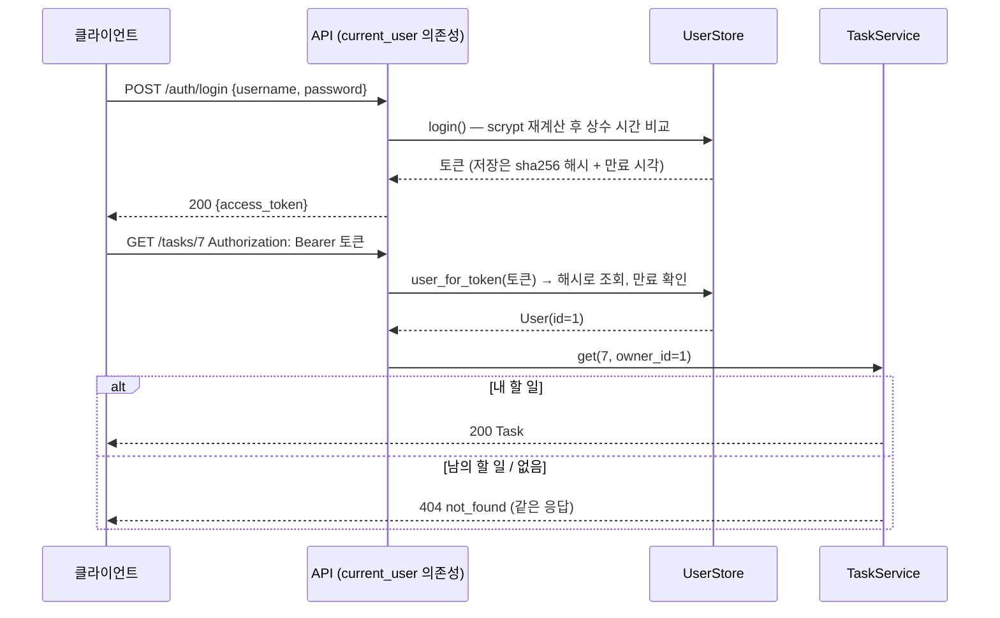

# 18 — 인증과 인가

## 목표

지금까지의 API 는 누구나 모든 할 일을 보고 지울 수 있습니다. 이 단원이 끝나면 사용자가 **가입·로그인**하고,
`Authorization: Bearer <토큰>` 없이는 할 일에 손댈 수 없으며, 각자 **자기 할 일만** 보입니다.
비밀번호는 해시로만 저장되고 토큰도 해시로만 저장됩니다. 외부 라이브러리 없이 표준 라이브러리로 만듭니다.

## 노트와의 연결

노트는 "**상태는 어디에 두고, 인증은 어디서 처리하는가?**"를 초급 아키텍트의 핵심 질문으로 꼽습니다.
이 단원의 답은 구체적입니다. "누구인가"(인증)는 HTTP 경계에서 한 번만 판정하고(`current_user` 의존성),
"무엇을 할 수 있는가"(인가)는 서비스 계층이 `owner_id` 로 판정합니다. 둘을 섞으면 CLI 처럼 HTTP 가 아닌 화면에서
규칙이 사라집니다. 15단원에서 계층을 나눈 이유가 여기서 처음 돈이 됩니다.

## 공부할 개념

| 개념 | 핵심 | 참고 |
| --- | --- | --- |
| 비밀번호 해싱 | 원문을 저장하지 않는다. 느린 해시(`scrypt`) + 사용자마다 다른 salt. 비교는 `hmac.compare_digest` (타이밍 공격 방지) | [hashlib.scrypt](https://docs.python.org/ko/3/library/hashlib.html#hashlib.scrypt), [secrets](https://docs.python.org/ko/3/library/secrets.html), [hmac.compare_digest](https://docs.python.org/ko/3/library/hmac.html#hmac.compare_digest) |
| 토큰과 Bearer 인증 | 로그인 성공 → 무작위 토큰 발급 → 이후 요청은 `Authorization: Bearer` 헤더. 서버는 토큰의 **해시**와 만료 시각만 저장 | [MDN: HTTP 인증](https://developer.mozilla.org/ko/docs/Web/HTTP/Authentication), [FastAPI 의존성](https://fastapi.tiangolo.com/ko/tutorial/dependencies/) |
| 소유권 검사(인가) | 리소스마다 "이 사용자의 것인가". 남의 것은 403 이 아니라 404 로 **존재조차 숨기는** 선택과 그 대가 | [MDN: 401](https://developer.mozilla.org/ko/docs/Web/HTTP/Status/401), [MDN: 403](https://developer.mozilla.org/ko/docs/Web/HTTP/Status/403) |

위 그림에서 **비밀번호는 로그인 때 한 번만** 오가고, 그 뒤로는 토큰만 오갑니다. 토큰 검증(누구인가)은 API 경계에서, 소유권(무엇을 할 수 있는가)은 서비스에서 판정합니다.

### 세션 vs JWT (개념만)

이 단원의 토큰은 **서버가 기억하는 토큰**(불투명 토큰, 세션과 같은 원리)입니다. 서버가 "이 토큰 = 이 사용자"를 저장하므로 즉시 폐기(revoke)할 수 있지만,
서버가 여러 대면 그 저장소를 공유해야 합니다(37단원). **JWT** 는 사용자 정보를 토큰 안에 넣고 서명해서 서버가 아무것도 저장하지 않는 방식입니다.
어느 서버든 서명만 검증하면 되지만, 만료 전에는 폐기할 방법이 없습니다. "상태를 어디에 두는가"의 문제이고, 어느 쪽이 맞는지는 서버 대수와 폐기 요구에 달려 있습니다.
PyJWT 같은 라이브러리는 이 단원에서 쓰지 않습니다. 원리를 모르는 채 라이브러리를 쓰면 `alg: none` 같은 사고를 냅니다.

## 과제

이 단원부터 테스트 **본문**도 여러분이 씁니다(◐). `test_unit18.py` 의 각 docstring 이 명세입니다. 구현과 테스트를 번갈아 채우세요.

| 파일 | 만드는 것 |
| --- | --- |
| `todo/auth.py` | `hash_password` / `verify_password` (scrypt, `scrypt$salt$hash` 형식), `new_token` / `hash_token`, `UserStore.register/login/user_for_token/revoke` |
| `todo/service.py` | `_owned`, `_visible` — 모든 메서드가 이미 이 둘을 부르고 있다 |
| `todo/api.py` | `bearer_token`, `current_user`, `POST /auth/register` (201 / 409 `username_taken` / 422), `POST /auth/login` (200 / 401), 할 일 경로 5개에 `user: User = Depends(current_user)` 를 받아 `owner_id=user.id` 로 호출 |
| `test_unit18.py` | 15개 테스트 본문 |

`Task.owner_id`, 마이그레이션 `004_add_owner.sql`, 리포지토리 세 구현의 `owner_id` 전달, `schemas.py` 의 `Credentials/UserOut/TokenOut`, `AuthError → 401` 핸들러는 완성되어 있습니다. 읽고 지나가세요.

## 스스로 답해 볼 질문

1. sha256 한 번은 비밀번호 해싱에 왜 부족한가요? 토큰에는 왜 충분한가요? (공격자가 1초에 몇 번 시도할 수 있는지, 입력의 엔트로피가 얼마인지로 답해 보세요)
2. 남의 할 일에 403 대신 404 를 돌려주면 공격자는 무엇을 알 수 없게 되나요? 대신 정직한 사용자가 잃는 것은? 은행 API 라면? 사내 위키라면?
3. 로그인 실패 메시지를 "사용자가 없습니다"와 "비밀번호가 틀립니다"로 나누면 무엇이 새나요?
4. `UserStore` 는 메모리에 있어 재시작하면 모두 로그아웃됩니다. 토큰을 SQLite 로 옮기면 무엇이 좋아지고 무엇이 생기나요(테이블, 만료 청소, 인덱스)? 서버가 2대면?
5. 할 일 목록은 `repo.all()` 을 받아 서비스가 `owner_id` 로 거릅니다. 사용자 1만 명 × 할 일 100개면 요청마다 100만 건을 훑습니다. 어디를 고쳐야 하나요? 15단원 질문 5와 같은 질문입니다.

## 함정

- `verify_password` 에서 `==` 로 비교하지 마세요. 테스트는 못 잡지만 `hmac.compare_digest` 를 쓰는 습관이 전부입니다.
- `secrets` 대신 `random` 으로 토큰을 만들면 예측 가능합니다. `random` 은 시뮬레이션용, `secrets` 가 보안용입니다.
- `Authorization` 헤더를 `Header()` 로 받을 때 FastAPI 는 밑줄·대소문자를 알아서 맞춥니다. 직접 `request.headers["authorization"]` 을 읽을 필요가 없습니다.
- `current_user` 를 `create_app` **안에** 정의하는 이유는 `users` 를 닫아 넣기 위해서입니다. 모듈 수준 전역 `UserStore` 를 만들면 테스트끼리 사용자가 섞입니다.
- 응답 모델에 `password_hash` 가 들어가지 않도록 `UserOut` 을 따로 둡니다. `response_model` 이 없는 경로에서 `User` 를 그대로 돌려주면 해시가 나갑니다.
- 만료 비교는 주입된 `clock` 으로. `datetime.now()` 를 쓰면 `test_token_expires_after_ttl` 을 쓸 방법이 없습니다.

## 완료 기준

- [ ] `pytest units/18-auth` 15개 테스트 함수(파라미터 포함 18개 항목) 전부 통과, `pytest.fail` 이 하나도 남지 않음
- [ ] 17단원의 테스트 `test_unit17.py` 를 이 폴더에 복사해 돌려 보고, **왜** 실패하는지 NOTES.md 에 한 줄 (힌트: 401). 그중 2개를 토큰을 넣어 통과하게 고치기
- [ ] `docs/adr/0010-auth-tokens-and-ownership.md`: 불투명 토큰 vs JWT, 404 vs 403, 토큰 저장 위치(메모리)를 각각 왜 골랐고 언제 다시 볼지
- [ ] `NOTES.md`: 배운 것 3가지 / 헷갈린 것 1가지 / 다음 단원에 바꿀 것, **세 문장 설명**("비밀번호를 왜 그대로 저장하지 않는지")
- [ ] **AI 코드 리뷰**: `auth.py` 를 리뷰받되 "보안 관점에서만" 요청하고, 지적 하나 반영, 하나 반박(근거는 공식 문서 링크로)
- [ ] **에이전트에게 작은 과제**: `POST /auth/logout` (토큰 폐기, 204) 추가. 스펙에 "폐기 후 같은 토큰은 401" 을 적고, 테스트를 내가 먼저 쓰고, 에이전트가 `auth.py` 의 해싱 코드를 건드리면 되돌리게 하세요
- [ ] 브랜치 `unit-18` → PR → 머지

## 더 깊이

- `SCRYPT_PARAMS["n"]` 을 `2**16`, `2**18` 로 올리고 `hash_password` 한 번의 시간을 `perf_counter` 로 재 보세요. 로그인 1초가 사용자에게는 긴가요, 공격자에게는 긴가요?
- 권한 모델: 지금은 "주인만"입니다. "읽기 공유", "관리자" 가 생기면 `_owned` 는 어떻게 바뀌어야 하나요? 역할(role) 기반과 속성(attribute) 기반 접근 제어를 찾아보세요.
- [OWASP Password Storage Cheat Sheet](https://cheatsheetseries.owasp.org/cheatsheets/Password_Storage_Cheat_Sheet.html) 에서 scrypt 권장 파라미터를 확인하고 이 단원의 값과 비교하세요.
