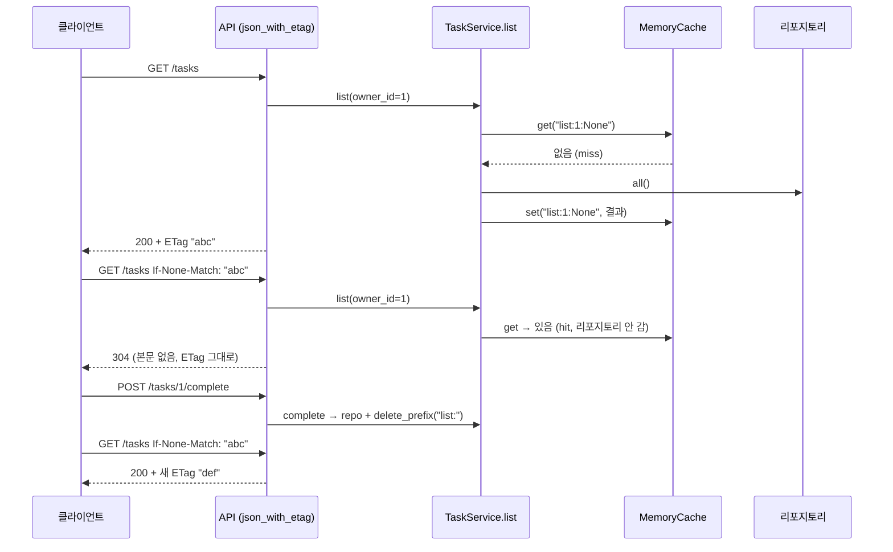

# 19 — 캐싱

## 목표

같은 질문에 같은 답을 다시 계산하지 않는 장치를 **세 층**에 넣습니다. 함수 한 개(`lru_cache`), 서비스 계층(목록 캐시와 무효화),
HTTP(`ETag` / `If-None-Match` → 304). 이 단원이 끝나면 "무엇을 캐시하고, 언제 버리고, 얼마나 옛 값을 참을 것인가"를
숫자(적중률)와 함께 말할 수 있습니다.

## 노트와의 연결

노트는 "**무엇을 캐시하는가?**"를 아키텍트의 질문으로 꼽고, 데이터 영역에서는 "**정합성·최신성**"을, 에이전트용 인프라에서는
"**에이전트는 사람보다 훨씬 많이 호출한다**"를 말합니다. 셋은 하나의 문제입니다. 에이전트가 1초에 100번 `GET /tasks` 를 부르면
캐시 없이는 버티기 어렵고, 캐시가 있으면 방금 완료한 할 일이 아직 "미완료"로 보일 수 있습니다. 이 단원은 그 둘 사이에서 **어디에 서는지를 결정**하는 연습입니다.

## 공부할 개념

| 개념 | 핵심 | 참고 |
| --- | --- | --- |
| `functools.lru_cache` 와 메모이제이션 | 순수 함수(같은 입력 → 같은 출력, 부작용 없음)의 결과를 인자 기준으로 기억. 인자는 해시 가능해야 한다 | [functools.lru_cache](https://docs.python.org/ko/3/library/functools.html#functools.lru_cache) |
| 앱 내 캐시와 무효화(invalidation) | 키 설계(`list:<owner>:<done>`), 적중/실패 세기, 크기 제한(LRU), **쓰기가 일어나면 버리기**. 캐시는 동작을 바꾸지 않고 속도만 바꿔야 한다 | [collections.OrderedDict](https://docs.python.org/ko/3/library/collections.html#collections.OrderedDict) |
| HTTP 캐시: `ETag`, `If-None-Match`, 304, `Cache-Control` | 서버가 본문의 지문(ETag)을 주고, 클라이언트가 다음에 그 지문을 보내면 서버는 "안 바뀜"(304, 본문 없음)만 답한다. 대역폭과 직렬화 비용을 아낀다 | [MDN: HTTP 캐싱](https://developer.mozilla.org/ko/docs/Web/HTTP/Caching), [MDN: ETag](https://developer.mozilla.org/ko/docs/Web/HTTP/Headers/ETag), [MDN: Cache-Control](https://developer.mozilla.org/ko/docs/Web/HTTP/Headers/Cache-Control) |

두 캐시가 **따로** 돕니다. 서비스 캐시는 리포지토리 호출을 아끼고(서버 안), ETag 는 본문 전송을 아낍니다(서버와 클라이언트 사이). 쓰기 한 번이 둘 다 무효화하는 것을 확인하세요.

### 정합성(consistency) vs 최신성(freshness)

이 단원의 서비스 캐시는 **쓰기 즉시 무효화**하므로 한 프로세스 안에서는 항상 최신입니다. 그 대신 쓰기가 잦으면 적중률이 떨어집니다.
반대편 극단은 TTL(13단원의 `cache_kv`): "30초까지는 옛 값이어도 좋다"고 **선언**하는 것입니다. 어느 쪽이 맞는지는 기능마다 다릅니다.
할 일 개수 배지는 30초 늦어도 되지만, "완료" 버튼을 누른 직후 목록에서 사라지지 않으면 사용자는 버그라고 느낍니다.

## 과제

| 파일 | 만드는 것 |
| --- | --- |
| `todo/cache.py` | `MemoryCache.get` (적중/실패 세기, LRU 갱신), `set` (크기 초과 시 가장 오래 안 쓴 것 내보내기), `delete_prefix` |
| `todo/service.py` | `_invalidate` (목록 캐시 비우기), `list` 의 캐시 조회·저장. `add/complete/remove` 는 이미 `_invalidate` 를 부른다 |
| `todo/api.py` | `make_etag`, `json_with_etag` (`ETag`, `Cache-Control: no-cache`, `If-None-Match` 일치 시 304). `GET /tasks`, `GET /tasks/{id}` 는 이미 이 함수를 쓴다 |
| `test_unit19.py` | 15개 테스트 본문. `lru_cache` 테스트 2개는 구현 없이 바로 쓸 수 있다 |

실험 하나(코드 제출 없음, NOTES.md 에 숫자): `JsonTaskRepository` 로 `TaskService` 를 만들고 `list()` 를 1,000번 부르는 시간을 `perf_counter` 로 잽니다.
캐시 없이 / 캐시 있고 읽기만 / 캐시 있고 10번에 1번 `add`. 세 숫자와 `cache.stats()` 를 적으세요. 10단원의 측정표 형식 그대로.

## 스스로 답해 볼 질문

1. `lru_cache` 를 `TaskService.list` 메서드에 바로 붙이면 안 되는 이유가 둘 있습니다. (힌트: `self` 가 인자라는 점, 그리고 무효화)
2. 쓰기마다 목록 캐시를 **전부** 비웁니다. owner 1 이 할 일을 추가했는데 owner 2 의 캐시까지 버리는 것은 낭비입니다. 키를 `owner_id` 별로 지우려면 `_invalidate` 가 무엇을 알아야 하나요? 그 세분화는 언제 할 가치가 있나요?
3. ETag 는 본문의 해시라서 **본문을 만들어야** 304 를 줄 수 있습니다. 즉 직렬화 비용은 그대로이고 전송만 아낍니다. 직렬화도 아끼려면 ETag 를 어디서 만들어야 하나요? (힌트: 11단원의 `version` 열, 마지막 수정 시각)
4. `Cache-Control: no-cache` 대신 `max-age=30` 을 주면 브라우저는 30초 동안 서버에 묻지 않습니다. 할 일 목록에 그래도 되나요? `/health` 는요?
5. 서버가 2대가 되면 `MemoryCache` 는 서로 모릅니다. 1번 서버에서 완료한 할 일이 2번 서버 캐시에는 미완료로 남습니다. 해결책 세 가지와 각각의 비용은? → 37단원

## 함정

- `cache.get(key)` 가 `None` 을 돌려줄 때 "없음"과 "값이 None" 을 구분 못 합니다. 이 단원에선 리스트만 넣으니 괜찮지만, `_MISSING` 센티널이 있는 이유를 알아 두세요.
- 캐시에 넣은 리스트를 그대로 돌려주면 호출자가 `.append` 한 것이 다음 호출자에게 보입니다. 넣을 때도 꺼낼 때도 `list(...)` 로 복사하세요.
- `OrderedDict.move_to_end` 를 `get` 에서 빼먹으면 LRU 가 아니라 FIFO 입니다. `test_cache_evicts_least_recently_used` 가 그 차이를 잡습니다.
- 304 응답에 본문을 넣으면 안 됩니다. 또 `ETag` 헤더는 304 에도 **있어야** 클라이언트가 자기 캐시를 갱신합니다.
- `If-None-Match` 비교는 따옴표까지 포함한 문자열 비교입니다. 따옴표를 빼고 만들면 `curl` 로는 되는데 브라우저에서 안 됩니다.
- `json_with_etag` 가 `Response` 를 직접 돌려주므로 `response_model` 검증을 건너뜁니다. 모양은 OpenAPI 문서용으로만 남습니다.

## 완료 기준

- [ ] `pytest units/19-caching` 15개 테스트 전부 통과
- [ ] 측정 실험 세 숫자 + `stats()` 를 `NOTES.md` 에 표로
- [ ] `docs/adr/0011-caching-strategy.md`: 무엇을 캐시하고(목록만) 무엇을 안 하는지(단건 조회, 인증), 무효화 방식(쓰기 즉시·전부), ETag 를 본문 해시로 한 이유. "다시 볼 신호"에 적중률 기준을 숫자로
- [ ] `NOTES.md`: 배운 것 3가지 / 헷갈린 것 1가지 / 다음 단원에 바꿀 것, **세 문장 설명**("304 가 왜 빠른지")
- [ ] **AI 코드 리뷰**: `MemoryCache` 를 리뷰받고 "스레드 안전한가"를 꼭 물어보기. 지적 하나 반영, 하나 반박
- [ ] **에이전트에게 작은 과제**: `MemoryCache` 에 TTL(초) 옵션 추가 — `set(key, value, ttl=None)`, 만료된 키는 `get` 에서 miss. 시간은 생성자의 `clock` 으로 주입하라는 조건을 스펙에 넣고, 에이전트가 `time.time()` 을 직접 부르면 되돌리게 하세요. 테스트는 내가 먼저
- [ ] 브랜치 `unit-19` → PR → 머지

## 더 깊이

- 약한 ETag `W/"..."` 와 강한 ETag 의 차이를 MDN 에서 읽어 보세요. 본문 해시는 어느 쪽인가요?
- `If-Match` 헤더로 "내가 본 버전일 때만 수정" 을 구현하면 11단원의 낙관적 잠금이 HTTP 로 올라옵니다. `POST /tasks/{id}/complete` 에 붙여 보세요(412 Precondition Failed).
- 캐시 스탬피드(cache stampede): 캐시가 비는 순간 1,000개의 요청이 동시에 리포지토리로 몰리는 현상. 어떻게 막을까요?
