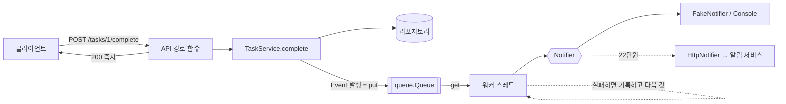

# 20 — 비동기와 백그라운드 작업

## 목표

"할 일을 완료하면 알림을 보낸다"를 추가하되, **알림이 느리거나 실패해도 완료 요청은 느려지거나 실패하지 않게** 만듭니다.
그 과정에서 `asyncio` 가 언제 도움이 되고 언제 아닌지를 숫자로 확인하고, 요청 처리와 뒷일을 큐와 워커로 분리합니다.
이 단원이 끝나면 "동기로 할지, 비동기로 할지, 뒤로 미룰지"를 기준을 가지고 고를 수 있습니다.

## 노트와의 연결

노트는 풀스택 기초에 "**비동기 처리**"를 넣고, "에이전트는 사람보다 훨씬 많이 호출한다 → … 일괄 처리"를 말합니다.
요청 하나가 끝나기 전에 바깥세상(메일 서버, 다른 서비스)을 기다리면, 호출이 많아질수록 그 기다림이 서버를 잡아먹습니다.
비동기는 그 기다림을 **겹치게** 하고, 큐는 그 기다림을 **요청 밖으로** 옮깁니다. 22단원에서 알림을 별도 서비스로 떼어낼 때
이 단원의 큐가 그 경계가 됩니다.

## 공부할 개념

| 개념 | 핵심 | 참고 |
| --- | --- | --- |
| `asyncio` 기초 | `async def` 는 코루틴, `await` 는 "기다리는 동안 양보". `asyncio.gather` 로 여러 기다림을 겹친다. **기다림(I/O)이 있을 때만** 빨라지고, `time.sleep` 이나 CPU 계산은 루프를 멈춘다 | [asyncio 코루틴과 태스크](https://docs.python.org/ko/3/library/asyncio-task.html) |
| 큐와 워커(스레드) | 생산자는 `queue.put` 하고 바로 돌아간다. 소비자 스레드가 `queue.get` 으로 자기 속도로 처리한다. `task_done`/`join` 으로 "다 끝났는지"를 안다. 센티널로 멈춘다 | [queue — 스레드 안전 큐](https://docs.python.org/ko/3/library/queue.html), [threading](https://docs.python.org/ko/3/library/threading.html) |
| 동기 vs 비동기 엔드포인트 | FastAPI 에서 `def` 경로는 스레드풀에서, `async def` 경로는 이벤트 루프에서 돈다. 동기 라이브러리(sqlite3)를 부르는 경로를 `async def` 로 쓰면 **서버 전체가 멈춘다** | [FastAPI: async 와 await](https://fastapi.tiangolo.com/ko/async/) |

왼쪽 흐름(요청 → 응답)과 오른쪽 흐름(큐 → 워커 → 발송)은 **다른 스레드**에서 **다른 속도**로 돕니다. 둘을 잇는 것은 큐 하나이고, 서비스는 큐 너머에 무엇이 있는지 모릅니다.

### 세 가지 선택지

| 상황 | 선택 | 이 단원의 예 |
| --- | --- | --- |
| 응답에 결과가 **필요**하고 빠르다 | 동기로 그냥 한다 | `service.get` |
| 응답에 결과가 필요한데 바깥을 여러 번 기다린다 | `async` + `gather` 로 겹친다 | `run_concurrent` (46단원 RAG 에서 다시) |
| 응답에 결과가 **필요 없다** | 큐에 넣고 워커에게 넘긴다 | 알림 발송 |

## 과제

| 파일 | 만드는 것 |
| --- | --- |
| `todo/async_demo.py` | `run_sequential` (차례로 `await`), `run_concurrent` (`asyncio.gather`). `python -m todo.async_demo` 로 세 숫자 보기 |
| `todo/worker.py` | `publish`, `_run` (센티널 처리, `task_done`), `_handle` (실패해도 루프 유지, `processed`/`failed` 세기), `stop(drain)` |
| `todo/service.py` | `complete` 끝에 `Event("task.completed", ...)` 발행 |
| `todo/api.py` | `/health` 를 `async def` 로 |
| `test_unit20.py` | 12개 테스트 본문 |

`events.py`(Event), `notifier.py`(Protocol, FakeNotifier, ConsoleNotifier), `worker.join`, `format_message` 는 완성되어 있습니다.

## 스스로 답해 볼 질문

1. `run_concurrent_but_blocking` 이 빨라지지 않는 이유를 "이벤트 루프는 스레드 하나"라는 문장으로 설명해 보세요. 그러면 CPU 계산이 많은 일은 어떻게 겹치나요? (`asyncio.to_thread`, 프로세스)
2. `complete()` 가 이벤트를 발행한 **직후** 프로세스가 죽으면 알림은 어떻게 되나요? 큐가 메모리에 있다는 것의 뜻입니다. 잃으면 안 되는 알림이라면 큐를 어디에 두어야 하나요? (힌트: 11단원 트랜잭션, "outbox" 패턴)
3. 워커가 실패한 이벤트를 그냥 버립니다. 재시도하면 무엇이 좋아지고 무엇이 위험한가요(같은 알림 두 번)? → 25·26단원
4. 알림 발송을 `async def` 경로 안에서 `await notifier.send()` 로 하는 설계와 큐 설계를 비교하세요. 알림 서버가 10초 동안 응답하지 않을 때 사용자가 보는 것은 각각 무엇인가요?
5. 워커 스레드가 1개입니다. 초당 완료가 1,000건이고 발송이 건당 0.1초면 큐는 어떻게 되나요? 워커를 늘리면 순서는 보장되나요?

## 함정

- `async def` 함수를 `await` 없이 부르면 **아무것도 실행되지 않고** 코루틴 객체만 생깁니다. "RuntimeWarning: coroutine was never awaited" 가 그 신호입니다.
- `asyncio.run()` 은 이미 루프가 도는 곳(pytest-asyncio, Jupyter)에서는 못 씁니다. 이 단원의 테스트는 `timed()` 가 `asyncio.run` 을 부르는 동기 테스트라 괜찮습니다.
- `_run` 에서 `task_done()` 을 `_STOP` 에도 불러야 `join()` 이 영원히 기다리지 않습니다. `finally` 에 두세요.
- 워커의 `except Exception` 은 보통은 나쁜 습관이지만, 여기서는 **루프를 지키는 것**이 목적입니다. 반드시 `log.exception` 으로 흔적을 남기세요.
- 테스트에서 워커를 `start` 하고 `stop` 을 안 하면 데몬 스레드가 남습니다. 픽스처의 `yield` 뒤에서 정리하세요.
- `daemon=True` 스레드는 프로세스가 끝나면 **큐에 남은 것과 함께** 사라집니다. 운영에서는 종료 시 `stop(drain=True)` 를 반드시 부르세요(35단원의 종료 신호 처리).

## 완료 기준

- [ ] `pytest units/20-async-and-background-jobs` 12개 테스트 전부 통과
- [ ] `python -m todo.async_demo` 의 세 숫자를 `NOTES.md` 에 적고, 각 숫자가 왜 그런지 한 줄씩
- [ ] `docs/adr/0012-background-notifications.md`: 알림을 요청 안에서 보내지 않고 큐로 넘긴 이유, 메모리 큐의 한계(유실), 재시도를 아직 안 하는 이유와 다시 볼 신호
- [ ] `NOTES.md`: 배운 것 3가지 / 헷갈린 것 1가지 / 다음 단원에 바꿀 것, **세 문장 설명**("비동기가 왜 항상 빠른 건 아닌지")
- [ ] **AI 코드 리뷰**: `worker.py` 를 리뷰받고 "종료 시 유실"과 "예외 처리 범위"에 대한 지적을 받아 하나 반영, 하나 반박
- [ ] **에이전트에게 작은 과제**: `GET /notifications/stats` → `{"queued": 큐 길이, "processed": n, "failed": n}` 추가. `create_app` 에 워커를 선택 인자로 넘기는 방법을 스펙에 적고(없으면 모두 0), 테스트는 내가 먼저. 에이전트가 전역 변수로 워커를 두려 하면 왜 안 되는지 설명하게 하세요
- [ ] 브랜치 `unit-20` → PR → 머지

## 더 깊이

- 워커를 스레드 대신 `asyncio.Queue` + `asyncio.create_task` 로 다시 써 보세요. 서비스가 동기인데 워커만 비동기면 어디서 만나야 하나요?
- FastAPI 의 `BackgroundTasks` 는 "응답 보낸 뒤 같은 프로세스에서 실행"입니다. 이 단원의 큐와 무엇이 같고 무엇이 다른가요?
- 운영에서는 Redis/RabbitMQ 같은 외부 큐를 씁니다. 이 단원의 `NotificationWorker` 인터페이스(`publish`, `start`, `stop`)를 그대로 두고 안만 바꿀 수 있나요? 그것이 15단원이 준 자유입니다.
