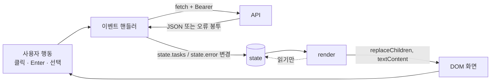

# 21 — 프런트엔드 기초

## 목표

API 를 사람이 쓸 수 있는 **화면**으로 만듭니다. 빌드 도구도 프레임워크도 없이 HTML 파일 하나와 자바스크립트 파일 하나로,
`fetch` 로 API 를 부르고, "상태(state) → 그리기(render)" 규칙으로 화면을 유지하며, 키보드와 화면 낭독기로도 쓸 수 있게 만듭니다.
브라우저가 다른 출처의 API 를 부르려면 서버가 허락해야 한다는 것(CORS)도 서버 쪽에서 직접 엽니다.

## 노트와의 연결

노트는 풀스택 기초로 "**UI 컴포넌트·렌더링·접근성**"을 꼽고, "**에이전트가 빨라지게 해 주는 정도는 프런트엔드, 백엔드, 인프라 순으로 작아진다**"고 합니다.
즉 프런트엔드는 에이전트가 가장 잘 만들어 주는 영역입니다. 그래서 이 단원의 목표는 화려한 화면이 아니라 **에이전트가 만든 화면을 검토할 수 있는 눈**입니다.
"state 를 바꾸고 render 하는가, DOM 을 직접 만지는가", "라벨이 있는가", "`innerHTML` 에 사용자 입력을 넣는가" — 이 셋을 볼 줄 알면 에이전트의 결과물을 판단할 수 있습니다.
또 노트의 "프런트엔드/백엔드 경계" 질문에 이 단원은 구체적으로 답합니다. 규칙은 서비스에, 화면은 보여 주기만.

## 공부할 개념

| 개념 | 핵심 | 참고 |
| --- | --- | --- |
| HTML 폼과 `fetch` | `<form>` 의 `submit` 이벤트(Enter 키 포함), `preventDefault`, `fetch(url, {method, headers, body})`, `await response.json()`. 응답의 오류 봉투를 예외로 바꾸는 작은 래퍼 | [MDN: fetch 사용하기](https://developer.mozilla.org/ko/docs/Web/API/Fetch_API/Using_Fetch), [MDN: 폼](https://developer.mozilla.org/ko/docs/Learn/Forms) |
| 상태와 렌더링 | `state` 객체 하나가 진실. 사용자 행동 → API → `state` 변경 → `render()` 가 DOM 을 다시 그림. `render` 는 `state` 를 읽기만 한다. 이 규칙이 React 같은 프레임워크의 핵심이기도 하다 | [MDN: DOM 소개](https://developer.mozilla.org/ko/docs/Web/API/Document_Object_Model/Introduction) |
| 접근성(accessibility)과 CORS | `<label for>`, `button type`, `aria-live`, 포커스 표시, 키보드만으로 전 기능. CORS 는 "다른 출처의 화면이 내 API 를 불러도 되는가"를 **서버가** 헤더로 답하는 규칙 | [MDN: 접근성 HTML](https://developer.mozilla.org/ko/docs/Learn/Accessibility/HTML), [MDN: CORS](https://developer.mozilla.org/ko/docs/Web/HTTP/CORS), [FastAPI CORS](https://fastapi.tiangolo.com/ko/tutorial/cors/) |



한 바퀴가 한 번의 사용자 행동입니다. DOM 은 오직 `render` 만 만지고, `render` 는 오직 `state` 만 읽습니다. 이 두 화살표를 어기는 코드(핸들러가 DOM 을 직접 고치기, `render` 가 API 를 부르기)가 버그의 대부분입니다.

### 실행 방법

```sh
uvicorn todo.api:app --reload                 # 터미널 1: API (출처 http://127.0.0.1:8000)
python -m http.server 5500 -d web             # 터미널 2: 화면 (출처 http://127.0.0.1:5500)
```

브라우저에서 `http://127.0.0.1:5500` 을 엽니다. 두 출처가 다르므로 CORS 를 열지 않으면 콘솔에 "blocked by CORS policy" 가 뜹니다. **그 오류를 먼저 보고** 나서 고치세요.
개발자 도구(F12)의 **Network** 탭에서 `OPTIONS` 사전 요청(preflight)과 `Authorization` 헤더를 눈으로 확인하세요. 16단원의 `curl -v` 와 같은 것을 브라우저가 보여 줍니다.

## 과제

| 파일 | 만드는 것 |
| --- | --- |
| `todo/api.py` | `create_app(..., cors_origins)` 에 `CORSMiddleware` (출처 목록, 메서드, 헤더, `ETag` 노출) |
| `web/index.html` | 입력마다 `<label for>`, 버튼마다 `type`, 상태 영역 `role="status" aria-live="polite"`, 목록 `aria-label` |
| `web/app.js` | `render()` 의 항목 그리기(제목은 `textContent`, 완료·삭제 버튼과 `aria-label`), 추가 폼 핸들러 |
| `test_unit21.py` | 12개 테스트 본문 |

`api()`(fetch 래퍼), `withErrors()`(오류 → state → render), 로그인·가입·필터·로그아웃 핸들러는 완성되어 있습니다. 읽고 같은 방식으로 쓰세요.

### 손으로 하는 점검 (자동 테스트가 못 하는 것)

- [ ] 마우스를 치우고 **Tab, Enter, Space 만으로** 가입 → 로그인 → 추가 → 완료 → 삭제 → 로그아웃
- [ ] 포커스가 어디 있는지 항상 보이는가 (파란 테두리)
- [ ] 제목에 `<b>굵게</b>` 를 넣어 추가하면 글자 그대로 보이는가 (굵게 보이면 `innerHTML` 을 쓴 것)
- [ ] 틀린 비밀번호로 로그인하면 오류 문구가 보이고, 맞게 다시 하면 문구가 사라지는가
- [ ] API 서버를 끄고 "추가"를 누르면 무슨 일이 생기는가. 사용자는 무엇을 보는가
- [ ] 브라우저 확대 200% 에서도 쓸 수 있는가

## 스스로 답해 볼 질문

1. CORS 는 서버를 보호하나요, 사용자를 보호하나요? `curl` 은 CORS 와 상관없이 호출됩니다. 그러면 무엇을 막는 건가요? (힌트: 로그인된 브라우저, 다른 사이트의 스크립트)
2. `render()` 가 목록을 매번 전부 지우고 다시 그립니다. 할 일 10개일 때와 1만 개일 때 무엇이 다른가요? React 가 "차이만 반영"하는 이유가 여기 있습니다. 그런데 1만 개를 한 화면에 그리는 것이 맞나요? (17단원의 페이지네이션)
3. 완료 버튼을 누르면 `POST` 후 목록을 **다시 받아** 그립니다. 응답 없이 `state.tasks` 의 그 항목만 `done=true` 로 바꾸는 방법(낙관적 갱신)과 비교하세요. 서버가 409 를 주면?
4. 토큰을 `localStorage` 에 두면 새로고침해도 로그인이 유지되지만, 같은 출처의 어떤 스크립트든 읽을 수 있습니다. 대안(`HttpOnly` 쿠키)은 무엇을 해결하고 무엇을 새로 만드나요(CSRF)?
5. 프런트엔드/백엔드 경계: "빈 제목 금지"가 HTML 의 `required` 에도 있고 서비스에도 있습니다. 하나를 지운다면 어느 쪽인가요? 왜 둘 다 있나요?

## 함정

- `<button>` 의 기본 `type` 은 `submit` 입니다. 폼 안의 "가입" 버튼에 `type="button"` 을 안 주면 로그인 폼이 함께 전송됩니다.
- `placeholder` 는 라벨이 아닙니다. 입력을 시작하면 사라지고, 낭독기 지원도 들쑥날쑥합니다.
- `fetch` 는 404·500 에도 **예외를 던지지 않습니다**. `response.ok` 를 직접 봐야 합니다. `api()` 래퍼가 그 일을 합니다.
- CORS 오류는 서버 로그에 안 남습니다. 서버는 정상 응답했고 **브라우저가** 자바스크립트에 안 넘긴 것이기 때문입니다. 브라우저 콘솔을 보세요.
- `allow_origins=["*"]` 와 `Authorization` 헤더는 함께 쓸 수 없습니다. 브라우저가 거부합니다. 출처를 나열하세요.
- `python -m http.server` 로 연 화면의 출처는 `http://127.0.0.1:5500` 이지 `http://localhost:5500` 이 아닙니다(다른 출처입니다). 둘 다 허용하거나 하나로 통일하세요.
- 사용자 이름에 `` 를 넣어 가입해 보세요. `textContent` 를 썼다면 아무 일도 없어야 합니다.

## 완료 기준

- [ ] `pytest units/21-frontend-basics` 12개 테스트 전부 통과
- [ ] 손 점검 6개 항목 결과를 `NOTES.md` 에 (안 되는 것은 왜 안 되는지)
- [ ] 다른 사람 1명에게 화면을 써 보게 하고 "가장 불편한 점" 한 줄 (3단계 끝의 "사용자에게 보여 주기" 의식을 미리)
- [ ] `NOTES.md`: 배운 것 3가지 / 헷갈린 것 1가지 / 다음 단원에 바꿀 것, **세 문장 설명**("CORS 가 무엇을 막는지")
- [ ] **AI 코드 리뷰**: `app.js` 를 리뷰받되 "접근성과 XSS 관점에서만" 요청. 지적 하나 반영, 하나 반박
- [ ] **에이전트에게 작은 과제**: "더 보기" 버튼으로 `next_cursor` 페이지 이어 받기. 스펙에 "render 는 state 만 읽는다", "`innerHTML` 금지", "키보드로 동작" 세 조건을 넣고, 결과를 **손 점검 목록으로** 검토하세요. 이 단원은 에이전트가 가장 잘하는 영역이니 지시의 질이 결과의 질입니다
- [ ] 브랜치 `unit-21` → PR → 머지 (ADR 은 선택: 토큰 저장 위치를 결정했다면 기록)

## 더 깊이

- `render()` 를 "전부 다시 그리기"에서 "바뀐 `<li>` 만 갱신"으로 바꿔 보고, 코드가 얼마나 복잡해지는지 느껴 보세요. 그 복잡함을 대신 져 주는 것이 프레임워크입니다.
- 19단원의 `ETag` 를 화면에서 써 보세요. `If-None-Match` 를 보내고 304 면 `state.tasks` 를 그대로 둡니다. `expose_headers` 가 왜 필요했는지 알게 됩니다.
- [MDN: ARIA](https://developer.mozilla.org/ko/docs/Web/Accessibility/ARIA) 의 첫 규칙: "쓸 수 있으면 ARIA 대신 시맨틱 HTML 을 써라". 이 단원에서 ARIA 없이도 되는 부분을 찾아보세요.
