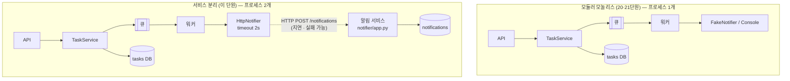

# 22 — 시스템 분해

## 목표

20단원에서 큐 뒤로 보낸 "알림"을 **별도 프로세스의 별도 서비스**(`notifier/`)로 떼어내고, 할 일 서비스가 HTTP 로 그것을 부르게 합니다.
그 과정에서 분산이 공짜가 아니라는 것(지연, 부분 실패, 타임아웃, 두 벌의 배포)을 숫자와 테스트로 확인하고,
**언제 나누지 말아야 하는지**를 말할 수 있게 됩니다. 이 단원의 결론은 "나누는 법"이 아니라 "나누는 기준"입니다.

## 노트와의 연결

노트는 아키텍트의 질문으로 "**시스템 분해와 상태의 위치, 모놀리스부터 마이크로서비스까지의 단위**"를 꼽고,
"**아키텍처는 정답이 하나가 아니라 단계마다 바뀐다. 프로토타입에 맞는 구조가 첫 운영 시스템에는 맞지 않을 수 있다**"고 합니다.
15단원의 계층 분리(한 프로세스 안의 경계)와 이 단원의 서비스 분리(프로세스 사이의 경계)는 같은 질문의 두 답입니다.
경계를 어디에 긋는가는 같고, 경계를 **얼마나 비싸게** 긋는가가 다릅니다. 23단원에서 단계별로 그 선택을 ADR 로 적습니다.

## 공부할 개념

| 개념 | 핵심 | 참고 |
| --- | --- | --- |
| 모놀리스 → 모듈러 모놀리스 → 서비스 분리 | 한 프로세스·한 배포(모놀리스), 한 프로세스 안의 분명한 모듈 경계(모듈러 모놀리스, 15·20단원이 만든 것), 프로세스를 나눔(서비스). 오른쪽으로 갈수록 독립 배포·확장은 얻고 단순함·일관성은 잃는다 | [Martin Fowler, MonolithFirst](https://martinfowler.com/bliki/MonolithFirst.html), [Microservices](https://martinfowler.com/articles/microservices.html) |
| 서비스 간 통신과 데이터 소유권 | 서비스는 **자기 데이터만** 가진다. 다른 서비스의 데이터는 API 로만 본다. 같은 DB 를 둘이 보면 나눈 것이 아니다 | [Microservices: Decentralized Data Management](https://martinfowler.com/articles/microservices.html#DecentralizedDataManagement) |
| 분산의 비용 | 함수 호출 1µs 가 HTTP 호출 1ms 가 되고, 상대가 죽어 있을 수 있고(부분 실패), 타임아웃 없이는 내 쪽도 같이 멈춘다. 배포·로그·테스트가 두 벌 | [Fallacies of distributed computing (위키백과)](https://ko.wikipedia.org/wiki/분산_컴퓨팅의_오류), [httpx 타임아웃](https://www.python-httpx.org/advanced/timeouts/) |



위아래의 왼쪽 절반은 **똑같습니다**. 달라진 것은 점선 하나(함수 호출 → 네트워크 호출)와 데이터베이스가 둘이 된 것뿐이고, 이 단원의 비용은 전부 그 점선에서 나옵니다. 20단원에서 큐를 두었기에 점선이 요청 경로 밖에 있습니다.

### 나누면 얻는 것과 잃는 것

| | 얻는다 | 잃는다 |
| --- | --- | --- |
| 배포 | 알림 서비스만 따로 배포·재시작 | 배포 두 벌, 버전 호환 문제 |
| 확장 | 알림이 몰리면 알림 서비스만 늘림 | 네트워크 홉, 직렬화 비용 |
| 장애 | 알림 서비스가 죽어도 할 일은 됨(큐 + 타임아웃 덕분) | 부분 실패라는 새 종류의 버그 |
| 팀 | 다른 사람이 알림 서비스를 맡을 수 있음 | 두 코드베이스, 두 로그, 계약 관리 |
| 데이터 | 각자 자기 스키마 | 조인 불가, 일관성은 "결국(eventually)" |

**나누지 말아야 할 때**: 한 사람이 만들고 운영한다 / 배포가 한 번에 되어도 아무 문제 없다 / 두 서비스가 같은 데이터를 자주 같이 바꾼다 / 아직 경계가 어디인지 확신이 없다. 이 저장소의 할 일 프로그램은 사실 전부 해당됩니다. 그래서 이 단원은 **연습**이고, 23단원의 "프로토타입" 시나리오 ADR 에서는 다시 합치는 결정을 적게 될 것입니다.

## 과제

| 파일 | 만드는 것 |
| --- | --- |
| `notifier/app.py` | `POST /notifications` (202, `{"id"}`), `GET /notifications?user_id=` |
| `todo/notifier.py` | `HttpNotifier.send` — `client.post(..., json=..., timeout=...)` + `raise_for_status()` |
| `test_unit22.py` | 10개 테스트 본문 (두 서비스를 TestClient 둘로 한 프로세스에서) |

### 손 실험 (NOTES.md 에 숫자와 관찰)

```sh
uvicorn notifier.app:app --port 8001          # 터미널 1
uvicorn todo.api:app --port 8000              # 터미널 2 (HttpNotifier 를 꽂도록 api.py 맨 아래 app 을 고치세요)
python -m http.server 5500 -d web             # 터미널 3
```

1. 화면에서 할 일을 완료하고 `curl http://127.0.0.1:8001/notifications` 로 알림이 도착했는지 본다.
2. 터미널 1 을 **끈다**. 완료를 또 누른다. 화면은 무엇을 보여 주는가? 터미널 2 의 로그에는 무엇이 찍히는가? 몇 초 걸리는가(타임아웃)?
3. 터미널 1 을 다시 켠다. 2번에서 보낸 알림은 도착하는가? (20단원 질문 2 의 답을 눈으로)
4. `HttpNotifier(timeout=None)` 으로 바꾸고 2번을 반복한다. 워커 스레드는 어떻게 되는가? `worker.stop()` 은 끝나는가?

## 스스로 답해 볼 질문

1. 알림 서비스가 할 일 DB 를 직접 읽어 "제목"을 가져오게 하면 코드가 더 간단합니다. 그러면 무엇이 깨지나요? 할 일 테이블에 열 하나를 추가할 때 누구에게 물어봐야 하나요?
2. 지금 알림 서비스가 죽으면 알림은 **사라집니다**(워커가 failed 로 세고 끝). 사라지면 안 된다면 어디에 무엇을 둬야 하나요? 재시도(25단원)와 멱등성(26단원)이 왜 세트로 오는지 생각해 보세요.
3. `test_http_call_is_slower_than_in_process_call` 의 배수는 얼마였나요? 진짜 네트워크(다른 기계)라면 몇 배가 될까요? 그 비용을 내고도 나눌 이유가 이 프로그램에 있나요?
4. 알림 서비스의 `POST /notifications` 본문 모양을 바꾸면(예: `message` → `text`) 할 일 서비스는 언제 그것을 알게 되나요? 한 저장소에 있을 때와 두 저장소에 있을 때가 다른가요? (24단원의 계약 테스트)
5. "모듈러 모놀리스에서 멈춘다"가 이 프로그램의 올바른 답이라면, 이 단원을 왜 했을까요? (힌트: 경계를 **나눌 수 있게** 설계하는 것과 **나누는 것**은 다르다)

## 함정

- `HttpNotifier` 에서 예외를 잡아 삼키면 워커의 `failed` 가 늘지 않아 장애가 **보이지 않게** 됩니다. 올려 보내세요. 판단은 워커가 합니다.
- `timeout` 없는 `httpx.Client()` 는 기본 5초가 있지만 `timeout=None` 은 **무한**입니다. 명시적으로 넣는 습관을 들이세요.
- 202 Accepted 는 "처리했다"가 아니라 "받았다"입니다. 알림 서비스가 받고 나서 실제 발송(메일 등)에 실패할 수 있습니다. 그것은 이제 알림 서비스의 문제이고, 그 경계가 바로 소유권입니다.
- 두 `TestClient` 를 한 테스트에서 쓰면 어느 것이 어느 서비스인지 헷갈립니다. 이름을 `todo_client`, `notifier_client` 로 끝까지 구분하세요.
- 알림 서비스를 같은 `todo/` 패키지 안에 두고 싶어집니다. 따로 두는 이유는 **따로 배포될 수 있어야** 하기 때문입니다. `notifier/` 는 `todo` 를 import 하지 않습니다. 확인하세요.

## 완료 기준

- [ ] `pytest units/22-system-decomposition` 10개 테스트 전부 통과
- [ ] 손 실험 4개의 관찰을 `NOTES.md` 에
- [ ] `notifier/` 안에 `from todo` 가 한 줄도 없음 (`grep -r "from todo" notifier/`)
- [ ] `docs/adr/0013-notifier-as-separate-service.md`: 왜 알림을 떼어냈는지(연습 목적이면 그렇게 적기), 통신 방식(동기 HTTP + 큐), 데이터 소유권, 그리고 **"다시 합칠 신호"** 를 반드시 적기
- [ ] `NOTES.md`: 배운 것 3가지 / 헷갈린 것 1가지 / 다음 단원에 바꿀 것, **세 문장 설명**("서비스를 나누면 왜 느려지는지")
- [ ] **AI 코드 리뷰**: "이 프로그램에서 알림 서비스를 분리하는 것이 옳은가"를 AI 에게 묻고, 찬성과 반대를 각각 받아 내 결론을 ADR 에
- [ ] **에이전트에게 작은 과제**: 알림 서비스에 `GET /notifications/count?user_id=` 추가와 그 계약을 `notifier/README.md` 한 쪽으로 문서화. 스펙에 "`todo` 패키지를 import 하지 말 것"을 넣고, 완료 후 `grep` 으로 **내가** 확인
- [ ] 브랜치 `unit-22` → PR → 머지
- [ ] **사용자에게 보여 주기**(3단계 끝): 가족·친구 1~2명에게 화면을 보여 주고 "가장 불편한 점" 한 줄씩 `NOTES.md` 에

## 더 깊이

- Sam Newman, *Monolith to Microservices* 의 "스트랭글러 피그(strangler fig)" 패턴: 한 번에 나누지 않고 가장자리부터 조금씩. 이 단원이 알림부터 떼어낸 이유입니다.
- 동기 HTTP 대신 메시지 브로커(큐 서버)를 두 서비스 **사이에** 두면 무엇이 달라지나요? 20단원의 메모리 큐가 프로세스 밖으로 나간 것입니다.
- 서비스가 셋 이상이 되면 "누가 누구를 부르는가" 그림이 필요해집니다. 32단원의 분산 추적이 그 그림을 자동으로 그립니다.
