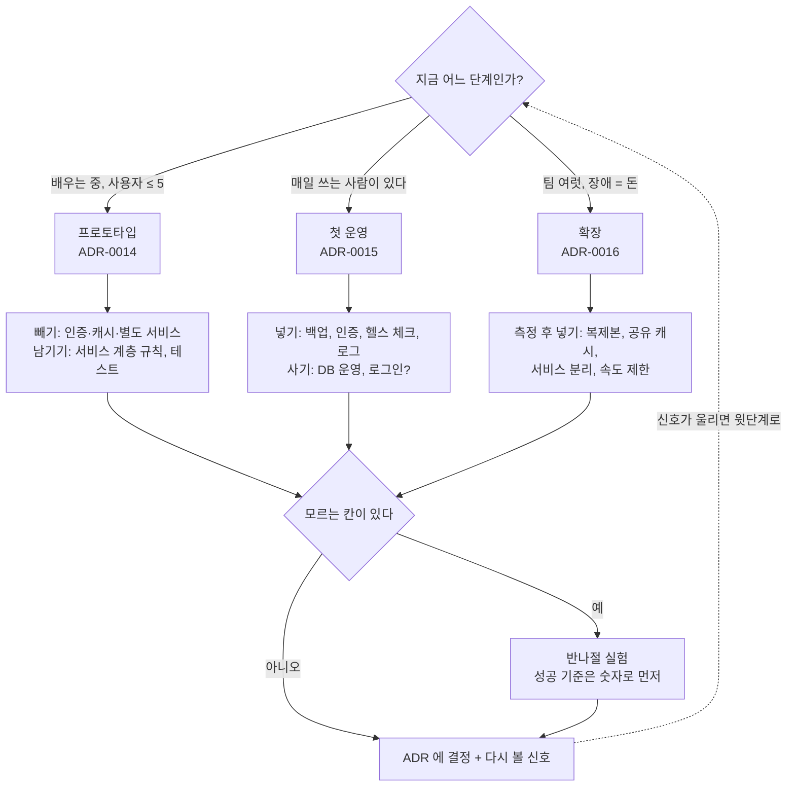

# 23 — 플랫폼·스택 선택과 단계별 아키텍처

## 목표

3단계(15~22단원)에서 만든 부품들 — 계층, HTTP API, 인증, 캐시, 큐, 화면, 별도 서비스 — 을 **언제 쓰고 언제 빼는지** 결정하는 연습입니다.
같은 프로그램을 세 시나리오(프로토타입 / 첫 운영 / 확장)에 놓고 ADR 세 편을 쓰고, 모르는 것은 반나절 실험으로 결정합니다.
이 단원이 끝나면 "지금 우리는 어느 단계인가"를 먼저 묻고, 그 답에 따라 다른 구조를 고르며, 그 선택을 숫자와 함께 설명할 수 있습니다.
코드 과제는 없습니다(○). 산출물은 문서 넷과 실험 하나입니다.

## 노트와의 연결

노트는 초급 아키텍트가 답해야 할 것으로 "**플랫폼 선택, 프런트엔드/백엔드 경계, 시스템 분해와 상태의 위치, 모놀리스부터 마이크로서비스까지의 단위,
스택 선택(때로는 실험으로 결정), 프로젝트 단계별 아키텍처 변화**"를 나열하고, 첫 질문으로 "**지금은 프로토타입인가, 첫 운영 시스템인가, 확장 단계인가?**"를 둡니다.
그리고 "**아키텍처는 정답이 하나가 아니라 단계마다 바뀐다. 프로토타입에 맞는 구조가 첫 운영 시스템에는 맞지 않을 수 있다**"고 못 박습니다.
이 단원은 그 문장을 ADR 세 편으로 **직접 겪는** 단원입니다. 22단원에서 나눈 알림 서비스를 프로토타입 ADR 에서 다시 합치는 결정을 적게 될 것이고, 그것이 정상입니다.

## 공부할 개념

| 개념 | 핵심 | 참고 |
| --- | --- | --- |
| 단계별 아키텍처 | 프로토타입(배우는 속도) → 첫 운영(데이터와 수면) → 확장(장애와 조율). 단계마다 "가장 비싼 것"이 다르고, 구조는 그것을 아끼는 쪽으로 바뀐다 | [Martin Fowler, Sacrificial Architecture](https://martinfowler.com/bliki/SacrificialArchitecture.html), [MonolithFirst](https://martinfowler.com/bliki/MonolithFirst.html) |
| 기술 선택 매트릭스와 빌드 vs 바이 | 제약을 먼저, 기준과 가중치를 그다음, 후보는 마지막에. "직접 만들기"의 진짜 비용은 만드는 시간이 아니라 **운영하는 시간**. 핵심 경쟁력이 아니면 산다 | [The Twelve-Factor App (한국어)](https://12factor.net/ko/) — 운영 가능한 앱의 최소 조건 |
| 실험으로 결정하기 | 매트릭스의 빈칸은 추측이 아니라 반나절 실험으로 채운다. 성공 기준을 **숫자로 먼저** 적고 시작한다 (10단원의 측정표, 30단원의 장애 실험과 같은 자세) | 이 저장소 `units/10-*` 의 측정표 형식 |

맨 위 질문에 먼저 답하고, 그 가지의 "빼기/넣기"를 매트릭스로 검토하고, 모르는 칸은 실험으로 채운 뒤 ADR 에 적습니다. ADR 의 "다시 볼 신호"가 울리면 맨 위로 돌아옵니다. 이 순환이 "단계마다 바뀐다"의 실제 모습입니다.

### 빌드 vs 바이를 판단하는 세 질문

1. 이것이 우리 제품의 **차별점**인가? (할 일 앱에서 로그인은 차별점이 아니다. 할 일 추천은 차별점일 수 있다)
2. 사서 쓰면 **되돌리기** 어려워지는가? (데이터가 그쪽에만 쌓이는가, 표준 형식으로 내보낼 수 있는가)
3. 직접 만들었을 때 **3년 운영 비용**은? (만드는 1주 + 보안 패치·백업·장애 대응 × 36개월)

## 과제

| 산출물 | 위치 | 내용 |
| --- | --- | --- |
| 기술 선택 매트릭스 1편 | `docs/decisions/` 또는 `NOTES.md` | `templates/decision-matrix.md` 로 **저장소(데이터베이스)** 선택. 제약 → 가중치 → 후보 순서를 지킬 것 |
| 시나리오 ADR 3편 | `docs/adr/0014-prototype.md`, `0015-first-production.md`, `0016-scale.md` | `templates/adr-00xx-*.md` 를 채운다. 세 편을 나란히 놓고 **바뀐 것과 안 바뀐 것**을 각 ADR 끝에 적는다 |
| 실험 1개 | `NOTES.md` | 매트릭스의 빈칸 하나를 고르고, 성공 기준을 숫자로 먼저 적고, 반나절 안에 끝내고, 결과로 칸을 채운다 |

실험 예시 (하나만 고르세요. 더 좋은 것이 있으면 그것으로):

- "SQLite 파일 하나로 첫 운영(사용자 500명, 동시 쓰기 10/초)을 버틴다" — 11단원의 스레드 테스트를 늘려 잠금 오류가 나는 지점을 찾는다.
- "19단원 메모리 캐시 없이도 `GET /tasks` p95 가 50ms 아래다" — 10단원 방식으로 10만 건을 넣고 17단원 `TestClient` 로 1,000번 호출해 잰다.
- "22단원의 HTTP 알림이 요청 지연에 영향을 주지 않는다" — 알림 서비스를 끈 채 완료 요청 100번의 p95 를 켠 상태와 비교한다.
- "JSON 파일 리포지토리는 할 일 몇 개부터 체감되게 느려지는가" — 15단원 질문 3 을 숫자로.

## 스스로 답해 볼 질문

1. 15~22단원에서 만든 것 중 **프로토타입에 넣지 않을 것**을 전부 적어 보세요. 그러면 남는 것은 무엇인가요? 그것이 왜 남나요?
2. 세 ADR 에서 끝까지 바뀌지 않은 것이 있다면 무엇인가요? 바뀌지 않는 것을 먼저 잘 만드는 것이 왜 "단계마다 바뀐다"와 모순이 아닌가요?
3. "확장 단계"의 결정을 프로토타입 때 미리 해 두면 무엇이 나쁜가요? 반대로 프로토타입의 결정이 확장 단계까지 남아 버리는 경우(사고)는 어떤 것들인가요? 어느 쪽 실수가 더 흔한가요?
4. 로그인을 외부 서비스에 맡기기로 했다면(바이), 18단원에서 배운 것은 헛된 것인가요? 사서 쓰는 사람이 원리를 알아야 하는 이유를 하나만 대 보세요.
5. 실험 결과가 내 예상과 달랐나요? 달랐다면 매트릭스의 어느 가중치가 틀렸던 것인가요? 같았다면 실험이 꼭 필요했나요(그래도 필요했다면 왜)?
6. 노트는 "스택 선택은 때로는 실험으로 결정"이라고 합니다. **실험으로 결정하면 안 되는** 것도 있나요? (힌트: 되돌리기 어려운 결정, 법적 요구)

## 함정

- 후보를 먼저 정하고 매트릭스를 채우면 가중치가 후보에 맞춰집니다. 제약과 가중치를 적은 뒤에 후보 칸을 여세요. 순서가 전부입니다.
- "확장성"을 모든 단계의 기준에 넣고 싶어집니다. 프로토타입 ADR 에서 확장성 가중치는 0이어야 정상입니다.
- 세 ADR 을 한 번에 쓰면 세 편이 비슷해집니다. 하루씩 띄우거나, 각 시나리오의 "가장 비싼 것"을 맨 위에 크게 적고 시작하세요.
- 실험의 성공 기준을 실험 **뒤에** 적으면 어떤 결과든 성공이 됩니다. 먼저 적고, 적은 것을 바꾸지 마세요.
- "빌드"가 재미있어서 고르는 것을 조심하세요. 학습 목적이라면 그렇게 적으면 됩니다(정직한 ADR). 운영 목적이라고 적으면서 빌드를 고르는 것이 문제입니다.
- ADR 의 "다시 볼 신호"를 "필요하면"이라고 쓰지 마세요. 숫자나 사건이어야 신호가 울립니다.

## 완료 기준

- [ ] `templates/decision-matrix.md` 를 채운 매트릭스 1편 (가중치 합 10, 빈칸은 실험으로 채웠거나 "모름"으로 정직하게)
- [ ] `docs/adr/0014-prototype.md`, `0015-first-production.md`, `0016-scale.md` — 각각 세 줄 질문, 대안 표, 결정, 다시 볼 신호(숫자), 그리고 22단원 알림 서비스에 대한 결정이 세 편 모두에 있음
- [ ] 실험 1개: 가설 · 숫자 기준 · 방법 · 결과 · 결론을 `NOTES.md` 에, 걸린 시간도 함께 (반나절을 넘겼다면 왜)
- [ ] `NOTES.md`: 배운 것 3가지 / 헷갈린 것 1가지 / 다음 단계(4단계)에 바꿀 것, **세 문장 설명**("왜 처음부터 크게 만들지 않는지"를 비개발자에게)
- [ ] **AI 코드 리뷰** 대신 **AI 설계 리뷰**: 세 ADR 을 AI 에게 주고 "가장 약한 가정"을 묻기. 지적 하나 반영, 하나 반박
- [ ] **에이전트에게 작은 과제**: 실험 코드(부하 생성·측정 스크립트 `scripts/experiment_23.py`) 작성을 맡기되, 가설과 성공 기준은 **내가** 먼저 쓰고, 숫자 해석과 결론은 **내가** 하기. 에이전트가 "결론"을 쓰려 하면 거부하세요
- [ ] 3단계 회고: 15~23단원 `NOTES.md` 의 "헷갈린 것" 9개를 모아 아직도 헷갈리는 것에 표시 → 4단계 시작 전에 하나 골라 다시 읽기
- [ ] 브랜치 `unit-23` → PR → 머지

## 더 깊이

- Martin Fowler, [Is High Quality Software Worth the Cost?](https://martinfowler.com/articles/is-quality-worth-cost.html) — "프로토타입이니까 대충"의 한계. 어디까지가 대충이고 어디부터가 빚인가.
- 12-factor 의 12 항목 중 이 저장소의 프로그램이 이미 지키는 것과 아직 아닌 것을 표로. 35단원에서 나머지를 채웁니다.
- 같은 매트릭스를 "할 일 앱"이 아니라 여러분이 실제로 만들고 싶은 것에 적용해 보세요. 가중치가 어떻게 달라지나요? 그것이 52단원 오너십 프로젝트의 첫 문서가 됩니다.
