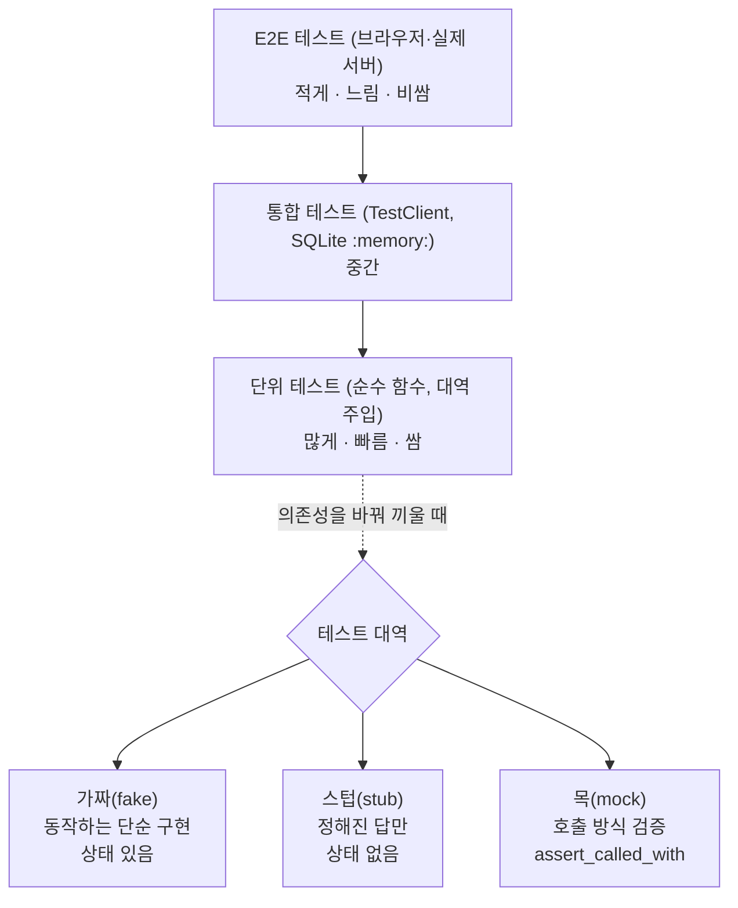

# 24 — 테스트 전략

## 목표

테스트를 "많이" 쓰는 대신 **어디에 어떤 종류의 테스트를 둘지** 결정할 수 있습니다. 가짜(fake)·스텁(stub)·목(mock)을
구분해 골라 쓰고, 커버리지 숫자가 말해 주는 것과 말해 주지 않는 것을 설명할 수 있으며,
"이 테스트는 내 목표를 반영하는가"를 스스로 검사하는 방법을 익힙니다.

## 노트와의 연결

노트의 보안·신뢰성 영역은 "단위·통합 테스트의 비율과 커버리지"를 첫 항목으로 꼽습니다. 그리고 에이전트와 일하는
워크플로에서는 "테스트가 내 목표를 제대로 반영하는지 확인하고, 아니면 고쳤다"고 적었습니다.
에이전트가 짠 코드를 믿는 근거가 테스트라면, 그 테스트 자체를 의심하는 눈이 먼저 필요합니다. 이 단원은 그 눈을 기릅니다.

## 공부할 개념

| 개념 | 핵심 | 참고 |
| --- | --- | --- |
| 테스트 피라미드(test pyramid) | 아래층 단위 테스트(unit test)는 많고 빠르게, 위층 통합(integration)·E2E(end-to-end)는 적고 느리게. 계약 테스트(contract test)는 대역과 진짜가 같은 약속을 지키는지 확인한다 | [Martin Fowler, Test Pyramid](https://martinfowler.com/bliki/TestPyramid.html) |
| 테스트 대역(test double) 세 가지 | **가짜(fake)**: 진짜처럼 동작하는 단순 구현(메모리 저장소). **스텁(stub)**: 정해진 답만 돌려준다. **목(mock)**: 어떻게 호출됐는지 기록하고 검증한다 | [Mocks Aren't Stubs](https://martinfowler.com/articles/mocksArentStubs.html), [unittest.mock](https://docs.python.org/ko/3/library/unittest.mock.html) |
| 커버리지(coverage)의 의미와 한계 | 실행된 줄의 비율일 뿐, 그 줄이 **검증**되었는지는 모른다. 단언(assert) 없는 테스트도 커버리지는 올린다 | [coverage.py](https://coverage.readthedocs.io/) |

세 대역을 고르는 기준은 간단합니다.

- 상태가 중요하고 여러 테스트에서 재사용한다 → **가짜**. 15단원의 `MemoryTaskRepository`가 가짜입니다.
- 특정 상황(실패, 빈 응답)만 만들고 싶다 → **스텁**.
- "정확히 이렇게 호출했는가"가 요구사항이다(결제를 두 번 부르면 안 된다 등) → **목**.

목은 강력하지만 구현에 밀착하기 쉽습니다. 메서드 이름 하나 바꾸면 깨지는 테스트가 수십 개면, 그 테스트는 리팩터링을 막는 비용이 됩니다.



읽는 법: 위로 갈수록 테스트는 적고 느리며, 아래층 단위 테스트에서 외부 의존성을 바꿔 끼울 때 "상태가 필요한가 / 특정 상황만 필요한가 / 호출 방식이 요구사항인가"에 따라 세 대역 중 하나를 고릅니다.

## 과제

`completion_notifier.py` 의 `TODO` 를 채워 `pytest units/24-testing-strategy` 를 통과시킨 뒤, 테스트 파일을 **고치는** 과제를 합니다.

| 할 일 | 하는 일 |
| --- | --- |
| `summarize(tasks)` | 외부 의존성 없는 순수 함수. 단위 테스트만으로 충분한 대표 사례 |
| `build_message(task, now)` | 알림 본문 생성. 시간은 `now` 로 주입 |
| `notify_completed(task, owner_email, sender, clock)` | `Sender` 를 주입받아 알림 발송. 미완료·잘못된 이메일이면 `ValueError` 이고 **send 를 호출하지 않는다** |
| `test_notify_sends_something__FIX_ME` 고치기 | 이 테스트는 `send("", "")` 를 보내도 통과한다. 무엇을 단언해야 하는지 정하고 고친 뒤 이름에서 `__FIX_ME` 를 뗀다 |
| 돌연변이 실험 1회 | 구현을 일부러 틀리게 바꾸고(예: 이메일 검사 삭제) 어떤 테스트가 잡는지 기록. 아무 테스트도 안 잡으면 테스트를 추가 |

테스트 파일 `test_unit24.py` 는 번호 순서대로 읽으세요. 1(단위) → 2(가짜) → 3(스텁) → 4(목) → 5(약한 테스트) → 6(계약 테스트)입니다.

커버리지는 선택입니다.

```bash
pip install coverage
coverage run -m pytest units/24-testing-strategy
coverage report -m          # Missing 열에 실행되지 않은 줄 번호가 나온다
```

실행된 줄이 100%여도 `__FIX_ME` 테스트가 보여 주듯 "검증"은 0%일 수 있습니다. 숫자는 **빠진 곳을 찾는 지도**로만 쓰세요.

### 프로젝트에 붙이기

이 단원의 코드는 독립 모듈이지만, 생각하는 방식은 `todo/` 전체에 적용합니다. 다음 표를 `NOTES.md` 에 채우세요.

| 계층(docs/project-api.md) | 테스트 종류 | 대역 |
| --- | --- | --- |
| `todo/service.py` 의 규칙(빈 제목, 중복 완료) | 단위 | `MemoryTaskRepository`(가짜) |
| `todo/repository.py` 의 `SqliteTaskRepository` | 통합(진짜 SQLite `:memory:`) | 없음 |
| `MemoryTaskRepository` vs `SqliteTaskRepository` | 계약 — 같은 테스트를 두 구현에 | 15단원에서 이미 하고 있음 |
| `todo/api.py` 의 `POST /tasks/{id}/complete` | 통합(`TestClient`) | 알림 발송은 가짜 |
| `notifier/` 서비스 호출(22단원) | 계약 + 목("완료 한 번에 발송 한 번") | `Mock(spec=...)` |

## 스스로 답해 볼 질문

1. `FakeSender` 와 `AlwaysFailingSender` 는 둘 다 `send` 를 가집니다. 왜 하나는 가짜이고 하나는 스텁일까요? 기준을 한 문장으로.
2. `Mock(spec=Sender)` 에서 `spec` 을 빼면 어떤 테스트가 거짓 통과(false pass)할 수 있을까요? `sender.snd(...)` 처럼 오타를 낸 구현을 상상해 보세요.
3. 계약 테스트가 없다면 `FakeSender` 로 통과한 테스트는 운영에서 무엇을 보장하나요?
4. 커버리지 100%인 프로젝트에서 장애가 났습니다. 어떤 종류의 결함이 커버리지로는 절대 잡히지 않을까요?
5. 테스트가 50개인데 모두 `Mock` 의 `assert_called_with` 입니다. 서비스 메서드 이름을 바꾸면 무슨 일이 생기나요? 이 비용은 어느 트레이드오프(유지보수성 vs 신뢰성)일까요?

## 함정

- `assert sender.send.called` 는 거의 아무것도 검증하지 않습니다. 무엇을, 누구에게 보냈는지가 요구사항이면 `assert_called_once_with` 를 쓰세요.
- 목을 쓰면서 "호출 순서"까지 단언하면 구현이 조금만 바뀌어도 깨집니다. 순서가 **요구사항**일 때만 단언하세요.
- 가짜가 진짜와 다르게 행동하면(예: 가짜는 중복을 허용하는데 진짜 DB는 UNIQUE 제약이 있음) 가짜로 통과한 테스트는 거짓 안도감을 줍니다. 계약 테스트가 그 간격을 메웁니다.
- 테스트가 구현 코드를 그대로 베껴 기대값을 계산하면(예: `expected = done / total`) 구현이 틀려도 같이 틀립니다. 기대값은 **손으로 적은 숫자**로.
- `datetime.now()` 를 테스트 안에서 부르면 분이 바뀌는 순간 깨집니다. 시간은 항상 주입합니다(`clock`).

## 완료 기준

- [ ] `pytest units/24-testing-strategy` 16개 테스트 전부 통과
- [ ] `test_notify_sends_something__FIX_ME` 를 고치고 이름을 바꿈. 고치기 전후에 "구현을 `send("", "")` 로 망가뜨렸을 때" 결과를 `NOTES.md` 에 기록
- [ ] 돌연변이 실험 1회 결과(바꾼 곳, 잡은 테스트 이름) 기록. 잡지 못했다면 테스트 1개 추가
- [ ] `NOTES.md` 의 "프로젝트에 붙이기" 표 작성 + 배운 것 3가지 / 헷갈린 것 1가지 / 다음 단원에 바꿀 것
- [ ] 세 문장 설명: "왜 테스트가 많아도 장애가 나는가"를 비개발자에게
- [ ] AI 코드 리뷰: 내 테스트 파일을 리뷰받고, "과도한 목 사용" 지적이 있으면 하나는 반영, 하나는 반박
- [ ] 에이전트에게 작은 과제: "`summarize` 에 `overdue`(마감 지난 개수) 항목을 추가하고 테스트 2개를 쓰라"를 맡기고, **테스트가 손으로 적은 기대값을 쓰는지** 검토
- [ ] 브랜치 `unit-24` → PR → 스스로 리뷰 → 머지

## 더 깊이

- 돌연변이 테스트(mutation testing) 도구 `mutmut` 은 이 단원의 "돌연변이 실험"을 자동화합니다. 한 번 돌려 보고, 살아남은 돌연변이(surviving mutant)가 무엇인지 보세요.
- 속성 기반 테스트(property-based testing) `hypothesis`: `summarize` 의 "open + done == total" 같은 성질을 임의 입력으로 검증합니다.
- 17단원의 `TestClient` 테스트는 피라미드의 어느 층일까요? 서비스 계층을 가짜로 바꾸면 층이 바뀌나요?
