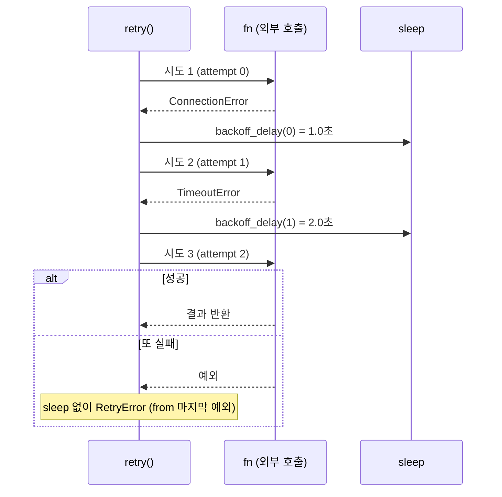

# 25 — 타임아웃·재시도·백오프

## 목표

외부 호출(HTTP, DB, 알림 서비스)에 **타임아웃을 걸고, 일시적 오류만 지수 백오프 + 지터로 재시도하며, 재시도하면 안 되는 오류를
구분하는** 재사용 가능한 함수를 만듭니다. 시간과 난수를 주입해 1초도 기다리지 않고 재시도 로직을 테스트합니다.

## 노트와의 연결

노트는 신뢰성 영역에서 "API 속도 제한 같은 장애 대응"을 꼽고, 학습법 5로 "일부러 고장 내 보기. 외부 API를 끊거나 응답을 늦춰
시스템이 어떻게 무너지는지 관찰한다"를 권합니다. 22단원에서 떼어낸 `notifier/` 서비스가 느려지면 `todo` API는 어떻게 되나요?
타임아웃이 없으면 한 요청이 영원히 스레드를 점유하고, 재시도가 없으면 1초짜리 네트워크 딸꾹질이 사용자 오류가 되며,
재시도가 무분별하면 이미 아픈 서버를 우리가 밟아 죽입니다(retry storm). 이 단원은 그 세 가지 사이의 균형을 코드로 만듭니다.

## 공부할 개념

| 개념 | 핵심 | 참고 |
| --- | --- | --- |
| 타임아웃(timeout) | 기다림의 상한. 연결(connect)·읽기(read) 타임아웃은 다르다. 없는 타임아웃은 "무한"이지 "기본값"이 아니다 | [concurrent.futures](https://docs.python.org/ko/3/library/concurrent.futures.html), [socket 타임아웃](https://docs.python.org/ko/3/library/socket.html#socket-timeouts) |
| 지수 백오프(exponential backoff)와 지터(jitter) | 대기 시간을 1, 2, 4, 8…로 늘리고(상한 있음), 그 안에서 난수를 섞어 여러 클라이언트가 동시에 재시도하는 "천둥 떼(thundering herd)"를 피한다 | [AWS Builders' Library: Timeouts, retries, and backoff with jitter](https://aws.amazon.com/builders-library/timeouts-retries-and-backoff-with-jitter/), [Exponential Backoff And Jitter](https://aws.amazon.com/blogs/architecture/exponential-backoff-and-jitter/) |
| 재시도해도 되는 오류 vs 안 되는 오류 | 일시적(transient): 타임아웃, 연결 끊김, 503, 429. 영구적: 400, 401, 404, 422, `ValueError`. 영구 오류 재시도는 비용만 쓰고 결과는 같다 | [random 모듈 (주입용 Random 객체)](https://docs.python.org/ko/3/library/random.html) |

세 번째 개념이 가장 중요합니다. "POST /tasks 가 타임아웃 났다"를 재시도하면 할 일이 두 개 생길 수 있습니다.
타임아웃은 "실패했다"가 아니라 **"결과를 모른다"** 입니다. 이 문제는 26단원(멱등성)에서 해결합니다. 이 단원에서는 그 위험을 인식만 하세요.

`call_with_timeout` 은 `concurrent.futures` 로 함수를 다른 스레드에 보내고 `future.result(timeout=)` 로 기다립니다.
Python 3.11부터 `concurrent.futures.TimeoutError` 는 내장 `TimeoutError` 와 같은 클래스입니다.

`retry(attempts=3, base_delay=1, max_delay=10)` 이 `MaxRng`(지터 최대) 로 움직이는 모습입니다.

읽는 법: `sleep` 은 시도와 시도 **사이**에만 불리고 대기 시간은 두 배씩 늘며(실제로는 0~상한 사이의 난수), 마지막 실패 뒤에는 자지 않고 바로 `RetryError` 를 던집니다.

## 과제

`retry.py` 의 `TODO` 를 채워 `pytest units/25-timeouts-and-retries` 를 통과시키세요.

| 함수 | 하는 일 |
| --- | --- |
| `backoff_delay(attempt, *, base_delay, max_delay, rng)` | `rng.uniform(0, min(max_delay, base_delay * 2**attempt))`. 완전 지터(full jitter) |
| `retry(fn, *, attempts, base_delay, max_delay, retry_on, sleep, rng)` | `retry_on` 에 속하는 예외만 재시도. 시도 **사이**에만 `sleep`. 모두 실패하면 `RetryError from 마지막 예외` |
| `call_with_timeout(fn, *, seconds, executor)` | 다른 스레드에서 실행, 시간 초과면 `TimeoutError` |

테스트의 `FakeSleep`, `MaxRng`, `FlakyFn` 은 24단원 기준으로 각각 가짜·스텁·가짜입니다. 어느 것이 왜 그런지 생각해 보세요.

### 프로젝트에 붙이기

| 어디에 | 무엇을 |
| --- | --- |
| `todo/worker.py` (20단원) — 알림 발송 함수 | `retry(lambda: call_with_timeout(lambda: client.post(...), seconds=2.0), attempts=3, retry_on=(TimeoutError, ConnectionError))` 로 감싼다. `httpx.Client(timeout=...)` 처럼 클라이언트 자체 타임아웃이 있으면 그것을 우선 쓰고 `call_with_timeout` 은 타임아웃 옵션이 없는 호출에만 쓴다 |
| `notifier/` 호출부(22단원) | 5xx·타임아웃은 재시도, 4xx 는 재시도하지 않도록 `retry_on` 을 정한다. HTTP 상태 코드를 예외 종류로 바꾸는 작은 함수가 필요하다 |
| `todo/repository.py` 의 `SqliteTaskRepository` | `sqlite3.OperationalError: database is locked` 는 일시적이다(11단원). `retry_on=(sqlite3.OperationalError,)` 와 짧은 `base_delay` 로 감싸되 **쓰기 트랜잭션 전체**를 재시도 단위로 한다 |
| `todo/api.py` | 재시도는 **호출하는 쪽**(클라이언트·워커)에 둔다. API 핸들러 안에서 외부 호출을 여러 번 재시도하면 요청 지연이 곱해진다 |

이 결정을 `docs/adr/0017-timeouts-and-retries.md` 에 남기세요. 맥락에 "어떤 호출을 몇 초로, 몇 번"을 표로 적습니다.

## 스스로 답해 볼 질문

1. 세 번 재시도에 `base_delay=1, max_delay=30` 이면 최악의 경우 사용자는 몇 초를 기다리나요? 그 시간을 사용자에게 보여 줘도 되나요?
2. 지터 없이 1000명의 클라이언트가 동시에 실패하고 정확히 2초 뒤 모두 재시도하면 서버는 무엇을 겪나요?
3. `retry_on=(Exception,)` 이 위험한 이유를 `ValueError` 와 `KeyboardInterrupt` 로 각각 설명해 보세요.
4. `call_with_timeout` 이 `TimeoutError` 를 던진 뒤에도 스레드 안의 함수는 계속 돕니다. 그 함수가 DB에 쓰는 중이었다면 무슨 일이 생기나요?
5. 재시도와 타임아웃을 호출 사슬의 **모든 층**(클라이언트 → API → 워커 → notifier)에 걸면 재시도 횟수는 어떻게 곱해지나요? 어느 층에 두어야 할까요?

## 함정

- `time.sleep` 을 직접 부르는 코드는 테스트가 느려지고, 테스트가 느리면 안 돌리게 됩니다. 반드시 주입하세요.
- `except Exception` 으로 모두 재시도하면 버그(`TypeError`)까지 세 번 반복한 뒤에야 보입니다.
- `with ThreadPoolExecutor() as pool:` 안에서 `result(timeout=)` 을 쓰면 `with` 를 나갈 때 작업이 끝날 때까지 기다립니다. 타임아웃이 무의미해집니다.
- 마지막 실패 뒤에 또 자는 구현을 흔히 합니다. 테스트 `test_gives_up_after_attempts_with_retry_error` 가 그것을 잡습니다.
- 재시도는 멱등(idempotent)한 호출에만 안전합니다. `GET` 은 괜찮고, `POST /tasks` 는 26단원 전까지는 위험합니다.

## 완료 기준

- [ ] `pytest units/25-timeouts-and-retries` 21개 테스트 전부 통과
- [ ] `todo/worker.py` 의 알림 발송을 `retry` + 타임아웃으로 감싸고, 20단원 테스트가 여전히 통과(가짜 notifier 사용)
- [ ] 고장 실험: notifier 를 끄고 할 일을 완료해 본다. 워커 로그에 몇 번 재시도했고 몇 초 걸렸는지 `NOTES.md` 에 기록(학습법 5)
- [ ] `docs/adr/0017-timeouts-and-retries.md` — 호출별 타임아웃·재시도 횟수 표와 "재시도하지 않는 오류" 목록
- [ ] `NOTES.md` 배운 것 3가지 / 헷갈린 것 1가지 / 다음 단원에 바꿀 것
- [ ] 세 문장 설명: "왜 실패하면 바로 다시 하지 않고 점점 오래 기다리는가"
- [ ] AI 코드 리뷰: `retry` 구현을 리뷰받고 "`except` 범위" 관련 지적 하나 반영, 하나 반박
- [ ] 에이전트에게 작은 과제: "`retry` 에 `on_retry: Callable[[int, BaseException, float], None] | None` 콜백을 추가하고(재시도마다 시도 번호·예외·대기 시간 전달) 테스트 2개를 써라". 검토 포인트: 콜백이 `sleep` **앞에서** 불리는지, 기존 21개 테스트가 그대로 통과하는지
- [ ] 브랜치 `unit-25` → PR → 스스로 리뷰 → 머지

## 더 깊이

- 재시도 예산(retry budget): 전체 요청의 10%까지만 재시도를 허용하는 방식. 서버가 전체적으로 아플 때 재시도가 부하를 키우는 것을 막습니다. [SRE Book: Addressing Cascading Failures](https://sre.google/sre-book/addressing-cascading-failures/)
- 마감(deadline) 전파: "이 요청 전체는 3초 안에"라는 예산을 호출 사슬 아래로 전달하면 각 층이 남은 시간만큼만 기다립니다. `retry` 에 `deadline` 인자를 추가해 보세요.
- `asyncio` 버전: `asyncio.wait_for(coro, timeout)` 과 `await asyncio.sleep` 으로 같은 것을 만들어 보세요(20단원).
