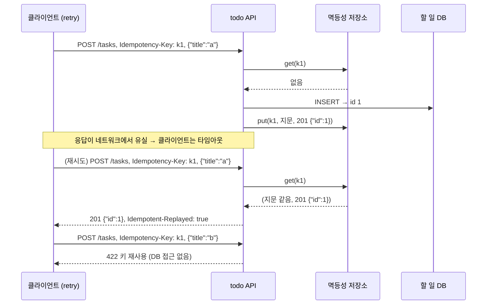

# 26 — 멱등성

## 목표

같은 요청이 두 번, 세 번 도착해도 **한 번만 실행되고 같은 응답을 돌려주는** API를 만듭니다. `Idempotency-Key` 헤더,
요청 지문(fingerprint), 멱등성 저장소(메모리·SQLite)를 구현하고, 같은 키에 다른 본문이 오는 충돌을 422로 거절합니다.

## 노트와의 연결

노트는 에이전트가 호출하는 시스템에 필요한 인프라로 "에이전트의 반복 재시도 → 멱등성 키로 중복 결제·중복 쓰기 방지"를 꼽습니다.
사람은 "추가" 버튼을 두 번 누르면 이상함을 느끼지만, 에이전트는 타임아웃이 나면 아무 의심 없이 같은 요청을 다시 보냅니다.
25단원의 `retry` 가 바로 그 에이전트입니다. 이 단원은 "재시도해도 안전한 쓰기"를 서버 쪽에서 보장합니다.

## 공부할 개념

| 개념 | 핵심 | 참고 |
| --- | --- | --- |
| 멱등성(idempotency) | 같은 연산을 여러 번 적용해도 결과가 한 번 적용한 것과 같다. `GET`·`PUT`·`DELETE` 는 본래 멱등, `POST` 는 아니므로 **키**로 멱등하게 만든다 | [AWS Builders' Library: Making retries safe with idempotent APIs](https://aws.amazon.com/builders-library/making-retries-safe-with-idempotent-APIs/), [IETF 초안: Idempotency-Key Header](https://datatracker.ietf.org/doc/draft-ietf-httpapi-idempotency-key-header/) |
| 요청 지문(fingerprint)과 해시 | 메서드·경로·본문을 `sha256` 으로 요약한 문자열. 같은 키로 **다른** 요청이 오면 재생이 아니라 오류여야 한다 | [hashlib](https://docs.python.org/ko/3/library/hashlib.html) |
| 멱등성 저장소와 TTL | 키 → (지문, 응답) 를 저장. 영원히 보관하면 저장소가 자라므로 만료(TTL, time to live)를 둔다. 13단원의 TTL dict 와 같은 생각 | [Stripe: Idempotent requests](https://docs.stripe.com/api/idempotent_requests) |

흐름은 이렇습니다.

```
요청 도착 (Idempotency-Key: k1, 본문 B)
  ├─ 키 없음           → 핸들러 실행 → 응답 저장 → 응답 (처음)
  ├─ 키 있음, 지문 같음  → 핸들러 실행 안 함 → 저장된 응답 (재생, replay)
  └─ 키 있음, 지문 다름  → 422 (키 재사용 오류)
핸들러가 예외를 던지면 → 아무것도 저장하지 않음 (다음 재시도가 실제로 실행되어야 하므로)
```

마지막 줄이 중요합니다. 실패한 시도를 저장하면 "DB가 잠깐 잠겼다"가 영구 실패로 굳습니다. 반대로 **4xx 응답은 저장**합니다.
빈 제목으로 보낸 요청은 다시 보내도 빈 제목이니까요(`test_stored_error_responses_are_replayed_too`).

25단원의 재시도 클라이언트가 타임아웃 뒤 같은 요청을 다시 보내는 상황입니다.



읽는 법: 두 번째 화살표 묶음에서 DB 에는 아무 접근이 없고 저장소에서 꺼낸 응답만 돌아가며, 마지막처럼 같은 키에 다른 본문이 오면 실행 없이 422 입니다.

## 과제

`idempotency.py` 의 `TODO` 를 채워 `pytest units/26-idempotency` 를 통과시키세요.

| 할 일 | 하는 일 |
| --- | --- |
| `make_fingerprint(method, path, body)` | `sha256(f"{METHOD}\n{path}\n" + body).hexdigest()` |
| `MemoryIdempotencyStore.get/put` | dict. `clock()` 과 `ttl_seconds` 로 만료 |
| `SqliteIdempotencyStore.get/put` | 테이블 `idempotency_keys`. `init_schema` 는 완성되어 있음 |
| `execute_idempotent(store, key, fingerprint, handler)` | 위 흐름. `(응답, 재생 여부)` 반환 |

### 프로젝트에 붙이기

| 어디에 | 무엇을 |
| --- | --- |
| `todo/idempotency.py` | 이 모듈을 옮긴다. 저장소는 `SqliteIdempotencyStore` 를 할 일 DB와 **같은 커넥션**으로 만든다 |
| `todo/api.py` — `POST /tasks`, `POST /tasks/{id}/complete` | 헤더 `Idempotency-Key` 를 읽어 `execute_idempotent` 로 핸들러를 감싼다. 지문은 `make_fingerprint(request.method, request.url.path, await request.body())`. 재생이면 응답 헤더 `Idempotent-Replayed: true` 를 붙인다 |
| 충돌 처리 | `IdempotencyConflictError` → 422, 오류 형식은 17단원 규약 `{"error": {"code": "idempotency_key_reused", "message": ...}}` |
| 키의 범위 | 18단원의 인증이 있으므로 키는 **사용자별**이다. 저장소 키를 `f"{user_id}:{header}"` 로 만든다. 다른 사용자가 같은 문자열을 보내도 섞이지 않는다 |
| 클라이언트 쪽 | 25단원의 재시도 루프는 **재시도마다 같은 키**를 보내야 한다. 키는 루프 밖에서 `uuid4()` 로 한 번 만든다 |

결정을 `docs/adr/0018-idempotency-key.md` 에 남기세요. "어느 엔드포인트에 적용하는가, TTL 은 얼마인가, 키의 범위는 무엇인가"를 포함합니다.

## 스스로 답해 볼 질문

1. `GET /tasks` 에도 멱등성 키가 필요할까요? `DELETE /tasks/1` 은요? (두 번 지우면 404 가 나는 것은 멱등성 위반인가요?)
2. 지문 없이 키만 저장하면 어떤 사고가 날까요? 에이전트가 키 생성 버그로 항상 같은 키를 보내는 상황을 상상해 보세요.
3. 첫 요청이 **아직 처리 중**인데 같은 키의 두 번째 요청이 오면 어떻게 해야 할까요? 지금 구현은 무엇을 하나요? (힌트: 409, "in progress" 표시)
4. TTL 을 24시간으로 했을 때 25시간 뒤에 같은 키가 오면 무엇이 생기나요? 그것이 문제인 경우와 아닌 경우를 하나씩.
5. 멱등성 저장소를 할 일 DB와 같은 트랜잭션에 넣으면 무엇이 좋아지나요? "핸들러는 성공했는데 저장소 put 이 실패"하는 경우를 생각해 보세요.

## 함정

- 키만 비교하고 지문을 비교하지 않으면, 잘못된 키 재사용이 **조용히 다른 사람의 응답**을 돌려줍니다. 가장 위험한 실패는 시끄러운 500이 아니라 조용한 200입니다.
- 핸들러가 예외를 던졌을 때도 저장하면 일시적 오류가 영구화됩니다.
- 키를 사용자별로 나누지 않으면 사용자 A의 키로 사용자 B가 A의 응답을 볼 수 있습니다(18단원의 소유권 검사와 같은 문제).
- 응답을 `dict` 로 저장하면 SQLite 에 넣을 때 깨집니다. **문자열(JSON)** 로 직렬화해 저장하세요(07단원).
- `time.time()` 을 직접 부르면 TTL 테스트가 불가능합니다. `clock` 을 주입하세요.

## 완료 기준

- [ ] `pytest units/26-idempotency` 29개 테스트 전부 통과
- [ ] `todo/api.py` 의 `POST /tasks` 에 `Idempotency-Key` 적용. `TestClient` 로 "같은 키 두 번 → 할 일 하나, 두 번째 응답에 `Idempotent-Replayed: true`" 테스트 1개, "같은 키 다른 본문 → 422" 테스트 1개 추가
- [ ] 고장 실험: 25단원 `retry` 로 감싼 클라이언트가 **키 없이** `POST /tasks` 를 재시도하게 만들어 중복 생성을 재현하고, 키를 붙여 사라지는 것을 확인. 전후 결과를 `NOTES.md` 에 기록
- [ ] `docs/adr/0018-idempotency-key.md`
- [ ] `NOTES.md` 배운 것 3가지 / 헷갈린 것 1가지 / 다음 단원에 바꿀 것
- [ ] 세 문장 설명: "왜 '추가' 요청이 두 번 와도 할 일이 하나만 생기는가"
- [ ] AI 코드 리뷰: `execute_idempotent` 를 리뷰받고, "처리 중 동시 요청" 지적이 나오면 지금 범위 밖임을 근거를 들어 반박하거나 반영
- [ ] 에이전트에게 작은 과제: "`SqliteIdempotencyStore` 에 만료된 행을 지우는 `purge_expired() -> int` 를 추가하고 테스트 2개를 써라". 검토 포인트: `clock` 을 쓰는지, 테스트가 FakeClock 으로 만료를 만드는지
- [ ] 브랜치 `unit-26` → PR → 스스로 리뷰 → 머지

## 더 깊이

- "처리 중" 상태: 첫 요청이 끝나기 전에 같은 키가 오면 409 를 돌려주는 설계. 저장소에 `status = in_progress` 행을 먼저 쓰고(예약) 끝나면 갱신합니다. 11단원의 낙관적 잠금과 비교해 보세요.
- 멱등성 키 없이도 멱등하게 만드는 방법: 클라이언트가 id 를 정해서 `PUT /tasks/{client_generated_id}` 로 보내기. 장단점은?
- 27단원의 속도 제한과 합치면: 재생된 요청은 속도 제한 토큰을 소모해야 할까요?
