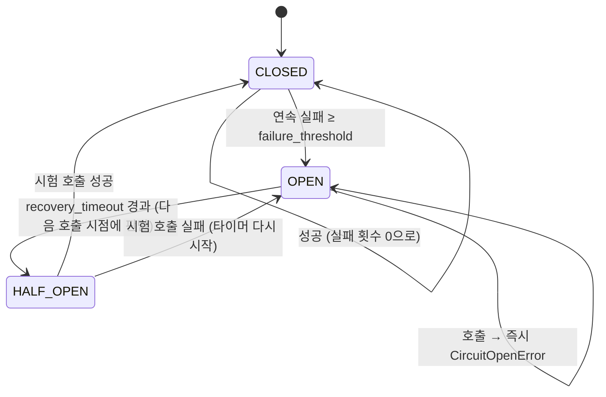

# 28 — 점진적 기능 저하·서킷 브레이커·격벽

## 목표

외부 의존(알림 서비스, 외부 API)이 죽거나 느려졌을 때 **핵심 기능은 살아남고 부가 기능만 조용히 줄어드는** 시스템을 만듭니다.
서킷 브레이커(circuit breaker) 상태 기계, 폴백(fallback), 격벽(bulkhead)을 구현하고 "외부 API가 멈추면 사용자는 무엇을 보게 되는가"에
코드로 답합니다.

## 노트와의 연결

노트는 보안·신뢰성 영역에서 "점진적 기능 저하(graceful degradation), 피해 범위 최소화"를 꼽고, 아키텍트가 던져야 할 질문으로
"외부 API가 멈추면 사용자는 무엇을 보게 되는가?"를 적었습니다. 22단원에서 notifier 를 별도 서비스로 떼어낸 순간, 우리 시스템에는
"죽을 수 있는 외부"가 생겼습니다. 25단원(재시도)은 짧은 장애를, 이 단원은 긴 장애를 다룹니다.

## 공부할 개념

| 개념 | 핵심 | 참고 |
| --- | --- | --- |
| 서킷 브레이커(circuit breaker) | 전기 차단기처럼 실패가 연속되면 회로를 열어(OPEN) 호출 자체를 막고, 시간이 지나면 반쯤 열어(HALF_OPEN) 하나만 시험해 본다. 죽은 서비스를 계속 두드리며 스레드와 시간을 태우는 것을 막는다 | [Martin Fowler: CircuitBreaker](https://martinfowler.com/bliki/CircuitBreaker.html) |
| 폴백(fallback)과 핵심/부가 기능 구분 | 실패했을 때 대신 돌려줄 "덜 좋은 답". 핵심 기능(할 일 추가·완료)은 폴백이 없고 반드시 되어야 하며, 부가 기능(알림·추천)은 폴백으로 줄어든다. 폴백이 거짓 답이면 안 된다 | [AWS Builders' Library: Avoiding fallback in distributed systems](https://aws.amazon.com/builders-library/avoiding-fallback-in-distributed-systems/) |
| 격벽(bulkhead) | 자원(스레드·커넥션)을 용도별로 칸막이해 한 의존이 느려져도 다른 기능의 자원을 다 먹지 못하게 한다. `threading.Semaphore` 로 "동시에 N개까지" | [threading.Semaphore](https://docs.python.org/ko/3/library/threading.html#semaphore-objects), [SRE Book: Addressing Cascading Failures](https://sre.google/sre-book/addressing-cascading-failures/) |

서킷 브레이커의 상태 기계입니다.

읽는 법: 평소(CLOSED)에는 실패만 세다가 문턱을 넘으면 열리고(OPEN), 정해진 시간이 지나면 **호출 하나만** 통과시켜(HALF_OPEN) 그 결과로 닫을지 다시 열지 정합니다.

## 과제

이 단원은 ◐ 입니다. `test_unit28.py` 의 16개 테스트 뼈대(이름과 docstring 만 있음)의 **본문을 먼저 채운 뒤** `circuit.py` 를 구현합니다.
테스트를 먼저 쓰면 상태 전이 규칙을 내가 어떻게 이해했는지가 드러납니다. 틀렸다면 구현 전에 발견하는 편이 쌉니다.

| 할 일 | 하는 일 |
| --- | --- |
| `CircuitBreaker(failure_threshold, recovery_timeout, failure_on, clock)` | 위 상태 기계. 상태 전이는 호출 시점에 지연 평가(타이머 스레드 없음) |
| `with_fallback(fn, fallback, on)` | 지정한 예외일 때만 `fallback(예외)` 의 결과 |
| `Bulkhead(max_concurrent)` | `with bulkhead.slot():` 자리가 없으면 즉시 `BulkheadFullError` |
| 마지막 테스트 | 셋을 합쳐 "notifier 가 죽어도 완료는 성공하고 알림은 큐에 쌓인다"를 증명 |

### 프로젝트에 붙이기

| 어디에 | 무엇을 |
| --- | --- |
| `todo/circuit.py` | 이 모듈을 옮긴다 |
| `todo/worker.py` — notifier 호출 | `bulkhead.slot()` 안에서 `breaker.call(lambda: retry(..., attempts=2))` 를 부르고, 전체를 `with_fallback(..., fallback=큐에 다시 넣기, on=(CircuitOpenError, RetryError, BulkheadFullError))` 로 감싼다. 순서: 격벽 → 브레이커 → 재시도 → 타임아웃 |
| `todo/api.py` — `POST /tasks/{id}/complete` | 알림 실패는 **응답 코드에 영향을 주지 않는다**. 완료는 200, 알림 상태는 응답 본문에 넣지 않거나 `"notification": "queued"` 로 표시 |
| `GET /health` (35단원 예고) | 브레이커 상태를 `{"status": "ok", "dependencies": {"notifier": "open"}}` 처럼 노출. 상태가 OPEN 이어도 핵심 기능이 되면 `status` 는 `ok` — "저하(degraded)" 를 구분하고 싶으면 `"status": "degraded"` |
| 31단원 로그 | 상태 전이(CLOSED→OPEN, OPEN→HALF_OPEN, …)를 WARNING 으로 남긴다. 33단원의 알림 규칙이 이 로그를 쓴다 |

`docs/adr/0020-graceful-degradation.md` 에 "핵심 기능 목록, 부가 기능별 폴백, 브레이커 수치(문턱·복구 시간)와 그 근거"를 남기세요.

## 스스로 답해 볼 질문

1. notifier 가 죽었을 때 사용자가 보아야 할 화면은 무엇인가요? (a) 500 오류 (b) 완료는 되고 아무 말 없음 (c) "완료됨. 알림은 잠시 뒤 발송" — 각각의 비용은?
2. `failure_threshold=1` 과 `=100` 의 차이는? 요청이 분당 5개인 서비스에서 100은 무슨 뜻인가요?
3. HALF_OPEN 에서 시험 호출을 **하나만** 통과시키는 이유는? 모두 통과시키면 무슨 일이 생기나요?
4. 폴백이 "거짓 답"이 되는 예를 할 일 앱에서 하나 찾아보세요. (힌트: 목록 조회가 실패했을 때 빈 목록을 돌려주면?)
5. 격벽 없이 notifier 호출이 스레드 풀의 스레드 전부를 10초씩 점유하면 `GET /tasks` 는 어떻게 되나요? 이것이 "연쇄 장애(cascading failure)"입니다.

## 함정

- 브레이커가 `ValueError` 같은 호출자 잘못까지 실패로 세면, 잘못된 요청 몇 개가 멀쩡한 의존 서비스를 "죽은 것"으로 만듭니다. `failure_on` 을 좁히세요.
- OPEN → HALF_OPEN 전이를 타이머 스레드로 하면 테스트가 어렵고 프로세스마다 스레드가 늘어납니다. 호출 시점에 `clock()` 으로 판단하세요.
- 폴백 안에서 또 외부를 호출하면 폴백도 같이 죽습니다. 폴백은 로컬(큐에 적재, 캐시된 값, 빈 목록)이어야 합니다.
- 브레이커는 프로세스별 상태입니다. 인스턴스가 둘이면 하나는 열리고 하나는 닫혀 있을 수 있습니다(37단원).
- "저하된 상태"를 아무에게도 알리지 않으면 알림이 조용히 며칠간 안 나갑니다. 상태 전이 로그와 `/health` 노출을 빼먹지 마세요.

## 완료 기준

- [ ] `test_unit28.py` 16개 테스트의 본문을 채우고 `pytest units/28-graceful-degradation` 전부 통과
- [ ] `todo/worker.py` 에 격벽 → 브레이커 → 재시도 순으로 적용. 가짜 notifier 로 "브레이커가 열린 뒤에는 notifier 가 호출되지 않는다" 테스트 1개
- [ ] 고장 실험(학습법 5): notifier 를 끄고 할 일 10개를 완료. 브레이커 **없을 때**와 **있을 때** 완료 요청의 p95 지연을 비교해 `NOTES.md` 에 표로 기록
- [ ] `docs/adr/0020-graceful-degradation.md` — 핵심/부가 기능 표와 폴백
- [ ] `NOTES.md` 배운 것 3가지 / 헷갈린 것 1가지 / 다음 단원에 바꿀 것
- [ ] 세 문장 설명: "알림 서버가 고장 나도 할 일 완료가 되는 이유"
- [ ] AI 코드 리뷰: 상태 기계를 리뷰받고 "HALF_OPEN 에서 동시 호출" 지적이 나오면 Lock 으로 반영하거나 단일 스레드 워커임을 근거로 반박
- [ ] 에이전트에게 작은 과제: "`CircuitBreaker` 에 `on_state_change: Callable[[CircuitState, CircuitState], None] | None` 콜백을 추가하고 테스트 2개를 써라". 검토 포인트: 같은 상태로의 전이(CLOSED→CLOSED)에는 불리지 않는지
- [ ] 브랜치 `unit-28` → PR → 스스로 리뷰 → 머지

## 더 깊이

- 실패율 기반 브레이커: "연속 N번"이 아니라 "최근 1분간 실패율 50% 이상"으로 여는 방식. 슬라이딩 윈도가 필요합니다.
- 타임아웃·재시도·브레이커·격벽·속도 제한을 한 그림에 놓고 "어느 것이 누구를 보호하는가"(나 vs 상대)를 표로 정리해 보세요.
- 30단원에서 이 장치들이 실제로 동작하는지 **일부러 고장 내서** 확인합니다.
