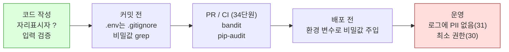

# 29 — 보안 기초

## 목표

OWASP 상위 항목 중 작은 웹 서비스에서 가장 흔한 것들(인젝션, 잘못된 인증, 비밀값 노출, 취약한 의존성)을 **내 코드에서 찾아 고치고**,
`pip-audit` 와 `bandit` 를 CI 전에 돌리는 습관(Shift Left)을 만듭니다. 일부러 취약하게 쓴 `vulnerable_app.py` 를 테스트로 증명하며 고칩니다.

## 노트와의 연결

노트는 보안·신뢰성 영역에서 "보안을 앞 단계로 당기는 Shift Left"를 꼽습니다. 보안을 배포 직전 감사로 미루면 고치는 비용이 가장 비쌀 때
발견합니다. 코드를 쓰는 순간(자리표시자), 커밋하는 순간(비밀값 검사), PR 을 올리는 순간(정적 분석·의존성 감사)에 당겨 놓으면
대부분은 1분짜리 수정이 됩니다. 에이전트가 코드를 많이 쓸수록 이 자동 검사의 가치는 커집니다. 사람이 모든 줄을 읽지 않기 때문입니다.

## 공부할 개념

| 개념 | 핵심 | 참고 |
| --- | --- | --- |
| OWASP Top 10 과 인젝션(injection) | 입력이 명령(SQL·셸·경로)의 일부로 해석되는 문제. 해법은 "데이터와 명령을 분리": SQL 자리표시자 `?`, `subprocess` 인자 리스트, 경로 정규화 후 범위 확인 | [OWASP Top Ten](https://owasp.org/www-project-top-ten/), [OWASP SQL Injection Prevention Cheat Sheet](https://cheatsheetseries.owasp.org/cheatsheets/SQL_Injection_Prevention_Cheat_Sheet.html) |
| 비밀값 관리(secrets management) | 비밀값은 코드가 아니라 **환경**에 둔다(`.env` 는 `.gitignore`, 운영은 환경 변수·비밀 저장소). 한 번 커밋된 비밀값은 회전(rotate)해야 한다. 토큰은 `secrets` 모듈로 | [12factor.net/ko/config](https://12factor.net/ko/config), [secrets 모듈](https://docs.python.org/ko/3/library/secrets.html) |
| Shift Left 도구: `pip-audit`, `bandit` | `pip-audit` 는 설치된 패키지의 알려진 취약점(CVE)을, `bandit` 는 소스의 위험한 패턴(`eval`, 하드코딩 비밀값, `random` 토큰, SQL 포매팅)을 찾는다 | [pip-audit](https://pypi.org/project/pip-audit/), [bandit](https://bandit.readthedocs.io/) |



읽는 법: 왼쪽(작성 시점)에서 잡을수록 수정 비용이 싸고, 오른쪽(운영)에서 발견될수록 비싸므로 검사를 왼쪽으로 "당기는" 것이 Shift Left 입니다.

## 과제

이 단원은 ◐ 입니다. `vulnerable_app.py` 의 문제 여섯 가지를 찾아 고치고, `test_unit29.py` 의 11개 뼈대(parametrize 포함 15개 수집)를 채워 고쳐졌음을 증명합니다.

| 문제 | 고치는 법 |
| --- | --- |
| 1. 하드코딩 비밀값 | `get_api_secret()` 이 `os.environ["TODO_API_SECRET"]` 을 읽고 없으면 `RuntimeError`. 소스에서 문자열 제거 |
| 2. SQL 포매팅 | `?` 자리표시자(08단원) |
| 3. 입력 검증 없음 | 문자열인지, 공백 제거 후 비어 있지 않은지, 길이 상한(예: 200)을 검사. 아니면 `ValueError` |
| 4. 평문 비밀번호 | 18단원의 해싱(`hashlib.scrypt` 또는 그때 쓴 라이브러리). 비교는 `hmac.compare_digest`. 없는 사용자와 틀린 비밀번호를 같은 응답으로 |
| 5. `random` 토큰 | `secrets.token_urlsafe(32)` |
| 6. 경로 탐색 | `(EXPORT_DIR / filename).resolve()` 가 `EXPORT_DIR.resolve()` 안에 있는지 `is_relative_to` 로 확인 |

도구를 돌려 보세요(가상환경 안에서).

```bash
pip install pip-audit bandit
pip-audit                                   # 설치된 패키지의 알려진 취약점
bandit -r units/29-security-basics          # 고치기 전: 여러 개 경고. 고친 뒤: 0개가 목표
bandit -r todo/ notifier/                   # 내 프로젝트에도
git log -p | grep -i "sk-live\|password ="  # 과거 커밋에 비밀값이 남아 있는지
```

### 프로젝트에 붙이기

| 어디에 | 무엇을 |
| --- | --- |
| `todo/` 전체 | `bandit -r todo/` 경고를 0으로. 거짓 양성(false positive)은 `# nosec` 와 이유를 주석으로 |
| `todo/api.py` — Pydantic 스키마(17단원) | 제목 `max_length`, 태그 개수 상한, 페이지 `limit` 상한(예: 100). 상한 없는 입력은 메모리 공격이 된다 |
| `todo/auth.py`(18단원) | 비밀번호 해시 확인, 로그인 실패 응답 통일, 로그인 시도에 27단원 속도 제한(무차별 대입 방지) |
| 비밀값 | JWT 서명 키·DB 경로 등을 환경 변수로. `.env.example` 에는 **이름만**. 35단원의 `app_config.py` 가 이것을 읽는다 |
| 의존성 | `requirements.txt` 의 버전을 고정(pin)하고 `pip-audit` 를 34단원 CI 에 넣는다 |
| 오류 응답 | 17단원 규약 `{"error": {...}}` 에 스택 트레이스·SQL 문을 절대 넣지 않는다 |

`docs/adr/0021-security-baseline.md` 에 "입력 상한 값, 비밀값 보관 위치, CI 에 넣는 검사와 실패 시 정책(차단 vs 경고)"을 남기세요.

## 스스로 답해 볼 질문

1. `f"... WHERE title = '{title}'"` 에서 `title` 을 `title.replace("'", "''")` 로 이스케이프하면 안전한가요? 왜 자리표시자가 더 나은가요?
2. 비밀값을 git 에 커밋했다가 다음 커밋에서 지웠습니다. 안전한가요? 무엇을 더 해야 하나요?
3. "없는 사용자입니다" 와 "비밀번호가 틀렸습니다"를 구분해 주면 사용자는 편합니다. 공격자는 무엇을 얻나요?
4. `pip-audit` 가 취약점을 보고했는데 그 기능을 우리는 쓰지 않습니다. 그래도 올려야 하나요? 판단 기준은?
5. 에이전트가 생성한 코드에서 보안 문제가 더 자주 나올까요, 덜 나올까요? 어느 쪽이든 Shift Left 가 왜 더 중요해지나요?

## 함정

- `bandit` 경고를 `# nosec` 로 전부 끄면 도구를 안 쓰는 것과 같습니다. 끌 때는 **이유**를 옆에 적으세요.
- `.env` 를 `.gitignore` 에 넣기 전에 한 번이라도 커밋했으면 이미 역사에 있습니다. `git log --all -- .env` 로 확인하세요.
- `Path(base) / user_input` 은 `user_input` 이 절대 경로(`/etc/passwd`)이면 `base` 를 **무시**합니다. `resolve()` 후 범위 확인이 필수입니다.
- 해시 비교를 `==` 로 하면 타이밍 공격에 노출됩니다(미세하지만 원칙입니다). `hmac.compare_digest`.
- 입력 검증을 API 계층에만 두면 CLI·워커 경로로 우회됩니다. 규칙은 서비스 계층(15단원)에.

## 완료 기준

- [ ] `test_unit29.py` 11개 테스트 본문 작성, 고치기 전 실패 → 고친 뒤 `pytest units/29-security-basics` 전부 통과
- [ ] `bandit -r units/29-security-basics` 와 `bandit -r todo/` 경고 0 (또는 이유 있는 `# nosec`)
- [ ] `pip-audit` 결과와 조치(올림/보류 + 이유)를 `NOTES.md` 에 기록
- [ ] `todo/api.py` 스키마에 길이·개수·limit 상한 추가, 상한 초과 → 422 테스트 1개
- [ ] `docs/adr/0021-security-baseline.md`
- [ ] `NOTES.md` 배운 것 3가지 / 헷갈린 것 1가지 / 다음 단원에 바꿀 것
- [ ] 세 문장 설명: "왜 비밀번호를 서버도 모르는 형태로 저장하는가"
- [ ] AI 코드 리뷰: 고친 `vulnerable_app.py` 를 리뷰받고 "아직 남은 문제"를 하나 더 찾아 반영
- [ ] 에이전트에게 작은 과제: "`todo/` 의 모든 Pydantic 스키마 문자열 필드에 `max_length` 를 추가하고 각 필드에 422 테스트를 써라". 검토 포인트: 상한 값이 **ADR 의 숫자**와 같은지, 에이전트가 임의로 정한 값은 없는지
- [ ] 브랜치 `unit-29` → PR → 스스로 리뷰 → 머지

## 더 깊이

- OWASP Top 10 의 나머지 항목(접근 제어 실패, 보안 설정 오류, SSRF)을 할 일 앱에 대입해 "해당/비해당/모름"으로 표를 만들어 보세요.
- `pre-commit` 훅으로 `bandit` 와 비밀값 검사를 커밋 시점으로 더 당겨 보세요.
- 30단원은 "그래도 뚫렸을 때 피해를 얼마나 좁힐 수 있는가"(최소 권한)로 이어집니다.
