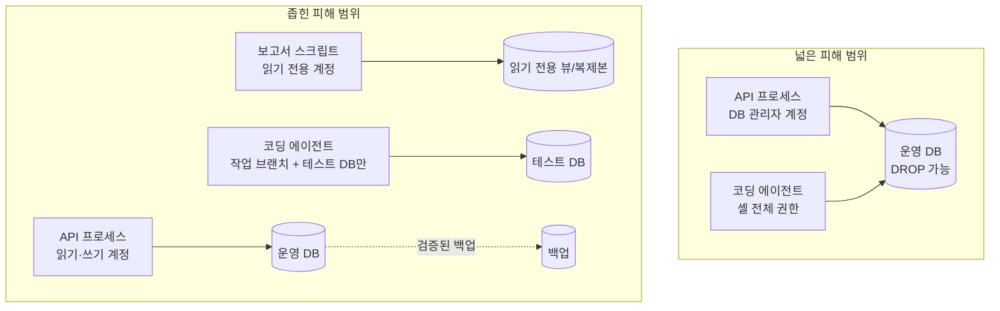

# 30 — 피해 범위 최소화와 장애 실험

## 목표

"뚫리거나 고장 났을 때 **얼마나 넓게** 피해가 번지는가"(blast radius)를 줄이는 장치 — 최소 권한, 읽기 전용 계정, 검증된 백업 — 를
내 시스템에 적용하고, 지금까지 만든 신뢰성 장치(25~28단원)가 실제로 작동하는지 **일부러 고장 내서** 세 가지 실험으로 확인합니다.

## 노트와의 연결

노트의 학습법 5는 "일부러 고장 내 보기. 외부 API를 끊거나 응답을 늦춰 시스템이 어떻게 무너지는지 관찰한다"입니다.
또 에이전트와 일한 경험으로 "에이전트 권한을 제한해 운영 데이터와 파일을 지울 수 없게 했다"고 적었습니다. 두 문장은 같은 생각입니다.
고장은 반드시 나므로, 났을 때의 피해를 **미리 좁혀 두고**, 좁혀졌는지 **미리 확인**합니다.
노트는 "인프라는 테스트와 실험 기간이 필요해 빠른 코딩이 큰 도움이 되지 않는다"고도 합니다. 이 단원에서 쓰는 코드는 거의 없습니다. 대신 실험하고 기록합니다.

## 공부할 개념

| 개념 | 핵심 | 참고 |
| --- | --- | --- |
| 피해 범위(blast radius)와 최소 권한(least privilege) | 각 주체(프로세스·계정·에이전트)에 **필요한 만큼만** 권한을 준다. "이 주체가 할 수 있는 가장 나쁜 일"이 그 주체의 피해 범위다. 읽기 전용 계정, 테이블 단위 권한, 운영/개발 분리 | [OWASP Top Ten (Broken Access Control)](https://owasp.org/www-project-top-ten/) |
| 백업 검증 | 백업은 "복구해 봤을 때"만 존재한다. 복구 연습의 소요 시간(RTO)과 잃는 데이터 범위(RPO)를 숫자로 안다 | 12단원 README, [SRE Book: Emergency Response](https://sre.google/sre-book/emergency-response/) |
| 장애 실험(chaos experiment) | 가설 → 정상 신호 정의 → 작게 고장 주입 → 관찰 → 되돌림 → 기록. 운영이 아니라 **내가 통제하는 환경**에서, 피해 상한을 정해 놓고 | [Principles of Chaos Engineering](https://principlesofchaos.org/) |

읽는 법: 위쪽은 한 주체가 실수하면 운영 DB 전체가 피해 범위이고, 아래쪽은 주체마다 닿을 수 있는 범위를 잘라 두어 같은 실수가 테스트 DB 나 읽기 전용 뷰에서 멈춥니다.

## 과제

이 단원은 ○ 입니다. 코드 대신 점검표와 실험 기록을 만듭니다. 두 템플릿을 복사해 채우세요.

| 할 일 | 산출물 |
| --- | --- |
| 최소 권한 점검표 작성 | `least_privilege_checklist.md` 를 프로젝트의 `docs/` 로 복사해 모든 행을 채운다. SQLite 는 사용자 계정이 없으므로 "읽기 전용 커넥션"(`sqlite3.connect("file:todo.db?mode=ro", uri=True)`)과 파일 권한(`chmod`)으로 흉내 낸다. 보고서 스크립트가 읽기 전용 커넥션으로 `INSERT` 하면 실패하는 것을 확인 |
| 에이전트 권한 제한 | 40단원 전이지만 지금 시작한다: 에이전트 설정에서 운영 DB 경로·`.env`·배포 명령을 금지 목록에 넣고, "운영 DB 를 지워 보라"고 시켜 **거부되는지** 확인한 기록을 남긴다 |
| 백업 복구 연습 | 12단원의 백업으로 **새 경로**에 복구하고 할 일 개수를 비교. 걸린 시간을 점검표에 기록 |
| 장애 실험 1: 의존 서비스 중단 | notifier 를 끈다. 28단원의 브레이커가 열리는가? 사용자는 무엇을 보는가? 복구 후 큐가 비워지는가? |
| 장애 실험 2: DB 읽기 전용 | DB 파일을 읽기 전용으로 바꾼다(`chmod 444`). `GET` 은 되고 `POST` 는 어떤 오류 응답을 내는가? 500 인가, 503 인가, 스택 트레이스가 새는가(29단원)? |
| 장애 실험 3: 요청 폭주 | 27단원의 200회 루프 스크립트를 동시 4개 돌린다. 429 비율, p95, 다른 사용자(다른 키)의 지연은? |

각 실험은 `chaos_experiment_log.md` 한 장씩입니다. **실험 전에 1번(가설)을 먼저 적고** 시작하세요. 예상과 다른 것이 이 단원의 수확입니다.

### 프로젝트에 붙이기

| 어디에 | 무엇을 |
| --- | --- |
| `todo/repository.py` | 읽기 전용 커넥션을 받는 `ReadOnlySqliteTaskRepository` 또는 커넥션 팩토리 옵션. 보고서·`GET` 전용 경로에서 쓴다(37단원 읽기 복제본의 예습) |
| `todo/api.py` | 실험 2에서 발견한 쓰기 실패를 `503 {"error": {"code": "storage_unavailable", ...}}` 로 통일. 스택 트레이스는 로그(31단원)에만 |
| `scripts/backup.sh`, `scripts/restore.sh` (12단원) | 복구 스크립트에 "복구 후 행 개수 비교" 단계 추가 |
| `docs/` | 점검표와 실험 기록 3장. 33단원의 런북이 이 기록을 재료로 쓴다 |

## 스스로 답해 볼 질문

1. 내 노트북에서 운영 DB 에 쓰기 권한이 있으면 편합니다. 그 편함의 대가로 내가 감수하는 "가장 나쁜 일"은 무엇인가요?
2. 백업은 매일 하는데 복구는 한 번도 안 해 봤습니다. 이 백업이 쓸모없을 수 있는 이유를 세 가지 들어 보세요.
3. 장애 실험을 운영 환경에서 해도 될까요? 어떤 조건(정상 신호, 피해 상한, 즉시 되돌림)이 갖춰지면 가능할까요?
4. 실험 2에서 `POST` 가 500 을 냈다면 그것은 버그인가요, 설계 누락인가요? 사용자에게 503 과 500 은 어떻게 다르게 읽히나요?
5. 에이전트에게 "테스트 DB 만" 접근을 허용했는데, 에이전트가 테스트 설정 파일을 고쳐 운영 DB 를 가리키게 하면? 권한의 경계는 어디에 두어야 하나요?

## 함정

- "고장 내 보기"를 운영 데이터로 하면 실험이 아니라 사고입니다. 복사본·테스트 환경에서.
- 실험 전에 가설을 안 적으면 어떤 결과든 "예상대로"가 됩니다. 기록표의 1번을 먼저.
- 되돌리는 방법을 모르는 고장은 주입하지 마세요. 되돌림이 실험 계획의 일부입니다.
- SQLite 에 사용자 계정이 없다고 최소 권한을 건너뛰지 마세요. 읽기 전용 커넥션·파일 권한·별도 복사본으로 같은 원칙을 연습할 수 있습니다.
- 에이전트 권한은 "설정 파일"이 아니라 "에이전트가 바꿀 수 없는 곳"에서 강제되어야 의미가 있습니다.

## 완료 기준

- [ ] `docs/least_privilege_checklist.md` 모든 행 작성, 조치 중 최소 2개 실행(예: 읽기 전용 커넥션 도입, 에이전트 금지 목록)
- [ ] 백업 복구 연습 1회, 걸린 시간과 잃는 데이터 범위를 숫자로 기록
- [ ] 장애 실험 3종 각각 `docs/experiments/EXP-01~03.md` 로 기록(가설이 실행 전에 적혀 있을 것)
- [ ] 실험에서 드러난 문제 중 최소 1개를 코드로 고치고 테스트 추가(예: 쓰기 실패 → 503)
- [ ] `NOTES.md` 배운 것 3가지 / 헷갈린 것 1가지 / 다음 단원에 바꿀 것 + "장애를 가장 먼저 알아챈 것은 무엇이었나" 한 줄
- [ ] 세 문장 설명: "왜 프로그램마다 다른 열쇠를 주는가"
- [ ] AI 코드 리뷰: 실험 기록 3장을 AI 에게 보여 주고 "빠진 실험"을 제안받아 하나는 다음 단계 목록에, 하나는 왜 지금 안 하는지 적기
- [ ] 에이전트에게 작은 과제: "`scripts/restore.sh` 에 복구 후 `SELECT COUNT(*)` 를 원본과 비교해 다르면 종료 코드 1 을 내는 단계를 추가하라". 검토 포인트: 복구 대상 경로가 **운영 DB 경로가 될 수 없게** 막혀 있는지
- [ ] 이 단계(4단계) 끝: 사용자에게 보여 주기 — 가족·친구 1~2명에게 프로그램을 보여 주고 "가장 불편한 점" 한 줄 받기
- [ ] 브랜치 `unit-30` → PR → 스스로 리뷰 → 머지

## 더 깊이

- 실험 4: 응답을 "끊기"가 아니라 "5초 늦추기"로 바꿔 보세요(프록시나 notifier 의 `time.sleep`). 타임아웃이 없는 호출이 어디 남아 있는지 드러납니다.
- 게임데이(game day): 팀이 모여 장애 시나리오를 함께 연습하는 행사. 혼자라면 "30분 타이머를 켜고 처음 보는 고장을 조사"하는 연습으로.
- 33단원에서 이 실험 기록이 런북과 알림 규칙의 출발점이 됩니다. 실험마다 "가장 먼저 알아챈 것"을 적어 두세요.
