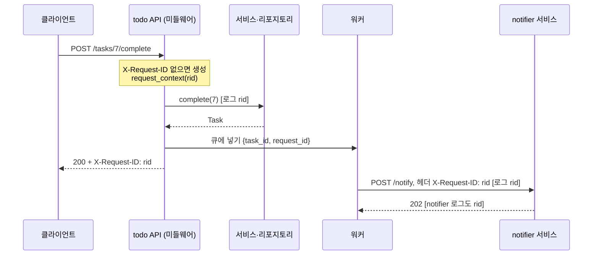

# 31 — 로깅

## 목표

`print` 대신 Python `logging` 으로 **레벨이 있고, JSON 한 줄로 구조화되어 있고, 요청 id로 묶이고, 개인정보가 빠진** 로그를 남깁니다.
장애가 났을 때 "요청 id 하나로 그 요청이 API → 서비스 → 워커 → notifier 를 지나간 자취"를 전부 찾을 수 있게 만드는 것이 목표입니다.

## 노트와의 연결

노트는 운영 영역에서 "관측성(observability)·알림·장애 관리"를 꼽고, "장애를 누가, 무엇으로 가장 먼저 알아채는가?"를 묻습니다.
로그는 관측성의 세 기둥(로그·지표·추적) 중 가장 먼저 만들고 가장 많이 들여다보는 것입니다. 하지만 "무엇을 남기는가"만큼
"무엇을 남기지 않는가"가 중요합니다. 14단원에서 분류한 개인정보(PII)가 로그에 찍히면 로그 저장소가 두 번째 개인정보 DB가 됩니다.

## 공부할 개념

| 개념 | 핵심 | 참고 |
| --- | --- | --- |
| `logging` 의 구조: 로거·핸들러·포매터·레벨 | 로거(logger)가 레코드를 만들고, 핸들러(handler)가 어디로 보낼지, 포매터(formatter)가 어떤 모양일지 정한다. 레벨은 DEBUG < INFO < WARNING < ERROR < CRITICAL. `logger.exception()` 은 ERROR + 트레이스백 | [logging HOWTO](https://docs.python.org/ko/3/howto/logging.html), [logging 모듈](https://docs.python.org/ko/3/library/logging.html) |
| 구조화 로그(structured logging) | 사람이 읽는 문장 대신 기계가 파싱하는 JSON 한 줄. `extra={"task_id": 3}` 로 필드를 붙인다. 12-factor 는 로그를 "이벤트 스트림"으로 stdout 에 쓰라고 한다 | [12factor.net/ko/logs](https://12factor.net/ko/logs) |
| `contextvars` 로 요청 id 전파 | 전역 변수는 동시에 처리되는 요청끼리 섞인다. `ContextVar` 는 스레드·asyncio 작업마다 따로 보이는 "실행 흐름별 변수". 미들웨어에서 설정하면 그 요청 안의 모든 로그가 같은 id를 갖는다 | [contextvars](https://docs.python.org/ko/3/library/contextvars.html) |

요청 id 가 서비스 경계를 넘는 모습입니다.

읽는 법: 세로선 하나가 프로세스 하나이고, 같은 `rid` 가 헤더와 큐 메시지에 실려 네 곳의 로그에 모두 찍히므로 `rid` 하나로 전체 자취를 검색할 수 있습니다.

## 과제

`structured_logging.py` 의 `TODO` 를 채워 `pytest units/31-logging` 를 통과시키세요.

| 할 일 | 하는 일 |
| --- | --- |
| `request_context(request_id=None)` | `ContextVar.set` / `reset` 으로 블록 안에서만 요청 id 설정. 예외가 나도 복원 |
| `redact(value)` | dict/list 를 재귀적으로 돌며 민감한 키의 값을 `"[REDACTED]"` 로. 새 객체 반환 |
| `JsonFormatter.format(record)` | `ts, level, logger, message, request_id, (extra 필드…), exc_info` 를 JSON 한 줄로 |
| `configure_logging(level, stream)` | 루트 로거에 핸들러 하나만. 다른 핸들러(caplog)는 건드리지 않음 |

테스트 파일의 마지막 세 개는 pytest 의 `caplog` 픽스처를 씁니다. `caplog` 는 **포맷 전의 `LogRecord`** 를 주므로 포매터가 붙이는
필드(요청 id)는 거기 없습니다. 그래서 포매터는 `StringIO` 에 실제 출력을 받아 검사합니다. [pytest: How to manage logging](https://docs.pytest.org/en/stable/how-to/logging.html)

### 프로젝트에 붙이기

| 어디에 | 무엇을 |
| --- | --- |
| `todo/logging_setup.py` | 이 모듈을 옮기고, 앱 시작 시(`todo/api.py` 의 앱 생성 함수, `todo/worker.py` 의 `main`) `configure_logging()` 을 한 번 호출 |
| `todo/api.py` — 요청 id 미들웨어 | 모든 요청에서: 헤더 `X-Request-ID` 가 있으면 그 값, 없으면 `new_request_id()`. `with request_context(rid):` 안에서 다음 핸들러를 호출하고 응답 헤더 `X-Request-ID` 에 되돌려 준다. 요청 시작·끝에 `INFO` 로그(`method, path, status, duration_ms`) |
| `todo/worker.py` | 큐 메시지에 `request_id` 를 넣고, 워커가 꺼낼 때 `request_context(msg["request_id"])` 로 복원. notifier 호출 시 헤더 `X-Request-ID` 로 전달 |
| `notifier/` | 같은 미들웨어를 둔다. 두 서비스의 로그를 요청 id로 이어 붙여 읽을 수 있어야 한다 |
| 레벨 규칙 | DEBUG: SQL·캐시 적중. INFO: 요청 시작/끝, 할 일 생성/완료. WARNING: 재시도(25단원), 429(27단원), 서킷 열림(28단원). ERROR: 처리 실패(`logger.exception`). 운영 기본 레벨은 INFO |
| 남기지 않는 것 | 비밀번호·토큰·`Authorization` 헤더·이메일·할 일 **제목**(사용자 콘텐츠). 제목 대신 `task_id` 만. 이 목록을 ADR 에 적는다 |

`docs/adr/0022-logging-policy.md` 에 "형식(JSON), 레벨 규칙, 요청 id 전파 경로, 금지 필드 목록, 보존 기간"을 남기세요.

## 스스로 답해 볼 질문

1. `print("완료:", task)` 와 `logger.info("completed", extra={"task_id": task.id})` 의 차이를 "새벽 3시의 나"의 입장에서 설명해 보세요.
2. 요청 id 를 전역 변수에 넣으면 동시에 두 요청이 올 때 무슨 일이 생기나요? `ContextVar` 는 그것을 어떻게 피하나요?
3. 클라이언트가 보낸 `X-Request-ID` 를 그대로 믿어도 될까요? 길이 1만 자짜리 값이 오면? 다른 요청과 같은 값을 일부러 보내면?
4. 할 일 제목을 로그에 남기지 않기로 했습니다. 그러면 "제목에 특정 문자가 있을 때만 생기는 버그"는 어떻게 조사하나요?
5. 로그가 하루 10GB 쌓입니다. 레벨을 WARNING 으로 올리는 것과 INFO 를 샘플링(10%만)하는 것의 트레이드오프는? (비용 vs 관측 가능성)

## 함정

- `logging.basicConfig()` 는 루트에 핸들러가 이미 있으면 아무것도 하지 않습니다. "로그가 안 나와요"의 흔한 원인입니다.
- `logger.info(f"task {task_id}")` 는 로그 레벨이 꺼져 있어도 문자열을 만듭니다. `logger.info("task %s", task_id)` 는 필요할 때만 만듭니다. 더 큰 문제는 f-string 안에 비밀값이 섞여도 `redact` 가 잡지 못한다는 것입니다. 값은 `extra` 로.
- `except Exception: logger.error("실패")` 는 트레이스백을 버립니다. `logger.exception("실패")` 를 쓰세요.
- `ContextVar.set()` 만 하고 `reset()` 을 안 하면 스레드 풀의 다음 요청이 이전 요청 id를 물려받습니다. 반드시 `try/finally`.
- 테스트에서 루트 로거의 핸들러를 전부 지우면 `caplog` 가 깨집니다. 내가 단 것만 지우세요(`test_configure_logging_keeps_other_handlers`).

## 완료 기준

- [ ] `pytest units/31-logging` 23개 테스트 전부 통과
- [ ] `todo/api.py` 에 요청 id 미들웨어 + 요청 시작/끝 로그. `TestClient` 로 "응답에 `X-Request-ID` 가 있다", "보낸 `X-Request-ID` 가 그대로 돌아온다" 테스트 2개
- [ ] `todo/worker.py` 와 `notifier/` 까지 요청 id 전파. 할 일 하나를 완료하고 **세 프로세스의 로그에서 같은 id 를 grep** 한 결과를 `NOTES.md` 에 붙이기
- [ ] 로그 전체를 `grep -i "password\|@"` 로 훑어 개인정보가 없음을 확인하고 기록
- [ ] `docs/adr/0022-logging-policy.md`
- [ ] `NOTES.md` 배운 것 3가지 / 헷갈린 것 1가지 / 다음 단원에 바꿀 것
- [ ] 세 문장 설명: "왜 서버는 사용자의 비밀번호를 기록하지 않는가"
- [ ] AI 코드 리뷰: 미들웨어를 리뷰받고, "클라이언트가 준 요청 id 검증" 지적이 나오면 반영(길이·문자 제한)
- [ ] 에이전트에게 작은 과제: "`JsonFormatter` 에 `static_fields: dict` 옵션(예: `{"service": "todo-api", "version": "1.2.0"}`)을 추가해 모든 줄에 포함되게 하고 테스트 2개를 써라". 검토 포인트: `extra` 와 키가 겹칠 때 어느 쪽이 이기는지 테스트가 정하는지
- [ ] 브랜치 `unit-31` → PR → 스스로 리뷰 → 머지

## 더 깊이

- 샘플링과 동적 레벨: 특정 사용자·요청 id 만 DEBUG 로 올리는 기능을 만들어 보세요(`ContextVar` 하나 더).
- 로그 집계: 두 서비스의 JSON 로그를 파일로 모아 `jq 'select(.request_id=="...")'` 로 필터링해 보세요. 운영에서는 이 역할을 로그 수집기가 합니다.
- Python 3.12+ 의 `logging.getHandlerByName`, `dictConfig` 로 설정을 코드 밖(YAML)으로 빼는 방법.
- 32단원에서는 로그로 "무슨 일이 있었나"를, 지표로 "얼마나 자주·얼마나 느리게"를 봅니다. 같은 요청 id가 추적(trace) id 와 어떻게 이어지는지 미리 생각해 보세요.
