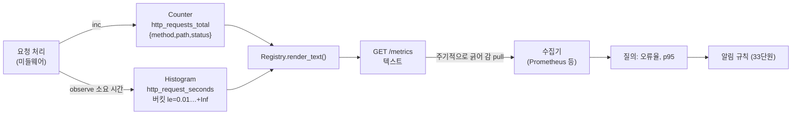

# 32 — 지표와 추적

## 목표

요청 수·오류 수(카운터)와 지연 분포(히스토그램)를 모아 **p50/p95 를 계산**하고, `GET /metrics` 로 Prometheus 텍스트 형식으로 내보냅니다.
분산 추적(distributed tracing)이 31단원의 요청 id와 어떻게 다르고 어떻게 이어지는지 개념으로 이해합니다.

## 노트와의 연결

노트는 운영 영역의 "관측성·알림·장애 관리"를 꼽고 "장애를 누가, 무엇으로 가장 먼저 알아채는가?"를 묻습니다. 30단원의 실험에서
그 답이 "내 눈"이었다면 아직 관측성이 없는 것입니다. 지표는 "지난 5분간 오류율 3%", "p95 지연 800ms" 처럼 **숫자 하나로 상태를 말해 주는**
신호이고, 33단원의 알림 규칙은 이 숫자 위에 세워집니다.

## 공부할 개념

| 개념 | 핵심 | 참고 |
| --- | --- | --- |
| 카운터(counter)와 히스토그램(histogram) | 카운터는 단조 증가(요청 수, 오류 수). 비율은 "증가량 / 시간"으로 나중에 계산. 히스토그램은 값의 분포를 누적 버킷(`le`)으로 센다. 라벨(label)은 `method`, `status` 처럼 차원을 나누는 키 — 사용자 id 같은 고유값은 라벨로 쓰지 않는다(카디널리티 폭발) | [Prometheus: Histograms and summaries](https://prometheus.io/docs/practices/histograms/) |
| 백분위수(percentile) p50/p95/p99 | "요청의 95%는 이 시간 안에 끝났다". 평균은 느린 꼬리를 숨긴다. nearest-rank: 정렬 후 `ceil(p/100 × n)` 번째 | [statistics 모듈 (quantiles)](https://docs.python.org/3/library/statistics.html) |
| 노출 형식과 분산 추적 | `/metrics` 는 수집기가 주기적으로 긁어 가는(pull) 텍스트. 추적(trace)은 한 요청이 지나간 구간(span)들을 부모-자식 트리로 — 요청 id는 "같은 요청"만 알려 주고, 추적은 "어디서 얼마나"까지 알려 준다. 표준은 OpenTelemetry | [Prometheus exposition formats](https://prometheus.io/docs/instrumenting/exposition_formats/), [OpenTelemetry: Traces](https://opentelemetry.io/docs/concepts/signals/traces/) |

읽는 법: 앱은 숫자를 메모리에 쌓고 `/metrics` 로 보여 주기만 하며, 비율·백분위수 계산과 알림은 바깥 수집기가 주기적으로 가져가서 합니다.

## 과제

이 단원은 ◐ 입니다. `test_unit32.py` 의 13개 뼈대를 채운 뒤 `metrics.py` 를 구현합니다.

| 할 일 | 하는 일 |
| --- | --- |
| `Counter(name, help, labels)` | 라벨 조합별 단조 증가. `render()` 는 Prometheus 텍스트 |
| `Histogram(name, help, buckets)` | 누적 버킷·count·sum, `percentile(p)` nearest-rank, `render()` |
| `Registry` | 이름 중복 거절, `render_text()` |
| `timed(histogram, clock)` | 블록 소요 시간 관측. 예외가 나도 기록 |

이 구현은 백분위수를 위해 **원시 값을 모두 보관**합니다. 운영용 라이브러리는 메모리가 무한히 자라지 않도록 버킷 개수만 보관하고
백분위수를 버킷 경계로 **근사**합니다. 그 차이를 "더 깊이"에서 다룹니다.

### 프로젝트에 붙이기

| 어디에 | 무엇을 |
| --- | --- |
| `todo/metrics.py` | 이 모듈을 옮기고 모듈 수준 `registry = Registry()` 와 `http_requests_total`, `http_request_seconds` 를 만든다 |
| `todo/api.py` — 미들웨어 | 31단원의 요청 id 미들웨어 옆에서 `with timed(http_request_seconds):` 로 감싸고 응답 뒤 `http_requests_total.inc(method=..., path=라우트 템플릿, status=str(code))`. `path` 는 `/tasks/{id}` 처럼 **템플릿**(실제 id 가 아니라) — 아니면 라벨이 무한히 늘어난다 |
| `GET /metrics` | `PlainTextResponse(registry.render_text())`. 27단원 속도 제한과 18단원 인증에서 제외하되, 운영에서는 내부망에서만 접근 가능하게(35단원) |
| `todo/worker.py` | `notifications_sent_total{result="ok"/"failed"/"queued"}`, 28단원 브레이커 상태를 `circuit_state{dependency="notifier"}` 게이지(0/1/2)로 — 게이지(gauge)는 이 단원에 없으니 Counter 를 흉내 내거나 직접 추가 |
| 추적(개념) | 31단원의 `X-Request-ID` 를 그대로 두고, 여유가 있으면 `traceparent` 헤더(W3C Trace Context)로 바꾸는 것을 "더 깊이"에서 |

## 스스로 답해 볼 질문

1. 평균 지연 110ms, p95 10ms, p99 2000ms 인 서비스가 있습니다. 사용자 100명 중 몇 명이 2초를 기다리나요? 평균만 보면 무엇을 놓치나요?
2. 카운터 라벨에 `user_id` 를 넣으면 무슨 일이 생기나요? 사용자가 10만 명이면 `/metrics` 응답은 몇 줄인가요?
3. 요청 id(31단원)로 세 서비스의 로그를 이어 붙였습니다. 추적(trace)이 추가로 알려 주는 것은 무엇인가요? "어느 구간이 느렸는가"를 로그만으로 알 수 있나요?
4. `/metrics` 를 인터넷에 열어 두면 어떤 정보가 새나요? 29단원의 눈으로.
5. 히스토그램 버킷 경계를 `(0.1, 1.0, 10.0)` 으로 하면 p95 가 "0.1과 1.0 사이"라고만 나옵니다. 버킷을 어떻게 골라야 하나요? 지금 서비스의 지연 분포를 먼저 재야 하는 이유는?

## 함정

- 라벨 값에 고유 식별자(id, 이메일, 요청 id)를 넣지 마세요. 지표 하나가 수십만 시계열이 됩니다.
- 카운터를 "현재 동시 요청 수"처럼 내려가는 값에 쓰면 안 됩니다. 그것은 게이지입니다.
- `/metrics` 핸들러 자체가 느리면(렌더에 1초) 수집기가 타임아웃 냅니다. 렌더는 메모리 값을 문자열로 바꾸는 것뿐이어야 합니다.
- 지표를 모으는 코드가 예외를 던져 요청을 실패시키면 관측이 장애가 됩니다. 미들웨어에서 지표 코드는 `try/except` 로 감싸고 실패는 로그만.
- 여러 인스턴스(37단원)에서는 인스턴스마다 다른 숫자입니다. 수집기가 합치며, 앱은 합치려 하지 않습니다.

## 완료 기준

- [ ] `test_unit32.py` 13개 테스트 본문 작성 후 `pytest units/32-metrics-and-tracing` 전부 통과
- [ ] `todo/api.py` 미들웨어 + `GET /metrics`. `TestClient` 로 "요청 3번 뒤 `/metrics` 에 `http_requests_total{...} 3` 이 있다" 테스트 1개, "`path` 라벨이 `/tasks/{id}` 템플릿이다" 테스트 1개
- [ ] 27단원 폭주 스크립트를 돌리고 `/metrics` 에서 p50/p95 를 직접 계산해 10단원 `perf_counter` 측정과 비교, `NOTES.md` 에 표
- [ ] `NOTES.md` 배운 것 3가지 / 헷갈린 것 1가지 / 다음 단원에 바꿀 것
- [ ] 세 문장 설명: "왜 평균 응답 시간 대신 95퍼센타일을 보는가"
- [ ] AI 코드 리뷰: 미들웨어를 리뷰받고 "라벨 카디널리티" 지적을 확인(없으면 왜 없는지 물어보기)
- [ ] 에이전트에게 작은 과제: "`Gauge(name, help)` 를 `set/inc/dec` 와 `render` 로 추가하고 테스트 3개를 써라". 검토 포인트: `# TYPE name gauge` 줄, 음수 허용 여부를 테스트가 명시하는지
- [ ] 브랜치 `unit-32` → PR → 스스로 리뷰 → 머지

## 더 깊이

- 버킷 근사: 원시 값 없이 누적 버킷만으로 p95 를 선형 보간하는 함수를 써 보고, 원시 값 기반 결과와 오차를 재 보세요. 메모리 vs 정확도의 트레이드오프입니다.
- OpenTelemetry Python SDK 로 `todo` API 와 `notifier` 에 자동 계측을 붙이고, 콘솔 exporter 로 span 트리를 눈으로 확인해 보세요. `traceparent` 헤더가 어떻게 전파되는지 봅니다.
- RED(Rate, Errors, Duration) 와 USE(Utilization, Saturation, Errors): 서비스 지표를 고르는 두 틀. 할 일 API 의 RED 세 지표를 정의해 보세요.
