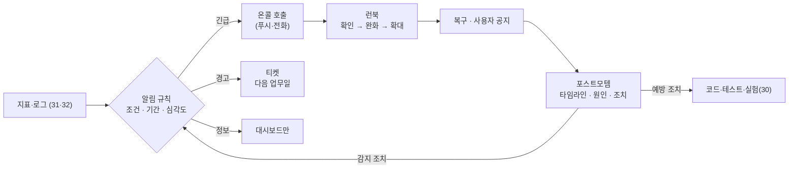

# 33 — 알림·장애 대응·포스트모템

## 목표

32단원의 지표 위에 **사람이 행동해야 할 때만 우는** 알림 규칙을 세우고, 알림마다 런북(runbook)을 연결하고,
장애가 끝나면 비난 없는 포스트모템(blameless postmortem)으로 "감지·완화·예방" 조치를 뽑아내는 순환을 만듭니다.
"장애를 누가, 무엇으로 가장 먼저 알아채는가?"에 "사용자가 아니라 알림이"라고 답할 수 있게 됩니다.

## 노트와의 연결

노트는 운영 영역에 "관측성·알림·장애 관리"를 두고, 질문으로 "장애를 누가, 무엇으로 가장 먼저 알아채는가?"를 적었습니다.
30단원의 실험 기록에서 "가장 먼저 알아챈 것" 열을 다시 보세요. 그것이 "내 눈"이나 "사용자"였다면 이 단원이 바꿉니다.
노트는 또 "인프라는 테스트와 실험 기간이 필요하다"고 했습니다. 알림 임계값은 코딩이 아니라 측정과 조정으로 정해집니다.

## 공부할 개념

| 개념 | 핵심 | 참고 |
| --- | --- | --- |
| 알림 규칙(alerting rule)과 심각도 | 조건(지표 + 기간 + 임계값) → 심각도(긴급 page / 경고 ticket / 정보). 증상(사용자가 겪는 것: 오류율·지연·가용성)에 알림을 걸고 원인(CPU, 큐 길이)은 대시보드로. 행동 없는 알림은 피로(alert fatigue)를 만들고 결국 진짜 알림을 무시하게 한다 | [SRE Book: Monitoring Distributed Systems](https://sre.google/sre-book/monitoring-distributed-systems/) |
| 런북(runbook)과 온콜(on-call) | 알림마다 "새벽 3시의 나"가 따라 할 수 있는 확인 순서·완화·확대 절차. 온콜은 그 알림을 받는 당번. 혼자인 프로젝트에서도 "받는 사람·시간·기대 응답"을 적어야 알림이 의미를 가진다 | [SRE Book: Being On-Call](https://sre.google/sre-book/being-on-call/), [Emergency Response](https://sre.google/sre-book/emergency-response/) |
| 비난 없는 포스트모템(blameless postmortem) | "누가 실수했나"가 아니라 "무엇이 그 행동을 합리적으로 보이게 했고, 시스템은 왜 막지 못했나". 타임라인, 감지 시간, 조치 항목(예방·감지·완화) | [SRE Book: Postmortem Culture](https://sre.google/sre-book/postmortem-culture/) |

읽는 법: 알림은 심각도에 따라 세 갈래로 나뉘고, 긴급만 사람을 깨우며, 포스트모템의 조치가 다시 알림 규칙(감지)과 코드(예방)로 되돌아가는 순환입니다.

## 과제

이 단원은 ○ 입니다. 세 템플릿을 채우고, 30단원의 실험 하나를 "실제 장애"로 삼아 전체 순환을 한 번 돌립니다.

| 할 일 | 산출물 |
| --- | --- |
| 알림 규칙표 | `alert_rules.md` → `docs/alerts.md`. 규칙 5개 이상, 모두 32단원 지표나 31단원 로그로 **실제 계산 가능**해야 하고 임계값마다 근거(측정값)가 있어야 함 |
| 알림 구현(최소) | 외부 서비스 없이: `scripts/check_alerts.py` 가 `/metrics` 를 읽어(또는 `/health` 를 호출해) 규칙을 평가하고 위반이면 종료 코드 1 과 메시지를 낸다. cron 이나 34단원 CI 의 스케줄 실행으로 5분마다 돌리고, 실패 시 이메일·메신저 웹훅으로 보낸다(무료 수단 중 아무것이나) |
| 런북 | 긴급 알림마다 한 장(`docs/runbooks/RB-01.md` …). 30단원 실험 기록이 "흔한 원인과 조치" 표의 재료 |
| 포스트모템 1회 | 30단원 실험 중 하나(또는 실제로 겪은 장애)를 `docs/postmortems/YYYY-MM-DD-제목.md` 로. 조치 항목에 "감지" 1개 이상 |
| 알림 발사 훈련 | 알림 규칙 하나를 일부러 위반시켜(notifier 끄기 등) 실제로 알림이 **내 손에 도착**하는지 확인. 도착까지 걸린 시간 기록 |

### 프로젝트에 붙이기

| 어디에 | 무엇을 |
| --- | --- |
| `GET /health` | 28단원 브레이커 상태, DB 쓰기 가능 여부(30단원 실험 2), 큐 길이를 포함해 "서비스 다운" 과 "저하" 알림의 근거로 쓴다 |
| `scripts/check_alerts.py` | 규칙 평가기. 규칙은 코드가 아니라 **표(JSON/YAML)** 에서 읽게 하면 임계값 조정이 배포 없이 된다 |
| 31단원 로그 | 알림 메시지에 **요청 id 예시 하나**와 런북 링크를 넣는다. 새벽의 나는 검색어가 필요하다 |
| `docs/adr/0023-alerting-policy.md` | 심각도 정의, 긴급 알림 목록, 받는 사람과 기대 응답 시간, "알림을 추가하는 기준"과 "지우는 기준" |

## 스스로 답해 볼 질문

1. "CPU 90%" 와 "p95 지연 2초" 중 어느 것에 긴급 알림을 걸어야 하나요? 증상과 원인의 차이로 설명해 보세요.
2. 지난 달 알림 40개가 울렸는데 행동한 것은 2개입니다. 나머지 38개는 무엇을 하고 있었나요? 어떻게 줄이나요?
3. 혼자 운영하는 프로젝트에 온콜이 필요한가요? "받지 않을 알림"은 왜 없는 것보다 나쁜가요?
4. 포스트모템에서 "배포 전 테스트를 안 돌린 사람"을 지목하면 다음 장애 때 무슨 일이 생기나요? 같은 사실을 비난 없이 쓰면 어떤 문장이 되나요?
5. 감지까지 40분, 복구까지 5분이 걸린 장애가 있습니다. 다음 조치는 "복구를 더 빠르게"인가요, "감지를 더 빠르게"인가요?

## 함정

- 알림을 "혹시 몰라서" 추가하면 한 달 뒤 전부 무시됩니다. 추가 기준은 "이 알림을 받으면 **지금 무엇을 할 것인가**"에 답이 있는가.
- 임계값을 감으로 정하지 마세요. 27·32단원에서 잰 p95 와 오류율의 몇 배인지 적으세요.
- 런북이 "로그를 확인한다"로 끝나면 새벽에는 쓸모없습니다. 명령어와 "정상이면 / 아니면" 분기를 적으세요.
- 포스트모템을 복구 직후에 안 쓰면 일주일 뒤에는 타임라인이 사라집니다. 24시간 안에 초안.
- 알림이 **도착하는지** 확인하지 않은 알림 시스템은 없는 것과 같습니다. 훈련으로 확인하세요.

## 완료 기준

- [ ] `docs/alerts.md` 규칙 5개 이상, 각각 근거 수치와 런북 연결
- [ ] `scripts/check_alerts.py` 와 5분 주기 실행, 위반 시 내 손에 도착하는 경로 1개
- [ ] 알림 발사 훈련 1회: 도착까지 걸린 시간 기록
- [ ] 긴급 알림마다 런북 1장(최소 2장)
- [ ] 포스트모템 1건, 조치 항목에 "감지" 1개 이상, 그중 1개 실제 반영
- [ ] `docs/adr/0023-alerting-policy.md`
- [ ] `NOTES.md` 배운 것 3가지 / 헷갈린 것 1가지 / 다음 단원에 바꿀 것 + "장애를 가장 먼저 알아채는 것은 이제 무엇인가" 한 줄
- [ ] 세 문장 설명: "왜 모든 이상 징후에 알림을 걸지 않는가"
- [ ] AI 코드 리뷰: 알림 규칙표를 AI 에게 리뷰받고 "원인에 건 알림"을 지적받으면 대시보드로 내리기
- [ ] 에이전트에게 작은 과제: "`check_alerts.py` 의 규칙 평가 함수에 대해 '임계값 바로 아래/위, 기간 미달' 경계 테스트 6개를 써라". 검토 포인트: 테스트가 시간을 주입하는지, 실제 `/metrics` 를 호출하지 않는지
- [ ] 브랜치 `unit-33` → PR → 스스로 리뷰 → 머지

## 더 깊이

- SLO(service level objective)와 오류 예산(error budget): "99.5% 가용성"을 목표로 정하면 한 달에 3.6시간의 장애 예산이 생깁니다. 예산 소진 속도(burn rate)로 알림을 거는 방식을 읽어 보세요.
- 장애 지휘(incident command): 사람이 둘 이상이면 "지휘자·조사자·기록자·소통 담당"으로 역할을 나눕니다. 혼자여도 "기록"은 따로 떼어 두세요(타임라인은 실시간으로).
- 36단원의 롤백·기능 플래그는 런북의 "완화" 절에 들어갈 가장 빠른 도구입니다.
