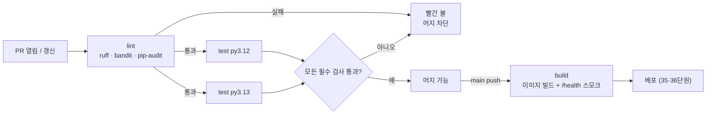

# 34 — CI/CD

## 목표

GitHub Actions 로 **PR 마다 린트·정적 분석·테스트(여러 Python 버전)·이미지 빌드**가 자동으로 돌고, 하나라도 깨지면 머지가 막히는
파이프라인을 만듭니다. 캐시로 실행 시간을 줄이고, CI 설정 파일 자체도 테스트합니다.

## 노트와의 연결

노트는 운영 영역에 "배포 환경·릴리스 전략·CI/CD"를, 그리고 "버전 관리·코드 리뷰·의존성 관리·기술 부채"를 둡니다.
01단원부터 PR 로 스스로 리뷰해 왔지만, 그 리뷰는 사람의 눈에 의존했습니다. CI 는 "테스트를 돌렸는가, 린트를 통과했는가, 취약한
의존성은 없는가"를 **사람이 잊어도** 매번 확인합니다. 에이전트가 PR 을 만드는 시대에 CI 는 에이전트 결과물의 첫 번째 검증 관문입니다
(노트: "결과물을 불확실한 것으로 보기").

## 공부할 개념

| 개념 | 핵심 | 참고 |
| --- | --- | --- |
| 워크플로(workflow)·잡(job)·스텝(step) | YAML 한 파일 = 워크플로. `on` 은 언제(pull_request, push), `jobs` 는 무엇을(각각 새 VM), `steps` 는 어떻게(`uses` 는 남의 액션, `run` 은 셸). `needs` 로 순서 | [GitHub Actions 문서](https://docs.github.com/actions), [Workflow syntax](https://docs.github.com/en/actions/reference/workflow-syntax-for-github-actions) |
| 매트릭스(matrix)와 캐시(cache) | 매트릭스는 같은 잡을 여러 조합(Python 3.12/3.13)으로 병렬 실행. 캐시는 `pip` 다운로드를 `requirements*.txt` 해시 기준으로 재사용 → 분 단위 절약 | [Using a matrix for your jobs](https://docs.github.com/en/actions/using-jobs/using-a-matrix-for-your-jobs) |
| 깨진 PR 막기: 상태 검사와 브랜치 보호 | CI 결과는 PR 의 상태 검사(status check)로 표시된다. 브랜치 보호 규칙(branch protection)에서 "필수 검사 통과"를 켜야 **머지가 막힌다**. CI 만 있고 보호가 없으면 빨간 불을 무시하고 머지할 수 있다 | 저장소 Settings → Branches |

읽는 법: 린트가 먼저 돌아 싸게 실패하고, 테스트는 두 버전이 병렬로 돌며, 브랜치 보호가 "모든 필수 검사 통과"를 머지 조건으로 삼을 때만 빨간 불이 실제로 머지를 막습니다.

## 과제

이 단원은 ◐ 입니다. 템플릿을 복사해 CI 를 올리고, `test_unit34.py` 의 8개 뼈대로 설정 파일을 검증합니다.

| 할 일 | 하는 일 |
| --- | --- |
| `ci.yml.example` → `.github/workflows/ci.yml` | 복사 후 `TODO` 를 채운다. 이 단원 폴더의 파일은 **실행되지 않는** 예시이고, 실제 워크플로는 저장소 루트 `.github/` 아래여야 한다 |
| `requirements-dev.txt` | `pytest`, `coverage`, `ruff`, `bandit`, `pip-audit`, `pyyaml` 버전 고정 |
| `pyproject.toml` 의 `[tool.ruff]` | 처음엔 기본 규칙만. 경고가 수백 개면 `ruff check --fix` 로 정리하는 PR 을 **따로** |
| 브랜치 보호 | main 에 "PR 필수 + 필수 검사: lint, test(3.12), test(3.13)" |
| `test_unit34.py` | `pyyaml` 로 워크플로를 읽어 8가지를 검사. YAML 1.1 에서 `on:` 키가 `True` 로 읽히는 함정을 테스트가 다룬다 |
| 일부러 깨 보기 | 테스트 하나를 실패하게 만든 PR 을 올려 머지 버튼이 **실제로 비활성화**되는 화면을 캡처해 `NOTES.md` 에 |

### 프로젝트에 붙이기

| 어디에 | 무엇을 |
| --- | --- |
| `.github/workflows/ci.yml` | 위 템플릿. 테스트는 `pytest units/` 전체가 아니라 **프로젝트 테스트**(`todo/`, `notifier/`)를 돌린다. 단원 테스트는 미완성 단원이 섞여 있으므로 별도 잡이나 `--ignore` |
| 29단원 | `bandit`, `pip-audit` 를 lint 잡에. 실패 정책(차단/경고)은 ADR-0021 을 따른다 |
| 24단원 | `coverage report --fail-under` 의 숫자. "현재 값 - 0"에서 시작해 내려가지 않게 하는 것이 목표 |
| 35단원 예고 | `build` 잡의 `docker build` 와 `/health` 스모크 테스트. Dockerfile 이 생기면 켠다 |
| 33단원 | `schedule:` 트리거로 `scripts/check_alerts.py` 를 5분마다 돌리는 두 번째 워크플로(선택) |

## 스스로 답해 볼 질문

1. CI 가 초록인데 운영에서 깨졌습니다. CI 가 검증하지 **않는** 것을 세 가지 들어 보세요(환경 변수, 실제 DB, 네트워크…).
2. 린트를 테스트보다 먼저 돌리고 실패하면 테스트를 건너뛰는 이유는? 반대로 둘 다 항상 돌리면 무엇을 얻나요?
3. 매트릭스에 3.12 와 3.13 을 둘 다 넣는 비용(시간·분)과 이득은? 운영은 한 버전만 쓰는데 왜?
4. 브랜치 보호 없이 CI 만 있을 때, 바쁜 날 빨간 불을 무시하고 머지하고 싶은 유혹은 어떻게 생기나요? 규칙이 사람의 의지를 대신하는 이유.
5. 에이전트가 올린 PR 의 CI 가 초록입니다. 머지해도 되나요? CI 가 "테스트가 내 목표를 반영하는가"(24단원)를 확인해 주나요?

## 함정

- `on:` 을 PyYAML 로 읽으면 키가 `True` 가 됩니다(YAML 1.1 의 불리언). `workflow.get("on") or workflow.get(True)` 처럼 다루거나 `yaml.safe_load` 대신 더 엄격한 로더를 쓰세요.
- 워크플로에 비밀값을 직접 쓰면 공개 저장소의 모든 이가 봅니다. `${{ secrets.NAME }}` 과 저장소 Settings → Secrets.
- `pip install` 에 캐시가 없으면 매 실행 1~2분이 설치에 갑니다. `setup-python` 의 `cache: pip` 한 줄.
- `ubuntu-latest` 는 바뀝니다. 재현성이 중요해지면 `ubuntu-24.04` 처럼 고정하세요.
- 단원 폴더의 미완성 테스트(`pytest.fail`)를 CI 에 포함하면 영원히 빨간 불입니다. 프로젝트 테스트와 분리하세요.

## 완료 기준

- [ ] `.github/workflows/ci.yml` 이 PR 에서 lint → test(3.12, 3.13) 로 돌고 초록
- [ ] 브랜치 보호로 필수 검사 설정, "일부러 깨뜨린 PR"이 머지 불가인 화면 기록
- [ ] `test_unit34.py` 8개 테스트 본문 작성 후 `pytest units/34-ci-cd` 전부 통과
- [ ] CI 한 번 실행 시간과 캐시 적중 후 시간을 `NOTES.md` 에 비교
- [ ] `NOTES.md` 배운 것 3가지 / 헷갈린 것 1가지 / 다음 단원에 바꿀 것
- [ ] 세 문장 설명: "왜 코드를 합치기 전에 기계가 먼저 검사하는가"
- [ ] AI 코드 리뷰: `ci.yml` 을 리뷰받고 "권한·비밀값" 지적 하나 반영, "불필요한 단계" 지적 하나는 반박 또는 수용
- [ ] 에이전트에게 작은 과제: "`ruff check` 경고를 `--fix` 로 정리하는 PR 을 만들되 **동작 변경이 없음**을 기존 테스트로 보여라". 검토 포인트: 린트 수정 PR 에 기능 변경이 섞이지 않았는지 diff 로 확인
- [ ] 브랜치 `unit-34` → PR → (이제 CI 가 돈다) → 머지

## 더 깊이

- CD(continuous deployment): `build` 잡 뒤에 35단원 호스팅의 배포 명령을 붙이면 main 머지 = 배포가 됩니다. 36단원의 롤백 전략이 먼저 있어야 안전합니다.
- 재사용 워크플로(reusable workflow)와 `workflow_call` 로 `todo` 와 `notifier` 두 서비스가 같은 파이프라인을 공유하기.
- 로컬에서 CI 와 같은 명령을 돌리는 `make ci` 또는 `scripts/ci.sh`. "CI 에서만 깨진다"를 줄입니다.
