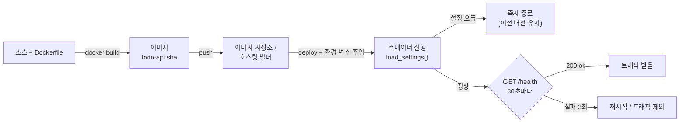

# 35 — 배포

## 목표

`todo` API 를 **Docker 이미지로 만들고, 설정은 환경 변수로 분리하고, 헬스 체크를 갖춘 채 무료 호스팅에 실제로 올려서**
인터넷의 다른 기기에서 할 일을 추가해 봅니다. "내 컴퓨터에서는 되는데"가 왜 생기고 어떻게 없애는지 몸으로 익힙니다.

## 노트와의 연결

노트는 운영 영역의 첫 항목으로 "배포 환경"을 꼽고, 4단계 끝에 "사용자에게 보여 주기"를 의식으로 둡니다. 배포되지 않은 소프트웨어는
사용자에게 존재하지 않습니다. 또 노트는 "인프라는 테스트와 실험 기간이 필요해 빠른 코딩이 큰 도움이 되지 않는다"고 했습니다.
이 단원에서 시간이 가장 많이 드는 곳은 코드가 아니라 "환경 변수 하나 빠짐", "포트가 다름", "파일 권한" 같은 것입니다. 그것이 정상입니다.

## 공부할 개념

| 개념 | 핵심 | 참고 |
| --- | --- | --- |
| 컨테이너 이미지(container image)와 Dockerfile | 코드 + 런타임 + 의존성을 한 덩어리로 굳힌 것. 어디서 돌려도 같다. 다단계 빌드(multi-stage)로 작게, 전용 사용자로 root 를 피한다 | [Dockerfile reference](https://docs.docker.com/reference/dockerfile/), [Docker Get started](https://docs.docker.com/get-started/) |
| 설정과 코드의 분리 (12-factor config) | 환경마다 다른 값은 환경 변수로. 이미지는 하나, 설정만 바뀐다. 비밀값은 이미지에 굽지 않는다. 시작 시 검증해 잘못됐으면 **뜨지 않는다** | [12factor.net/ko/config](https://12factor.net/ko/config), [12factor.net/ko/processes](https://12factor.net/ko/processes) |
| 헬스 체크(health check) | 플랫폼이 주기적으로 `GET /health` 를 호출해 "살아 있는가(liveness)"와 "요청을 받을 준비가 됐는가(readiness)"를 본다. 실패하면 트래픽을 빼거나 재시작한다. 28단원의 "저하(degraded)"를 구분해 표현 | [AWS Builders' Library: Implementing health checks](https://aws.amazon.com/builders-library/implementing-health-checks/) |

읽는 법: 이미지는 한 번 만들어 어디든 같고, 환경 변수는 실행 시점에 들어가며, 헬스 체크가 통과할 때만 사용자 트래픽이 들어옵니다.

## 과제

이 단원은 ◐ 입니다. `app_config.py` 와 `test_unit35.py` 의 12개 뼈대(parametrize 포함 19개 수집)를 채우고, 실제로 배포합니다.

| 할 일 | 하는 일 |
| --- | --- |
| `app_config.py` | `load_settings(env)` 환경 변수 → `Settings`, 잘못되면 `ConfigError`. `health_payload()` |
| `Dockerfile.example` → `Dockerfile` | 저장소 루트로 복사, `TODO` 채움. `dockerignore.example` → `.dockerignore` |
| 로컬 실행 | `docker build -t todo-api .` → `docker run -p 8000:8000 -e TODO_API_SECRET=dev todo-api` → `curl localhost:8000/health` |
| 실제 배포 | 아래 "무료 호스팅" 참고. 배포 URL 을 `NOTES.md` 에 |
| 다른 기기에서 확인 | 휴대폰으로 `/health` 와 `/docs`(17단원 OpenAPI) 열어 보기, 할 일 하나 추가 |

### 무료 호스팅에 올리기

Render 나 Fly.io 같은 서비스는 GitHub 저장소나 Dockerfile 에서 바로 배포할 수 있는 무료 또는 저가 등급을 제공해 왔습니다.
요금과 제한은 자주 바뀌므로 **반드시 공식 문서에서 현재 조건을 확인**하고 결제 수단 등록 여부를 미리 보세요.

- [Render 문서](https://render.com/docs) — "Web Service" 로 Dockerfile 배포, 환경 변수와 헬스 체크 경로(`/health`) 설정이 대시보드에 있음
- [Fly.io 문서](https://fly.io/docs/) — `fly launch` 가 Dockerfile 을 읽음, `fly secrets set TODO_API_SECRET=...`, `fly.toml` 의 `[checks]`

공통 순서: (1) 환경 변수에 `TODO_API_SECRET`(29단원의 `secrets.token_urlsafe(32)` 로 생성), `TODO_ENV=production`, `TODO_HOST=0.0.0.0` 설정
(2) 헬스 체크 경로 `/health` (3) 배포 (4) 로그에서 31단원 JSON 로그가 보이는지 확인 (5) 플랫폼이 주는 포트 환경 변수(`PORT`)가 있으면 `TODO_PORT` 로 연결.

**SQLite 와 무료 등급**: 컨테이너의 파일 시스템은 보통 재배포 때 사라집니다. 영구 디스크(persistent volume)를 붙이거나,
이번 단원은 "재배포하면 데이터가 사라진다"를 **알고 받아들이고** ADR 에 적습니다. 37단원에서 다시 봅니다.

### 프로젝트에 붙이기

| 어디에 | 무엇을 |
| --- | --- |
| `todo/config.py` | `app_config.py` 를 옮긴다. 앱 생성 함수가 `settings = load_settings()` 를 **한 번** 받아 모든 곳에 주입(15단원 의존성 주입). 전역으로 아무 데서나 `os.environ` 을 읽지 않는다 |
| `todo/api.py` — `GET /health` | `health_payload(settings, database_ok=repo.ping(), dependencies={"notifier": breaker.state.value})`. `repo.ping()` 은 `SELECT 1` |
| `todo/api.py` 시작 | `configure_logging(settings.log_level)`(31단원), 속도 제한 수치(27단원)를 설정에서 |
| `notifier/` | `Dockerfile.notifier` 와 자체 `/health`. 두 서비스가 서로의 URL 을 환경 변수로 받는다 |
| `.env.example` | 변수 **이름과 설명만**. 실제 `.env` 는 `.gitignore` |
| 34단원 CI | `build` 잡을 켠다: 이미지 빌드 + `/health` 스모크 테스트 |

`docs/adr/0024-deployment.md` 에 "호스팅 선택과 이유, 설정 변수 목록, 데이터 영속성에 대한 결정(영구 디스크 vs 감수), 헬스 체크 의미"를 남기세요.

## 스스로 답해 볼 질문

1. 같은 이미지를 개발·운영에서 쓰고 설정만 바꾼다면, "운영에서만 나는 버그"는 어디서 올 수 있나요?
2. 설정이 잘못됐을 때 "기본값으로 어떻게든 뜨기"와 "즉시 종료"의 트레이드오프는? 운영에서 `TODO_API_SECRET=changeme` 로 떠 있는 서버는 무엇이 문제인가요?
3. `/health` 가 DB 에 `SELECT 1` 을 보내게 했습니다. DB 가 느려지면 헬스 체크가 실패하고 플랫폼이 컨테이너를 재시작합니다. 좋은 일인가요? 28단원의 눈으로.
4. 컨테이너를 root 로 돌리면 무엇이 위험한가요? 30단원의 피해 범위로 설명해 보세요.
5. 재배포하면 SQLite 파일이 사라집니다. 지금 이 프로젝트에서 그것은 허용 가능한 결정인가요? 어떤 신호가 오면 바꿔야 하나요?

## 함정

- `TODO_HOST=127.0.0.1` 로 컨테이너 안에서 띄우면 밖에서 접속이 안 됩니다. 컨테이너 안에서는 `0.0.0.0`.
- `.dockerignore` 없이 빌드하면 `.git`, `.venv`, `.env` 가 이미지에 들어갑니다. 비밀값 유출 + 이미지 비대.
- `pip install` 레이어 앞에 소스 전체를 `COPY` 하면 코드 한 줄 바꿀 때마다 의존성을 다시 설치합니다. `requirements.txt` 먼저.
- 헬스 체크가 너무 많은 것을 검사하면(외부 API 까지) 부가 기능 장애가 서비스 재시작으로 번집니다. 핵심만 `down`, 나머지는 `degraded`.
- 환경 변수의 값은 **전부 문자열**입니다. `"8000"` 을 `int()` 로, `"false"` 를 `bool()` 로 바꾸면 `True` 입니다. 명시적으로 파싱하세요.

## 완료 기준

- [ ] `test_unit35.py` 12개 테스트 본문 작성 후 `pytest units/35-deployment` 전부 통과
- [ ] `docker build` 성공, 이미지 크기 기록, 로컬 `docker run` 에서 `/health` 200
- [ ] 실제 호스팅에 배포되어 휴대폰에서 할 일 추가 성공. URL 과 날짜를 `NOTES.md` 에
- [ ] 배포 로그에 31단원 JSON 로그가 보이고 비밀값이 없음을 확인
- [ ] `docs/adr/0024-deployment.md`
- [ ] `.env.example` 작성, `.env` 가 git 에 없음을 `git ls-files | grep .env` 로 확인
- [ ] `NOTES.md` 배운 것 3가지 / 헷갈린 것 1가지 / 다음 단원에 바꿀 것 + 배포에 걸린 총 시간과 막힌 곳 목록
- [ ] 세 문장 설명: "왜 서버 주소와 비밀번호를 프로그램 안에 적지 않는가"
- [ ] AI 코드 리뷰: Dockerfile 을 리뷰받고 "레이어 순서·사용자 권한" 지적 하나 반영
- [ ] 에이전트에게 작은 과제: "`load_settings` 에 `TODO_CORS_ORIGINS`(쉼표 구분 목록, 기본 빈 리스트)를 추가하고 테스트 3개(없음·하나·여럿+공백)를 써라". 검토 포인트: 빈 문자열이 `[""]` 가 아니라 `[]` 가 되는지
- [ ] 사용자에게 보여 주기: 배포된 URL 을 가족·친구에게 보내고 "가장 불편한 점" 한 줄 받기
- [ ] 브랜치 `unit-35` → PR → 머지 → (CI 의 build 잡 초록)

## 더 깊이

- liveness 와 readiness 를 분리한 `/health/live`, `/health/ready`: 시작 중(마이그레이션 적용 중)에는 live 지만 ready 가 아닙니다.
- 이미지 크기 줄이기: `python:3.12-slim` vs `alpine` 의 트레이드오프(C 확장 빌드 문제), 레이어 캐시 순서.
- 36단원에서는 "새 버전을 어떻게 안전하게 바꿔 끼우는가"를, 37단원에서는 "컨테이너를 둘로 늘리면 무엇이 깨지는가"를 봅니다.
