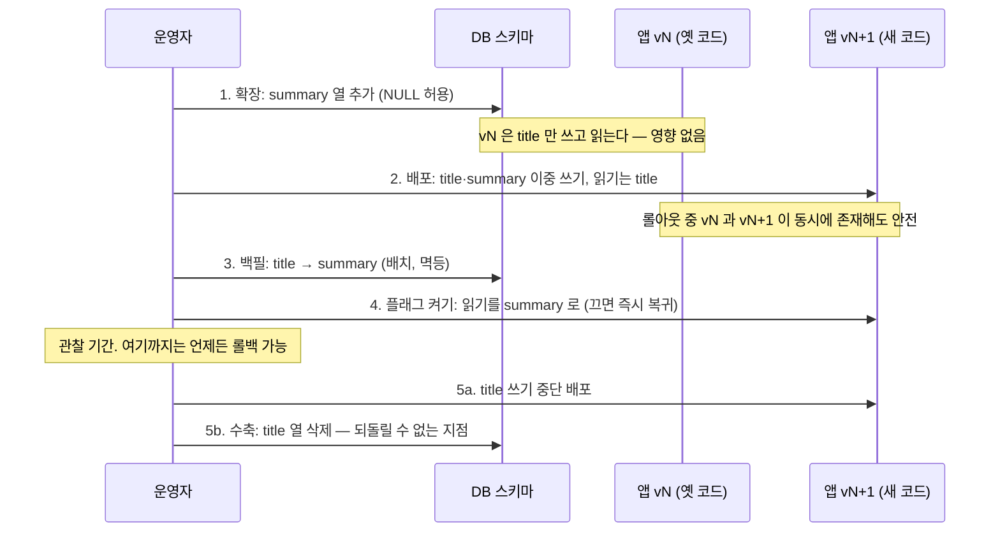

# 36 — 릴리스 전략

## 목표

**배포(deploy)와 릴리스(release)를 분리**합니다. 기능 플래그로 코드가 나가 있어도 사용자에게는 보이지 않게 하고,
블루/그린·카나리·롤백의 차이를 알고 내 규모에 맞는 것을 고르며, 스키마 변경을 확장-수축(expand-contract) 순서로 쪼개
"되돌릴 수 없는 지점"을 맨 마지막으로 미룹니다.

## 노트와의 연결

노트는 운영 영역에 "릴리스 전략"을 두고, 데이터 영역에서는 "되돌리기 어려운 결정"(12단원)을 강조했습니다. 두 주제가 여기서 만납니다.
새 버전을 내보내는 일은 코딩보다 **순서**의 문제입니다. 33단원의 런북에서 "완화" 절의 가장 빠른 도구가 "롤백"과 "플래그 끄기"였습니다.
그 도구가 실제로 작동하려면 배포가 그렇게 설계되어 있어야 합니다.

## 공부할 개념

| 개념 | 핵심 | 참고 |
| --- | --- | --- |
| 기능 플래그(feature flag / toggle) | 코드 경로를 설정으로 켜고 끈다. 배포 ≠ 릴리스. 비율(카나리)·특정 사용자(내부 테스트)로 점진 공개. 플래그는 **빚**이다 — 릴리스가 끝나면 지운다 | [Martin Fowler: Feature Toggles](https://martinfowler.com/articles/feature-toggles.html) |
| 블루/그린·카나리·롤백 | 블루/그린: 새 환경을 통째로 띄우고 트래픽을 한 번에 전환, 되돌리기는 다시 전환. 카나리: 일부(5%)에만 먼저, 지표를 보고 확대. 롤백: 이전 이미지 재배포. 모두 "이전 버전이 새 데이터를 읽을 수 있을 때만" 안전하다 | [BlueGreenDeployment](https://martinfowler.com/bliki/BlueGreenDeployment.html), [CanaryRelease](https://martinfowler.com/bliki/CanaryRelease.html) |
| 확장-수축(expand-contract, parallel change) | 스키마 변경을 "추가 → 이중 쓰기 → 백필 → 읽기 전환 → 제거"로 쪼갠다. 새 코드와 옛 코드가 동시에 도는 구간에서 둘 다 깨지지 않는다 | [Martin Fowler: ParallelChange](https://martinfowler.com/bliki/ParallelChange.html), [SRE Book: Release Engineering](https://sre.google/sre-book/release-engineering/) |

`tasks.title` → `tasks.summary` 로 열 이름을 바꾸는 경우입니다.

읽는 법: 위에서 아래로 시간이 흐르며, 마지막 두 단계(5a·5b) 전까지는 어느 시점에서든 옛 코드로 돌아가도 데이터가 깨지지 않습니다.

## 과제

이 단원은 ○ 입니다. 템플릿을 채우고, 실제로 플래그 뒤에서 기능 하나를 릴리스하고, 확장-수축을 한 번 끝까지 수행합니다.

| 할 일 | 산출물 |
| --- | --- |
| `feature_flags.py` 완성 + 테스트 | docstring 의 규칙을 `test_unit36.py` 로 옮겨(최소 6개: 모르는 플래그·꺼짐·허용 사용자·100%·같은 사용자 일관성·비율 근사) 통과. 비율 테스트는 사용자 1000명을 넣어 `percentage ± 5` 안인지 |
| 플래그 뒤의 릴리스 1회 | 작은 기능(예: 할 일 목록 정렬 옵션)을 플래그 `FLAG_SORT_V2` 뒤에 넣어 **꺼진 채 배포** → 내 계정만 켜서 확인 → 100% → 다음 릴리스에서 플래그 제거. 각 단계의 날짜를 체크리스트에 |
| 확장-수축 1회 | `expand_contract_plan.md` 로 실제 열 하나를 바꾼다(예: `done: INTEGER` → `completed_at: TEXT`, 12단원 마이그레이션 번호 두 개). 4단계 뒤 **일부러 롤백**해서 데이터가 멀쩡한지 확인 |
| 릴리스 체크리스트 | `release_checklist.md` 를 `docs/releases/vX.Y.Z.md` 로 복사해 두 번(위 두 릴리스)에 사용 |
| 롤백 연습 | 35단원 호스팅에서 이전 이미지 태그로 되돌리는 데 걸리는 시간을 재서 런북(33단원) "완화" 절에 적기 |

### 프로젝트에 붙이기

| 어디에 | 무엇을 |
| --- | --- |
| `todo/flags.py` | `feature_flags.py` 를 옮기고 35단원 `Settings` 에서 `FeatureFlags.from_env(os.environ)` 로 만들어 주입 |
| `todo/api.py` | 플래그가 필요한 핸들러는 `flags.is_enabled("sort_v2", user_id=current_user.id)` 로 분기. 분기는 **한 곳**(서비스 계층 진입점)에만 |
| `GET /health` 또는 `GET /flags`(관리자만) | 현재 플래그 상태 노출 — 런북에서 "지금 무엇이 켜져 있나"를 바로 본다 |
| `todo/migrations/` (12단원) | 확장용 번호와 수축용 번호를 **다른 파일**로. 수축 파일 머리말에 "실행 조건: vN+2 가 N일 이상 안정" |
| 31단원 로그 | 모든 로그에 `version`(커밋 해시) 필드 — 카나리 중 "어느 버전의 오류인가"를 가른다 |
| 34단원 CI | 이미지 태그를 커밋 해시로. 롤백은 "이전 해시로 재배포" 한 명령 |

`docs/adr/0025-release-strategy.md` 에 "선택한 배포 방식(지금 규모에서는 보통 재생성 또는 단순 롤백)과 그 이유, 플래그 수명 규칙(최대 N주), 수축 단계 실행 조건"을 남기세요.

## 스스로 답해 볼 질문

1. "배포했지만 릴리스하지 않았다"는 문장이 가능한 이유를 플래그로 설명해 보세요. 반대로 "릴리스했지만 배포하지 않았다"도 가능한가요?
2. 혼자 쓰는 인스턴스 하나짜리 서비스에 블루/그린이 필요한가요? 카나리의 "5%"는 사용자가 10명일 때 무슨 뜻인가요?
3. 열 이름을 `ALTER TABLE ... RENAME COLUMN` 한 줄로 바꾸고 새 코드를 배포하면, 배포되는 30초 동안 무슨 일이 생기나요?
4. 플래그가 20개 쌓인 코드는 어떤 상태인가요? 조합이 2^20 이면 테스트는 어떻게 하나요? 플래그를 "빚"이라 부르는 이유.
5. 롤백이 "이전 이미지 재배포"로 끝나지 않는 경우를 하나 들어 보세요(힌트: 수축 뒤, 또는 외부 시스템에 이미 보낸 알림).

## 함정

- 플래그 분기를 코드 곳곳에 흩뿌리면 지울 때 못 찾습니다. 진입점 한 곳에서 분기하고, 플래그 이름으로 grep 가능하게.
- `percentage` 판단에 `random` 을 쓰면 같은 사용자가 새로고침마다 다른 화면을 봅니다. 사용자 id 해시로 **결정적**으로.
- 확장 단계에서 `NOT NULL` 열을 기본값 없이 추가하면 옛 코드의 INSERT 가 즉시 깨집니다.
- 백필 스크립트가 멱등하지 않으면 중간에 끊겼을 때 재실행이 두 번 적용됩니다(26단원).
- 수축을 서두르지 마세요. 되돌릴 수 없는 유일한 단계입니다. "관찰 기간 N일"을 ADR 에 숫자로.

## 완료 기준

- [ ] `test_unit36.py` 직접 작성(6개 이상) + `feature_flags.py` 구현, `pytest units/36-release-strategy` 통과
- [ ] 플래그 뒤 릴리스 1회: 꺼진 배포 → 내 계정만 → 100% → 플래그 제거까지 날짜 기록
- [ ] 확장-수축 1회 완료, 4단계 뒤 롤백 연습에서 데이터 무결성 확인(행 개수·샘플 비교)
- [ ] 롤백 소요 시간 측정 → 런북 "완화" 절에 반영
- [ ] `docs/releases/` 에 체크리스트 2장, `docs/adr/0025-release-strategy.md`
- [ ] `NOTES.md` 배운 것 3가지 / 헷갈린 것 1가지 / 다음 단원에 바꿀 것
- [ ] 세 문장 설명: "왜 데이터베이스 열 하나를 바꾸는 데 다섯 단계가 필요한가" (`expand_contract_plan.md` 끝의 초안을 내 말로)
- [ ] AI 코드 리뷰: 확장-수축 계획을 AI 에게 리뷰받고 "이중 쓰기 구간의 불일치" 지적이 나오면 검증 쿼리로 반영
- [ ] 에이전트에게 작은 과제: "백필 스크립트를 1000행 배치·멱등·재실행 가능하게 작성하고, 중간에 강제 종료 후 재실행해도 결과가 같다는 테스트를 써라". 검토 포인트: 테스트가 실제로 중간 상태를 만드는지(절반만 처리된 DB)
- [ ] 브랜치 `unit-36` → PR → 머지

## 더 깊이

- 시맨틱 버전(semantic versioning): [semver.org/lang/ko](https://semver.org/lang/ko/). API 의 하위 호환을 깨는 변경은 언제 메이저를 올리나요? 17단원의 오류 응답 형식을 바꾸면?
- 다크 런치(dark launch): 새 코드 경로를 실제 트래픽으로 **실행하되 결과는 버리고** 비교만 하는 방식. 확장-수축 4단계의 안전망.
- 37단원에서 인스턴스가 둘이 되면 "롤아웃 중 두 버전 공존"이 상시 상태가 됩니다. 이 단원의 호환성 규칙이 그때 필수가 됩니다.
