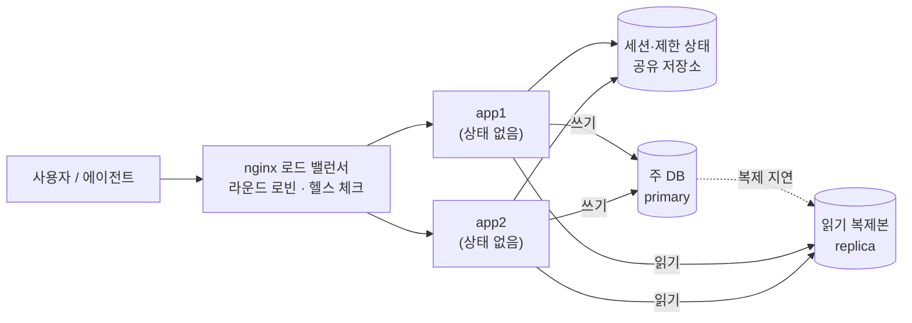

# 37 — 확장과 기술 부채

## 목표

앱 인스턴스를 **두 개**로 늘리고 nginx 로드 밸런서 뒤에 두어, 프로세스 메모리에 숨어 있던 상태(세션·속도 제한·브레이커·캐시)가
어떻게 깨지는지 직접 보고 세션을 외부화합니다. 읽기 복제본·샤딩을 개념으로 익히고, 의존성 갱신 루틴과 **기술 부채 장부**로
5단계 전체에서 "감수하기로 한 것"을 한 곳에 모읍니다.

## 노트와의 연결

노트는 운영 영역에 "로드 밸런싱, 샤딩·인덱싱·복제"와 "버전 관리·코드 리뷰·의존성 관리·기술 부채"를 둡니다. 두 묶음이 한 단원에
있는 이유는, 확장이 곧 부채를 드러내기 때문입니다. 27단원에서 "메모리 dict 는 인스턴스가 둘이면 한도가 두 배"라고 적어 두었습니다.
그때는 괜찮았던 결정이 오늘 이자를 청구합니다. 아키텍트의 일은 그 이자를 **미리 장부에 적어 두는 것**입니다.

## 공부할 개념

| 개념 | 핵심 | 참고 |
| --- | --- | --- |
| 로드 밸런서(load balancer)와 상태 없는 서버(stateless server) | 요청을 여러 인스턴스에 나눈다(라운드 로빈·최소 연결). 그러려면 "다음 요청이 다른 인스턴스로 가도" 같아야 한다 → 세션·캐시·제한 상태를 프로세스 밖으로. 12-factor 의 "프로세스" 원칙 | [nginx: HTTP load balancing](https://nginx.org/en/docs/http/load_balancing.html), [12factor.net/ko/processes](https://12factor.net/ko/processes) |
| 읽기 복제본(read replica)과 샤딩(sharding) — 개념 | 복제본: 쓰기는 주(primary) 하나, 읽기는 복제본 여럿. 복제 지연(replication lag) 때문에 "방금 쓴 것을 못 읽는" 문제(19단원 최신성). 샤딩: 데이터를 키(사용자 id)로 여러 DB 에 나눔 — 조인·트랜잭션이 어려워지는 되돌리기 힘든 결정 | [docker compose](https://docs.docker.com/compose/) |
| 의존성 갱신과 기술 부채 장부(tech debt ledger) | 의존성은 매주 작은 갱신이 분기별 큰 갱신보다 싸다(`pip list --outdated`, `pip-audit`, 테스트, PR). 부채는 "이자(매번 치르는 비용)"와 "원금(갚는 비용)", "상환 신호"를 적어 관리한다 | 29·34단원, `tech_debt_ledger.md` |

읽는 법: 두 앱은 메모리에 아무것도 기억하지 않고 공유 저장소와 DB 만 보며, 쓰기는 주 DB 하나로 모이고 읽기는 복제본으로 흩어지는데 점선(복제 지연)이 "방금 쓴 것을 못 읽는" 순간을 만듭니다.

## 과제

이 단원은 ◐ 입니다. `session_store.py` 와 `test_unit37.py` 의 9개 뼈대를 채우고, compose 로 두 인스턴스를 실제로 띄웁니다.

| 할 일 | 하는 일 |
| --- | --- |
| `session_store.py` | `MemorySessionStore`(대조군), `SqliteSessionStore`(공유). 테스트가 "인스턴스 둘"을 저장소 객체 둘로 흉내 낸다 |
| `docker-compose.example.yml` → `docker-compose.yml`, `nginx.conf.example` → `nginx.conf` | 앱 2개 + nginx. `TODO_INSTANCE_ID` 를 응답 헤더 `X-Instance` 로 노출 |
| 깨지는 것 관찰 | `TODO_SESSION_STORE=memory` 로 띄워 로그인 → 새로고침 반복 → 로그아웃되는 순간 포착. `sqlite` 로 바꿔 사라지는 것 확인 |
| 상태 없는 서버 점검표 | 아래 표를 `NOTES.md` 에 채운다 |
| 의존성 갱신 루틴 1회 | `pip list --outdated` → 하나씩 올림 → 테스트 → PR. 걸린 시간 기록. 주간 반복 일정(34단원 `schedule:` 또는 달력)에 등록 |
| 기술 부채 장부 | `tech_debt_ledger.md` → `docs/tech-debt.md`. 25~37단원 ADR 의 "감수하는 점"을 전부 옮긴다(최소 8개) |

상태 없는 서버 점검표:

| 프로세스 메모리에 있는 것 | 인스턴스 2개일 때 증상 | 조치 | 이번에 할까? |
| --- | --- | --- | --- |
| 로그인 세션(18단원) | 새로고침마다 로그아웃 | 세션 외부화(이 단원) | 예 |
| 속도 제한 버킷(27단원) | 한도 2배 | 공유 저장소 | 장부 TD-01 |
| 서킷 브레이커(28단원) | 한쪽만 열림 | 공유 또는 감수 | 장부 TD-02 |
| 서비스 캐시(19단원) | app1 에서 수정한 것이 app2 캐시에 남음 | TTL 짧게 / 공유 캐시 / 무효화 메시지 | |
| 멱등성 저장소(26단원) | SQLite 공유라면 OK, 메모리라면 중복 생성 | SQLite 유지 | 확인 |
| 지표(32단원) | 인스턴스별 숫자 | 수집기가 합침 — 정상 | 아니오 |
| 업로드 파일·SQLite 파일 | 볼륨 공유 안 하면 인스턴스마다 다른 데이터 | 볼륨 공유(지금) → 외부 DB(다음) | 장부 |

### 프로젝트에 붙이기

| 어디에 | 무엇을 |
| --- | --- |
| `todo/session_store.py` | 이 모듈. 18단원 로그인이 세션 방식이면 여기로, JWT 방식이면 "토큰 폐기 목록"을 같은 저장소에 |
| `todo/api.py` | 35단원 `Settings.instance_id` 를 읽어 모든 응답에 `X-Instance` 헤더. 27단원 속도 제한의 IP 키는 `X-Forwarded-For` 의 첫 값 |
| `docker-compose.yml` | 앱 2개 + nginx (+ notifier, 워커 1개). 두 앱이 **같은** SQLite 파일을 공유하므로 11단원의 `database is locked` 가 돌아온다 — 25단원 `retry` 로 감싼 것이 여기서 값을 한다 |
| 읽기 경로(개념 → 작은 실천) | 30단원의 읽기 전용 커넥션을 `GET` 핸들러에 쓰고, "쓰기 직후 읽기"가 복제 지연을 만나면 어떤 UX 가 되는지 ADR 에 적는다(실제 복제는 하지 않음) |
| `docs/tech-debt.md` | 장부. 분기별 점검 일정 |
| `docs/adr/0026-scaling-and-debt.md` | "지금 인스턴스 수, 세션 외부화 방식, 공유 SQLite 의 한계와 외부 DB 로 가는 신호, 샤딩을 하지 않는 이유, 의존성 갱신 주기" |

## 스스로 답해 볼 질문

1. 인스턴스를 둘로 늘리면 처리량이 두 배가 되나요? 두 앱이 같은 SQLite 파일에 쓸 때 병목은 어디로 옮겨 가나요?
2. 세션을 SQLite 에 넣으니 모든 요청이 세션 조회로 DB 를 칩니다. 이 비용은 19단원의 어떤 도구로 줄일 수 있고, 그러면 무엇이 다시 깨지나요?
3. 읽기 복제본에서 "방금 추가한 할 일이 목록에 없다"가 생깁니다. 사용자에게 설명 가능한 UX 와 불가능한 UX 를 하나씩.
4. 사용자 id 로 샤딩하면 "전체 할 일 중 오늘 마감"을 어떻게 구하나요? 샤딩을 **하지 않기로** 결정하는 신호는 무엇인가요?
5. 기술 부채 장부의 항목 중 "영원히 안 갚아도 되는 것"이 있나요? 그것은 부채인가요, 결정인가요?

## 함정

- 로드 밸런서 뒤에서는 클라이언트 IP 가 nginx 의 IP 로 보입니다. `X-Forwarded-For` 를 안 보면 속도 제한이 **모든 사용자를 한 사람으로** 셉니다.
- `proxy_next_upstream` 이 POST 를 다른 인스턴스로 재시도하면 중복 생성입니다. 멱등성 키(26단원)가 없으면 GET 만.
- 워커를 2개로 늘리면 같은 알림이 두 번 나갑니다. 큐에서 "꺼내기"가 원자적이고 처리가 멱등해야 합니다.
- 의존성을 분기에 한 번 몰아 올리면 무엇이 깨뜨렸는지 못 찾습니다. 작게 자주.
- 장부에 적고 안 보면 적지 않은 것과 같습니다. 점검 일정을 달력에.

## 완료 기준

- [ ] `test_unit37.py` 9개 테스트 본문 작성 후 `pytest units/37-scaling-and-tech-debt` 전부 통과
- [ ] `docker compose up` 으로 앱 2개 + nginx, `curl -i localhost:8080/health` 에서 `X-Instance` 가 번갈아 나오는 출력 기록
- [ ] 메모리 세션에서 로그아웃 현상 재현 → SQLite 세션으로 해결, 전후 기록
- [ ] 27단원 폭주 스크립트를 로드 밸런서에 대고 돌려 429 비율이 1개 인스턴스 때와 어떻게 다른지 기록(TD-01 의 이자를 숫자로)
- [ ] 상태 없는 서버 점검표 작성
- [ ] 의존성 갱신 1회(PR 머지) + 주간 일정 등록
- [ ] `docs/tech-debt.md` 8개 이상, `docs/adr/0026-scaling-and-debt.md`
- [ ] `NOTES.md` 배운 것 3가지 / 헷갈린 것 1가지 / 다음 단계(6단계)에 바꿀 것
- [ ] 세 문장 설명: "왜 서버를 두 대로 늘리면 로그인이 풀릴 수 있는가"
- [ ] AI 코드 리뷰: 부채 장부를 AI 에게 보여 주고 "이자 추정이 과소/과대"인 항목을 지적받아 하나 수정, 하나 반박
- [ ] 에이전트에게 작은 과제: "`SqliteSessionStore` 와 26단원 `SqliteIdempotencyStore` 의 공통 부분(TTL 있는 키-값 테이블)을 뽑아 `TtlTable` 로 만들고 두 저장소를 그 위에 다시 구현하되 두 단원의 테스트가 모두 통과하게 하라"(TD-04 상환). 검토 포인트: 테스트를 고치지 않았는지, 공개 메서드 시그니처가 그대로인지
- [ ] 5단계 끝: 사용자에게 보여 주기 — 배포된 서비스를 가족·친구에게 다시 보여 주고 4단계 때 받은 "불편한 점"이 해결됐는지 묻기
- [ ] 브랜치 `unit-37` → PR → 머지

## 더 깊이

- SQLite 를 PostgreSQL 로 바꾸는 날: 15단원의 리포지토리 패턴 덕에 `SqliteTaskRepository` 옆에 `PostgresTaskRepository` 를 두고 같은 계약 테스트(24단원)를 돌리면 됩니다. 언제 바꿀지의 신호를 장부에 적어 두세요.
- 수평 확장(인스턴스 늘리기)과 수직 확장(더 큰 머신)의 비용 곡선. 지금 규모에서 어느 쪽이 싼가요?
- 6단계(38단원~)에서는 이 시스템을 **에이전트가** 호출합니다. 43단원에서 노트의 표(속도 제한·캐시·멱등성·배치·페이지네이션·읽기 전용)를 다시 꺼내 이 단계에서 만든 장치들이 모두 제자리에 있는지 확인합니다.
