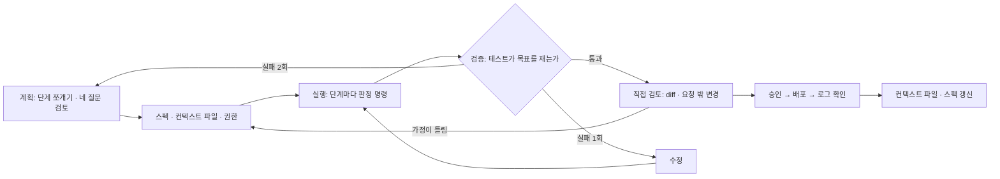

# 41 — 계획·검증·수정 루프 실전

## 목표

노트의 체크리스트(맡기기 전 / 중 / 후)를 **한 기능에 끝까지** 적용합니다.
스펙(39단원)과 컨텍스트 파일(40단원)을 들고, 기능을 검증 가능한 단계로 쪼개어 에이전트에게 맡기고, 결과물을 불확실한 것으로 보고 직접 검토해 배포까지 갑니다.
끝나면 "세션 로그"가 남고, 그 로그로 내 위임 방식의 약점을 하나 찾습니다.

## 노트와의 연결

노트가 말하는 워크플로 5단계는 **계획 → 스펙 → 실행 → 검증 → 수정**이고, 체크리스트는 다음과 같습니다.

- **맡기기 전**: 프로토타입·MVP·운영 중 무엇인지 한 줄 / 요구사항·기술 설계·아키텍처를 스펙에 / 검증 가능한 단계로 쪼개기 / 계획 검토(가정·보안·과잉 설계·빠진 부분) / 권한 제한
- **맡기는 중**: 대화형 vs 큰 덩어리 / 테스트·평가 기준 제공 / 바뀐 가정 기록
- **맡긴 후**: 결과물을 불확실한 것으로 보고 직접 검토 / 테스트가 목표를 반영하는지 / 승인 단계 거쳐 배포 후 로그 확인 / 컨텍스트 파일 갱신

그리고 이 경고가 있습니다.

> "아주 긴 자율 실행의 가치는 토큰 비용에 비해 과대평가돼 있다"

15단원부터 해 온 "에이전트에게 작은 과제" 의식이 이 체크리스트의 축약판이었습니다. 이 단원은 축약하지 않은 전체를 한 번 통과합니다.

읽는 법: 앞으로 가는 화살표가 노트의 5단계이고, 뒤로 가는 두 화살표(두 번 실패 → 계획으로, 검토에서 가정 오류 → 스펙으로)가 이 단원이 연습하는 **루프**입니다.

## 공부할 개념

| 개념 | 핵심 | 참고 |
| --- | --- | --- |
| 검증 가능한 단계로 쪼개기 | 각 단계는 "끝났는지 **기계가** 판정할 수 있어야" 합니다. 테스트 통과, 명령의 종료 코드, 스키마 검증. "코드가 깔끔해짐"은 단계가 아닙니다. 단계 크기의 기준: 실패했을 때 버리고 다시 해도 아깝지 않은 크기 | 24단원 테스트 전략 |
| 계획 검토의 네 질문 | 에이전트가 낸 계획을 실행 전에 읽으며 묻습니다. ① 어떤 **가정**을 했는가 ② **보안**(권한·입력·비밀값)은 ③ **과잉 설계**는 없는가(지금 규모에 필요한가) ④ **빠진 부분**은(오류 경로·마이그레이션·문서) | 42단원 실패 유형 |
| 결과물을 불확실한 것으로 보기 | "테스트 통과"는 "테스트가 재는 것은 통과"라는 뜻입니다. 직접 묻습니다: 테스트가 스펙의 요구사항을 재는가 / 테스트 자체가 수정되지 않았는가 / 로그·지표에서 실제 동작이 보이는가 / diff에 요청하지 않은 변경이 없는가 | 24단원 "테스트가 내 목표를 반영하는가" |

### 대화형 vs 큰 덩어리

| | 대화형 (단계마다 확인) | 큰 덩어리 (한 번에 맡김) |
| --- | --- | --- |
| 맞는 경우 | 성숙한 코드, 되돌리기 어려운 변경, 스펙에 빈칸이 남음 | 프로토타입, 격리된 모듈, 스펙·테스트가 완비됨 |
| 비용 | 내 주의력 | 토큰 + 잘못된 방향으로 멀리 갈 위험 |
| 신호 | 에이전트의 질문이 많다 → 대화형 | 질문이 0~2개 → 덩어리 가능 |

39단원 과제 D의 "질문 수"가 여기서 결정 기준이 됩니다.

## 과제

기능은 39단원에서 스펙을 쓴 **반복 할 일**입니다 (스펙을 안 썼다면 예시 스펙 "마감 하루 전 알림"을 써도 됩니다).

| 단계 | 하는 일 | 체크리스트 항목 | 산출물 |
| --- | --- | --- | --- |
| 1. 전 | `worksheets/checklist.md` "맡기기 전" 5칸을 채웁니다. 단계 쪼개기는 **각 단계의 판정 명령**까지 적습니다 (예: `pytest -q -k recurring_next`) | 전 1~5 | 체크리스트 1부 |
| 2. 계획 받기 | 스펙·컨텍스트 파일을 주고 "구현하지 말고 계획만" 요청. 계획을 네 질문으로 검토해 고칩니다 | 전 4 | 세션 로그 "계획" 절 |
| 3. 실행 | 단계별로 맡깁니다. 1·2단계는 대화형, 3단계부터는 덩어리로 시도해 차이를 기록. 바뀐 가정은 **즉시** 스펙 8절에 | 중 1~3 | 세션 로그 "실행" 절 |
| 4. 검토 | diff 전체를 직접 읽습니다. 테스트가 요구사항 R1~R4를 재는지 표로 대응. 요청하지 않은 변경 목록 | 후 1~2 | 세션 로그 "검토" 절 |
| 5. 배포와 확인 | 34단원 CI 통과 → 35단원 배포(승인 단계) → 로그·`/metrics` 확인 | 후 3 | 로그 캡처 |
| 6. 갱신 | 이번에 알게 된 사실을 컨텍스트 파일에 1~3줄 반영. 넣지 않기로 한 것도 이유와 함께 | 후 4 | `CLAUDE.md` diff |
| 7. 회고 | 세션 로그를 보고 "내가 다음에 다르게 할 것 하나" | — | 세션 로그 마지막 절 |

## 스스로 답해 볼 질문

1. "검증 가능한 단계"로 쪼갰을 때 단계가 10개를 넘으면 무엇이 문제이고, 2개뿐이면 무엇이 문제인가요?
2. 에이전트가 낸 계획에 "캐시 계층을 추가하겠다"가 들어 있습니다. 세 줄 질문의 어떤 답을 보고 과잉 설계인지 판단하나요?
3. 테스트가 모두 통과했는데 diff에 `test_` 파일 수정이 있습니다. 어떤 순서로 무엇을 확인하겠습니까?
4. 긴 자율 실행(예: 한 시간 혼자 돌게 두기)이 이득인 경우를 하나라도 생각할 수 있나요? 그 경우 어떤 조건이 갖춰져 있나요?
5. "바뀐 가정"을 채팅 안에만 두고 스펙에 적지 않으면 **언제** 그 대가를 치르나요?

## 함정

- 계획을 읽지 않고 "좋아 보인다"로 승인하기. 계획 검토는 네 질문을 **글로 답할 때까지**가 검토입니다.
- 단계마다 새 테스트를 에이전트가 만들게 하고 그대로 믿기. 테스트는 내가 뼈대를 주거나, 에이전트가 만든 것을 스펙과 대조해야 합니다.
- 실패한 단계를 같은 세션에서 계속 밀어붙이기. 두 번 실패하면 멈추고 스펙·단계 크기·컨텍스트 파일 중 무엇이 문제인지 봅니다.
- 배포 뒤 로그를 안 보기. "배포 성공"은 명령의 종료 코드일 뿐, 기능이 동작한다는 뜻이 아닙니다 (33단원 "장애를 누가 먼저 알아채는가").

## 완료 기준

- [ ] `worksheets/checklist.md` 전·중·후 12항목 모두 채움 (빈 항목은 "해당 없음 + 이유")
- [ ] `worksheets/session-log.md` 작성: 계획 / 실행(단계별 시도 수·판정 명령·결과) / 검토(요구사항↔테스트 대응표, 요청하지 않은 변경 목록) / 회고
- [ ] 스펙 8절 "바뀐 가정"에 1건 이상 기록
- [ ] 배포 후 로그 또는 지표 캡처 1장과 "기능이 실제로 동작했다"는 근거 한 줄
- [ ] 컨텍스트 파일 diff (추가 1~3줄)
- [ ] `NOTES.md` 에 배운 것 3가지 / 헷갈린 것 1가지 / 다음 단원에 바꿀 것
- [ ] 세 문장 설명: "AI가 짠 코드를 왜 사람이 다시 보는가"를 비개발자에게 세 문장으로
- [ ] AI 코드 리뷰: 에이전트가 만든 코드를 **다른 세션**의 에이전트에게 리뷰시키고, 하나 반영·하나 반박
- [ ] 에이전트에게 작은 과제: 이 단원 자체가 그 의식입니다. 세션 로그가 기록입니다
- [ ] 브랜치 `unit-41` → PR → 머지

## 더 깊이

- 같은 기능을 "큰 덩어리 한 번"으로 다시 맡겨 보고, 대화형과의 토큰·시간·재작업량을 비교하세요. 노트의 "과대평가" 주장을 내 숫자로 검증합니다.
- 세션 로그를 세 번 쌓이면 패턴이 보입니다: 내가 늘 빠뜨리는 체크리스트 항목이 무엇인지 → 53단원 자가 진단의 재료.
- 계획 검토 네 질문을 에이전트에게 **먼저** 스스로 답하게 하면 품질이 달라지나요? 실험하고 기록하세요.
