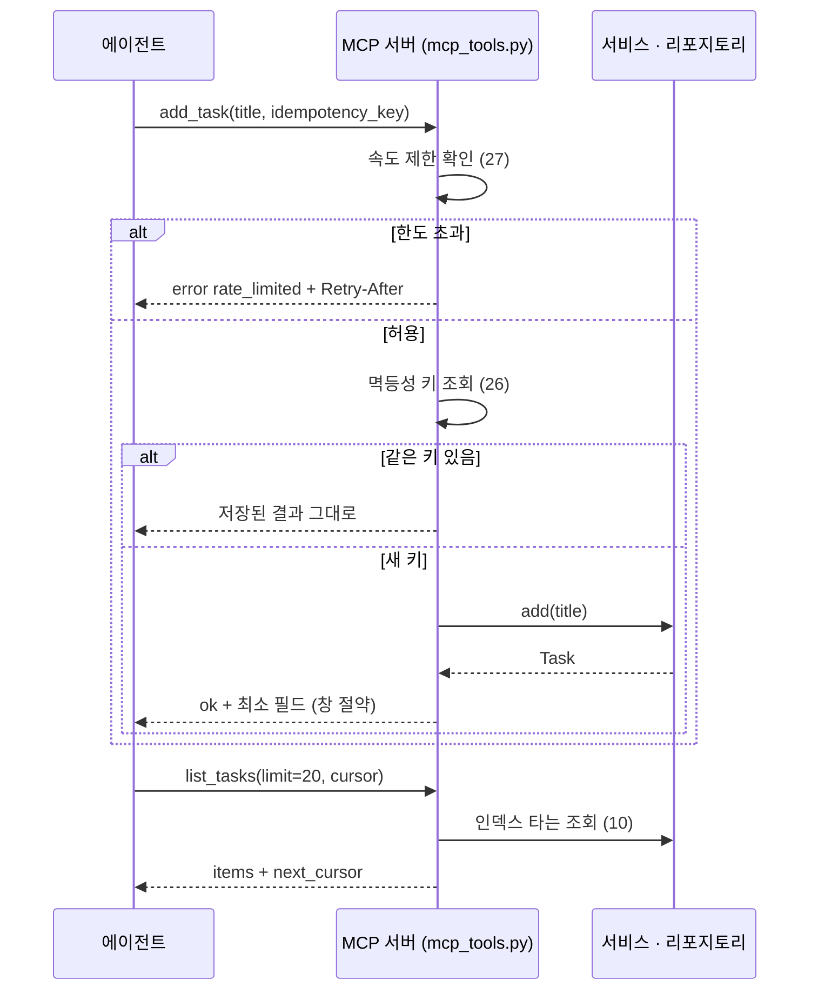

# 43 — 에이전트가 호출할 시스템 설계

## 목표

할 일 API를 **에이전트가 도구로 호출하는 시스템**으로 다시 봅니다. 노트의 인프라 표(속도 제한·캐시·비용 / 멱등성 키 / 인덱스·읽기 복제본 / 응답 시간 측정·일괄 처리·페이지네이션 / 최소 권한·읽기 전용·백업)를 점검표로 만들어 내 시스템을 채점하고,
`list / add / complete` 세 기능을 MCP(Model Context Protocol) 도구로 노출하는 `mcp_tools.py`를 완성합니다.

## 노트와의 연결

> "논문 리뷰 에이전트는 하루 5,000~10,000번 웹 검색을 호출한다"

> "병목은 LLM의 토큰 생성 속도만이 아니다. 데이터를 가져와 처리하는 시간이 더 길다"

사람 3명이 하루 20번 누르던 API를, 에이전트 하나가 1분에 60번 부를 수 있습니다. 26단원(멱등성)·27단원(속도 제한)에서 "에이전트 재시도"와 "에이전트의 대량 호출"을 예고했던 것이 여기서 합쳐집니다.
노트의 표는 그대로 **점검표**가 됩니다.

읽는 법: 위에서 아래로 시간이 흐르며, 에이전트의 재시도·대량 호출이 서비스에 닿기 **전에** MCP 계층에서 속도 제한과 멱등성 키가 걸러 내는 지점을 보세요.

| 노트의 표 | 이 저장소에서 이미 만든 것 | 이번에 확인할 것 |
| --- | --- | --- |
| 속도 제한·캐시·비용 | 27 토큰 버킷, 19 ETag·서비스 캐시 | 에이전트 클라이언트별 한도, 429에 `Retry-After`가 있는가 |
| 멱등성 키 | 26 `Idempotency-Key` | 도구 호출 재시도에서 중복 생성이 없는가 |
| 인덱스·읽기 복제본 | 10 인덱스, 37 읽기 복제본 개념 | 에이전트의 조회 패턴(검색·필터)이 인덱스를 타는가 |
| 응답 시간 측정·일괄 처리·페이지네이션 | 32 p95, 17 커서 페이지네이션 | 도구 응답이 창을 넘치지 않도록 `limit` 상한이 있는가 |
| 최소 권한·읽기 전용·백업 | 30 최소 권한, 12 백업 | 도구별로 읽기/쓰기 권한이 나뉘는가 |

## 공부할 개념

| 개념 | 핵심 | 참고 |
| --- | --- | --- |
| 도구 인터페이스 설계 | 도구는 **이름·설명·입력 스키마**로 모델에게 보입니다(38단원: 설명은 창에 들어감). 좋은 도구: 하나의 동사, 짧고 정확한 설명, 입력은 적고 필수 항목 분명, 출력은 모델이 다음 결정을 내리기에 충분하고 **작음**. 오류는 예외가 아니라 모델이 읽을 수 있는 메시지로 | [MCP 소개](https://modelcontextprotocol.io/), [Tool use overview](https://platform.claude.com/docs/en/agents-and-tools/tool-use/overview) |
| MCP 서버의 구조 | 서버는 도구(tool)·리소스(resource)·프롬프트(prompt)를 제공하고, 클라이언트(에이전트 하네스)가 목록을 받아 호출합니다. Python SDK의 `FastMCP`는 함수에 데코레이터를 붙여 도구를 등록하고, 타입 힌트와 docstring으로 스키마와 설명을 만듭니다 | [MCP Python SDK](https://github.com/modelcontextprotocol/python-sdk) |
| 도구 호출이 병목인 시스템 | 에이전트 한 턴의 시간 = LLM 생성 + **도구 실행의 합**. 느린 도구 하나가 전체를 늦춥니다. 대책: 응답 시간 측정(32단원), 일괄 처리(한 번에 여러 id), 페이지네이션 상한, 캐시, 읽기 전용 경로 분리 | 노트 인프라 표 |

### 도구 설계의 결정들

| 결정 | 선택지 | 이 단원의 기본값 (바꿔도 됩니다, 단 ADR에) |
| --- | --- | --- |
| 도구 단위 | 엔드포인트 1:1 vs 작업 단위 | 작업 단위 3개: `list_tasks`, `add_task`, `complete_task` |
| 목록 크기 | 무제한 vs 상한 | `limit` 기본 20, 최대 50, 커서로 이어 받기 |
| 중복 추가 | 그대로 생성 vs 멱등성 키 | `idempotency_key` 선택 인자, 같은 키면 같은 결과 |
| 오류 | 예외 전파 vs 결과 객체 | `{"ok": False, "error": {"code", "message"}}` — API 오류 형식과 통일 |
| 권한 | 전부 허용 vs 읽기/쓰기 분리 | 서버 실행 시 `read_only=True`면 `add/complete` 미등록 |

## 과제

`mcp_tools.py`의 `TODO`를 채워 `pytest units/43-designing-for-agents`의 테스트 뼈대를 **진짜 테스트로 바꾸고** 통과시키세요.
테스트 뼈대는 **서버가 아니라 순수 함수**를 검사합니다. 서버(`build_server`)는 함수를 등록하는 얇은 껍데기여야 합니다.

| 함수 | 하는 일 |
| --- | --- |
| `list_tasks(repo, done=None, limit=20, cursor=None)` | 할 일 목록을 `{"items": [...], "next_cursor": ...}`로. `limit`은 1~50으로 자른다. 각 항목은 `id, title, done, due`만 (창 절약) |
| `add_task(repo, title, idempotency_key=None, keys=None)` | 할 일 추가. `keys`(멱등성 저장소, dict)에 같은 키가 있으면 저장된 결과를 그대로 반환. 빈 제목은 오류 결과 |
| `complete_task(repo, task_id)` | 완료 처리. 없는 id는 `not_found`, 이미 완료는 `already_done` 오류 결과 (409와 같은 의미) |
| `build_server(repo, read_only=False)` | `FastMCP` 서버에 위 함수를 도구로 등록. `read_only`면 `list_tasks`만 |
| `tool_descriptions()` | 세 도구의 이름·설명을 돌려준다 (설명 길이 테스트용) |

`repo`는 15단원의 `TaskRepository` Protocol입니다. 테스트에서는 파일 안의 `_InMemoryRepo`(이 단원 전용 최소 구현)를 씁니다. 실제 프로젝트에서는 `todo/mcp_server.py`로 옮기고 `SqliteTaskRepository`를 주입하세요.

| 과제 | 하는 일 | 산출물 |
| --- | --- | --- |
| A. 점검표 채점 | `checklist-agent-ready-system.md`로 37단원까지의 시스템을 채점합니다. "없음" 항목마다 지금 규모에 필요한지(세 줄 질문) 판단 | 점검표 |
| B. 구현 | 위 다섯 함수 구현, 테스트 뼈대의 `pytest.fail`을 실제 검증으로 교체 | `mcp_tools.py`, `test_unit43.py` |
| C. 연결 | `python mcp_tools.py`로 서버를 띄우고 Claude Code에 MCP 서버로 등록해 "오늘 할 일 알려 줘"가 `list_tasks`를 부르는지 확인. 도구 설명이 창에서 몇 글자인지 기록 | `NOTES.md` |
| D. 부하 실험 | 에이전트에게 "할 일 200개를 추가하고 모두 완료해 봐"를 시킵니다 (개발 DB). 속도 제한에 걸리는가, 멱등성 키 없이 재시도하면 중복이 생기는가, p95는 | 측정표 |
| E. ADR-0028 | "할 일 API를 MCP 도구로 노출" 결정. 대안: REST만 두고 에이전트가 HTTP 호출 / MCP 도구 / 둘 다 | `docs/adr/0028-mcp-tools.md` |

## 스스로 답해 볼 질문

1. `list_tasks`가 제목·완료·마감만 돌려주고 태그·버전·생성 시각을 빼는 이유는 무엇인가요? 모델이 태그가 필요하면 어떻게 해야 하나요?
2. 도구 설명(description)이 길고 자세하면 모델이 더 잘 쓸 것 같습니다. 반대 효과는 무엇인가요? (38단원 창 예산)
3. 에이전트가 `add_task`를 호출했는데 네트워크 오류로 응답을 못 받고 다시 호출했습니다. 멱등성 키가 없으면 무슨 일이 생기고, 키는 **누가** 만들어야 하나요?
4. `read_only=True` 서버와 "쓰기 도구를 등록하되 설명에 '사용 금지'라고 적기" 중 무엇이 안전한가요? 40단원의 어떤 원칙인가요?
5. 노트의 "데이터를 가져와 처리하는 시간이 더 길다"를 내 시스템에서 확인하려면 어떤 지표 두 개를 나란히 놓아야 하나요?

## 함정

- 도구 하나에 인자 10개. 모델이 조합을 틀립니다. 도구를 나누거나 기본값을 두세요.
- 오류를 예외로 던지기. MCP 서버에서 예외는 모델에게 모호한 실패로 보입니다. 코드가 있는 결과 객체로 돌려주면 모델이 다음 행동(재시도·사용자에게 묻기)을 고를 수 있습니다.
- 서버 코드 안에 규칙 넣기. "이미 완료면 거부"는 서비스 계층(15단원)의 일입니다. 도구는 번역만 합니다.
- 테스트에서 실제 MCP 서버를 띄우기. 뼈대가 순수 함수만 보는 이유입니다. 서버 연결은 과제 C에서 손으로 확인합니다.

## 완료 기준

- [ ] `pytest units/43-designing-for-agents` — 뼈대 9개 테스트를 모두 실제 검증으로 바꾸고 통과 (`pytest.fail` 0개)
- [ ] `tool_descriptions()`의 설명 합계가 400자 이하 (테스트로 확인)
- [ ] `checklist-agent-ready-system.md` 채점 완료, "없음" 항목마다 판단 한 줄
- [ ] 과제 D 측정표: 요청 수, 429 발생 수, 중복 생성 수(멱등성 키 없이/있이), p95
- [ ] `docs/adr/0028-mcp-tools.md` (상태: 채택)
- [ ] `NOTES.md` 에 배운 것 3가지 / 헷갈린 것 1가지 / 다음 단원에 바꿀 것
- [ ] 세 문장 설명: "사람이 쓰던 서비스를 AI가 쓰게 하면 무엇이 달라지는가"
- [ ] AI 코드 리뷰: `mcp_tools.py`를 리뷰받고(특히 지연·비용·일관성 트레이드오프), 하나 반영·하나 반박
- [ ] 에이전트에게 작은 과제: `_InMemoryRepo`를 `SqliteTaskRepository`로 바꾼 `todo/mcp_server.py`를 만들게 하고, 도구 설명이 그대로인지·규칙이 서비스 계층에 남아 있는지 검토
- [ ] 브랜치 `unit-43` → PR → 머지

## 더 깊이

- MCP의 **리소스**(resource)로 `tasks://open`을 노출하면 도구 호출 없이 컨텍스트에 넣을 수 있습니다. 도구와 리소스 중 무엇이 창을 덜 쓰는지 비교하세요.
- 일괄 처리: `complete_tasks(ids: list[int])`를 추가하면 과제 D의 200회 호출이 몇 회로 줄고, 멱등성과 부분 실패 처리는 어떻게 바뀌나요?
- 44단원부터는 반대 방향입니다. 내 시스템이 LLM을 **호출**합니다. 그때 노트의 표가 다시 한번(이번엔 LLM 공급자의 속도 제한·비용에 대해) 적용됩니다.
