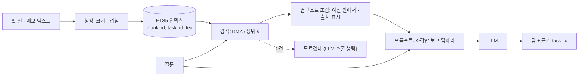

# 46 — RAG

## 목표

"지난달에 치과 관련해서 뭐 했더라?" 같은 질문에 **내 할 일 데이터에 근거해** 답하는 `GET /tasks/ask?q=`를 만듭니다.
긴 텍스트를 청크(chunk)로 나누고, 14단원의 FTS5로 검색해, 찾은 조각만 프롬프트에 넣는 RAG(Retrieval-Augmented Generation)의 세 단계를 직접 구현하고, 검색 품질을 숫자로 잽니다.

## 노트와의 연결

노트는 RAG를 "검색으로 찾은 문서를 프롬프트에 넣어 답하게 하는 기법"으로 풀고, 4대 스킬 ①에 넣었습니다.
38단원의 컨텍스트 창 예산이 여기서 다시 핵심입니다. 모든 할 일을 프롬프트에 넣을 수 없으니(비용·창 크기·잡음) **관련된 것만 골라 넣는** 문제가 RAG입니다.
14단원에서 FTS5와 임베딩 개념을 미리 봤고, 이 단원은 FTS5로 먼저 끝까지 만든 뒤 임베딩이 필요한지 묻습니다.

읽는 법: 왼쪽 위(색인)는 데이터가 바뀔 때, 왼쪽 아래(검색)는 질문마다 돌며, 검색 결과가 비면 LLM에 가지 않고 "모르겠다"로 끝나는 점선이 **환각**을 막는 첫 장치입니다.

## 공부할 개념

| 개념 | 핵심 | 참고 |
| --- | --- | --- |
| 청킹(chunking) | 검색 단위를 정하는 일. 너무 크면 관련 없는 내용이 딸려 와 창을 낭비하고, 너무 작으면 문맥이 끊깁니다. 크기(글자 수)와 겹침(overlap)을 인자로 두고 **측정으로** 정합니다. 할 일 제목은 짧으니 "제목 + 태그 + 메모"를 한 문서로 묶고, 긴 메모만 나눕니다 | — |
| 검색과 순위(BM25) | FTS5는 단어 일치 기반으로 BM25 점수를 냅니다(`ORDER BY rank`). 장점: 빠르고 설명 가능하고 추가 비용 0. 약점: 동의어("치과"↔"이빨"), 오타. 임베딩 검색은 의미 유사도로 이를 보완하지만 비용·의존성이 생깁니다. 먼저 FTS5로 재고, 실패 사례를 모은 뒤 결정 | [SQLite FTS5](https://www.sqlite.org/fts5.html), 14단원 |
| 컨텍스트 조립과 근거 표시 | 찾은 조각을 **예산**(글자 수 또는 토큰) 안에서 점수 순으로 넣고, 각 조각에 출처(`task_id`)를 붙입니다. 프롬프트는 "주어진 조각에 없으면 모른다고 답하라"를 명시하고, 답에 근거 id를 포함하게 해 검증 가능하게 만듭니다 | 44단원 프롬프트 설계 |

### 검색 품질을 재는 법 (47단원의 예고)

질문 20개와 "정답 조각(task_id)"을 적어 두면 두 숫자를 셀 수 있습니다.

- **재현율@k**(recall@k): 상위 k개 안에 정답이 있는 비율
- **정밀도@k**(precision@k): 상위 k개 중 정답인 비율

청크 크기·k·겹침을 바꿀 때마다 이 둘을 다시 잽니다. "느낌상 좋아졌다"는 기록하지 않습니다.

## 과제

`rag.py`의 `TODO`를 채워 `pytest units/46-rag`의 뼈대를 실제 테스트로 바꾸고 통과시키세요. 테스트는 **청킹과 검색**(SQLite `:memory:`)만 봅니다. LLM 호출은 `FakeLLM`으로 조립 결과만 확인합니다.

| 이름 | 하는 일 |
| --- | --- |
| `chunk_text(text, size=200, overlap=40)` | 글자 수 기준으로 나눔. 겹침만큼 앞 조각의 끝을 포함. 빈 문자열은 `[]`, `size` 이하는 한 조각. `overlap >= size`면 `ValueError` |
| `Fts5Index(conn)` | `init_schema()`: `chunks` FTS5 가상 테이블(`chunk_id`, `task_id`, `text`). `add(task_id, text)`: 청킹해 넣음. `remove(task_id)`: 그 할 일의 조각 삭제. `search(query, k=5) -> list[Hit]` (`task_id`, `text`, `score`), 점수 좋은 순 |
| `assemble_context(hits, budget_chars=1200)` | 점수 순으로 예산 안에 들어가는 조각만, `"[task_id=3] 텍스트"` 형식으로 줄바꿈 연결. 예산을 넘는 첫 조각에서 멈춤(자르지 않음) |
| `build_ask_prompt(question, context)` | (system, user). "조각에 없으면 모른다고 답하라, 근거 task_id를 적어라" |
| `answer(llm, index, question, k=5)` | 검색 → 0건이면 LLM 없이 `NO_EVIDENCE_MESSAGE` → 조립 → 호출 → 텍스트 반환 |

| 과제 | 하는 일 | 산출물 |
| --- | --- | --- |
| A. 구현 | 위 항목 + 테스트 뼈대 교체 | `rag.py`, `test_unit46.py` |
| B. 평가 세트 | 내 실제 할 일 데이터(또는 100건 생성)로 질문 20개와 정답 task_id를 적습니다 | `evals/ask_set.jsonl` (47단원과 공유) |
| C. 매개변수 실험 | `size ∈ {100, 200, 400}`, `overlap ∈ {0, 40}`, `k ∈ {3, 5, 10}`로 recall@k·precision@k 표. 어떤 조합을 고르고 왜 | 측정표, `NOTES.md` |
| D. API 연결 | `GET /tasks/ask?q=` — 44단원 `get_llm()`이 `None`이면 검색 결과만(조각 목록) 돌려주는 폴백 | 프로젝트 PR |
| E. 실패 수집과 ADR-0030 | FTS5가 못 찾은 질문(동의어·오타)을 모읍니다. 20개 중 몇 개인가요? 그 비율로 "임베딩 검색 도입 여부"를 ADR-0030으로 결정 (지금은 안 한다도 결정입니다) | `docs/adr/0030-retrieval-method.md` |

## 스스로 답해 볼 질문

1. 할 일 제목이 평균 10글자인데 청크 크기 200은 의미가 있나요? 청킹이 **필요한 데이터**와 그렇지 않은 데이터를 구분해 보세요.
2. 검색 결과가 0건일 때 LLM을 부르지 않는 것과, "관련 정보가 없습니다"를 모델이 말하게 하는 것의 차이는? (비용·일관성·환각)
3. `assemble_context`가 예산을 넘는 조각을 **자르지 않고** 멈추는 이유는 무엇일까요? 잘린 조각은 어떤 오답을 만들 수 있나요?
4. 할 일을 수정하면 인덱스는 언제 갱신해야 하나요? 19단원 캐시 무효화와 같은 문제인가요, 다른 문제인가요?
5. recall@5가 0.9인데 사용자가 "답이 틀린다"고 합니다. 검색은 맞는데 답이 틀리는 경우는 어디서 생기고, 어떻게 분리해 재나요? → 47단원

## 함정

- 모든 할 일을 프롬프트에 넣기. 100건이면 되지만 1만 건이면 안 됩니다. 처음부터 검색을 두면 규모가 커져도 설계가 바뀌지 않습니다.
- FTS5 질의에 사용자 입력을 그대로 넣기. `"` `*` `AND` 같은 FTS 문법 문자가 오류를 냅니다. 토큰을 따옴표로 감싸거나 문법 문자를 제거하세요 (8단원 인젝션의 FTS 판).
- 임베딩부터 시작하기. 의존성·비용·지연이 생기고, 왜 필요했는지 설명할 근거가 없습니다. 실패 사례 비율이 근거입니다.
- 근거 없이 답하게 두기. 답에 `task_id`가 없으면 사용자는 검증할 수 없고, 47단원에서 평가도 할 수 없습니다.

## 완료 기준

- [ ] `pytest units/46-rag` — 뼈대 10개 테스트를 실제 검증으로 바꾸고 통과, 네트워크 0회
- [ ] `evals/ask_set.jsonl` 질문 20개 (각각 `question`, `expected_task_ids`)
- [ ] 과제 C 측정표 (최소 6개 조합 × recall@k·precision@k)와 선택 이유
- [ ] `GET /tasks/ask?q=`가 LLM 없이도 검색 결과를 돌려주는 테스트 1개
- [ ] `docs/adr/0030-retrieval-method.md` (FTS5 유지 또는 임베딩 도입, 근거는 실패 비율)
- [ ] `NOTES.md` 에 배운 것 3가지 / 헷갈린 것 1가지 / 다음 단원에 바꿀 것
- [ ] 세 문장 설명: "AI가 내 데이터를 보고 답하게 하려면 왜 '검색'이 먼저 필요한가"
- [ ] AI 코드 리뷰: `rag.py` 리뷰(지연: 검색 + LLM 두 단계, 비용: k와 예산), 하나 반영·하나 반박
- [ ] 에이전트에게 작은 과제: 과제 C의 조합을 모두 돌려 표를 만드는 스크립트 (LLM 없이 검색만)
- [ ] 브랜치 `unit-46` → PR → 머지

## 더 깊이

- 임베딩 검색을 실험한다면: 조각마다 벡터를 저장하고 코사인 유사도로 상위 k를 고른 뒤, FTS5 결과와 **합치는**(hybrid) 방식이 보통 둘 중 하나보다 낫습니다. 같은 평가 세트로 재 보세요.
- 질문을 모델에게 먼저 **고쳐 쓰게**(동의어 확장) 한 뒤 FTS5로 검색하면 임베딩 없이 재현율이 오르나요? 호출이 하나 늘어난 비용과 비교하세요.
- 조각 크기를 토큰 기준으로 바꾸려면 [Token counting](https://platform.claude.com/docs/en/build-with-claude/token-counting)을 쓸 수 있지만 호출 비용이 듭니다. 글자 수 ÷ 상수로 어림하는 것과 어느 쪽이 적절한지 판단해 보세요.
