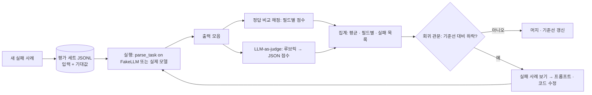

# 47 — 평가

## 목표

45단원의 "자연어 → 할 일 초안"을 **평가 세트**(eval set)로 재고, 정답 비교 채점기와 LLM-as-judge(모델이 채점자) 프롬프트를 만들어,
프롬프트나 모델을 바꿀 때마다 "좋아졌는가"를 숫자로 답할 수 있게 됩니다. 평가는 CI에 들어가 회귀(regression)를 막습니다.

## 노트와의 연결

노트는 4대 스킬 ①에 "평가(eval, LLM-as-a-judge)"를 넣고, 용어 풀이에서 "평가 없는 개선은 없다"는 태도를 강조합니다.
44단원 과제 C에서 프롬프트 세 버전을 **내 눈으로** 채점했고, 45단원에서 `confidence` 임계값 0.6을 **임의로** 정했고, 46단원에서 recall@k를 쟀습니다.
이 단원은 그 세 가지를 하나의 습관으로 묶습니다: 바꾸기 전에 재고, 바꾼 뒤에 다시 재고, 떨어지면 막는다.

읽는 법: 왼쪽의 세트는 실제 사용에서 나온 **새 실패 사례**로 계속 자라고, 오른쪽 관문이 "느낌"이 아닌 숫자로 머지를 결정합니다.

## 공부할 개념

| 개념 | 핵심 | 참고 |
| --- | --- | --- |
| 평가 세트 만들기 | 한 줄에 하나의 사례(JSONL): `input`, `expected`, `tags`(난이도·유형). 출처는 실제 사용 로그(31단원, 개인정보 제거) > 내가 쓴 사례 > 모델이 생성한 사례. **기대값은 사람이 확인**합니다. 모델이 만든 기대값으로 같은 모델을 채점하면 모방을 보상하게 됩니다 | 44단원 과제 C |
| 정답 비교 vs LLM-as-judge | 출력이 **제약된 형식**(날짜, 레이블, 구조)이면 프로그램 채점: 결정적이고 공짜. **자유 텍스트**(요약 품질, 46단원의 답)이면 모델 채점자에게 루브릭(검사 가능한 주장 목록)을 주고 JSON으로 점수를 받습니다. 채점자 모델은 **평가 대상 모델과 다르게**, 출력은 구조화 출력으로. 채점자도 평가가 필요합니다(사람 채점과 일치율) | [Structured outputs](https://platform.claude.com/docs/en/build-with-claude/structured-outputs) |
| 회귀 관문과 기준선 | 기준선(baseline) 점수를 저장소에 기록하고, PR마다 평가를 돌려 **허용 하락폭** 이하면 통과. 비결정성 때문에 1회 점수에는 잡음이 있으니, 잡음 폭(같은 설정 3회 반복의 편차)을 먼저 재고 그보다 큰 변화만 믿습니다 | 34단원 CI |

### 채점기 설계

`parse_task`의 출력은 필드가 네 개이고 성격이 다릅니다. 하나의 "맞음/틀림"으로 뭉개면 무엇이 나빠졌는지 모릅니다.

| 필드 | 채점 방식 | 점수 |
| --- | --- | --- |
| `title` | 정규화(공백·조사 제거) 후 정확 일치, 아니면 토큰 겹침 비율 | 0~1 |
| `due` | 정확 일치만 (날짜는 틀리면 틀린 것) | 0 또는 1 |
| `tags` | 집합 F1 (정밀도·재현율의 조화 평균) | 0~1 |
| `needs_clarification` | 기대가 "질문해야 함"이면 질문 유무 일치 | 0 또는 1 |

### 평가 세트의 건강 검사

- **오라클**: 기대값을 그대로 출력으로 넣으면 점수가 1.0이어야 합니다.
- **널**: 빈 출력(제목 "", 날짜 없음)을 넣으면 0에 가까워야 합니다.
- 두 검사가 실패하면 채점기가 고장난 것이지 모델이 좋거나 나쁜 것이 아닙니다. 테스트 뼈대에 둘 다 있습니다.

## 과제

`scorer.py`의 `TODO`를 채워 `pytest units/47-evals`의 뼈대를 실제 테스트로 바꾸고 통과시키세요. 테스트는 채점기만 봅니다(네트워크 없음).

| 이름 | 하는 일 |
| --- | --- |
| `load_eval_set(path)` | JSONL → `list[EvalCase]`. 빈 줄 무시, 잘못된 줄은 줄 번호와 함께 `ValueError` |
| `normalize_title(s)` | 공백 정리, 끝의 "하기" 제거, 소문자 |
| `score_title / score_due / score_tags / score_clarification` | 위 표대로 |
| `score_case(case, output) -> CaseScore` | 필드별 점수 + 가중 평균(`total`). 가중치: title 0.4, due 0.3, tags 0.2, clarification 0.1 |
| `aggregate(scores) -> Report` | 평균 `total`, 필드별 평균, `tags`별 평균, `total < 0.5`인 실패 사례 id 목록 |
| `regression_check(report, baseline_total, tolerance=0.02)` | 평균이 기준선보다 `tolerance` 넘게 낮으면 `False` |

| 과제 | 하는 일 | 산출물 |
| --- | --- | --- |
| A. 구현 | 위 항목 + 테스트 뼈대 교체 | `scorer.py`, `test_unit47.py` |
| B. 세트 확장 | `evals/parse_eval_set.jsonl`의 10개를 **30개 이상**으로. 45단원 과제 B의 20문장을 넣고, 유형 태그(상대 날짜·태그 있음·모호함·주입 시도)를 고르게 | JSONL |
| C. 기준선 | 실제 모델로 세트를 3회 돌려 평균과 편차를 기록. 편차가 잡음 폭입니다 | `evals/baseline.json` |
| D. 개선 한 번 | 실패 목록을 보고 프롬프트 **한 가지**를 바꿉니다. 다시 3회. 잡음 폭보다 크게 올랐나요? 떨어진 필드는 없나요? | `NOTES.md` 비교표 |
| E. LLM-as-judge | 44단원 요약(자유 텍스트)을 위해 `evals/judge_prompt.md` 루브릭을 완성하고, 요약 10개를 모델 채점자와 내가 각각 채점해 일치율을 냅니다 | 일치율 표 |
| F. CI 관문과 ADR-0031 | `pytest`와 별도로 평가 스크립트를 CI에 넣되, 실제 모델 호출은 **수동 트리거 또는 주 1회**로(비용). 기본 PR에서는 `FakeLLM` 오라클·널 검사만. ADR-0031: "평가 관문의 위치와 빈도" | `.github/workflows/eval.yml`, `docs/adr/0031-eval-gate.md` |

## 스스로 답해 볼 질문

1. 평가 세트 30개는 충분한가요? 무엇을 기준으로 "충분"을 정하나요? (잡음 폭, 유형별 최소 개수)
2. 채점자 모델이 "친절한 답"에 점수를 더 줍니다. 루브릭을 어떻게 고치면 막을 수 있나요? "검사 가능한 주장"의 예를 셋 적어 보세요.
3. 기준선 0.82, 변경 후 0.85, 3회 편차 ±0.04. 개선됐다고 말할 수 있나요?
4. 실제 사용 로그에서 실패 사례를 세트에 넣을 때 개인정보(14·31단원)는 어떻게 처리하나요? 제목을 바꾸면 사례의 가치가 줄지 않나요?
5. 45단원의 `confidence` 임계값 0.6을 이 세트로 어떻게 정하겠습니까? 임계값을 바꿀 때 무엇이 오르고 무엇이 내리나요?

## 함정

- 테스트와 평가를 혼동하기. 테스트(pytest)는 **내 코드**가 결정적으로 맞는지, 평가는 **모델+프롬프트**가 통계적으로 좋은지. 평가를 pytest 안에 넣고 실제 모델을 부르면 CI가 느리고 비싸고 불안정해집니다.
- 평가 세트를 보고 프롬프트에 사례를 그대로 넣기. 세트에 과적합됩니다. 사례 일부는 **보지 않고** 남겨 두세요(검증용 분리).
- 평균만 보기. 평균이 올랐는데 "모호함" 유형이 떨어졌다면 사용자 일부에겐 나빠진 것입니다. 유형별 점수를 항상 함께.
- 채점자를 평가하지 않기. LLM-as-judge의 점수는 사람 채점과의 일치율을 한 번 재기 전까지는 숫자가 아니라 의견입니다.
- 1회 결과로 판단하기. 비결정성은 평가에도 적용됩니다. 반복과 편차 없이는 비교가 아닙니다.

## 완료 기준

- [ ] `pytest units/47-evals` — 뼈대 10개 테스트를 실제 검증으로 바꾸고 통과 (오라클 1.0·널 ≈ 0 포함)
- [ ] `evals/parse_eval_set.jsonl` 30개 이상, 유형 태그 4종 이상, 모두 내가 기대값을 확인함
- [ ] `evals/baseline.json`: 3회 평균·편차·필드별 평균·날짜·모델 id
- [ ] 과제 D 비교표: 변경 내용 한 줄, 전/후 평균, 편차, 유형별 변화, 판정
- [ ] 과제 E: 채점자-사람 일치율 (10개 중 __개)
- [ ] CI에 FakeLLM 건강 검사 단계 추가, 실제 모델 평가는 별도 트리거. ADR-0031 작성
- [ ] `NOTES.md` 에 배운 것 3가지 / 헷갈린 것 1가지 / 다음 단원에 바꿀 것
- [ ] 세 문장 설명: "AI 기능이 좋아졌다는 걸 어떻게 증명하는가"
- [ ] AI 코드 리뷰: `scorer.py` 리뷰(가중치의 근거, 정규화의 과잉), 하나 반영·하나 반박
- [ ] 에이전트에게 작은 과제: 세트에서 유형별 개수와 기대값 누락을 검사하는 `evals/lint_set.py` (네트워크 없음)
- [ ] 브랜치 `unit-47` → PR → 머지

## 더 깊이

- 쌍 비교(pairwise): 두 프롬프트의 출력을 나란히 주고 "어느 쪽이 나은가"를 묻는 채점이 절대 점수보다 안정적인 경우가 많습니다. A/B 위치를 무작위로 바꾸고 "무승부"를 허용하세요. 50단원 A/B 테스트와 같은 뿌리입니다.
- 46단원 `ask_set.jsonl`에 같은 채점기를 붙이면 RAG는 **검색 점수**와 **답 점수**를 따로 가집니다. 둘을 분리해야 "검색은 맞는데 답이 틀림"을 진단할 수 있습니다.
- 평가 결과를 32단원 지표처럼 시간축으로 쌓으면, 모델 공급자가 모델을 바꿨을 때(같은 id라도) 알아챌 수 있습니다.
