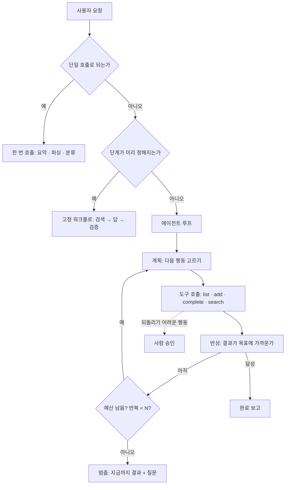

# 48 — 에이전틱 워크플로

## 목표

44~47단원의 부품(LLM 호출·구조화 출력·도구·RAG·평가)으로 **"할 일 비서"** 에이전트를 설계합니다.
계획·반성·다단계 실행의 패턴을 알고, 더 중요하게는 **언제 에이전트가 과한지**를 네 가지 기준으로 판정해, 이 비서의 기능 대부분을 단일 호출이나 고정 워크플로로 되돌립니다.

## 노트와의 연결

4대 스킬 ①의 마지막이 "에이전틱 워크플로"입니다. 38~42단원에서는 에이전트를 **쓰는** 쪽이었고, 여기서는 **만드는** 쪽입니다.
만들어 보면 38단원의 모든 문제(창 예산, 도구 설명 비용, 서브에이전트의 요약 손실, 실패 유형 4가지)가 **내 코드의 버그**로 돌아옵니다.
노트의 "아주 긴 자율 실행의 가치는 과대평가돼 있다"는 내가 만드는 에이전트의 **정지 조건**에 대한 경고이기도 합니다.

읽는 법: 위의 두 갈림길에서 대부분의 기능이 왼쪽(단일 호출·고정 워크플로)으로 빠져야 정상이고, 루프에 들어간 경우에도 **예산·반복 상한·승인**이라는 세 개의 멈춤 장치가 있어야 합니다.

## 공부할 개념

| 개념 | 핵심 | 참고 |
| --- | --- | --- |
| 세 가지 수준: 단일 호출 / 워크플로 / 에이전트 | **단일 호출**: 입력 하나, 출력 하나(44·45). **워크플로**: 단계와 순서를 코드가 정하고 모델은 각 단계를 채움(46 RAG). **에이전트**: 모델이 다음 행동을 **고르고** 도구 결과를 보고 반복. 아래 수준일수록 싸고 빠르고 예측 가능하며 평가하기 쉽습니다 | [Tool use overview](https://platform.claude.com/docs/en/agents-and-tools/tool-use/overview) |
| 에이전트가 과한지 판정하는 네 기준 | ① **복잡성**: 단계를 미리 정할 수 없는가 ② **가치**: 비용·지연을 감수할 만큼 결과가 값진가 ③ **실행 가능성**: 모델이 이 종류의 일을 잘하는가 ④ **오류 비용**: 틀렸을 때 잡고 되돌릴 수 있는가. 하나라도 "아니오"면 한 수준 내려갑니다 | — |
| 계획·반성·정지 조건 | 계획은 "다음 도구 하나"를 고르는 것으로 충분하고, 반성은 도구 결과를 목표와 비교하는 한 번의 판단입니다. 정지 조건은 **반복 상한·토큰 예산·승인 필요 행동** 세 가지를 코드로 강제합니다. 모델의 "다 했습니다"는 정지 조건이 아닙니다 (42단원 조기 중단) | 42단원 실패 유형 |

### 할 일 비서가 받을 요청과 적정 수준

| 요청 | 적정 수준 | 이유 (네 기준) |
| --- | --- | --- |
| "오늘 할 일 요약해 줘" | 단일 호출 (44) | 단계 고정, 오류 비용 낮음 |
| "내일 치과 예약 추가" | 단일 호출 + 확인 (45) | 쓰기지만 확인 단계가 오류를 잡음 |
| "지난달 건강 관련해서 뭐 했지" | 워크플로 (46) | 검색 → 답, 순서 고정 |
| "이번 주 할 일 중 미룰 수 있는 거 다음 주로 옮겨 줘" | 에이전트 **후보** | 어떤 것을 미룰지 판단 + 여러 쓰기. 오류 비용 중간 → 승인 단계 필수 |
| "내 할 일 습관을 분석해서 개선안 줘" | 워크플로 (집계 쿼리 → 한 번 호출) | 에이전트처럼 보이지만 단계는 고정 가능 |

## 과제

코드는 쓰지 않습니다(○). 설계와 판정을 합니다. 구현은 52단원에서 사용자가 원한 것만.

| 과제 | 하는 일 | 산출물 |
| --- | --- | --- |
| A. 요청 수집 | 49단원 인터뷰 전이지만, 가족·친구에게 "할 일 앱에 말로 시키고 싶은 것" 10개를 받아 옵니다 | `worksheets/agent-design.md` 1부 |
| B. 수준 판정 | 10개 요청 각각을 네 기준으로 채점해 단일 호출 / 워크플로 / 에이전트로 분류. 에이전트로 남는 것이 몇 개인가요? | 워크시트 2부 |
| C. 에이전트 설계 | 에이전트로 남은 것 하나(없으면 위 표의 "미루기")를 설계: 도구 목록(43단원 MCP 도구 재사용), 시스템 프롬프트 초안, 루프 의사코드, 정지 조건 세 가지, 승인이 필요한 행동, 실패 유형 4가지 각각의 방어 | 워크시트 3부 |
| D. 비용·지연 추산 | 설계한 루프가 평균 몇 번 돌고(도구 호출 수), 호출당 입력 토큰이 얼마나 자라는지(도구 결과 누적) 표로 어림. 44단원 측정값 사용 | 워크시트 4부 |
| E. 평가 계획 | 47단원 방식으로 이 에이전트를 어떻게 평가할지: 종료 상태(어떤 할 일이 어떻게 바뀌었나)로 채점하는 사례 5개 | 워크시트 5부 |
| F. 되돌리기 | C의 설계를 보고 "이걸 워크플로로 바꾸면 무엇을 잃는가"를 적습니다. 잃는 것이 작다면 워크플로로 **내립니다** | 워크시트 6부 |

## 스스로 답해 볼 질문

1. "미룰 수 있는 할 일을 옮겨 줘"에서 모델이 판단해야 하는 부분과 코드가 결정할 수 있는 부분을 나눠 보세요. 모델의 몫이 줄면 수준이 내려가나요?
2. 반복 상한을 10으로 두면 11번째가 필요한 요청은 어떻게 되나요? 상한에 걸렸을 때 사용자에게 무엇을 보여 줘야 하나요?
3. 에이전트가 도구 결과 20개를 창에 쌓은 뒤 내린 판단과, 처음 판단은 품질이 같을까요? 38단원 창 예산을 떠올려 보세요.
4. 승인 단계가 있으면 안전하지만 사용자는 "비서가 자꾸 물어본다"고 느낍니다. 어떤 행동만 승인에 걸어야 할까요? 기준을 하나 정해 보세요.
5. 에이전트의 평가가 단일 호출의 평가보다 어려운 이유는 무엇인가요? "경로"가 아니라 "종료 상태"를 채점하라는 말의 뜻은?

## 함정

- 에이전트부터 만들기. 멋있어 보이지만 비싸고 평가가 어렵습니다. 세 수준 중 **가장 낮은 것**에서 시작해 필요가 증명될 때 올립니다.
- 정지 조건을 프롬프트에만 적기 ("10번 이상 반복하지 마"). 반복 상한은 `for _ in range(10)`입니다. 모델이 지키는 것이 아니라 코드가 강제하는 것입니다.
- 도구를 많이 주기. 도구 설명이 창을 먹고(38단원) 선택지가 많을수록 잘못 고릅니다. 요청에 필요한 최소 도구만.
- 쓰기 도구를 승인 없이 주기. "삭제"와 "일괄 수정"은 43단원 `read_only` 원칙 그대로, 사람이 보기 전엔 실행되지 않게.
- 경로를 채점하기 ("도구를 이런 순서로 불렀는가"). 같은 결과에 이르는 경로는 여럿입니다. 종료 상태를 채점하세요.

## 완료 기준

- [ ] `worksheets/agent-design.md` 1~6부 완성 (요청 10개의 수준 판정표 포함)
- [ ] 에이전트로 남은 요청 수와 그 근거(네 기준 채점) 명시
- [ ] 설계 C에 정지 조건 세 가지, 승인 필요 행동, 실패 유형 4가지의 방어가 각각 한 줄 이상
- [ ] 비용·지연 추산표 (반복 수 × 호출당 토큰)
- [ ] 과제 F의 결론: 에이전트 유지 또는 워크플로로 하향, 이유
- [ ] `NOTES.md` 에 배운 것 3가지 / 헷갈린 것 1가지 / 다음 단원에 바꿀 것
- [ ] 세 문장 설명: "AI 비서가 '알아서' 하게 두는 것과 단계마다 묻게 하는 것 사이에서 어떻게 정하는가"
- [ ] AI 코드 리뷰(설계 리뷰): 워크시트 C를 에이전트에게 보여 주고 과잉 설계 지적을 받아 하나 반영·하나 반박
- [ ] 에이전트에게 작은 과제: 과제 E의 사례 5개를 47단원 JSONL 형식(초기 상태·요청·기대 종료 상태)으로 만들기
- [ ] 브랜치 `unit-48` → PR → 머지

## 더 깊이

- SDK의 tool runner(`client.beta.messages.tool_runner`)는 루프를 대신 돌려 줍니다. 그래도 정지 조건과 승인은 **내가** 넣어야 합니다. 어디에 넣을 수 있는지 문서에서 찾아보세요.
- 43단원 MCP 서버를 이 에이전트의 도구로 그대로 쓰면, 사람이 쓰는 Claude Code와 내 비서가 **같은 도구**를 씁니다. 그때 도구 설명을 누구 기준으로 써야 하나요?
- 42단원 실패 유형 검토표에 "내가 만든 에이전트" 열을 추가해 52단원까지 채우세요. 쓰는 쪽과 만드는 쪽에서 같은 유형이 나오는지 비교합니다.
