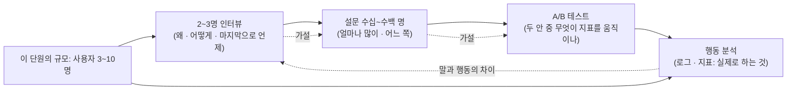

# 49 — 사용자 공감

## 목표

지금까지 각 단계 끝마다 받아 온 "가장 불편한 점" 한 줄을 **체계적인 사용자 조사**로 바꿉니다.
2~3명 인터뷰를 설계·진행·기록하고, 설문과 행동 데이터(로그·지표)로 "말하는 것"과 "하는 것"의 차이를 확인한 뒤, 52단원에서 해결할 **불편 하나**를 근거와 함께 고릅니다.

## 노트와의 연결

노트의 4대 스킬 ④ "빌드 방향 잡기" 중 제품 결정에는 "사용자 공감: 2~3명 인터뷰부터 수백 명 설문, A/B 테스트, 행동 분석"이 있습니다.
그리고 "PM·디자이너·엔지니어의 경계가 흐려지고 있다"고 합니다. 구현이 병목이 아니면, **무엇을 만들지** 아는 사람이 병목을 쥡니다. 그 앎은 사용자에게서 옵니다.

읽는 법: 왼쪽에서 오른쪽으로 갈수록 사람 수는 늘고 "왜"는 줄며, 사용자 3~10명인 내 프로그램에서 실제로 할 수 있는 것은 양 끝(인터뷰와 내 로그)입니다.

## 공부할 개념

| 개념 | 핵심 | 참고 |
| --- | --- | --- |
| 인터뷰 설계 | 좋은 질문은 **과거의 구체적 행동**을 묻습니다("마지막으로 할 일을 놓친 건 언제였나요? 그때 무슨 일이 있었나요"). 나쁜 질문은 미래·가정·해결책을 묻습니다("알림 기능이 있으면 쓰시겠어요?"). 5명을 넘으면 새 발견이 급격히 줄어드니 2~3명으로 시작 | — |
| 말하는 것 vs 하는 것 | 사람은 자기 행동을 정확히 기억하지 못하고, 질문자를 실망시키지 않으려 합니다. 인터뷰(말)는 **가설**을 주고, 로그·지표(행동, 31·32단원)는 **검증**을 줍니다. "자주 쓴다"는 말과 `/tasks` 호출 로그를 나란히 놓으세요 | 31·32단원 |
| 불편의 우선순위 | 빈도(얼마나 자주) × 강도(얼마나 아픈가) × 해결 가능성(내가 몇 단원 안에). 세 축을 1~3점으로 곱하면 52단원 후보가 정렬됩니다. 점수는 근거(인터뷰 인용·로그 수치)와 함께 | 50단원 핵심 지표 |

### 인터뷰에서 하지 말 것

- 내 프로그램을 **설명**하지 않기. 설명하는 순간 사용자는 평가자가 되고 솔직함이 줄어듭니다.
- "~하면 좋겠죠?"처럼 답을 유도하지 않기.
- 침묵을 메우지 않기. 5초 기다리면 진짜 이야기가 나옵니다.
- 기능 요청을 그대로 받아 적지 않기. "알림이 있으면 좋겠다" 뒤의 **문제**("어제 약 먹는 걸 잊었다")를 묻습니다.

## 과제

| 과제 | 하는 일 | 산출물 |
| --- | --- | --- |
| A. 질문지 | `worksheets/interview-guide.md`를 내 프로그램에 맞게 고칩니다. 과거 행동 질문 5개, 후속 질문("그때 어떻게 했어요?") 준비, 금지 질문 목록 | 질문지 |
| B. 인터뷰 3명 | 지금까지 프로그램을 보여 준 가족·친구 중 3명. 각 20~30분. 녹음 대신 **기록표**에 인용을 그대로 적습니다. 같은 사람이 두 번 등장하는 불편에 표시 | `worksheets/interview-log.md` × 3 |
| C. 설문 | 인터뷰에서 나온 불편 5~8개를 "지난 한 달 동안 겪은 횟수"로 묻는 10문항 설문을 만들어 손닿는 사람 10명에게. 해결책을 묻지 않습니다 | 설문 문항과 결과표 |
| D. 행동 데이터 | 31·32단원 로그·지표에서 지난 30일: 활성 사용자 수, 사용자별 `POST /tasks`·`complete` 횟수, 미완료로 30일 넘게 남은 할 일 비율, 가장 많이 호출된/전혀 호출되지 않은 엔드포인트. 인터뷰의 "말"과 다른 지점을 표시 | 행동 데이터표 |
| E. 우선순위 | 불편 목록에 빈도×강도×해결 가능성을 매기고, 상위 1개를 52단원 과제로. 근거(인용·수치)를 한 문단 | `worksheets/pain-points.md` |

## 스스로 답해 볼 질문

1. "알림 기능이 있으면 쓰시겠어요?"에 "네"라고 답한 사람이 실제로 쓰지 않는 이유를 셋 적어 보세요.
2. 인터뷰 3명이 모두 다른 불편을 말했습니다. 표본이 작아서인가요, 사용자 유형이 달라서인가요? 어떻게 구분하나요?
3. 로그에 "완료 버튼을 거의 안 누른다"가 보입니다. 가능한 해석을 셋 적고, 각 해석을 확인할 **다음 질문**을 정해 보세요.
4. 가족을 인터뷰하면 어떤 편향이 생기나요? 그래도 하는 이유는?
5. 우선순위 1위가 "구현이 쉬운 것"이 아니라 "강도가 높은 것"이면, 52단원에서 어떤 위험이 생기고 어떻게 줄이나요? (스펙 깊이, 단계 쪼개기)

## 함정

- 인터뷰를 데모로 만들기. 내 프로그램을 보여 주고 싶은 유혹이 가장 큽니다. 처음 15분은 프로그램 없이 사용자의 하루를 듣습니다.
- 첫 번째 사람의 말에 설계를 바꾸기. 3명을 다 듣고 겹치는 것을 찾습니다. 1명의 강한 의견은 가설입니다.
- 설문으로 "왜"를 묻기. 설문은 **얼마나**를 셉니다. "왜"는 인터뷰.
- 행동 데이터를 보고 사용자에게 묻지 않기. 데이터는 "무엇"을 보여 주지만 "왜"는 말하지 않습니다. 둘은 번갈아 씁니다.
- 로그에서 개인을 식별하기. 14·31단원 규칙대로 집계만 보고, 특정인의 할 일 제목을 읽지 않습니다.

## 완료 기준

- [ ] 질문지 (과거 행동 질문 5개 이상, 금지 질문 목록 포함)
- [ ] 인터뷰 기록표 3부, 각 부에 **그대로 인용** 3개 이상
- [ ] 설문 10문항과 응답 10명 이상 결과표
- [ ] 행동 데이터표와 "말과 행동이 다른 지점" 1개 이상
- [ ] `worksheets/pain-points.md`: 불편 5개 이상, 점수표, 52단원 과제 1개와 근거 문단
- [ ] `NOTES.md` 에 배운 것 3가지 / 헷갈린 것 1가지 / 다음 단원에 바꿀 것
- [ ] 세 문장 설명: "왜 사용자에게 '무엇을 원하세요'라고 묻지 않는가"
- [ ] AI 코드 리뷰(질문지 리뷰): 질문지에서 유도 질문·가정 질문을 찾아 달라고 하고, 하나 반영·하나 반박
- [ ] 에이전트에게 작은 과제: 로그에서 과제 D의 집계를 뽑는 스크립트 (개인 식별 정보는 출력하지 않도록 지시에 명시, 읽기 전용)
- [ ] 브랜치 `unit-49` → PR → 머지

## 더 깊이

- A/B 테스트는 사용자 10명으로는 통계적 의미가 없습니다. 몇 명부터 가능한지, 그 전까지 무엇으로 대신하는지(인터뷰 + 행동 데이터) 50단원에서 이어집니다.
- 인터뷰 기록을 47단원 방식으로 다룰 수 있을까요? 인용문 30개를 모델에게 묶음(클러스터)으로 나누게 하고, 내 분류와 일치율을 재 보세요. 모델이 분류를 **대신**하는 것이 아니라 **초안**을 만드는 예입니다.
- [The AI Engineering Skills Map](https://www.deeplearning.ai/the-batch/the-ai-engineering-skills-map)에서 "제품 결정" 부분을 다시 읽고, 내 규모(사용자 10명)에서 할 수 없는 것과 할 수 있는 것을 표로 나눠 보세요.
