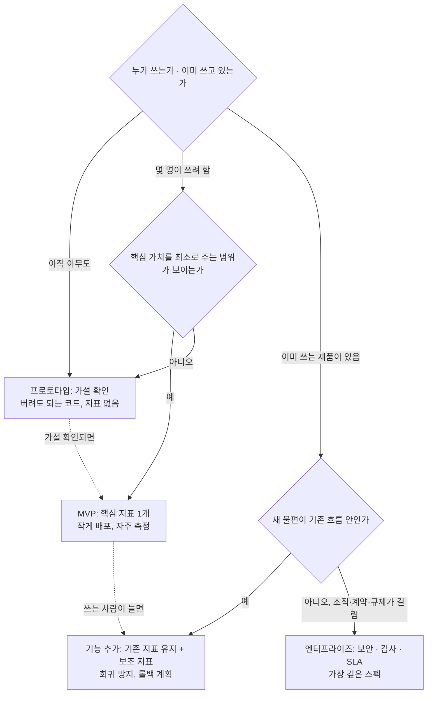

# 50 — 제품 결정과 핵심 지표

## 목표

49단원에서 고른 불편을 **어떤 단계의 제품**(프로토타입 / MVP / 기능 추가 / 엔터프라이즈)으로 풀지 정하고, 성공을 재는 **핵심 지표 하나**를 정의서로 적고, 단위 경제성(한 사용자·한 요청에 드는 비용과 가치)을 어림합니다.
이 결정이 52단원의 스펙 0절(세 줄 질문)과 "가치로 측정"의 기준이 됩니다. ADR-0032로 남깁니다.

## 노트와의 연결

노트의 "빌드 루프 주도"는 "프로토타입·MVP·기능 추가·엔터프라이즈 중 선택, 작은 단위로 자주 배포, 핵심 지표"이고,
"제품 결정"은 "제품·디자인·비즈니스 감각: 시장 규모·단위 경제성·손익"입니다.
노트의 워크플로 문장 "계획의 깊이는 프로젝트에 맞춘다"의 **"프로젝트에"**가 바로 이 단계 선택입니다. 39단원 스펙 깊이, 41단원 체크리스트 전-1("한 줄")이 여기서 결정됩니다.

읽는 법: 위의 질문 세 개에 답하면 네 상자 중 하나에 도착하고, 상자마다 **스펙 깊이와 지표의 종류**가 다르며, 점선은 시간이 지나 다음 상자로 옮겨 가는 길입니다.

## 공부할 개념

| 개념 | 핵심 | 참고 |
| --- | --- | --- |
| 네 단계의 선택 | **프로토타입**: 가설이 맞는지 가장 싸게 확인(지표 없음, 코드 버림). **MVP**: 핵심 가치를 주는 최소 범위를 실제 사용자에게(지표 1개). **기능 추가**: 운영 중 제품에 더하기(기존 지표를 깨지 않는 것이 먼저). **엔터프라이즈**: 보안·감사·계약이 요구사항. 단계가 틀리면 스펙이 너무 얕거나(사고) 너무 깊어(안 만듦) 집니다 | 23단원 단계별 아키텍처, 39단원 |
| 핵심 지표 하나 | 한 문장으로 "이 기능이 가치를 냈다"를 말하는 수. 좋은 지표는 **사용자 행동**이고(열어 봤다 ✕ / 마감 전 완료했다 ○), 내가 조작할 수 없고, 짧은 주기로 잴 수 있습니다. 보조 지표(guardrail)는 핵심 지표를 올리느라 망가뜨리면 안 되는 것(오류율, 지연, 비용) | 32단원 지표 |
| 단위 경제성 | 한 사용자(또는 한 요청)당 **비용**과 **가치**. 비용: LLM 토큰(44단원 측정값), 호스팅, 내 시간. 가치: 아낀 시간, 놓치지 않은 할 일 수, (돈을 받는다면) 매출. 시장 규모는 "이 불편을 가진 사람이 몇 명인가"의 어림. 숫자는 틀려도 되고 **어림의 근거**가 적혀 있어야 합니다 | — |

### 핵심 지표의 좋은 예와 나쁜 예 (할 일 프로그램)

| 나쁜 지표 | 왜 | 고친 지표 |
| --- | --- | --- |
| 일일 방문 수 | 행동이 아니라 노출. 알림을 늘리면 오르지만 가치는 아님 | 주당 "마감 전 완료" 할 일 수 (사용자당) |
| 추가된 할 일 수 | 많이 적는 것이 목표가 아님 | 추가 후 7일 안에 완료되는 비율 |
| 요약 기능 호출 수 | 호출 ≠ 도움 | 요약을 본 뒤 10분 안에 완료 처리된 할 일 수 |
| 만족도 설문 5점 | 말, 그리고 느림 | (보조 지표로만) |

## 과제

| 과제 | 하는 일 | 산출물 |
| --- | --- | --- |
| A. 단계 결정 | 49단원의 불편에 대해 위 흐름도의 질문 세 개에 답하고 단계를 정합니다. 반대 의견(한 단계 위·아래)도 적고 반박 | `worksheets/metric-definition.md` 1부 |
| B. 핵심 지표 정의서 | 지표 이름 / 한 문장 정의 / 계산식(어느 로그·테이블에서) / 측정 주기 / 현재 값(기준선) / 목표 값과 기한 / 보조 지표 2개 / 이 지표가 올라도 가치가 없는 경우 | 정의서 2부 |
| C. 측정 구현 | 32단원 `/metrics` 또는 집계 쿼리로 핵심 지표를 **지금** 잴 수 있게 만듭니다. 기준선을 2주 치 기록 | 프로젝트 PR, 기준선 표 |
| D. 단위 경제성 | `worksheets/unit-economics.md`: 사용자당 월 비용(LLM 토큰 × 44단원 측정 평균 × 예상 호출 수, 호스팅 ÷ 사용자 수), 사용자당 월 가치(아낀 시간 × 시간 가치, 놓치지 않은 할 일), 시장 어림("이 불편을 가진 사람"을 세 가지 방법으로) | 워크시트 |
| E. 빌드 루프 계획 | "작은 단위로 자주 배포"를 52단원 계획으로: 1주 단위 배포 3번, 각 배포 후 지표 확인 시점 | 정의서 3부 |
| F. ADR-0032 | "<불편>을 <단계>로 만들고 <핵심 지표>로 잰다". 대안: 다른 단계, 다른 지표 | `docs/adr/0032-product-stage-and-metric.md` |

## 스스로 답해 볼 질문

1. 핵심 지표를 둘 두면 안 되는 이유는 무엇일까요? 둘이 반대로 움직일 때 어떤 일이 생기나요?
2. "마감 전 완료 비율"을 핵심 지표로 두면 사용자가 **마감을 안 적게** 될 수 있습니다. 어떤 보조 지표가 이를 잡나요?
3. 프로토타입 단계인데 47단원 평가와 34단원 CI를 다 갖추려 합니다. 무엇이 문제인가요? 반대로 운영 중 제품에 프로토타입 깊이로 기능을 더하면?
4. 사용자당 월 LLM 비용이 가치 추정보다 큽니다. 선택지를 셋 적어 보세요 (기능을 줄인다 / 모델·effort를 낮춘다 / 호출을 줄인다 / 안 만든다 …). 각각 무엇을 잃나요?
5. 시장 어림이 10배 틀렸다면 결정이 바뀌나요? 바뀌지 않는다면 그 어림은 왜 하나요?

## 함정

- 지표를 만들기 쉬운 것으로 고르기 (요청 수). 재기 쉬운 것과 가치 있는 것은 다릅니다. 가치 있는 것을 재기 쉽게 **만드는** 것이 32단원의 일입니다.
- 기준선 없이 시작하기. 기능을 배포한 뒤에는 "전"을 잴 수 없습니다. 과제 C가 52단원보다 먼저인 이유입니다.
- 단계를 야심으로 정하기 ("제대로 만들자"). 단계는 사용자 수와 되돌리기 비용으로 정합니다.
- 비용 어림에 내 시간을 0으로 넣기. 노트가 "완료한 일의 개수가 아니라 만들어 낸 가치로 측정"하라는 것은 내 시간도 비용이라는 뜻입니다.
- 지표가 오르면 끝이라고 생각하기. 지표는 가설의 대리물입니다. 49단원 인터뷰로 돌아가 "정말 나아졌는지" 다시 듣습니다.

## 완료 기준

- [ ] 단계 결정과 반대 의견 반박 (1부)
- [ ] 핵심 지표 정의서 완성 (8개 항목 모두), 보조 지표 2개
- [ ] 핵심 지표를 실제로 재는 코드 또는 쿼리와 2주 기준선 값
- [ ] `worksheets/unit-economics.md`: 비용·가치·시장 어림 각각 근거 포함
- [ ] 52단원 배포 계획 (3회, 날짜, 확인할 지표)
- [ ] `docs/adr/0032-product-stage-and-metric.md`
- [ ] `NOTES.md` 에 배운 것 3가지 / 헷갈린 것 1가지 / 다음 단원에 바꿀 것
- [ ] 세 문장 설명: "기능이 '성공했다'를 어떻게 숫자 하나로 말하는가"
- [ ] AI 코드 리뷰(정의서 리뷰): 지표의 조작 가능성과 보조 지표 누락을 지적받고, 하나 반영·하나 반박
- [ ] 에이전트에게 작은 과제: 핵심 지표 집계 쿼리를 작성하고 `:memory:` 데이터로 검증하는 테스트 (읽기 전용 권한)
- [ ] 브랜치 `unit-50` → PR → 머지

## 더 깊이

- A/B 테스트가 의미 있으려면 몇 명이 필요한지, "최소 검출 가능 효과"와 표본 크기의 관계를 찾아보세요. 사용자 10명에서는 대신 **전후 비교 + 인터뷰**를 씁니다. 그 한계도 적어 두세요.
- 36단원 피처 플래그로 기능을 절반에게만 켜면 사용자 10명으로도 **정성적** A/B는 가능합니다. 무엇을 알 수 있고 무엇은 알 수 없나요?
- 손익(P&L) 한 장: 월 비용 합계와 월 가치 합계를 표 하나로. 숫자가 작아도 **구조**를 한 번 써 보면 51단원에서 비개발자와 이야기할 언어가 생깁니다.
