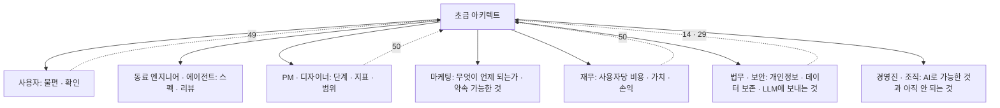

# 51 — 소통과 리더십

## 목표

50단원의 결정(단계·지표·비용)을 **비개발자가 이해하고 동의할 수 있는 말**로 옮깁니다.
설계 리뷰 발표를 한 번 준비해 실제로 발표하고, 마케팅·재무·법무 역할의 질문에 답하는 연습을 하며, "AI로 무엇이 가능한가"를 조직(가족·친구·동료)에게 설명하는 짧은 자료를 만듭니다.

## 노트와의 연결

노트의 "소통과 리더십"은 "마케팅·재무·법무와 조율, 비엔지니어에게 가능성 설명, 조직의 AI 이해"입니다. 그리고 이렇게 덧붙입니다.

> "경영진을 포함해 많은 사람이 아직 AI로 무엇이 가능한지 모른다"

> "PM·디자이너·엔지니어의 경계가 흐려지고 있다"

7단원부터 매 단원 해 온 "세 문장 설명"이 이 단원의 준비 운동이었습니다. 이번엔 세 문장이 아니라 **15분 발표와 질의응답**입니다.
초급 아키텍트의 일은 결정을 내리는 것만이 아니라, 결정을 **다른 사람이 따라올 수 있게** 만드는 것입니다.

읽는 법: 가운데에서 뻗는 화살표마다 **같은 결정을 다른 언어로** 말해야 하며, 점선은 그 대화의 재료가 어느 단원에서 왔는지입니다.

## 공부할 개념

| 개념 | 핵심 | 참고 |
| --- | --- | --- |
| 청중별 번역 | 같은 결정("요약 기능에 LLM을 쓴다")을 사용자에겐 **무엇이 달라지는가**, 재무에겐 **사용자당 얼마·언제 회수**, 법무에겐 **어떤 데이터가 어디로 가고 얼마나 남는가**, 경영진에겐 **되는 것·안 되는 것·위험**으로. 번역이 안 되는 결정은 내가 아직 이해하지 못한 결정입니다 | 50단원 단위 경제성, 14단원 거버넌스 |
| 설계 리뷰 발표 | 구조: 문제(사용자 인용 1개) → 세 줄 질문 → 선택지 2~3개와 트레이드오프 → 결정과 이유 → 되돌리기 어려운 것 → 지표와 확인 시점 → 질문 받기. 15분, 슬라이드 7장 이하, 다이어그램 1개. 리뷰의 목적은 승인이 아니라 **내가 못 본 것을 찾는 것** | 23·39단원 ADR |
| 조직의 AI 이해 돕기 | 과장도 공포도 아닌 **보여 주기**: 되는 것(44~47단원에서 측정한 수치), 안 되는 것(평가에서 실패한 사례), 비용(토큰), 위험(환각·주입·개인정보)과 내가 둔 방어. "AI가 다 한다"와 "AI는 못 믿는다" 사이의 **구체적 중간**을 말하는 사람이 드뭅니다 | 47단원 평가 결과 |

### 역할별 예상 질문 (답을 미리 적어 둡니다)

| 역할 | 질문 | 답의 재료 |
| --- | --- | --- |
| 마케팅 | "자연어로 할 일 추가, 라고 광고해도 되나요?" | 45단원 정확도(평가 세트 점수), 확인 단계가 있다는 사실 |
| 재무 | "사용자가 1,000명이 되면 월 비용은?" | 50단원 사용자당 비용 × 1,000, 캐시·effort로 줄일 여지 |
| 법무 | "사용자의 할 일 내용이 외부 LLM 회사로 가나요? 얼마나 보관되나요?" | 44단원: 무엇을 보내는지, 공급자 데이터 보존 정책(문서 링크), 14단원 PII 분류 |
| 보안 | "사용자가 프롬프트에 이상한 걸 넣으면?" | 44·45단원 태그 격리, 초안만 만들고 서비스가 결정, 권한 분리 |
| 경영진 | "그래서 AI로 뭘 더 할 수 있어요?" | 48단원 수준 판정표: 단일 호출로 되는 것 / 안 되는 것 |

## 과제

| 과제 | 하는 일 | 산출물 |
| --- | --- | --- |
| A. 발표 개요 | `worksheets/design-review-outline.md`를 채워 50단원 결정의 설계 리뷰를 준비합니다. 다이어그램 1개(Mermaid)를 직접 그립니다 | 개요 + 슬라이드 7장 이하 |
| B. 발표와 질의 | 비개발자 1명 + (가능하면) 개발자 1명 앞에서 15분 발표. 질문을 **모두 받아 적고**, 답하지 못한 것을 표시. 발표 후 "가장 이해 안 된 부분"을 물어봅니다 | 질문 기록 |
| C. 역할 번역 | `worksheets/audience-translation.md`: 같은 결정을 5개 역할의 언어로 각 5문장 이내. 역할마다 예상 질문 2개와 답 | 번역표 |
| D. 조율 시뮬레이션 | 친구에게 "법무 역할"을 맡겨 "LLM에 사용자 데이터를 보내도 되는가"를 10분 동안 따져 묻게 합니다. 내가 답하지 못한 것은 14·29·44단원으로 돌아가 찾아 적습니다 | 기록 |
| E. AI 가능성 한 장 | "우리 할 일 앱에서 AI가 지금 하는 것 / 할 수 있지만 안 한 것(이유) / 아직 못 하는 것"을 한 장으로. 숫자는 44~47단원 측정값만 | `worksheets/ai-capability-one-pager.md` |

## 스스로 답해 볼 질문

1. 발표에서 "LLM", "토큰", "RAG"를 쓰지 않고 요약 기능의 비용 구조를 설명해 보세요. 어떤 비유가 정확하고 어떤 비유가 오해를 낳나요?
2. 재무 담당이 "비용을 반으로 줄여 달라"고 합니다. 50단원 선택지 중 무엇을 제안하고, 무엇을 **잃는지**를 어떻게 함께 말하나요?
3. 설계 리뷰에서 내 결정이 뒤집혔습니다. 그것은 실패인가요? 리뷰의 목적에 비추어 답해 보세요.
4. "AI가 다 해 준다"고 믿는 사람과 "AI는 못 믿는다"는 사람에게 **같은 자료**로 설명할 수 있나요? 어떤 수치가 양쪽 모두에게 유효한가요?
5. 경계가 흐려진다면 초급 아키텍트가 PM·디자이너의 일을 **대신**해야 하나요, 아니면 그들과 **같은 언어**를 써야 하나요? 차이는?

## 함정

- 기술 용어로 안심시키기. "ETag로 캐시해서 괜찮아요"는 설명이 아니라 회피입니다. 상대가 다시 설명할 수 있어야 전달된 것입니다.
- 과장: "정확도 95%"라고 말하면서 평가 세트가 30개임을 빼기. 수치에는 항상 **표본과 조건**을 붙입니다.
- 질문을 방어하기. 설계 리뷰의 질문은 공격이 아니라 내가 못 본 것입니다. "좋은 질문이네요, 모르겠습니다, 찾아보겠습니다"는 정답입니다.
- 비개발자를 가르치려 들기. 그들은 내가 모르는 것(시장, 법, 돈)을 압니다. 조율은 쌍방향입니다.
- 한 장 자료에 모든 기능 넣기. "안 하는 것과 이유"가 "하는 것"만큼 중요합니다.

## 완료 기준

- [ ] 설계 리뷰 개요 완성, 슬라이드 7장 이하, 직접 그린 다이어그램 1개
- [ ] 실제 발표 1회, 받은 질문 전부 기록, 답하지 못한 질문과 나중에 찾은 답
- [ ] 역할 번역표 5개 역할 × (설명 + 예상 질문 2개와 답)
- [ ] 법무 역할 시뮬레이션 기록과 보완한 근거 (문서 링크)
- [ ] AI 가능성 한 장 (하는 것 / 안 한 것과 이유 / 못 하는 것, 수치에 표본 명시)
- [ ] `NOTES.md` 에 배운 것 3가지 / 헷갈린 것 1가지 / 다음 단원에 바꿀 것
- [ ] 세 문장 설명: 이번엔 반대로 — 비개발자 청중이 내 발표를 **자기 말로 세 문장**으로 요약하게 하고 그대로 적기
- [ ] AI 코드 리뷰(발표 리뷰): 발표 개요를 에이전트에게 주고 "비개발자가 막힐 지점"을 찾게 해 하나 반영·하나 반박
- [ ] 에이전트에게 작은 과제: 44~47단원 측정값(토큰·지연·평가 점수)을 한 표로 모으는 스크립트 (NOTES.md 파싱, 읽기 전용)
- [ ] 브랜치 `unit-51` → PR → 머지

## 더 깊이

- 33단원 포스트모템을 비개발자에게 발표해 보세요. "비난 없는"이 기술 조직 밖에서도 통하는지, 어떤 단어를 바꿔야 하는지.
- 같은 결정을 **글**(1쪽 메모)과 **말**(15분)로 전달했을 때 무엇이 더 잘 남는지 일주일 뒤 물어보세요.
- 노트의 "높은 주도성의 오너십"(52단원)은 소통 없이는 독단이 됩니다. 52단원 계획을 세우기 전에 이번 발표에서 들은 반대 의견 하나를 계획에 반영하세요.
