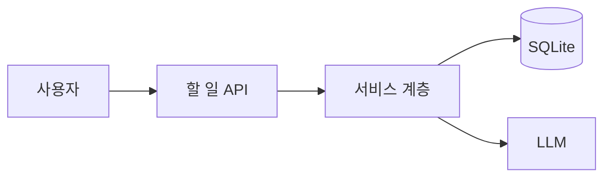

# 설계 리뷰 발표 개요 (51단원) — 15분, 슬라이드 7장 이하

- 발표 날짜 / 청중 (역할만):
- 리뷰받고 싶은 결정 한 문장:
- 내가 가장 자신 없는 부분 (청중이 여기를 찔러 주길 바람):

| # | 슬라이드 | 내용 (한 장에 한 메시지) | 시간 |
| --- | --- | --- | --- |
| 1 | 문제 | 사용자 인용 1개 (49단원) + 빈도·강도 수치 1개 | 2분 |
| 2 | 세 줄 질문 | 누가·얼마나 / 지연·비용·일관성 우선순위 / 되돌리기 어려운 결정 | 2분 |
| 3 | 선택지 | 2~3개, 각각 장점·단점·비용 한 줄 (ADR 표 그대로) | 3분 |
| 4 | 결정과 이유 | 고른 것, 이유 두 가지, 버린 것을 버린 이유 | 2분 |
| 5 | 그림 | 데이터·요청의 흐름 다이어그램 1개 (Mermaid, 12 노드 이하) | 2분 |
| 6 | 위험과 되돌리기 | 가장 큰 위험 2개와 방어, 롤백 방법, 피처 플래그 | 2분 |
| 7 | 지표와 다음 확인 | 핵심 지표(50단원), 기준선, 확인 날짜, 이 결정을 다시 볼 신호 | 2분 |

## 다이어그램 초안

## 예상 질문과 준비한 답

| 역할 | 질문 | 답 (한두 문장) | 근거 (단원·수치) |
| --- | --- | --- | --- |
| | | | |

## 발표 후 기록

| 질문 (그대로) | 누가 | 답했는가 | 나중에 찾은 답 |
| --- | --- | --- | --- |
| | | | |

- 청중이 "가장 이해 안 됐다"고 한 부분:
- 내 결정 중 바뀐 것:
