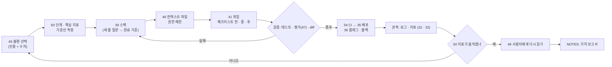

# 52 — 오너십 프로젝트

## 목표

49단원에서 사용자가 말한 불편 하나를 **지시 없이** 끝까지 책임집니다: 스펙(39) → 컨텍스트 파일·권한(40) → 체크리스트로 에이전트에게 위임(41) → 검증 → CI·배포(34·35) → 핵심 지표로 가치 측정(50) → 사용자에게 다시 확인(49).
이 단원의 산출물은 코드가 아니라 **"만들어 낸 가치"의 증거**입니다. 튜터 모드는 꺼집니다(`CLAUDE.md`). 에이전트는 스펙대로 구현하고, 빠진 결정은 내게 묻습니다.

## 노트와의 연결

> "높은 주도성의 오너십: 지시를 기다리지 않고 문제를 찾아 제안·실행, 완료한 일의 개수가 아니라 만들어 낸 가치로 측정"

> "엔지니어는 완성된 디자인을 받아 그대로 구현하는 역할을 더는 기대하기 어렵다. 스펙의 빈칸을 스스로 채우고, 스펙이 없으면 직접 써야 한다"

38~51단원의 모든 단원이 이 단원의 부품입니다. 노트의 네 가지 스킬(소프트웨어 기초·코딩 에이전트·AI 기본 요소·빌드 방향)이 **한 기능 안에서** 함께 쓰이는지가 이 단원의 시험입니다.

읽는 법: 왼쪽에서 오른쪽으로 한 기능이 지나는 길이고, 두 개의 되돌아가는 화살표(검증 실패 → 스펙, 지표 무반응 → 불편 재선택)가 이 단원에서 실제로 일어나도 **정상**입니다.

## 공부할 개념

이 단원은 새 개념 대신 **세 가지 통합 기술**을 연습합니다.

| 기술 | 핵심 | 참고 |
| --- | --- | --- |
| 문제에서 시작하는 범위 설정 | 불편 → 단계(50) → 스펙 깊이(39) → 배포 단위(작게 3번). 범위가 커지려 할 때마다 "핵심 지표를 움직이는 데 이게 필요한가"로 자릅니다. 과잉 설계(42)는 에이전트만 하는 것이 아닙니다 | 39·42·50단원 |
| 위임과 책임의 분리 | 구현은 에이전트가, **결정과 검증은 내가**. 스펙에 없는 결정을 에이전트가 물으면 답하고 스펙 8절에 적습니다. 결과가 틀리면 "에이전트가 잘못했다"가 아니라 스펙·컨텍스트 파일·단계 쪼개기 중 무엇이 빠졌는지 찾습니다 | 40·41단원 |
| 가치의 측정과 보고 | 배포는 끝이 아니라 측정의 시작. 핵심 지표의 전후, 보조 지표(오류율·비용)의 변화, 사용자의 말(인터뷰 재방문)을 한 장에 모아 "이 일이 만든 가치"를 숫자와 인용으로 씁니다. 가치가 없었다면 그것도 보고입니다 | 49·50단원 |

## 과제

`worksheets/ownership-plan.md`가 전체 지도입니다. 각 단계의 산출물은 해당 단원의 양식을 **그대로** 씁니다 (새 양식을 만들지 않습니다).

| 단계 | 하는 일 | 쓰는 양식 | 산출물 |
| --- | --- | --- | --- |
| 0. 선언 | 불편·단계·지표·기준선·배포 3회 계획을 한 쪽에. 51단원 발표에서 들은 반대 의견 1개를 반영했음을 표시 | `ownership-plan.md` 0부 | 계획서 |
| 1. 스펙 | 39단원 템플릿 전체(운영 중이면) 또는 단계에 맞는 깊이. 에이전트에게 "질문만" 요청해 질문 2개 이하까지 다듬기 | `39/templates/spec-template.md` | `specs/<기능>.md` |
| 2. 환경 | 컨텍스트 파일에 이번 기능의 가정 추가, 권한 단계표 갱신, 운영 DB 세 겹 확인 | `40/worksheets/permissions-worksheet.md` | diff, 워크시트 |
| 3. 위임 | 체크리스트 전·중·후 전부. 검증 가능한 단계로 쪼개고, 대화형/덩어리 선택을 단계별로. 세션 로그 작성 | `41/worksheets/checklist.md`, `session-log.md` | 체크리스트, 세션 로그 |
| 4. 검증 | 테스트↔요구사항 대응표, diff 전부 읽기, LLM 기능이면 47단원 평가 세트 통과 + 기준선 비교, 실패 유형 4가지 점검 | `42/worksheets/failure-review.md` | 검토 기록 |
| 5. 배포 | CI 통과 → 피처 플래그 뒤에 배포 1 → 24시간 로그·지표 → 플래그 확대 → 배포 2·3. 각 배포 후 확인 시점에 본 것을 기록 | 50단원 정의서 3부 | 배포 기록 3회 |
| 6. 측정 | 2주 뒤 핵심 지표 전후, 보조 지표, 비용(토큰·시간). 49단원 참가자 중 2명에게 다시 20분 인터뷰 | `49/worksheets/interview-log.md` | 측정표, 인터뷰 2부 |
| 7. 보고 | "가치 보고서" 한 쪽: 문제 → 한 일 → 숫자 전후 → 사용자 인용 → 비용 → 배운 것 → 다음 제안 1개 (지시받지 않은 것) | `ownership-plan.md` 7부 | 보고서 |

## 스스로 답해 볼 질문

1. 지표가 움직이지 않았습니다. 가능한 원인을 네 층으로 나눠 보세요: 불편을 잘못 골랐다 / 해법이 틀렸다 / 구현이 틀렸다 / 측정이 틀렸다. 각각 어떤 증거로 구분하나요?
2. 에이전트가 스펙에 없는 결정을 묻지 않고 혼자 정했습니다. 결과는 괜찮았습니다. 그래도 문제인가요? 무엇을 고치나요?
3. 배포 1 후 오류율(보조 지표)이 올랐지만 핵심 지표도 올랐습니다. 배포 2로 가나요, 되돌리나요? 기준을 미리 적어 두었나요?
4. "완료한 일의 개수가 아니라 만들어 낸 가치"로 잰다면, 이 단원에서 기능을 **만들지 않기로** 결정하는 것도 가치일 수 있나요? 어떤 경우에?
5. 다음 제안 1개를 적을 때, 그것이 "내가 만들고 싶은 것"인지 "사용자가 겪는 것"인지 어떻게 구분하나요? 49단원의 어떤 증거가 있어야 하나요?

## 함정

- 범위 확장. "이왕 하는 김에"는 과잉 설계의 사람 버전입니다. 핵심 지표에 닿지 않는 것은 스펙 2절(하지 않는 것)로 보냅니다.
- 튜터 모드 해제를 "에이전트가 다 한다"로 읽기. 결정·검증·배포 승인·측정은 전부 내 일입니다. 에이전트는 구현합니다.
- 기준선 없이 배포하기. 50단원 과제 C를 건너뛰었다면 지금 2주를 기다려서라도 잽니다. 전후가 없으면 가치를 말할 수 없습니다.
- 한 번에 크게 배포하기. 3회로 나눈 이유는 되돌리기 비용입니다. 플래그 뒤에서 작게.
- 측정 결과가 나쁠 때 보고를 미루기. 나쁜 결과의 정직한 보고가 오너십입니다. "안 됐다, 이유는 이렇다, 다음은 이렇다"가 보고서입니다.
- 운영 데이터를 에이전트 세션에서 만지기. `CLAUDE.md`의 규칙("`*.db`, `todo.json` 삭제는 확인")은 이 단원에서 가장 자주 시험받습니다.

## 완료 기준

- [ ] `worksheets/ownership-plan.md` 0부(선언)와 7부(가치 보고서) 완성, 1~6부는 각 단원 양식 파일로 링크
- [ ] 스펙 파일, 에이전트 질문 수 기록 (1차 __ → 최종 __)
- [ ] 체크리스트 12항목·세션 로그·실패 유형 검토표 작성
- [ ] 테스트↔요구사항 대응표, LLM 기능이면 평가 기준선 대비 결과
- [ ] 배포 3회 기록 (각각 날짜·범위·확인 시점에 본 로그·지표·되돌리기 여부)
- [ ] 핵심 지표 전후 표(기준선 2주 vs 배포 후 2주)와 보조 지표, 비용
- [ ] 재인터뷰 2부, 인용 각 2개 이상
- [ ] 가치 보고서에 "지시받지 않은 다음 제안" 1개와 그 근거
- [ ] `NOTES.md` 에 배운 것 3가지 / 헷갈린 것 1가지 / 다음 단원에 바꿀 것
- [ ] 세 문장 설명: 가치 보고서를 **사용자 본인**에게 세 문장으로
- [ ] AI 코드 리뷰: 최종 코드를 다른 세션에서 리뷰, 하나 반영·하나 반박
- [ ] 에이전트에게 작은 과제: 이 단원 전체가 그 의식입니다
- [ ] 브랜치 `unit-52` → PR(들) → 머지, 필요하면 ADR 추가 (번호는 0033부터)

## 더 깊이

- 같은 불편을 **에이전트 없이** 내가 직접 구현했다면 시간이 얼마나 걸렸을지 어림하고, 실제 위임 시간(세션 로그)과 비교하세요. 노트의 "구현은 병목이 아니다"가 내 경우에도 맞는지 숫자로.
- 가치 보고서를 51단원 청중에게 다시 발표하세요. 설계 리뷰 때의 반대 의견이 결과로 답해졌나요?
- 이 단원을 한 번 더 할 수 있다면 49단원 우선순위 2위로. 두 번째는 어디가 빨라지고 어디는 그대로인지가 53단원 자가 진단의 가장 좋은 재료입니다.
