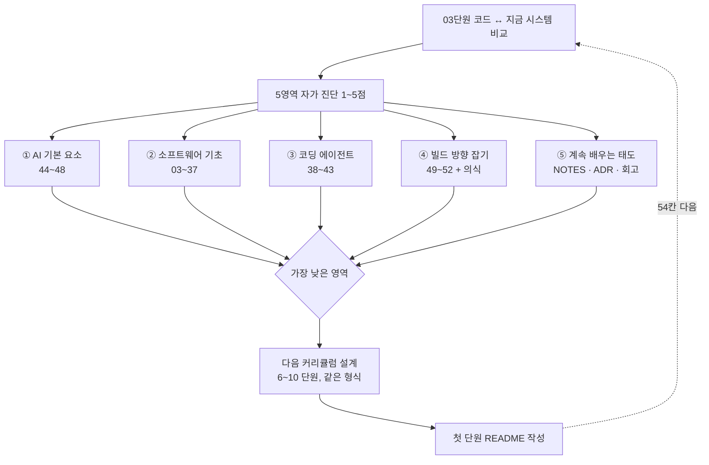

# 53 — 종합 회고와 다음 지도

## 목표

03단원의 `todo_memory.py`와 지금의 시스템을 나란히 놓고 **무엇이 달라졌는지**를 코드·설계·습관의 세 층에서 적습니다.
노트의 다섯 영역으로 자가 진단을 하고, 가장 약한 영역을 위한 **다음 커리큘럼**을 이 저장소의 형식(단원 표 + README 구조)으로 직접 설계합니다. 이 커리큘럼은 지도였고, 다음 지도는 내가 그립니다.

## 노트와의 연결

> "네 가지 스킬을 묶는 바탕은 계속 배우는 태도다"

노트의 로드맵 표에서 상태를 바꿔 온 54칸이 이제 다 찼습니다. 회고의 목적은 뿌듯함이 아니라 **다음 병목을 찾는 것**입니다.
노트가 "구현은 더 이상 병목이 아니다"라고 했듯, 이 회고도 "내가 얼마나 만들었나"가 아니라 "내 판단의 어디가 가장 느린가"를 묻습니다.

읽는 법: 비교(위)가 진단의 근거가 되고, 다섯 영역 중 **가장 낮은 점수**가 다음 지도의 출발점이 되며, 점선은 이 회고가 한 번이 아니라 **주기**라는 뜻입니다.

## 공부할 개념

| 개념 | 핵심 | 참고 |
| --- | --- | --- |
| 세 층의 비교 | **코드**: 03단원 다섯 함수와 지금의 `TaskService`·리포지토리·API — 같은 `add`가 몇 겹을 지나는가, 왜. **설계**: ADR 0001~0032를 시간순으로 읽으며 "그때는 몰랐던 것"과 "지금도 유효한 것"을 표시. **습관**: `NOTES.md` 54개의 "다음 단원에 바꿀 것"이 실제로 바뀌었는지 | 03단원, `docs/adr/` |
| 5영역 자가 진단 | ① AI 기본 요소 ② 소프트웨어 기초(데이터·아키텍처·보안·신뢰성·운영) ③ 코딩 에이전트 ④ 빌드 방향 잡기 ⑤ 계속 배우는 태도. 각 영역을 1~5점으로 매기되 **점수마다 증거**(파일·측정값·사건)를 붙입니다. 증거가 없는 점수는 3점을 넘을 수 없습니다 | 노트 4대 스킬 + 바탕 |
| 다음 지도 그리기 | 가장 낮은 영역 하나를 골라 6~10단원의 표(단원·제목·핵심·노트·코드 기호)를 만들고, 첫 단원 README를 이 저장소의 공통 구조로 씁니다. 하나의 프로그램을 계속 키우는지, 새 프로그램인지 결정하고 이유를 적습니다 | `docs/curriculum.md` |

### 자가 진단의 기준 (각 영역 1~5)

| 점수 | 뜻 |
| --- | --- |
| 1 | 용어를 안다 |
| 2 | 예제를 따라 할 수 있다 |
| 3 | 내 프로그램에 적용했고 테스트·측정이 있다 |
| 4 | 트레이드오프를 설명하고 ADR로 결정했으며, 틀린 결정을 한 번 이상 되돌렸다 |
| 5 | 다른 사람(또는 에이전트)이 할 수 있게 스펙·컨텍스트 파일·평가로 **옮겼다** |

## 과제

| 과제 | 하는 일 | 산출물 |
| --- | --- | --- |
| A. 코드 비교 | `units/03-functions/todo_memory.py`의 `add_task`와 지금의 "할 일 추가" 경로(API → 서비스 → 리포지토리 → DB → 알림 큐 → 감사 로그)를 나란히 놓고, 각 겹이 **어느 단원의 어떤 문제** 때문에 생겼는지 표로. 없어도 되는 겹이 있다면 솔직히 표시 | `worksheets/retrospective.md` 1부 |
| B. 설계 비교 | ADR 32개를 시간순으로 읽고 (a) 지금도 유효 (b) 대체됨 (c) 그때 틀렸음 으로 분류. (c)에서 공통점을 찾습니다 | 회고 2부 |
| C. 습관 비교 | `NOTES.md`의 "다음 단원에 바꿀 것" 54개 중 실제로 바뀐 것의 비율. 반복해서 적었지만 안 바뀐 것은 무엇인가 | 회고 3부 |
| D. 자가 진단 | `worksheets/self-assessment.md` 5영역 × (점수 + 증거 2개 + 가장 약한 하위 항목) | 진단표 |
| E. 노트 다시 읽기 | 학습 노트를 처음부터 다시 읽고, 처음엔 이해 못 했지만 지금은 내 경험으로 설명할 수 있는 문장 5개, 여전히 동의하지 않는 문장 1개와 이유 | 회고 4부 |
| F. 다음 지도 | `worksheets/next-map.md`: 가장 낮은 영역, 6~10단원 표, 반복할 의식, 첫 단원 README 전체. 에이전트에게 "이 커리큘럼의 빈칸을 질문하라"고 시켜 질문 2개 이하까지 다듬기 (39단원 방식) | 다음 커리큘럼 |

## 스스로 답해 볼 질문

1. 03단원의 `add_task`는 5줄이었고 지금은 수십 줄을 여러 파일에서 지납니다. 어느 지점부터 "복잡함"이 "과잉"이 되나요? 세 줄 질문으로 답해 보세요.
2. 가장 높은 점수를 준 영역의 증거와 가장 낮은 영역의 증거를 비교해 보세요. 점수 차이가 **경험의 양** 때문인가요, **적성** 때문인가요? 어떻게 구분하나요?
3. 노트에 동의하지 않는 문장을 찾지 못했다면, 그것은 노트가 다 맞아서인가요?
4. 다음 커리큘럼이 "새 기술 배우기"로 기울었다면 경고입니다. 가장 낮은 영역이 ④나 ⑤였다면 단원들은 어떤 모양이어야 하나요?
5. 이 회고를 6개월 뒤에 다시 한다면 무엇이 달라져 있길 바라나요? 그것을 **지금** 측정 가능한 문장으로 적어 두세요.

## 함정

- 점수를 후하게 주기. 증거 규칙(증거 없으면 3점 이하)을 지키세요. 낮은 점수가 다음 지도의 좋은 출발점입니다.
- 비교를 "옛날 코드는 나빴다"로 끝내기. 03단원 코드는 그 규모에 **맞았습니다**. 질문은 "언제 무엇이 바뀌어서 겹이 필요해졌나"입니다.
- 다음 지도를 너무 크게 그리기. 54단원을 또 설계하지 마세요. 6~10단원, 그리고 첫 단원은 **지금 시작할 수 있을 만큼** 구체적으로.
- 회고를 혼자만 읽기. 51단원 청중 중 한 명에게 자가 진단표를 보여 주고 "동의하지 않는 점수"를 물으세요.
- 노트를 경전으로 두기. 1년 전 노트의 일부는 이미 틀렸을 수 있습니다. 동의하지 않는 문장 하나를 찾는 과제가 그래서 있습니다.

## 완료 기준

- [ ] `worksheets/retrospective.md` 1~4부 (코드 겹 표, ADR 분류와 (c)의 공통점, 습관 변화 비율, 노트 문장 5+1)
- [ ] `worksheets/self-assessment.md` 5영역 모두 점수·증거 2개·약한 하위 항목, 타인 1명의 이견 기록
- [ ] `worksheets/next-map.md`: 영역 선택 이유, 6~10단원 표, 의식 표, 첫 단원 README 전체(공통 구조 8절)
- [ ] 에이전트 질문 수 (1차 __ → 최종 __)
- [ ] 학습 노트의 로드맵 표 54칸 상태 갱신
- [ ] `NOTES.md` 마지막 항목: 54단원 전체에서 배운 것 3가지 / 여전히 헷갈리는 것 1가지 / 다음 지도에서 바꿀 것
- [ ] 세 문장 설명: "1년 동안 무엇을 배웠는가"를 처음 프로그램을 보여 줬던 사람에게 세 문장으로
- [ ] AI 코드 리뷰: 03단원 코드와 지금 코드를 함께 주고 "되돌려도 되는 겹"을 지적받아 하나 수용·하나 반박
- [ ] 에이전트에게 작은 과제: ADR 32개의 제목·날짜·상태를 표로 뽑는 스크립트 (읽기 전용) — 과제 B의 재료
- [ ] 브랜치 `unit-53` → PR → 머지. 이 PR의 설명이 이 커리큘럼의 마지막 "스스로 리뷰"입니다

## 더 깊이

- 다음 지도의 첫 단원을 **실제로 시작**하세요. 회고는 다음 행동이 있을 때만 회고입니다.
- 이 저장소의 `docs/curriculum.md`에서 "다시 쓴다면 빼거나 합칠 단원"을 표시해 보세요. 그 판단 자체가 ② 소프트웨어 기초와 ④ 빌드 방향의 증거입니다.
- 자가 진단표를 6개월마다 다시 채우고, 영역별 점수의 변화를 32단원 지표처럼 시간축에 두세요. 노트가 말한 "계속 배우는 태도"의 측정값입니다.
